# FDE 면접과 온보딩을 위한 엔터프라이즈 AI 아키텍처 발표안

고객의 레거시 데이터를 안전하게 연결하고, 근거를 제시하는 AI를 배포하며, 현장 프로토타입을 운영 서비스로 전환하는 설계를 다룬다. 발표의 중심 질문은 **“이 답변을 어떤 데이터와 권한으로 만들었고, 장애가 난 뒤에도 같은 사실을 재현할 수 있는가?”**다. 1부는 거시적 파이프라인에서 출발해 네 기술 영역의 실패 지점과 코드로 확대하고, 마지막에 하나의 운영 체계로 돌아온다. 2부 현장 플레이북은 고객 Discovery, 결정 기록, 오답 신고의 재현, 용량 산정, 장애 대응과 운영 이관으로 이 설계를 현장에서 합의하고 지키는 방법을 다룬다. 3부 규모 확장은 한 공장의 파일럿을 전 공장으로 넓힐 때 먼저 깨지는 곳을 찾고, 필터 검색·파티션·서빙 대기열·재인덱싱·비용을 측정으로 교정하는 방법을 다룬다.

기준일은 2026년 11월 17일이다. 공식 문서가 설명하는 동작에는 해당 링크를 붙였다. 아래 규모, 지연시간, 품질 기준, 일정과 비용은 **제조업 고객을 가정한 제안값**이며 특정 기업의 내부 구현이나 실제 고객 측정치가 아니다.

## 사례와 발표 사용법

고객은 ERP의 설비 원장, 정비 API의 작업 이력, 파일 서버의 PDF 매뉴얼을 갖고 있다. 정비 엔지니어는 “부산 공장 P-101의 반복 과열 원인과 점검 순서는?”이라고 묻는다. 1차 목표는 **권한이 있는 근거와 설비 상태를 함께 보여주는 정비 지원**이다. 실제 설비 제어나 작업 지시 확정은 별도 승인된 업무 시스템에서 수행한다.

| 설계 입력 | 가정과 검증 방법 |
| --- | --- |
| 데이터 규모 | 파일럿 공장 하나 기준으로 매뉴얼 10만 건, 청크 100만 개, 평시 변경 50건/초, 버스트 500건/초. 실제 분포와 문서별 ACL 선택도로 부하 시험한다. 3부는 이 수치를 공장 수만큼 늘린다고 가정한다(6-1). |
| 현장 MVP | 공장 하나, 설비군 하나, 승인된 문서 집합. 코드의 정확 검색 경로는 요청자에게 허용된 청크 최대 5,000개까지 지원한다. |
| 사용자 경험 | 동시 사용자 50명, 전체 응답 p95 5초 이내를 제안한다. 인증·검색·추론을 분리 측정한다. |
| 정합성 | 상태 변경의 source-to-serving 지연 p95 60초 이내, 권한 철회의 serving 반영 30초 이내를 목표로 별도 관리한다. 대기 중인 응답의 최대 수명과 재검증 정책도 합의한다. |
| 업무 성과 | 정비 근거를 찾는 시간과 정답 도달률을 동일 과제의 전후 비교로 측정한다. 다운타임 감소를 작은 파일럿만으로 인과적으로 주장하지 않는다. |
| 환경 | 외부 인터넷 없는 온프레미스. 내부 IdP, DNS, NTP, PKI, 레지스트리, 모델 저장소와 관측 시스템을 사용한다. |

1부 기술 아키텍처는 **22개 프레임, 약 63분**, 2부 현장 플레이북은 **6개 프레임, 약 19분**, 3부 규모 확장은 **6개 프레임, 약 18분**이며 질의응답을 따로 둔다. 15분 면접에서는 0-1 → 1-1 → 1-2 → 2-1 → 2-2 → 2-3 → 3-1 → 4-1 → 0-2를 사용하고 각 코드의 핵심 불변식 하나만 설명한다. 30분 심화 면접은 여기에 1-5, 2-4, 2-5, 3-4, 4-2, 4-4, 5-2, 6-1을 더한 17개 프레임으로 설계 판단과 확장 질문까지 다룬다. 온보딩에서는 세 부의 모든 프레임을 따라가며 동봉한 코드를 실행한다.

모든 프레임은 화면 핵심, 화면 구성, 엔지니어링 분석, **근거 데이터**, 대표 코드, 발표자 대본으로 이루어진다. 근거 데이터 표는 값마다 출처를 구분한다. 공식 문서 링크, 저장소 코드가 계산하고 단위 테스트가 같은 값을 확인하는 `코드:`, 단순 산술의 `계산:`, 고객과 합의해 바꿀 `제안값`이다. 코드에 상수로 고정한 기준이라도 고객과 합의해 바꿀 값이면 `제안값`으로 표시하고 고정한 파일을 함께 적는다. 마지막의 면접 후속 질문, 고객 상황 롤플레이와 용어집은 발표자 노트의 Q&A 탭에서도 프레임별로 열린다.

## Prezi 캔버스와 카메라 경로

저장소의 줌 캔버스(`index.html`)가 이 구성을 구현한다. Prezi의 주제(topic)·하위 주제(subtopic)·확대 공개(zoom reveal) 구조를 그대로 따른다. 캔버스 가운데에 허브(표지, 중심 질문, 0-1과 0-2)가 있고, 1부의 네 주제가 허브 둘레의 대각선에, 2부와 3부가 바깥 궤도의 왼쪽과 오른쪽에 놓인다. 주제 원 안에는 가운데 제목 원을 둘러싸고 프레임 원이 시계 방향으로 놓이며, 프레임 원 안에는 화면 핵심과 함께 도식·코드·데이터 창 세 개가 들어 있다. 좌표는 CSS 픽셀 단위의 제작 좌표이며 Prezi API 파라미터가 아니다.

| 층 | 크기 | 보이는 것 |
| --- | --- | --- |
| 조감도 | 59,800 × 33,800 | 허브와 주제 6개, 1부의 흐름(데이터와 권한 상태 · 근거가 붙은 응답 · 검증된 실행 환경 · 운영 피드백), 허브를 감싼 Identity · Policy · Lineage · Observability 고리, 선택한 경로의 번호 |
| 허브 | 지름 11,600 | 제목, 중심 질문, 사례 질문, 0-1과 0-2 프레임 |
| 주제 | 지름 13,800 | 주제 제목 원과 프레임 5~6개의 번호·짧은 제목·발표 시간 |
| 프레임 | 지름 4,000 | 번호와 kicker, 제목, 화면 핵심 한 문장, 요점 세 개, 도식·코드·데이터 창 |
| 세부 | 960 × 540 | 도식(SVG), 대표 코드, 근거 데이터 표 |

멀리서는 주제 이름만 보이고, 주제로 들어가면 프레임의 짧은 제목이, 프레임으로 들어가면 본문과 세 창이 나타난다. 확대할 때는 출발과 함께 다음 층을 드러내고, 축소할 때는 떠나는 내용이 작아지며 부모 안으로 들어가도록 비행의 약 3분의 2 지점에서 층을 바꾼다. 주제 원은 −9°~8°, 프레임 원은 ±4°만큼 기울어져 있고, 카메라가 대상의 기울기만큼 함께 회전해 도착하면 항상 똑바로 보여준다. 먼 이동은 van Wijk–Nuij 경로로 잠깐 축소했다가 다시 확대해 지금 어디에 있는지 잃지 않게 한다.

| 경로 | 순서 | 용도 |
| --- | --- | --- |
| 면접 15분 | 조감도 → 허브 → 0-1 → 1-1 → 1-2 → 2-1 → 2-2 → 2-3 → 3-1 → 4-1 → 0-2 → 네 영역의 결과 | 21단계. Level 1·2는 도식, Level 3은 코드 하나만 확대 |
| 면접 심화 30분 | 조감도 → 허브 → 0-1 → 1-1 → 1-2 → 1-5 → 2-1 → 2-2 → 2-3 → 2-4 → 2-5 → 3-1 → 3-4 → 4-1 → 4-2 → 4-4 → 5-2 → 6-1 → 0-2 → 네 영역의 결과 | 37단계. 설계 판단과 확장 질문 대비 |
| 1부 기술 아키텍처 | 조감도 → 허브 → 0-1 → 주제 1~4(주제 1은 0-1에서 바로, 주제 2~4는 조감도를 거쳐 진입) → 0-2 → 네 영역의 결과 | 98단계. 모든 프레임의 도식·코드·데이터 |
| 2부 현장 플레이북 | 조감도 → 주제 5 → 5-1~5-6 → 조감도 | 27단계 |
| 3부 규모 확장 | 조감도 → 주제 6 → 6-1~6-6 → 조감도 | 27단계 |
| 온보딩 전체 | 1부 → 2부 → 3부 | 150단계 |

조감도의 경로 번호는 Prezi의 경로 보기처럼 선택한 경로가 방문하는 프레임 순서다. 네 영역의 결과 단계에서는 주제 1~4 위에 **재생 가능한 상태 · 허용된 근거 · 검증된 실행물 · 운영 가능한 책임**을 겹쳐 보인다.

색은 개요 초록, 데이터 통합 파랑, AI 청록, 보안 보라, 운영 주황, 현장 플레이북 올리브, 규모 확장 남색으로 고정한다. 실패 경로는 붉은 점선과 붉은 상자, 정상 경로는 실선으로 표시하고 색 외에 라벨도 붙인다. 도식은 프레임의 창 안에서 확대해 읽히도록 가로세로비 약 1.3~2.8로 배치한다.

발표 중에는 `→`·Space로 다음 단계, `←`로 이전 단계, `Shift + →`로 다음 프레임으로 간다. 주제·프레임·창을 클릭하면 그 안으로 확대하고, `Esc`나 빈 곳 클릭은 한 단계 축소한다. `O`는 조감도, `0`~`6`은 허브와 주제로 이동한다. 휠·드래그·두 손가락으로 자유롭게 둘러본 뒤 `→`를 누르면 경로로 돌아온다. `N`은 발표자 노트(대본·분석·데이터·화면·Q&A 탭, 경로별 시간 예산과 타이머), `P`는 별도 발표자 창이며 같은 브라우저의 두 창이 단계와 타이머를 동기화한다. 주소의 `#경로~단계`(예: `#interview~2-2.code`)로 특정 단계를 바로 공유한다.

Mermaid는 편집 가능한 도식 원본이다. 줌 캔버스는 확대해도 선명하도록 SVG를 인라인으로 넣고, 핸드아웃과 Prezi Present 이관에는 PNG를 사용한다. Prezi로 옮길 때는 주제를 topic, 프레임을 subtopic으로 만들고 각 도식을 PNG로 가져오며, 제목·화면 핵심·코드·근거 데이터는 네이티브 텍스트로 유지한다. Present와 Infographics의 이미지 지원 범위는 다르므로 여기서는 PNG를 사용한다. [Prezi 이미지 형식 안내](https://support.prezi.com/hc/en-us/articles/8285064300183-Adding-and-using-the-Bynder-integration)

## Frame 0-1 | Level 1 Overview | 고객 질문에서 운영 피드백까지

**[화면 핵심 (On-screen Message)]**

`End-to-End Architecture Overview` · **전체 아키텍처**

> 답변에 쓰인 데이터·권한·버전을 추적해 실패를 경계별로 분해한다.

- 수집·계약과 허용 문서 검색
- 폐쇄망 공급망과 평가 피드백
- 단계별 요청 deadline 배분

**[화면 시각화 가이드 (Visual Layout)]**

전체 캔버스를 보여준다. 고객 질문과 ERP를 양끝에 놓고, 그 사이에 네 영역을 배치한다. 질문이 데이터와 권한을 거쳐 근거가 붙은 응답이 되는 경로를 한 번만 애니메이션으로 따라간다. 카메라는 마지막에 수집과 정규화 사이의 경계에 멈춘다. 발표 시간 3분.

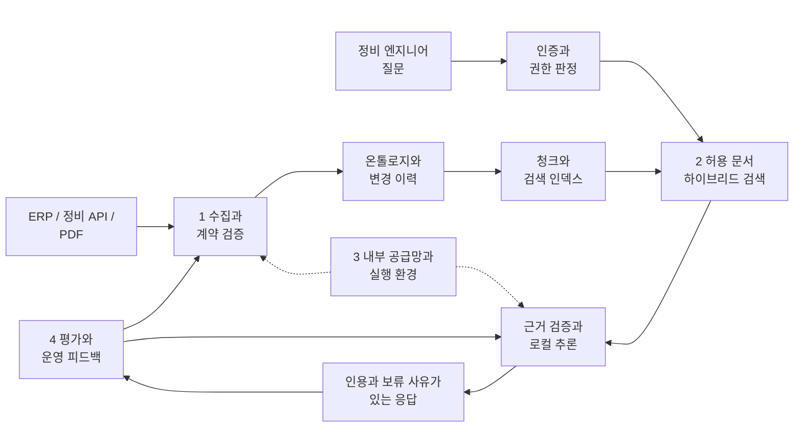

**[핵심 엔지니어링 분석 (Research & Considerations)]**

- **시스템 구성요소:** 소스 어댑터, 내구성 있는 원본 보관, 계약 검증기, 정규화 저장소, 검색 projection, 정책 저장소, 로컬 모델 서버, API, 감사 outbox와 관측 시스템이다. 데이터 plane과 배포·정책을 다루는 control plane의 자격증명을 분리한다.
- **핵심 고려사항:** “모델이 틀렸다”는 현상을 수집 누락, 오래된 데이터, 잘못된 identity 연결, 권한 필터, 검색 recall, 생성의 근거 이탈로 분해한다. 요청 trace와 문서·모델·정책 버전이 있어야 어느 경계가 원인인지 판별할 수 있다.
- **설계 결정:** 처음부터 모든 시스템을 실시간 연결하지 않는다. 데이터 정합성·접근 경계를 공유하는 작은 수직 경로를 완성한다. UI가 표시하는 설비 상태 시각과 문서 버전을 분리해 최신성의 의미를 드러낸다.
- **병목과 비용:** 예컨대 100만 개 × 768차원 × 4바이트는 원시 벡터만 약 3.07GB다. 인덱스, 복제본, 원문과 메타데이터는 별도다. LLM의 요청당 입력·출력 토큰, GPU 처리량과 큐 대기시간을 함께 측정하고, 청크 변경 해시로 불필요한 재임베딩을 줄인다.
- **실패 시 동작:** 검색은 성공하고 추론이 늦으면 승인된 근거 목록을 반환한다. ACL 서비스가 불확실하면 검색을 허용하지 않는다. 서로 다른 실패를 모두 “답변 없음”으로 집계하지 않는다.

**[근거 데이터 (Evidence Data)]**

| 항목 | 값 | 근거 |
| --- | --- | --- |
| 요청 전체 deadline | 5,000 ms | 계산: 50 + 250 + 200 + 4,000 + 200 + 300 |
| 추론 단계 비중 | 80% | 계산: 4,000 ÷ 5,000 |
| 검색·재순위 deadline | 450 ms | 계산: 250 + 200 |
| 원시 벡터(1,000,000 × 768 × 4 B) | 3,072,000,000 B | 코드: fde/capacity.py |
| 여유분(margin) | 300 ms | 제안값 · 단계별 p95를 더하지 않는 완충, 부하 시험 후 조정 |

**[실전 코드 (Production-grade Code)]**

아래는 측정 결과가 아닌 요청 deadline 배분이다. 각 I/O 호출에 남은 시간을 전달하고, 전체 요청 deadline을 상한으로 둔다. 단계별 p95를 더해 전체 p95라고 계산하지 않는다. 예제 모듈은 이 배분을 인자로 받는다. 2-2의 `retrieve`·`revalidate_evidence`는 요청의 남은 시간을 `timeout_ms`로 받아 DB 문장 시간을 그 값으로 줄이고(상한 2,000ms), 2-3의 ToolBudget은 요청 deadline(`deadline`)과 자체 예산(기본 4초, 상한 5초) 중 이른 시각에 멈춘다. 단계별 남은 시간은 호출하는 API가 요청 deadline에서 계산해 넘긴다.

```python
# 단위 ms. 실제 값은 현장 부하 시험으로 조정한다.
stage_deadlines_ms = {
    "authentication": 50,
    "retrieval": 250,
    "reranking": 200,
    "inference": 4000,
    "validation": 200,
    "margin": 300,
}
if sum(stage_deadlines_ms.values()) > 5000:
    raise ValueError("요청 전체 deadline을 초과했습니다")
```

**[발표자 노트 (Speaker Script)]**

“고객은 설비가 과열되는 이유를 물었지만, 우리가 실제로 해결할 문제는 훨씬 구체적입니다. 같은 P-101이 어느 공장의 설비인지 알아야 하고, 매뉴얼과 정비 이력이 같은 대상을 가리켜야 합니다. 그다음 이 사용자가 볼 수 있는 문서만 모델에 전달해야 합니다. 저는 이 경계들을 먼저 설계하겠습니다. 문제가 생겼을 때 어느 데이터와 정책, 모델 버전으로 답했는지 재현할 수 있어야 현장 팀이 이 서비스를 신뢰할 수 있기 때문입니다. 먼저 가장 왼쪽, 서로 다른 소스가 같은 설비를 가리키는 지점으로 들어가겠습니다.”

## Frame 1-1 | Level 2 Topic Cluster | 레거시 통합에서 객체의 의미와 책임을 정하기

**[화면 핵심 (On-screen Message)]**

`Legacy Entity Resolution` · **권위 소스 매핑**

> 속성별 권위 소스(authoritative source)를 고객과 합의해 업무 객체를 정의한다.

- 소스 키와 canonical ID 매핑
- 설비·작업·근거의 관계와 책임
- 불명확한 매칭의 검토 대기열 격리

**[화면 시각화 가이드 (Visual Layout)]**

파랑 영역으로 확대한다. ERP 설비 ID, 정비 시스템의 장비 코드, PDF의 문자열 P-101을 각각 표시하고, 승인된 매핑만 하나의 Asset에 연결한다. 확신이 없는 연결은 회색 검토 대기열에 둔다. `Asset → WorkOrder → Evidence`를 업무 의미의 골격으로 강조한다. 발표 시간 2분.

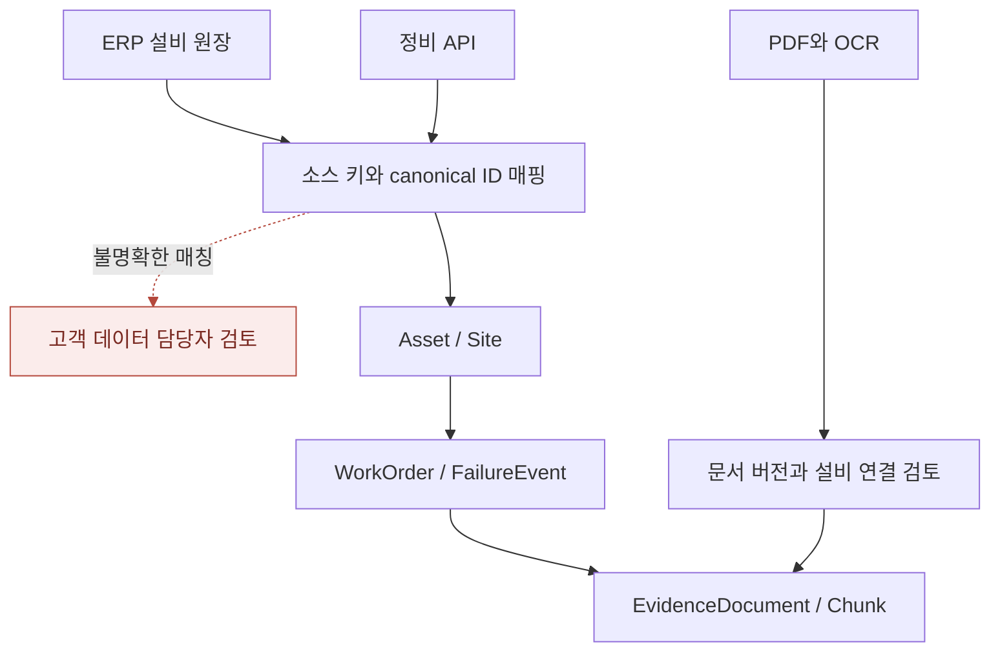

**[핵심 엔지니어링 분석 (Research & Considerations)]**

- **시스템 구성요소:** ERP는 snapshot+CDC, API는 pagination·cursor·rate limit을 가진 poller, 비정형 문서는 파일 manifest·parser·OCR 경로로 다룬다. 원본 URI, 체크섬, source schema, event time, 수집 시각과 접근 분류를 보존한다.
- **핵심 고려사항:** 문자열 유사도만으로 설비를 합치면 다른 공장의 동일 코드가 하나의 객체가 된다. source key는 tenant·site·source 범위 안에서만 유일하다. 스키마의 기본 키는 (tenant_id, source, source_key)이므로, 공장마다 코드 체계가 따로인 정비 시스템은 source를 `cmms-busan`처럼 공장 단위로 등록해 site를 키에 넣는다. 불확실한 entity resolution은 자동 확정하지 않고 후보, 근거와 승인자를 기록한다.
- **온톨로지 결정:** Asset의 소유 공장과 상태, WorkOrder의 상태 전이, Evidence의 유효 버전, 관계의 cardinality를 명시한다. 객체·속성·관계와 업무 action을 연결하는 관점은 Palantir의 Ontology 설명과도 연결된다. 여기의 SQL 구현은 해당 제품 자체를 재현한다는 의미가 아니다. [Palantir Ontology](https://www.palantir.com/docs/foundry/ontology/overview)
- **충돌 해결:** 속성별 authoritative source를 합의한다. 예컨대 자산 소유 공장은 ERP, 작업 완료 상태는 정비 시스템이 책임진다. 서로 다른 소스의 벽시계 timestamp를 비교해 무조건 최신 값을 택하지 않는다. 코드의 Asset projection은 상태를 쓰는 authoritative source 하나로 범위를 고정한다.
- **보안과 확장성:** 원문은 격리 저장소에서 제한적으로 열고, 정규화·검색 projection으로 갈수록 필요한 필드만 이동한다. API 429는 지수 backoff와 jitter, cursor의 내구성 있는 저장으로 대응한다. PDF parser는 크기·페이지·실행시간 상한과 격리 실행이 필요하다.

**[근거 데이터 (Evidence Data)]**

| 항목 | 값 | 근거 |
| --- | --- | --- |
| 매핑 기본 키 범위 | 3개 열 (tenant_id · source · source_key) | 코드: sql/schema.sql |
| tenant·자산당 authoritative 매핑 | 최대 1개 (부분 UNIQUE 인덱스 `one_authority`) | 코드: sql/schema.sql |
| 매핑 없는 source key의 이벤트 | ValueError · receipt 0건 | 코드: tests/test_database.py |
| 예제 P-101 매핑 | source key 2개 (`erp` · `cmms-busan`) → Asset 1개 (권위 1 · 비권위 1) | 제안값 · 고객 담당자 승인을 가정한 예제 |
| 사례 원천 경로 | 3종 (ERP 설비 원장 · 정비 API · PDF 매뉴얼) | 제안값 · 사례 설계 입력 |
| API rate limit 응답 | HTTP 429 · Retry-After는 선택(MAY) | [RFC 6585](https://www.rfc-editor.org/rfc/rfc6585) |

**[실전 코드 (Production-grade Code)]**

`sql/schema.sql`의 매핑 테이블과 제약을 사용한다. 아래 두 source key가 같은 설비라는 판단은 고객 담당자가 승인했다고 가정한다. 정비 시스템의 비권위 매핑은 Asset 상태를 덮어쓸 수 없다. 장비 코드 `P-101`은 공장마다 따로 매기므로 source를 `cmms-busan`으로 두어, 다른 공장의 `P-101`이 같은 기본 키가 되지 않게 한다.

```sql
INSERT INTO fde.identity_map
    (tenant_id, source, source_key, asset_id, authoritative)
VALUES
    ('acme', 'erp', 'A1',
     '00000000-0000-0000-0000-000000000001', true),
    ('acme', 'cmms-busan', 'P-101',   -- 공장별 코드 체계는 source에 site를 넣는다
     '00000000-0000-0000-0000-000000000001', false);

-- schema.sql에는 tenant와 asset별 권위 소스를 하나로 제한하는
-- 부분 UNIQUE 인덱스가 있다. 매핑 변경 권한은 ingest 계정에 주지 않는다.
```

**[발표자 노트 (Speaker Script)]**

“저는 첫 인터뷰에서 테이블 목록만 받지 않겠습니다. ‘이 설비의 소유 공장은 누가 결정하고, 어떤 시스템이 정비 완료를 확정합니까?’를 묻겠습니다. 두 시스템의 값이 다를 때 어느 쪽을 선택할지 정하지 않으면 통합은 성공해도 업무 결과는 틀릴 수 있습니다. 처음에는 고객이 확인한 매핑을 사용하고, 모호한 대상은 연결을 보류하겠습니다. 그 위에 객체와 관계를 만들면 검색뿐 아니라 향후 작업 지시 승인 같은 업무에도 같은 의미를 재사용할 수 있습니다.”

## Frame 1-2 | Level 3 Deep Dive and Code | 재전송과 역순 이벤트에도 상태를 보존하기

**[화면 핵심 (On-screen Message)]**

`Idempotent Event Ingestion` · **멱등 수집**

> 소스 위치가 더 클 때만 갱신해 재전송과 역순 도착을 견딘다.

- event_id와 payload hash 검사
- receipt·상태·outbox의 원자적 기록
- COMMIT 이후 consumer offset ACK

**[화면 시각화 가이드 (Visual Layout)]**

CDC consumer와 materialized Asset 사이로 확대한다. `offset 10 → 20 → 10 재전송`을 순서대로 보여주고 DB 상태가 20에서 유지되는 장면을 강조한다. receipt·state·audit outbox를 하나의 트랜잭션 테두리로 묶는다. 발표 시간 4분.

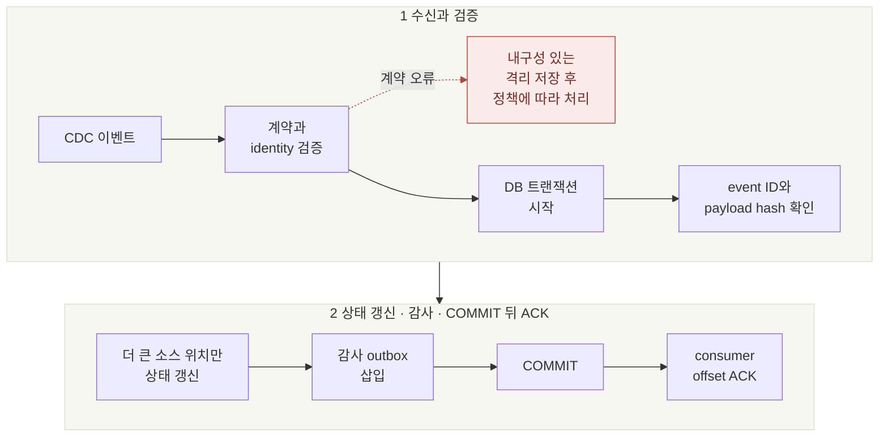

**[핵심 엔지니어링 분석 (Research & Considerations)]**

- **시스템 구성요소:** snapshot의 기준 위치와 CDC 연결, partition별 consumer, receipt 저장소, 버전 조건부 upsert, outbox exporter가 필요하다. DB commit 이후 offset ACK 전에 죽으면 같은 이벤트를 다시 처리할 수 있어야 한다.
- **핵심 고려사항:** Debezium은 장애 복구 중 마지막으로 기록된 offset부터 재개하면서 중복 이벤트를 만들 수 있다. sink가 재전송을 견뎌야 한다. [Debezium PostgreSQL 장애 복구](https://debezium.io/documentation/reference/stable/connectors/postgresql.html)
- **정합성 결정:** `event_id`는 tenant·source·source_key·epoch·offset·sequence로 만든다. 같은 식별자에 다른 payload가 오면 데이터 계약 위반으로 실패시킨다. 단순 중복 제거만으로는 처음 도착한 오래된 이벤트가 새 상태를 덮는 일을 막지 못하므로 버전 비교도 필요하다.
- **순서의 범위:** `(epoch, offset, sequence)`는 동일 authoritative source의 객체 안에서만 비교한다. PostgreSQL LSN 하나를 모든 소스의 전역 시계로 사용하지 않는다. 한 트랜잭션에 여러 변경이 있으면 별도 순번을 보존한다. repartition이나 소스 교체는 부트스트랩과 epoch 전환 절차를 요구한다.
- **운영 트레이드오프:** DB와 Kafka 사이의 전역 exactly-once를 주장하지 않는다. 상태·receipt·outbox를 원자적으로 쓰고 재시도하는 방식으로 효과를 멱등화한다. SQL timeout이나 일시 장애는 ACK하지 않는다. 계약 오류는 제한된 격리 저장소에 원문·오류 코드·소스 위치를 내구성 있게 기록한 뒤 partition 진행 정책을 적용한다.

**[근거 데이터 (Evidence Data)]**

| 항목 | 값 | 근거 |
| --- | --- | --- |
| event_id 구성 | 6개 필드 → SHA-256 hex 64자 | 코드: fde/ingestion.py |
| 순서 비교 키 | 3요소 (epoch, offset, sequence) · 각 0 이상 2^63 미만 | 코드: fde/ingestion.py |
| 같은 이벤트 2회 적용 | applied 1 · duplicate 1 · outbox 1행 | 코드: tests/test_database.py |
| 동시 재전송 2건 | applied 1 · duplicate 1 | 코드: tests/test_database.py |
| 감사 outbox insert 실패 | assets · receipts · audit_outbox 각 0행 | 코드: tests/test_database.py |
| 수집 트랜잭션 timeout | lock 2 s · statement 3 s | 코드: fde/ingestion.py |
| Debezium 장애 복구 중 전달 | at least once (1회 이상, 중복 가능) | [Debezium PostgreSQL](https://debezium.io/documentation/reference/stable/connectors/postgresql.html) |

**[실전 코드 (Production-grade Code)]**

전체 트랜잭션은 `fde/ingestion.py`의 `apply_event`에 있다. 아래 코드는 `sql/schema.sql`과 1-1의 권위 매핑이 준비된 실습 DB에서 실행한다. `FDE_INGEST_DSN`은 ingest 권한의 전용 연결이다.

```python
import os
from dataclasses import replace
import psycopg
from fde.ingestion import Event, apply_event

event = Event("acme", "erp", "A1", 1, 10, 0, 2, "upsert",
              {"name": "Pump A1", "status": "running"})
with psycopg.connect(os.environ["FDE_INGEST_DSN"], autocommit=True) as conn:
    print(apply_event(conn, event))                         # applied
    print(apply_event(conn, event))                         # duplicate
    newer = replace(event, offset=20,
                    payload={"name": "Pump A1", "status": "stopped"})
    print(apply_event(conn, newer))                         # applied
    older = replace(event, offset=9)
    print(apply_event(conn, older))                         # stale
# 각 함수는 commit을 마치고 반환한다. consumer ACK는 그 이후에 수행한다.
```

핵심 SQL은 `ON CONFLICT ... DO UPDATE ... WHERE (현재 위치) < (입력 위치)`다. receipt insert와 이 SQL, 감사 outbox insert 중 하나라도 실패하면 전부 rollback한다. 이미 열린 외부 트랜잭션 안에서 호출하면 조기 ACK 위험이 있어 함수가 거부한다.

**[발표자 노트 (Speaker Script)]**

“consumer가 데이터를 쓴 직후 죽으면, 재시작한 프로세스는 같은 이벤트를 다시 받을 수 있습니다. 저는 이 상황을 예외로 취급하지 않고 정상적인 복구 경로로 설계합니다. 여기서 receipt만 넣으면 중복은 막지만 역순 도착은 못 막습니다. 그래서 소스 위치가 더 클 때만 상태를 갱신합니다. 그리고 상태와 감사 이벤트는 같은 트랜잭션에 씁니다. 테스트에서는 감사 insert를 일부러 실패시켜 상태와 receipt까지 되돌아가는지 확인했습니다. 이 방식이면 복구 후의 최종 상태를 설명할 수 있습니다.”

## Frame 1-3 | Level 3 Deep Dive and Code | 스키마 변경과 삭제를 검색까지 전달하기

**[화면 핵심 (On-screen Message)]**

`Schema Evolution and Tombstones` · **스키마와 삭제**

> source와 canonical 계약을 분리하고 삭제는 tombstone으로 남긴다.

- 정규화 어댑터와 알 수 없는 버전 격리
- 오래된 backfill로 인한 부활 차단
- 검색 제외와 캐시 무효화

**[화면 시각화 가이드 (Visual Layout)]**

오른쪽 미시 프레임으로 이동한다. `v1 asset_name/state → canonical → v2 name/status/criticality`를 위에 놓고, 아래에는 `삭제 → tombstone → 인덱스 비활성화 → 캐시 무효화`를 그린다. 오래된 backfill이 tombstone에 막히는 화살표를 강조한다. 발표 시간 3분.

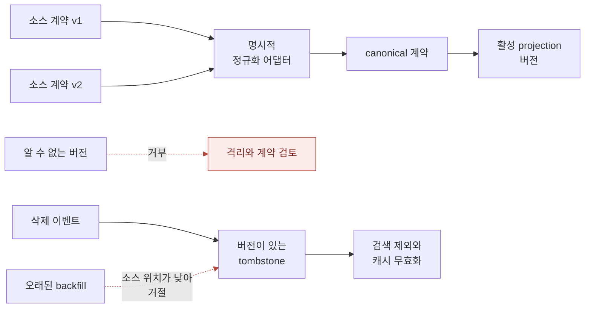

**[핵심 엔지니어링 분석 (Research & Considerations)]**

- **시스템 구성요소:** source schema registry, 버전별 adapter, canonical schema, 이중 projection과 활성 버전 포인터, 삭제 전파 작업을 구분한다. 파일은 본문 해시와 ACL 버전을 따로 기록해 권한 변경만 발생한 경우도 잡는다.
- **핵심 고려사항:** Schema Registry의 BACKWARD는 새 consumer가 과거 데이터를 읽는 방향이며, transitive는 직전 버전뿐 아니라 과거 버전까지 검사한다. 형식과 optional/default 선언에 따라 허용되는 변경이 달라진다. 필드 이름을 바꾸거나 단위를 바꾸는 것을 단순 호환 변경으로 가정하지 않는다. [Confluent 스키마 호환성](https://docs.confluent.io/platform/current/schema-registry/fundamentals/schema-evolution.html)
- **의미의 변화:** `temperature=70`의 단위가 섭씨에서 화씨로 바뀌면 JSON 타입 검사는 통과해도 의미가 깨진다. 단위·enum·null의 의미를 계약에 넣고, source와 canonical 버전을 각각 기록한다. 신규 버전을 모르면 값을 추측해 통과시키지 않는다.
- **배포 순서:** 새 consumer가 과거 계약을 읽도록 먼저 배포하고, 확장된 canonical 필드와 새 projection을 채운다. shadow 비교 후 활성 포인터를 바꾸고, rollback 기간이 끝난 뒤 옛 필드를 제거한다. 규격 호환성만으로 잘못 연결된 identity나 업무 의미까지 검증되지는 않는다.
- **삭제와 보관:** tombstone은 역순 재생으로 객체가 부활하는 일을 막는다. 검색 projection과 관련 캐시에서 삭제를 확인하고, 개인정보 원문 제거는 별도 보관 정책에 맞춰 수행한다. receipt·tombstone GC 기준은 최대 replay·backfill 기간보다 짧게 잡지 않는다. 증분 snapshot 중 DDL 허용 여부도 connector 버전과 절차로 확인한다.

**[근거 데이터 (Evidence Data)]**

| 항목 | 값 | 근거 |
| --- | --- | --- |
| 지원 source 계약 | v1 · v2 (2개) · v3은 ValueError | 코드: tests/test_core.py |
| v1 → v2 정규화 결과 | canonical 3필드 동일 (name · status · criticality) | 코드: tests/test_core.py |
| criticality 범위 | 1~5 · 생략 시 3 | 코드: fde/ingestion.py |
| 삭제 이벤트 payload | 0개 필드 (빈 객체만 허용) | 코드: fde/ingestion.py |
| tombstone 뒤 오래된 upsert | offset 20 삭제 → offset 10은 stale · deleted 유지 | 코드: tests/test_database.py |
| 삭제 표시된 청크의 다음 검색 | 0건 | 코드: tests/test_database.py |
| Schema Registry 기본 호환성 | BACKWARD · 직전 1개 버전과만 비교 | [Confluent 스키마 호환성](https://docs.confluent.io/platform/current/schema-registry/fundamentals/schema-evolution.html) |

**[실전 코드 (Production-grade Code)]**

아래는 새 offset의 삭제가 과거 upsert를 이기는 실행 예다. `normalize()`는 v1과 v2를 명시적으로 매핑하고 v3 등 알 수 없는 계약을 거부한다. 삭제 객체의 payload는 빈 객체만 허용한다.

```python
import os
import psycopg
from fde.ingestion import Event, apply_event

deleted = Event("acme", "erp", "A1", 1, 30, 0, 2, "delete", {})
backfill = Event("acme", "erp", "A1", 1, 8, 0, 1, "upsert",
                 {"asset_name": "Pump A1", "state": "running"})
with psycopg.connect(os.environ["FDE_INGEST_DSN"], autocommit=True) as conn:
    print(apply_event(conn, deleted))                       # applied
    print(apply_event(conn, backfill))                      # stale
# 검색 인덱스도 버전 조건과 deleted 상태를 반영해야 한다.
# 동봉 코드는 Asset tombstone과 RAG chunk의 삭제 제외를 각각 검증한다.
```

**[발표자 노트 (Speaker Script)]**

“스키마 진화에서 중요한 질문은 필드를 추가할 수 있느냐보다 기존 consumer가 과거 의미를 계속 읽을 수 있느냐입니다. 저는 source와 canonical 계약을 분리하겠습니다. 그러면 고객이 필드 이름을 바꿔도 아래 업무 모델은 안정적으로 유지할 수 있습니다. 삭제도 같은 원칙입니다. 행을 지우고 잊어버리면 늦게 도착한 backfill이 데이터를 되살릴 수 있습니다. 그래서 작은 tombstone을 남기고, 검색까지 삭제가 전달됐는지 확인합니다. 이제 이 정리된 데이터가 사용자 질문에 답하는 경로로 이동하겠습니다.”

## Frame 1-4 | Level 3 Deep Dive and Code | 매뉴얼의 절·표·점검 단계를 끊지 않고 청크로 나누기

**[화면 핵심 (On-screen Message)]**

`Structure-aware Chunking` · **구조 보존 청킹**

> 점검 절차와 표는 한 청크에 두고, 예산을 넘으면 자르지 않고 실패한다.

- 절차·표는 원자 단위, 표 머리글 동반
- 문서·버전·절 경로·페이지 구간 기록
- 예산 초과는 오류, 명시할 때만 경계 분할

**[화면 시각화 가이드 (Visual Layout)]**

1-3의 검색 projection 앞단, PDF가 청크가 되는 경계로 확대한다. 왼쪽에 매뉴얼 42–44쪽의 `5.2 과열` 절을 펼치고 문단·점검 단계 1–3·허용 온도 표가 각각 하나의 상자로 묶여 오른쪽 세 청크로 이동하게 한다. 페이지 경계를 넘는 점검 절차가 한 청크에 남는 장면과 표 머리글이 행과 함께 움직이는 장면을 강조하고, 각 청크에 `manual-p101:v3:0002 · p.42–43` 같은 태그를 붙인다. 예산 40 tokens에서 절차가 잘리지 않고 멈추는 경로와 파서 손상(단계 번호 누락, 머리글 없는 행)은 붉은 점선과 붉은 상자로 분리한다. 발표 시간 3분.

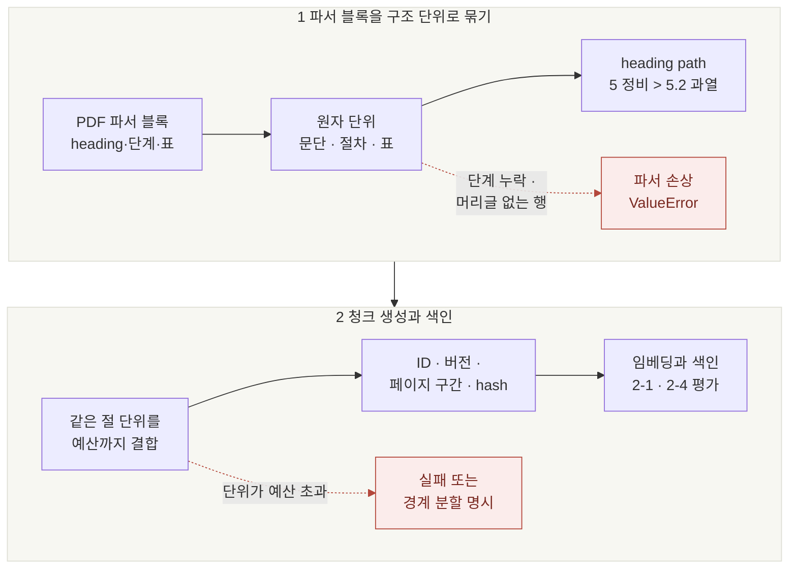

**[핵심 엔지니어링 분석 (Research & Considerations)]**

- **시스템 구성요소:** 레이아웃 파서, 구조 단위 조립기, 토큰 예산 추정기, 청크 메타데이터, 임베딩·색인 작업으로 나눈다. 파서는 heading level, 문단, 번호가 붙은 점검 단계, 표 머리글과 행을 페이지 번호와 함께 순서대로 내보낸다. `fde/chunking.py`는 PDF를 직접 파싱하지 않고 이 블록 목록만 받으므로, 표 인식·다단 레이아웃·OCR 품질은 원본 페이지와 대조하는 표본 검수로 따로 확인한다.
- **핵심 고려사항과 원자 단위:** 고정 길이 분할은 “1. 펌프를 정지”와 “3. 베어링 온도 측정”을 다른 청크로 보낼 수 있다. 검색이 뒤쪽 청크만 가져오면 안전 단계가 빠진 점검 순서가 근거가 되고, 머리글과 떨어진 표 행은 “80°C 이하”가 어느 부품의 기준인지 잃는다. 그래서 번호 절차와 머리글이 있는 표를 쪼개지 않는 단위로 두고, 청크는 절 경계를 넘지 않는다. Azure AI Search 문서는 고정 크기 분할의 시작점으로 512 tokens와 25% overlap(128 tokens)을 권하면서, HTML·Markdown의 heading 구문으로 절 단위로 나누는 가변 분할도 함께 소개한다. [Azure AI Search chunking](https://learn.microsoft.com/en-us/azure/search/vector-search-how-to-chunk-documents)
- **예산 초과와 파서 손상:** 예산을 넘는 단위는 `ValueError`로 멈추며 앞부분만 남기지 않는다. `split_oversized=True`를 명시할 때만 문장·단계·행 경계에서 나누고, 표는 part마다 머리글을 반복하며 `(i, n)` part 번호를 남긴다. 머리글과 행 하나, 또는 문장 하나가 예산보다 크면 그때도 실패한다. Unstructured의 `by_title`도 `Title`에서 청크를 닫고 `Table`을 다른 요소와 합치지 않지만, 기본값에서는 작은 절을 합치고(`combine_text_under_n_chars`) 너무 큰 표는 text-splitting으로 `TableChunk`를 만든다. 여기서는 절을 합치지 않고 행 경계와 머리글 반복을 요구하며, 단계 번호 누락·단계 사이에 끼어든 주의 문단·머리글 없는 행·페이지 역행·heading level 건너뜀을 파서 손상으로 보고 거부한다. [Unstructured chunking](https://docs.unstructured.io/open-source/core-functionality/chunking)
- **토큰 추정과 코드 보존:** `estimate_tokens`는 공백으로 나눈 단어마다 ASCII 4자당 1 token(올림)과 비ASCII 문자당 1 token을 더하는 결정적 추정이며 어떤 모델의 tokenizer와도 같다고 주장하지 않는다. Azure 문서는 흔한 OpenAI 모델에서 token 하나를 약 4자로 설명하면서도, 문자 수와 LLM이 세는 token 수는 다를 수 있다고 적는다. 실제 임베딩 모델 tokenizer로 표본을 재서 여유를 두고 예산을 정한다. 경계는 문장·단계·행 사이에서만 생기므로 `P-101`, `ZX-19` 같은 설비·에러 코드는 잘리지 않으며, lexical 검색이 코드 원형을 찾는 전제와 맞는다(2-1 참조).
- **식별자와 평가 라벨:** 청크 ID는 `문서:v버전:순번`으로 결정되고 5-2 재현 기록의 evidence 식별자 형식을 통과한다. 첫 heading 앞의 본문은 거부하므로 모든 청크가 절 경로를 갖고, 경로는 2-4의 span 라벨과 같은 `5 정비 > 5.2 과열` 형식으로 잇는다. content hash는 절 경로와 본문으로 계산하므로 embedding 모델이 같으면 같은 hash의 청크는 재임베딩을 건너뛸 수 있다(0-1 참조). 청크 전략을 바꾸면 ID가 바뀌므로 정답 라벨은 청크 ID가 아니라 문서·버전·절·페이지 구간으로 붙이고, 변경은 면접 Q&A의 청크 크기 답변처럼 인덱스 재생성과 고정 holdout 재평가를 거쳐 승격한다(2-4, 4-2 참조).
- **주장하지 않는 것:** 512 tokens와 overlap 0은 출발 제안값이며 이 고객 매뉴얼의 최적값이 아니다. 절차와 표를 통째로 두므로 overlap 없이 시작하며, Azure 문서도 구조화된 데이터는 overlap이 덜 필요할 수 있다고 적는다. Azure Text Split의 기본 상한 5,000자와 Unstructured의 기본 상한 500자처럼 도구 기본값도 크게 다르므로, 크기는 코드형·의미형 Hit@5와 context 예산 안의 support rate로 고른다. 이 코드는 한국어 검색 품질이나 파서 정확도를 증명하지 않는다.

**[근거 데이터 (Evidence Data)]**

| 항목 | 값 | 근거 |
| --- | --- | --- |
| 고정 크기 분할 시작점 | 512 tokens · overlap 25% (128 tokens) | [Azure AI Search chunking](https://learn.microsoft.com/en-us/azure/search/vector-search-how-to-chunk-documents) |
| Text Split `maximumPageLength` 기본값 | 5,000자 (최소 300 · 최대 50,000) | [Azure Text Split skill](https://learn.microsoft.com/en-us/azure/search/cognitive-search-skill-textsplit) |
| Unstructured `max_characters` 기본값 | 500자 | [Unstructured chunking](https://docs.unstructured.io/open-source/core-functionality/chunking) |
| 예제 점검 절차 | 3단계 · 45 tokens · p.42–43 → 청크 1개 | 코드: fde/chunking.py |
| 같은 입력의 예산 40 tokens | ValueError · 출력 청크 0개 | 코드: fde/chunking.py |
| 명시적 분할, 예산 17 tokens | 표 2 part · part마다 머리글 1회 · 15/16 tokens | 코드: fde/chunking.py |
| 파일럿 시작 예산 | 512 tokens · overlap 0 | 제안값 · 코드형·의미형 holdout 비교 후 교체 |

**[실전 코드 (Production-grade Code)]**

`fde/chunking.py`의 `chunk_blocks`는 파서가 만든 블록을 받아 청크를 만든다. 아래 블록은 실행 확인용 fixture이며 실제 매뉴얼이나 파서 출력이 아니다.

```python
from fde.chunking import Block as B, chunk_blocks

blocks = [
    B("heading", "5 정비", 41, level=1), B("heading", "5.2 과열", 42, level=2),
    B("paragraph", "P-101 과열은 ZX-19 경보와 함께 기록된다.", 42),
    B("step", "1. 펌프를 정지하고 잠금 표지를 단다.", 42),
    B("step", "2. 냉각수 유량과 필터 막힘을 확인한다.", 43),
    B("step", "3. 베어링 온도를 측정한다.", 43),
    B("table_header", "부품 | 허용 온도", 43),
    B("table_row", "베어링 | 80°C 이하", 43), B("table_row", "모터 권선 | 120°C 이하", 44),
]
for c in chunk_blocks("manual-p101", 3, blocks, max_tokens=48):
    print(c.chunk_id, c.section, c.pages, c.kinds, c.tokens)
# manual-p101:v3:0001 5 정비 > 5.2 과열 (42, 42) ('paragraph',) 17
# manual-p101:v3:0002 5 정비 > 5.2 과열 (42, 43) ('procedure',) 45
# manual-p101:v3:0003 5 정비 > 5.2 과열 (43, 44) ('table',) 24
try:
    chunk_blocks("manual-p101", 3, blocks, max_tokens=40)
except ValueError as error:
    print(error)
# procedure of 45 tokens exceeds 40; raise the budget or allow boundary splits
```

같은 입력에 `split_oversized=True`를 주면 예산 40에서 절차가 1–2단계(33 tokens)와 3단계(12 tokens)의 두 part로 나뉜다. token 수는 모듈의 결정적 추정값이며 임베딩 모델 tokenizer로 잰 값이 아니다.

**[발표자 노트 (Speaker Script)]**

“매뉴얼을 고정 길이로 자르면 구현은 쉽지만, 점검 절차의 1단계와 3단계가 서로 다른 청크로 갈 수 있습니다. 그러면 검색이 3단계만 가져왔을 때 모델은 펌프 정지라는 안전 단계 없이 점검 순서를 말할 수 있습니다. 그래서 저는 번호가 붙은 절차와 머리글이 있는 표를 쪼개지 않는 단위로 다루겠습니다. 예산을 넘는 단위가 나오면 앞부분만 남기지 않고 실패시키고, 꼭 나눠야 하면 단계나 행 경계에서만 나누면서 표 머리글을 반복합니다. 각 청크에는 문서 버전과 절 경로, 페이지 구간을 남겨 인용과 재현에 씁니다. 토큰 수는 결정적인 추정값이므로 실제 임베딩 모델의 tokenizer로 표본을 재고 여유를 두겠습니다. 512 tokens 같은 크기도 정답으로 두지 않고 코드형과 의미형 holdout으로 비교하겠습니다. 이때 정답 라벨을 청크 ID가 아니라 문서 버전과 절·페이지 구간으로 붙여야 청크 전략을 바꿔도 같은 기준으로 비교할 수 있습니다.”

## Frame 1-5 | Level 3 Deep Dive and Code | 원천 데이터를 계약으로 검사하고 위반은 격리하기

**[화면 핵심 (On-screen Message)]**

`Data Contracts & Quarantine` · **데이터 계약**

> 값은 고치지 않고 사유와 함께 격리하며, 형식이 바뀌면 수집을 멈춘다.

- 형식·enum·단위·범위별 사유 코드
- 지연은 경고, 미래 시각은 격리
- 모르는 버전·필드는 ACK 전 중단

**[화면 시각화 가이드 (Visual Layout)]**

1-2 도식의 `계약과 identity 검증` 상자로 다시 확대한다. 정비 API 작업 이력 세 건(offset 10·11·12)을 왼쪽에 놓고, 정상 레코드는 그대로 통과시키고 `P101`과 화씨 198.5가 섞인 레코드는 사유 코드 두 개를 단 채 격리 상자로, 132초 늦게 도착한 레코드는 `late_event` 표식을 단 채 수용 경로로 보낸다. 아래 띠에서는 owner가 status enum에 `deferred`를 더한 revision 2를 승인한 뒤, `deferred` 때문에 격리됐던 기록(테스트 fixture의 position 7)이 원래 수집 시각으로 다시 판정되어 1-2의 멱등 수집으로 들어가는 흐름을 보인다. 형식·단위 위반인 offset 11은 enum 개정으로 풀리지 않고 격리에 남는다. `schema_version 2`가 도착하면 레코드를 하나씩 버리지 않고 배치 전체가 SchemaBreak에서 멈추는 경로를 붉은 점선과 붉은 상자로 강조한다. 발표 시간 3분.

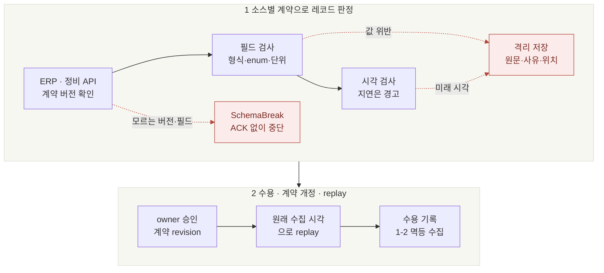

**[핵심 엔지니어링 분석 (Research & Considerations)]**

- **시스템 구성요소:** 소스마다 계약 하나를 둔다. 계약에는 소스 이름, 계약 revision, 허용 schema_version, 데이터 owner, 필드별 형식(ID 패턴·enum·정수·단위가 있는 수량·범위·timestamp), 최대 수집 지연과 허용 시계 오차가 들어간다. 판정기·격리 저장소·replay·배치 요약이 같은 계약을 쓰고, 계약 승인자는 1-1에서 합의한 authoritative source의 owner다. 이 검사는 1-2 수집 트랜잭션의 앞단에서 동작한다.
- **핵심 고려사항과 무변환 원칙:** 문자열 "92"를 숫자로, 화씨 198.5를 섭씨로 바꾸거나 모르는 필드를 버리면 하류 지표는 정상처럼 보이고 오류는 숨는다. 판정은 원문 그대로 수용하거나 `bad_id_format:asset_key` 같은 사유 코드와 함께 격리하는 두 가지뿐이다. 1-3의 섭씨·화씨 예처럼 타입 검사로는 의미 변화를 못 잡으므로 수량은 값과 단위를 함께 받고, 단위가 다르면 변환하지 않고 `unit_mismatch`로 격리한다. bool이나 3.0도 정수로 인정하지 않는다.
- **형식 변경은 중단:** dbt model contract는 enforce된 계약에 모든 열의 이름과 data_type을 요구하고, 결과 형태가 맞지 않으면 모델을 빌드하지 않으며 열 삭제와 data_type 변경을 breaking change로 본다. [dbt model contracts](https://docs.getdbt.com/docs/mesh/govern/model-contracts) 여기서도 모르는 schema_version, 계약에 없는 필드, 객체가 아닌 레코드는 레코드 격리가 아니라 `SchemaBreak`로 배치 전체를 멈추고 offset을 ACK하지 않으며, revision은 1-3의 새 consumer 우선 배포 순서로 올린다. Confluent Schema Registry의 기본 BACKWARD는 transitive가 아니어서 새 schema를 직전 버전과만 비교한다. 이런 호환성 검사는 형식만 보므로 registry를 통과해도 단위·범위 같은 의미 검사는 따로 필요하다. [Confluent 스키마 호환성](https://docs.confluent.io/platform/current/schema-registry/fundamentals/schema-evolution.html)
- **최신성은 경고, 시계 오류는 격리:** 레코드 지연은 수집 시각에서 event time을 뺀 값이며 30초(제안값)를 넘으면 `late_event` 경고와 함께 수용한다. 늦게 온 정상 데이터를 버리면 상태가 더 틀려지고, 순서는 timestamp가 아니라 1-2의 소스 위치가 결정하기 때문이다. event time이 수집 시계보다 5초(제안값) 넘게 앞서면 시계나 매핑 오류로 보고 격리한다. dbt source freshness는 가장 최근 적재 데이터가 `warn_after`·`error_after`에 count와 period로 정한 시간보다 오래됐는지 보는 소스 단위 검사이므로, 소스 정지를 잡는 그 검사와 레코드 단위 lag가 함께 필요하다. [dbt source freshness](https://docs.getdbt.com/reference/resource-properties/freshness)
- **격리와 replay:** 격리 기록에는 원문·사유 코드·소스 위치·소스 이름과 계약 revision·수집 시각이 남는다. replay는 같은 소스의 더 높은 계약 revision에서만 허용하고 원래 수집 시각으로 다시 판정하므로 같은 입력에서 같은 결과가 나온다. 원천 값을 고친 경우는 replay가 아니라 새 이벤트로 들어오고, replay로 수용된 레코드도 1-2의 위치 비교를 거치므로 더 새로운 상태를 덮지 못한다. 격리 원문에는 연락처 같은 PII가 섞일 수 있어 3-3의 접근 제한 원본과 같은 보관 기준을 적용한다.
- **주장하지 않는 것:** 계약 통과는 값이 맞다는 증명이 아니다. 범위 안의 잘못된 온도나 잘못 연결된 identity는 통과할 수 있으므로 1-1의 매핑 검토와 원천 표본 대조를 함께 둔다. 배치 요약의 lag p95는 source-to-serving p95 60초 목표 중 수집 구간일 뿐이며 색인 반영까지의 지연은 별도로 측정한다(4-3 참조).

**[근거 데이터 (Evidence Data)]**

| 항목 | 값 | 근거 |
| --- | --- | --- |
| dbt 계약의 breaking change | 4종 (열 삭제 · data_type 변경 · constraint 삭제·변경 · 계약 모델 제거) | [dbt model contracts](https://docs.getdbt.com/docs/mesh/govern/model-contracts) |
| Schema Registry 기본 호환성 | BACKWARD · 직전 1개 버전과만 비교 | [Confluent 스키마 호환성](https://docs.confluent.io/platform/current/schema-registry/fundamentals/schema-evolution.html) |
| 예제 배치 3건 판정 | 수용 2 · 격리 1 · late_event 1 | 코드: fde/contracts.py |
| offset 11 격리 사유 | bad_id_format 1 · unit_mismatch 1 | 코드: fde/contracts.py |
| offset 12 지연 | 132.0 s > 30 s → 경고 후 수용 | 코드: fde/contracts.py |
| `deferred` 격리 기록(fixture position 7)의 revision 2 replay | 수용 1 · 격리 0 · 지연 12.0 s 유지 | 코드: fde/contracts.py · tests/test_contracts.py |
| 수집 지연 경고 / 시계 오차 상한 | 30 s / 5 s | 제안값 · source-to-serving p95 60 s 중 수집 구간 몫 |

**[실전 코드 (Production-grade Code)]**

`fde/contracts.py`의 `validate_batch`는 한 partition의 `(소스 위치, 레코드)` 쌍을 받는다. 아래 계약과 레코드는 실행 확인용 fixture이며 고객 스키마가 아니다. 30초·5초와 −40~150°C 범위는 제안값이다.

```python
from datetime import datetime, timezone
from fde.contracts import Contract, Field, SchemaBreak, validate_batch

work_orders = Contract(
    source="cmms.work-orders", revision=1, schema_versions=(1,), owner="정비 시스템 owner",
    fields=(Field("work_order_id", "id", pattern=r"WO-\d{6}"),
            Field("asset_key", "id", pattern=r"[A-Z]{1,3}-\d{1,4}"),
            Field("status", "enum", choices=("open", "closed")),
            Field("bearing_temp", "quantity", unit="C", minimum=-40, maximum=150),
            Field("event_time", "timestamp")),
    max_lag_seconds=30, max_skew_seconds=5)
ok = {"schema_version": 1, "work_order_id": "WO-000123", "asset_key": "P-101", "status": "closed",
      "bearing_temp": {"value": 92.5, "unit": "C"}, "event_time": "2026-11-16T09:00:00+09:00"}
bad = dict(ok, asset_key="P101", bearing_temp={"value": 198.5, "unit": "F"})
late = dict(ok, event_time="2026-11-16T08:58:00+09:00")
now = datetime(2026, 11, 16, 0, 0, 12, tzinfo=timezone.utc)
result = validate_batch(work_orders, [(10, ok), (11, bad), (12, late)], ingest_time=now)
print(result.counts, result.quarantined[0].reasons, sep="\n")
# {'accepted': 2, 'quarantined': 1, 'bad_id_format': 1, 'unit_mismatch': 1, 'late_event': 1}
# ('bad_id_format:asset_key', 'unit_mismatch:bearing_temp')
try:
    validate_batch(work_orders, [(13, dict(ok, schema_version=2))], ingest_time=now)
except SchemaBreak as error:
    print(error)  # position 13: unknown schema_version 2; revise the contract before ACK
```

`replay(revised, quarantined)`는 같은 소스이면서 revision이 더 높은 계약에서만 실행되고 각 격리 기록의 원래 수집 시각으로 다시 판정한다. 테스트는 위 배치와 별도로 status가 `deferred`여서 격리된 기록(position 7)이 enum에 `deferred`를 더한 revision 2에서 수용되고 지연 12.0초가 유지되는지 확인한다. 위 배치의 `result.quarantined`(offset 11)를 같은 revision 2로 replay하면 `{'accepted': 0, 'quarantined': 1, 'bad_id_format': 1, 'unit_mismatch': 1}`로 격리에 남는다. 형식·단위 위반은 계약 개정이 아니라 원천에서 고친 새 이벤트로 해소된다. 실제 격리 저장소의 내구성과 접근 통제는 이 모듈 밖의 책임이다.

**[발표자 노트 (Speaker Script)]**

“정비 API가 어느 날 온도를 화씨로 보내기 시작해도 JSON 타입 검사는 그대로 통과합니다. 그래서 저는 소스마다 계약을 두고 형식, enum, 단위와 범위를 검사하겠습니다. 위반한 레코드는 고쳐서 넣지 않고 원문과 사유 코드, 소스 위치를 붙여 격리합니다. 모르는 schema 버전이나 계약에 없는 필드가 오면 그 필드를 버리고 진행하는 대신 배치 전체를 멈추고 offset을 ACK하지 않습니다. 반대로 늦게 도착한 정상 데이터는 버리지 않고 경고로 세는데, 순서는 이미 1-2의 소스 위치 비교로 지키고 있기 때문입니다. 계약이 틀렸던 것으로 판명되면 owner 승인으로 revision을 올리고, 격리 기록을 원래 수집 시각으로 다시 판정합니다. 다만 계약을 통과했다고 값이 맞다는 뜻은 아니어서, 범위 안의 잘못된 값은 매핑 검토와 원천 표본 대조로 따로 확인하겠습니다. 사유별 격리 건수는 데이터 owner와 함께 보는 운영 지표로 넘기겠습니다.”

## Frame 2-1 | Level 2 Topic Cluster | 권한이 있는 근거 안에서 하이브리드 검색하기

**[화면 핵심 (On-screen Message)]**

`Authorized Hybrid Retrieval` · **권한 내 하이브리드**

> 허용된 문서 집합 안에서 BM25와 dense 벡터를 RRF로 결합한다.

- DB 권한과 문서 ACL의 사전 적용
- 키워드형·의미형 holdout 분리
- 허용 청크 5,000개 한도의 파일럿 정확 검색

**[화면 시각화 가이드 (Visual Layout)]**

전체 조감도를 거쳐 청록 영역으로 확대한다. 인증된 요청에서 시작해 권한 경계를 지난 뒤 lexical·dense 두 갈래로 나뉘게 한다. 두 화살표가 RRF에서 합쳐지고 reranker·context assembler로 이어진다. 비허용 문서가 LLM 앞에서 뒤늦게 제거되는 그림은 사용하지 않는다. 발표 시간 2분.

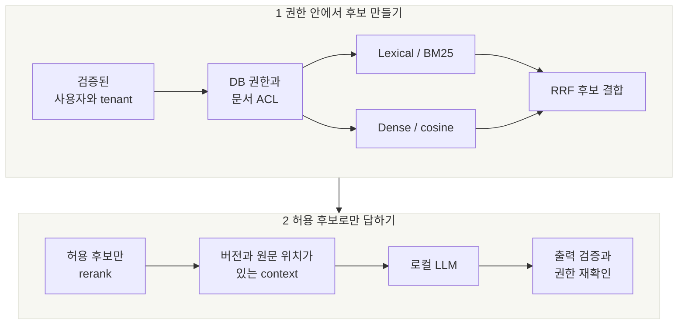

**[핵심 엔지니어링 분석 (Research & Considerations)]**

- **시스템 구성요소:** 검증된 주체, 정책 저장소, 문서·청크 ACL, lexical index, embedding index, fusion, 선택적 reranker, context budgeter와 모델 서버다. 문서의 검색 권한과 실제 업무 action 수행 권한은 별도다.
- **핵심 고려사항과 검색 트레이드오프:** 에러 코드 `ZX-19`와 부품 번호는 lexical 검색이 유리할 수 있고, “과열”과 “온도 상승”처럼 표현이 다른 질문은 dense가 도울 수 있다. 어느 쪽이 우월한지 미리 결론내리지 않고, 키워드형과 의미형 holdout을 분리한다. 원시 BM25 점수와 cosine을 임의로 더하지 않고 순위 기반 RRF를 기준선으로 쓴다. [Elastic RRF](https://www.elastic.co/docs/reference/elasticsearch/rest-apis/reciprocal-rank-fusion)
- **보안 결정:** 허용 집합에서 후보를 만들고, reranker와 LLM도 그 후보만 받는다. “전체 top-5를 가져와 나중에 ACL 필터”는 누출뿐 아니라 허용 문서가 top-5 밖으로 밀리는 recall 손실도 만든다. 문서 요약·청크·원문 링크에 같은 권한 의미를 적용한다.
- **물리 실행의 주의점:** 논리적으로 ACL을 적용해도 ANN 엔진이 물리적으로 전역 후보를 먼저 훑을 수 있다. pgvector는 근사 인덱스의 필터와 iterative scan 동작을 문서화한다. 선택도가 높은 ACL에서는 tenant partition, 별도 인덱스, iterative scan 또는 작은 허용 집합의 정확 검색을 비교한다. [pgvector filtering](https://github.com/pgvector/pgvector#filtering)
- **확장 결정:** 동봉한 코드는 RLS로 허용된 최대 5,000개 청크를 읽은 뒤 정확 BM25+cosine+RRF를 수행하는 **제한된 파일럿 경로**다. 100만 개 전체의 검색 엔진으로 사용하지 않는다. 대규모 경로는 ACL을 적용하는 검색 backend로 교체하고 recall·지연·권한을 다시 검증한다. 범위 초과 시 조용히 자르지 않고 실패시킨다.
- **한국어와 비용:** 단순 정규식 tokenizer와 테스트용 2차원 벡터로 한국어 검색 성능을 주장하지 않는다. 형태소 분석·동의어·설비 코드 보존, 한국어 embedding과 reranker는 고객 질의로 선택한다. embedding 모델 교체는 새 인덱스를 만들어 평가 후 전환한다.

**[근거 데이터 (Evidence Data)]**

| 항목 | 값 | 근거 |
| --- | --- | --- |
| 파일럿 정확 검색 상한 | 허용 청크 5,000개 · 초과 시 ValueError (자르지 않음) | 코드: fde/retrieval.py |
| RRF 결합 점수 | 경로별 1 / (60 + rank)의 합 · 동률은 chunk ID 순 | 코드: fde/retrieval.py |
| BM25 파라미터 | k1 1.2 · b 0.75 (허용 문서 안에서만 IDF 계산) | 코드: fde/retrieval.py |
| 결합 window · 반환 수 | 경로별 상위 50 · 기본 k 5 (1 ≤ k ≤ window ≤ 100) | 코드: fde/retrieval.py |
| Elastic RRF `rank_constant` 기본값 | 60 | [Elastic RRF](https://www.elastic.co/docs/reference/elasticsearch/rest-apis/reciprocal-rank-fusion) |
| HNSW 사후 필터의 평균 결과 | `hnsw.ef_search` 40 · 조건 10% → 평균 4행 | [pgvector filtering](https://github.com/pgvector/pgvector#filtering) |

**[실전 코드 (Production-grade Code)]**

아래는 서로 다른 검색 경로를 같은 API로 결합하는 실행 예다. 벡터는 알고리즘 확인용 fixture이며 실제 모델 출력이 아니다. `fde/retrieval.py`에 BM25·cosine·RRF 구현과 차원·NaN·0 벡터 검사가 들어 있다.

```python
from fde.retrieval import Chunk, rank

authorized_chunks = [
    Chunk("code-manual", 1, "ZX-19 trip code inspection", (0.0, 1.0)),
    Chunk("heat-manual", 1, "An overheated pump should be shut down.", (1.0, 0.0)),
]
results = rank("ZX-19", (1.0, 0.0), authorized_chunks, k=2)
print([chunk.id for chunk in results])
# 두 후보가 반환된다. 순위 동률은 chunk ID로 결정해 재현성을 확보한다.
# RRF의 1 / (60 + rank)는 순위 결합 점수이며 정답 확률이 아니다.
```

**[발표자 노트 (Speaker Script)]**

“현장 질문에는 자연어와 정확한 식별자가 섞여 있습니다. ‘P-101에서 ZX-19가 반복되는 이유’라는 질문을 벡터 검색만으로 처리하면 중요한 코드가 약해질 수 있습니다. 그래서 lexical과 dense를 함께 평가하겠습니다. 다만 보안은 검색 뒤에 붙이는 필터가 아닙니다. 허용된 문서 집합 안에서 두 검색을 수행하고, 그 후보만 reranker와 모델로 보냅니다. 작은 파일럿은 정확 검색으로 시작할 수 있지만, 실제 규모로 넓힐 때는 ACL 선택도가 검색 recall에 미치는 영향까지 다시 측정하겠습니다.”

## Frame 2-2 | Level 3 Deep Dive and Code | RBAC와 테넌트 경계를 DB에서 강제하기

**[화면 핵심 (On-screen Message)]**

`Database Row-level Security` · **DB 행 수준 보안**

> 요청자가 보낸 role 대신 DB의 membership과 RLS로 읽기 범위를 제한한다.

- 요청마다 트랜잭션 범위의 identity 설정
- 소유자·reader 분리와 FORCE RLS
- 응답 직전 권한·버전·본문 재검증

**[화면 시각화 가이드 (Visual Layout)]**

검색 후보가 만들어지는 경계로 확대한다. Alice·Acme·Engineer 토큰과 Acme·HR 문서, Beta 문서를 나란히 놓고 뒤의 두 문서가 DB 조회 결과에 포함되지 않는 장면을 보여준다. 코드의 `set_config(..., true)`와 비특권 DB 계정을 강조한다. 발표 시간 4분.

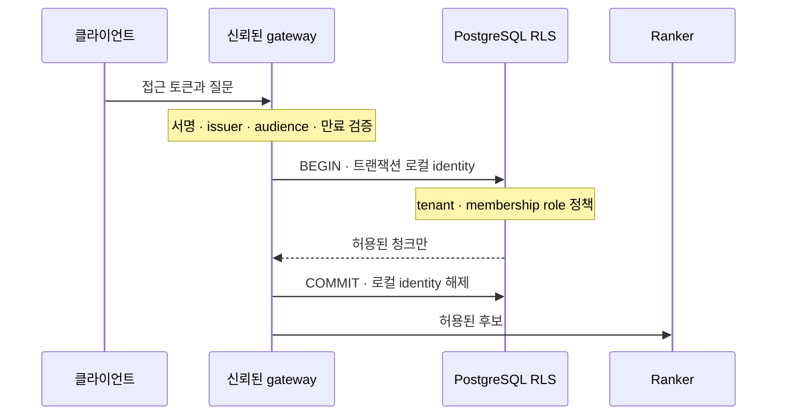

**[핵심 엔지니어링 분석 (Research & Considerations)]**

- **시스템 구성요소:** IdP 토큰 검증, 서버에서 tenant를 결정하는 gateway, membership 테이블, chunk ACL과 읽기 전용 DB role이다. 클라이언트가 보낸 `roles=[admin]`이나 tenant 파라미터를 권한 근거로 신뢰하지 않는다.
- **핵심 고려사항:** RBAC는 업무 role을 정의하고 문서 ACL과 tenant 조건으로 실제 읽기 범위를 제한한다. 더 복잡한 프로젝트·지역·보안등급은 ABAC 정책으로 확장할 수 있지만 정책 충돌과 deny 우선순위를 명시해야 한다.
- **DB 경계:** table owner, superuser, BYPASSRLS 계정으로 서비스하면 정책을 우회할 수 있다. 예제는 소유자와 reader를 분리하고 FORCE RLS를 켠다. [PostgreSQL Row Security](https://www.postgresql.org/docs/current/ddl-rowsecurity.html)
- **연결 풀과 위협 모델:** identity 설정은 요청마다 트랜잭션 범위로 지정한다. RLS는 이 설정을 바꿀 수 있는 침해된 gateway까지 막아주는 장치가 아니다. 토큰 검증·parameterized SQL·최소 DB 권한·서비스 격리가 함께 필요하다. 테넌트 간 강한 관리 경계가 필요하면 DB나 자격증명 자체를 분리한다.
- **철회와 캐시:** 예제는 응답 캐시를 사용하지 않는다. serving membership 변경은 다음 요청에서 적용된다. 실제 소스의 ACL 변경부터 serving까지의 전파와, 이미 생성 중인 응답의 철회 창은 별도다. 중요한 응답은 반환 직전 인용된 문서의 현재 권한·버전을 다시 확인한다. 캐시를 도입하면 tenant·subject 또는 권한 fingerprint·policy version·문서 버전을 키에 포함하고 철회에 따라 무효화한다.

**[근거 데이터 (Evidence Data)]**

| 항목 | 값 | 근거 |
| --- | --- | --- |
| 요청 identity 설정 | 트랜잭션 로컬 2개 (`app.tenant` · `app.subject`) | 코드: fde/retrieval.py |
| 검색·재검증 statement_timeout | 요청의 남은 시간(`timeout_ms`) · 상한 2,000 ms | 코드: fde/retrieval.py · tests/test_core.py |
| reader 계정 속성 | rolsuper false · rolbypassrls false · identity 없이 조회 0행 | 코드: tests/test_database.py |
| 다른 tenant · 비회원 · 철회 후 검색 | 0건 | 코드: tests/test_database.py |
| 응답 직전 재검증 | 근거 1–5개 · 철회·버전 변경 시 PermissionError | 코드: fde/retrieval.py · tests/test_database.py |
| RLS를 우회하는 계정 | 3종 (superuser · BYPASSRLS · FORCE 없는 table owner) | [PostgreSQL Row Security](https://www.postgresql.org/docs/current/ddl-rowsecurity.html) |

**[실전 코드 (Production-grade Code)]**

실행 함수는 `fde/retrieval.py`의 `retrieve`와 `revalidate_evidence`이고 정책 전문은 `sql/schema.sql`에 있다. 아래는 reader 전용 DSN으로 호출하는 코드다. Principal은 예제의 신뢰된 입력이며 실제 서비스에서는 gateway의 토큰 검증 결과로만 만든다.

```python
import os
import psycopg
from fde.retrieval import Principal, retrieve, revalidate_evidence

principal = Principal(tenant="acme", subject="alice")
with psycopg.connect(os.environ["FDE_READER_DSN"], autocommit=True) as conn:
    results = retrieve(conn, principal, "pump", (1.0, 0.0), "fixture-v1")
    if results:
        revalidate_evidence(conn, principal, results, "fixture-v1")
    print([chunk.id for chunk in results])
# 함수 안에서 transaction-local tenant와 subject를 설정한다.
# membership은 DB에서 읽는다. 요청자가 임의 role을 넘길 인자는 없다.
```

정책의 핵심은 아래와 같다(`sql/schema.sql`). 소유자도 정책을 우회하지 않도록 FORCE를 켜고, `memberships`에도 요청자 본인 행만 보이는 RLS가 적용된다.

<!-- deck -->
```sql
ALTER TABLE fde.chunks ENABLE ROW LEVEL SECURITY;
ALTER TABLE fde.chunks FORCE ROW LEVEL SECURITY;

CREATE POLICY readable_chunks ON fde.chunks FOR SELECT TO fde_reader
USING (
    tenant_id = current_setting('app.tenant', true)
    AND NOT deleted
    AND EXISTS (
        SELECT 1 FROM fde.memberships m
        WHERE m.tenant_id = chunks.tenant_id
          AND m.subject = current_setting('app.subject', true)
          AND m.roles && chunks.allowed_roles
    )
);
```

이 SQL은 `schema.sql`에 이미 포함되어 있으므로 기존 정책 위에 다시 생성하지 않는다. 실제 API에서는 모델 생성이 끝난 뒤 응답 직전에 `revalidate_evidence`를 호출한다. 이는 새 READ COMMITTED 조회로 권한·버전·본문이 유지되는지 확인한다. 통합 테스트는 실제 비특권 LOGIN 계정으로 tenant 경계·HR 문서 제외·membership 변경·삭제·생성 중 철회와 버전 변경·요청 간 identity 초기화를 확인한다. 조회 직후 일어나는 철회와 네트워크 반환을 원자적으로 묶는 기능은 아니므로 요청 수명과 허용 철회 창을 함께 제한한다. 두 함수는 `timeout_ms`로 받은 요청의 남은 시간(예: 0-1의 검색 단계 250ms, 검증 단계 200ms)을 `statement_timeout`으로 걸고, 2,000ms는 그 값의 상한일 뿐이다.

**[발표자 노트 (Speaker Script)]**

“이 설계에서 role을 결정하는 주체는 브라우저나 LLM이 아니라 고객의 인증과 권한 체계입니다. gateway는 토큰의 서명, issuer, audience, 만료를 확인하고 서버의 tenant 매핑을 사용합니다. DB에서도 같은 경계를 강제합니다. 여기서 흔한 실수는 개발 때 쓰던 DB 소유자 계정으로 서비스를 띄우는 것입니다. 그러면 RLS가 있어도 기대한 통제가 안 될 수 있습니다. 그래서 테스트도 소유자가 아닌 실제 reader 계정으로 실행합니다. 또 연결 풀을 돌려 쓸 때 이전 사용자의 설정이 다음 요청에 남지 않는지 확인했습니다.”

## Frame 2-3 | Level 3 Deep Dive and Code | 환각과 에이전트 권한을 다른 경계에서 통제하기

**[화면 핵심 (On-screen Message)]**

`Guardrails and Tool Budgets` · **출력·도구 통제**

> 인용 출처는 코드로 검증하고 주장 내용은 독립 평가로 확인한다.

- 인용 ID·버전·원문 대조
- 고영향 판단의 전문가 검토
- read-only search와 호출 예산

**[화면 시각화 가이드 (Visual Layout)]**

생성 경로로 확대한다. 모델 출력의 각 claim에 `chunk_id / version / quote` 태그를 붙이고, 없는 출처·바뀐 버전·원문에 없는 인용을 붉게 표시한다. 도구 호출은 모델과 업무 시스템 사이의 별도 검증 문을 지나게 한다. 발표 시간 4분.

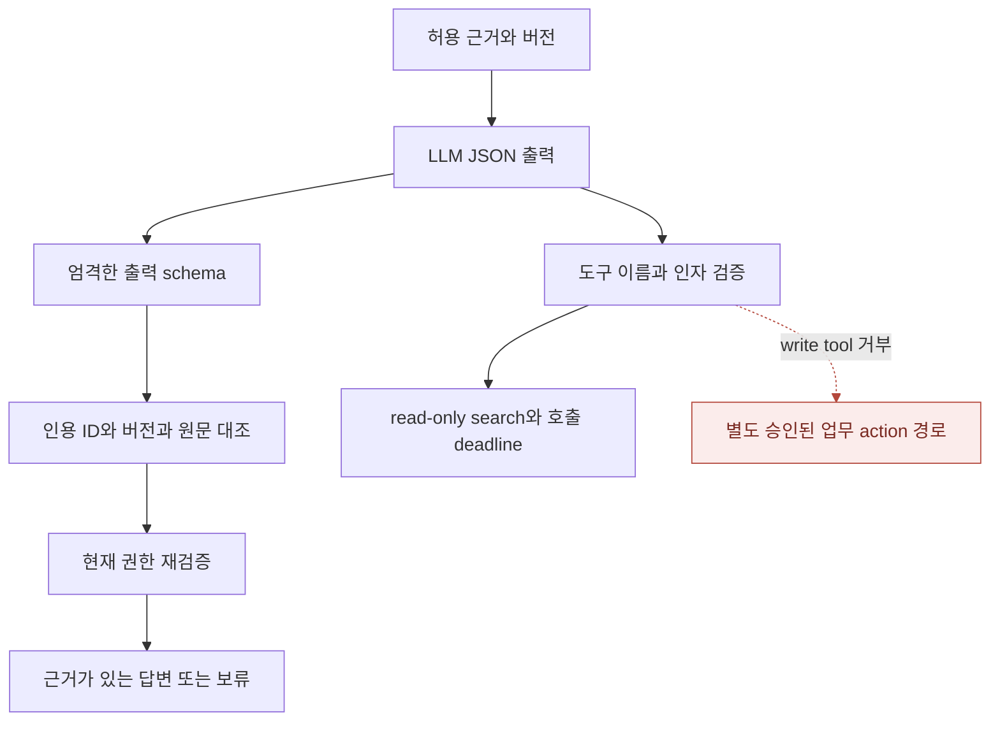

**[핵심 엔지니어링 분석 (Research & Considerations)]**

- **시스템 구성요소:** 제한된 context, 구조화 출력 schema, claim별 citation validator, 의미적 support 평가, tool gateway, 호출·시간·토큰 예산이다. 근거가 없는 질문에는 보류하도록 하고, 인용 링크는 권한 있는 내부 원문 viewer로 연결한다.
- **핵심 고려사항과 환각 통제:** JSON 유효성은 내용의 진실을 증명하지 않는다. 인용문이 원문에 있다는 사실도 “계속 가동하라”라는 주장이 “점검 전 정지하라”라는 문장으로 뒷받침된다는 뜻은 아니다. 코드가 보장하는 것은 인용 provenance다. 의미적 support는 독립 라벨과 평가, 높은 영향의 판단은 전문가 확인으로 통제한다.
- **Prompt injection:** 검색 문서는 명령을 담을 수 있는 비신뢰 입력이다. RAG만으로 간접 prompt injection이 해결되지는 않는다. [OWASP Prompt Injection](https://genai.owasp.org/llmrisk/llm01-prompt-injection/)
- **에이전트 권한:** 모델에게 임의 SQL, shell, URL fetch를 주지 않는다. 예제 gateway는 `search(query)` 하나만 허용하고 tenant와 subject를 서버에 고정한다. 쓰기가 필요해지면 객체 ID, 예상 객체 버전, idempotency key, 별도 action 권한과 승인 상태를 검증하는 경로를 만든다.
- **지연과 비용:** 도구 호출 수, 전체 deadline, 입력·출력 토큰 상한을 함께 둔다. 이 예제의 ToolBudget은 도구 호출 수와 남은 시간을 관리하며, 토큰 상한은 실제 모델 adapter에서 설정해야 한다. ToolBudget은 자체 예산(기본 4초, 생성자 상한 5초)과 요청 deadline(`deadline`, `time.monotonic()` 값) 중 이른 시각에 멈추므로, 도구 호출이 요청 deadline 5초를 넘기지 않는다. 재시도로 같은 deadline을 새로 부여하지 않는다. 확신을 RRF 점수나 모델의 자가 평가 숫자로 대신하지 않는다.

**[근거 데이터 (Evidence Data)]**

| 항목 | 값 | 근거 |
| --- | --- | --- |
| 거부되는 인용 오류 | 3종 (다른 버전 · 검색되지 않은 ID · 원문에 없는 quote) | 코드: tests/test_core.py |
| 의미를 뒤집은 claim | 출처 검증 통과 1건 · support는 별도 평가 | 코드: tests/test_core.py |
| 모델 출력 크기 상한 | 16,000 B | 코드: fde/guardrails.py |
| claim 수 · quote 길이 | claim 1–5개 (보류 시 0개) · quote 8–1,000자 | 코드: fde/guardrails.py |
| 허용 도구 | 1개 (`search`, 인자 `query`만) · `delete` 도구와 `tenant` 인자 거부 | 코드: tests/test_core.py |
| 도구 예산 기본값 | 호출 2회 · 4.0 s (상한 3회 · 5 s, 요청 deadline이 더 이르면 그 시각) · 소진 시 TimeoutError | 코드: fde/guardrails.py · tests/test_core.py |

**[실전 코드 (Production-grade Code)]**

실행 가능한 출력 검증 예다. 실제 모델 adapter는 동일한 JSON 계약으로 출력하고, 로컬 endpoint의 timeout·최대 응답 크기·출력 토큰을 강제해야 한다. 그 adapter와 IdP 연결은 고객 환경의 통합 지점이다.

```python
import json
from fde.guardrails import validate_answer
from fde.retrieval import Chunk

evidence = [Chunk("manual-p1", 2,
                  "The pump must stop before inspection.", (1.0, 0.0))]
model_output = json.dumps({
    "abstain": False,
    "claims": [{
        "text": "점검 전에 펌프를 정지해야 합니다.",
        "chunk_id": "manual-p1", "version": 2,
        "quote": "must stop before inspection",
    }],
})
validated = validate_answer(model_output, evidence)
print(validated["claims"][0]["chunk_id"])
# unknown field, duplicate JSON key, 잘못된 citation/version/quote는 거부한다.
```

`fde/guardrails.py`의 `ToolBudget.invoke`는 허용 도구와 정확한 인자 집합을 검사하고 호출 횟수를 차감한다. callback은 받은 `remaining_seconds`를 실제 네트워크 timeout에 적용해야 한다. 호출자는 요청 deadline을 `deadline`으로 넘겨 도구 예산이 그보다 늦게 끝나지 않게 한다. Python deadline 검사만으로 임의의 blocking 함수를 중단할 수 있다고 가정하지 않는다.

**[발표자 노트 (Speaker Script)]**

“저는 환각을 없앴다고 말하지 않겠습니다. 대신 무엇을 기계적으로 검증했고 무엇을 평가해야 하는지 구분하겠습니다. 이 코드는 검색하지 않은 문서의 인용, 오래된 버전, 원문에 없는 문장을 거부합니다. 하지만 원문의 뜻을 뒤집은 주장을 완벽히 판별하지는 못합니다. 그 부분은 별도의 정답·support 평가로 확인합니다. 에이전트의 경우에는 모델이 잘 행동할 것이라는 기대 대신 실제 호출 가능한 기능을 제한합니다. 모델이 문서의 악성 지시를 따라도 검색 이상의 업무 권한이 생기지 않도록 만드는 것입니다.”

## Frame 2-4 | Level 3 Deep Dive and Code | 검색 품질을 Hit@k·MRR·nDCG로 고정하고 비교하기

**[화면 핵심 (On-screen Message)]**

`Retrieval Evaluation` · **검색 지표**

> 정답을 청크가 아닌 문서 구간으로 라벨링해 전략을 같은 기준으로 비교한다.

- 문서·버전·절·쪽 구간 라벨
- Hit@5·Recall·MRR·nDCG의 분모 구분
- 슬라이스별 집계와 짝 bootstrap 비교

**[화면 시각화 가이드 (Visual Layout)]**

2-1의 검색 결과가 평가로 넘어가는 경계로 확대한다. 위 띠 왼쪽에 P-101 질문의 정답 구간 라벨 두 개(점검 절차 42–43쪽 등급 3, ZX-19 경보 설명 18쪽 등급 1)를 놓고, 고정 길이 청킹과 1-4 구조 보존 청킹의 top-5가 같은 라벨에 겹치는 장면을 나란히 보여준다. 구버전 v2 청크와 이미 찾은 라벨을 다시 덮는 중복 청크는 이득 0으로 붉게 표시한다. 아래 띠에서는 전체 평균 0.93 뒤에 의미형 0.80이 숨는 장면과, 의미형 30개 질의의 bootstrap 구간이 0을 포함하는 장면을 차례로 강조한다. 전체 평균만 보고 승격하는 경로는 붉은 점선과 붉은 상자로 분리한다. 발표 시간 3분.

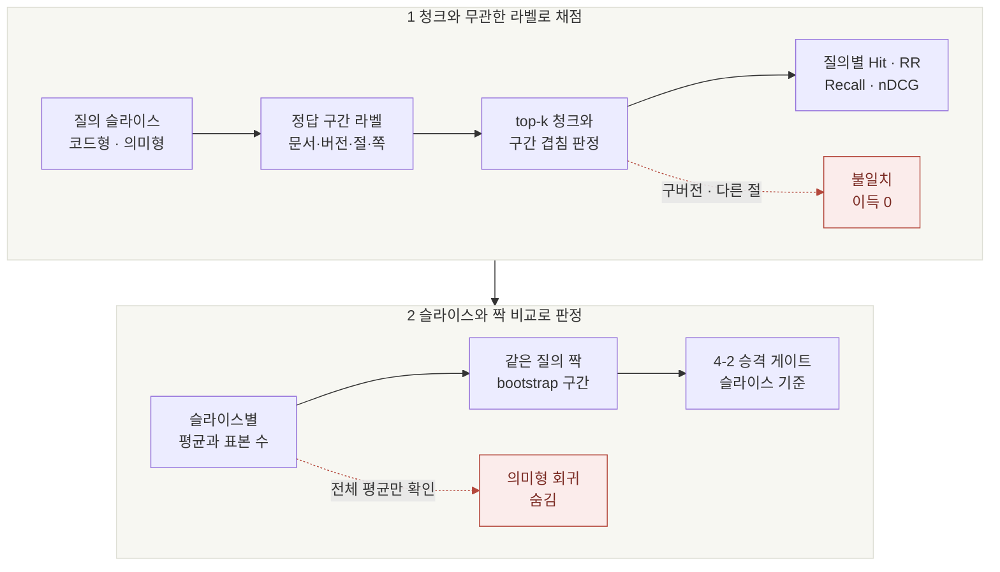

**[핵심 엔지니어링 분석 (Research & Considerations)]**

- **시스템 구성요소:** 버전이 고정된 질의 세트, 문서 구간 라벨, 질의별 검색 실행 기록(run), 지표 계산기, 슬라이스 집계와 짝 비교로 나눈다. `fde/metrics.py`는 검색을 실행하지 않고 질의별 top-k 결과와 라벨을 숫자로 바꾸는 순수 함수다. 라벨은 문서 ID·버전·절 경로·쪽 구간과 등급을 갖고, 청크가 같은 문서·버전이며 쪽 구간이 겹치고 같은 절 또는 그 하위 절에 있으면 일치한다. 라벨에 청크 ID를 쓰지 않으므로 1-4의 청킹 전략을 바꿔도 같은 라벨로 다시 채점할 수 있다.
- **핵심 고려사항과 분모:** Hit@k는 정답 구간을 하나 이상 찾은 질의의 비율, Recall@k는 질의의 정답 구간 중 상위 k개 안에서 찾은 비율, MRR은 첫 일치 순위의 역수 평균이다. 아래 P-101 fixture에서 고정 길이 청킹은 Recall 1.0·MRR 0.3333, 구조 보존 청킹은 Recall 0.5·MRR 1.0으로 지표마다 우열이 뒤집힌다. 그래서 승격 지표는 4-2처럼 슬라이스별 Hit@5로 미리 고정하고, 나머지 지표는 원인 분석에 쓴다. Elastic의 rank evaluation 문서도 recall을 가능한 모든 관련 결과 대비 상위 k개 안의 비율로, MRR을 첫 관련 문서 순위의 역수로 정의한다. [Elastic rank evaluation](https://www.elastic.co/docs/reference/elasticsearch/rest-apis/search-rank-eval)
- **nDCG와 중복 청크:** nDCG는 등급을 log2(순위 + 1)로 할인해 더한 DCG를, 라벨 등급으로 만든 ideal DCG로 나눈 값이다. 작은 청크 여러 개가 같은 라벨을 덮을 때 이득을 반복해 더하면 nDCG가 1을 넘으므로, 라벨마다 처음 일치한 순위에서 한 번만 인정하고 한 순위에는 라벨 하나의 이득만 준다(Recall은 한 청크가 덮은 라벨을 모두 센다). 중복 청크가 context 예산만 쓰고 새 근거를 더하지 않는다는 사실이 숫자에 드러난다. scikit-learn `ndcg_score`도 로그 할인 뒤 ideal DCG로 나눠 0과 1 사이 값을 만들며, 모듈은 그 문서 예제 값 0.69·0.49와 k=4의 0.35를 테스트에서 재현한다. [scikit-learn ndcg_score](https://scikit-learn.org/stable/modules/generated/sklearn.metrics.ndcg_score.html)
- **평균이 슬라이스를 숨기는 이유:** 코드형 70개 중 69개, 의미형 30개 중 24개를 찾으면 전체 Hit@5는 0.93이지만 의미형은 0.80으로 4-2의 슬라이스 기준 90%에 미달한다. 질의 구성 비율만 바뀌어도 전체 평균이 움직이므로 전체 값은 보고만 하고 게이트는 슬라이스별로 건다. 슬라이스 이름은 `fde/release_gate.py`와 같은 `factoid`·`semantic`이고, 근거 없는 질의와 권한 없는 질의는 검색 지표가 아니라 보류 게이트로 평가한다.
- **짝 비교와 표본 크기:** 두 전략은 같은 질의에서 비교해야 하므로 질의 ID를 함께 복원추출하는 paired bootstrap으로 차이의 구간을 구한다. SciPy `bootstrap`도 `paired=True`이면 같은 인덱스로 모든 표본을 재추출한다. 기본값은 재표본 9,999회, 신뢰수준 0.95, BCa 방법이고, 문서는 percentile 방법이 가장 직관적이지만 실무에서는 드물게 쓰인다고 적는다. [SciPy bootstrap](https://docs.scipy.org/doc/scipy/reference/generated/scipy.stats.bootstrap.html) `fde/metrics.py`는 의존성을 늘리지 않으려고 같은 9,999회와 0.95로 표준 라이브러리만 써서 percentile 구간을 계산한다. seed 7에서 의미형 30개의 4건 개선·1건 회귀(+0.10)는 구간 [-0.0333, +0.2333]으로 판정 불가이고, 같은 비율의 120개에서는 [+0.0333, +0.1750]으로 개선 판정이 나온다.
- **주장하지 않는 것:** 예제 순위와 질의 결과는 계산 확인용 fixture이며 고객 데이터나 실제 검색 성능이 아니다. 쪽 단위 라벨은 같은 절·같은 쪽의 인접 문단도 정답으로 세므로 라벨 해상도가 곧 지표 해상도다. 절 경계를 넘는 청크는 기록한 절 경로 하나로만 일치하므로 절을 섞는 청킹 전략에는 보수적으로 채점된다. bootstrap 구간은 의사결정 보조이며 유의성 검정이나 운영 성능 보장이 아니다. 최종 승격은 튜닝에 쓰지 않은 고정 holdout과 4-2 게이트로 판정한다.

**[근거 데이터 (Evidence Data)]**

| 항목 | 값 | 근거 |
| --- | --- | --- |
| `ndcg_score` 문서 예제 | 0.69 · 0.49 · k=4에서 0.35 | [scikit-learn ndcg_score](https://scikit-learn.org/stable/modules/generated/sklearn.metrics.ndcg_score.html) |
| 같은 예제의 `score_query` nDCG | 0.6957 · 0.4937 · k=4에서 0.3520 | 코드: fde/metrics.py |
| rank_eval 지표 기본 k | 10 (precision · recall · MRR · DCG) | [Elastic rank evaluation API](https://www.elastic.co/docs/api/doc/elasticsearch/operation/operation-rank-eval) |
| SciPy `bootstrap` 기본값 | 9,999회 · 신뢰수준 0.95 · BCa | [SciPy bootstrap](https://docs.scipy.org/doc/scipy/reference/generated/scipy.stats.bootstrap.html) |
| **P-101 예제 고정 길이 → 구조 보존** | nDCG@5 0.5197 → 0.8262 · Recall@5 1.0 → 0.5 | 코드: fde/metrics.py |
| 전체 평균에 숨은 의미형 슬라이스 | 전체 0.93 · 코드형 69/70 · 의미형 0.80 | 코드: fde/metrics.py |
| 의미형 +0.10 차이의 95% 구간 (seed 7) | n=30 [-0.0333, +0.2333] · n=120 [+0.0333, +0.1750] | 코드: fde/metrics.py |

**[실전 코드 (Production-grade Code)]**

`fde/metrics.py`의 `score_query`는 한 질의의 top-k 결과를 구간 라벨로 채점하고, `summarize`와 `paired_bootstrap`은 슬라이스 집계와 짝 비교를 맡는다. 아래 순위와 질의 결과는 계산 확인용 fixture이며 실제 검색 결과가 아니다.

```python
from fde.metrics import Label, Retrieved as R, paired_bootstrap, score_query

doc, sec, alarm = "manual-p101", "5 정비 > 5.2 과열", "3 경보 > 3.4 ZX-19"
labels = [Label(doc, 3, sec, (42, 43), grade=3),     # 점검 절차: 직접 근거
          Label(doc, 3, alarm, (18, 18), grade=1)]   # 경보 설명: 보조 근거
fixed = [R("fx-0031", doc, 3, "5 정비 > 5.1 소음", (40, 40)),
         R("fx-0034", doc, 2, sec, (42, 42)),          # 구버전 v2: 불일치
         R("fx-0035", doc, 3, sec, (43, 43)),
         R("fx-0036", doc, 3, sec, (43, 43)),          # 이미 찾은 라벨: 이득 0
         R("fx-0011", doc, 3, alarm, (18, 18))]
structured = [R("manual-p101:v3:0002", doc, 3, sec, (42, 43)),
              R("manual-p101:v3:0003", doc, 3, sec, (43, 44)),       # 같은 라벨: 이득 0
              *(R(f"manual-p101:v3:{n:04d}", doc, 3, "6 부품", (n + 43, n + 43))
                for n in (7, 8, 9))]                                 # 다른 절 3개
print("fixed     ", score_query(fixed, labels, k=5))
print("structured", score_query(structured, labels, k=5))
# fixed      hit=1 recall=1.0000 rr=0.3333 ndcg=0.5197
# structured hit=1 recall=0.5000 rr=1.0000 ndcg=0.8262
base = {f"s{i:02d}": int(i >= 6) for i in range(30)}               # 의미형 24/30
cand = {**base, "s02": 1, "s03": 1, "s04": 1, "s05": 1, "s29": 0}  # 4건 개선, 1건 회귀
print(paired_bootstrap(base, cand, seed=7))
# n=30 diff=+0.1000 95% [-0.0333, +0.2333] inconclusive
```

`score_run`은 평가 질의 ID와 run의 질의 ID가 정확히 같지 않으면 실패한다. 빠진 질의를 0점이나 제외로 조용히 처리하지 않기 위해서다. 라벨 없는 질의, 같은 순위 목록 안의 중복 청크, 두 run의 질의 집합 불일치도 `ValueError`로 거부한다.

**[발표자 노트 (Speaker Script)]**

“검색을 바꿀 때마다 좋아졌다는 말을 숫자로 확인하려면 먼저 정답을 고정해야 합니다. 저는 정답을 청크 ID가 아니라 문서 버전과 절, 쪽 구간으로 라벨링하겠습니다. 그래야 청킹 전략을 바꿔도 같은 라벨로 다시 채점할 수 있습니다. 지표는 분모가 다른 네 가지를 구분해서 봅니다. 하나라도 찾았는지 보는 Hit@5, 몇 개를 찾았는지 보는 Recall, 첫 정답의 순위를 보는 MRR, 등급과 순위를 함께 보는 nDCG입니다. 예제처럼 지표마다 우열이 뒤집힐 수 있으므로 승격 기준은 질문 유형별 Hit@5로 미리 정해 두겠습니다. 전체 평균 0.93 뒤에 의미형 0.80이 숨을 수 있어서 판정은 슬라이스별로 합니다. 그리고 의미형 30개에서 10%p 개선은 우연과 구분되지 않을 수 있으므로, 같은 질의를 짝지어 비교한 구간이 0을 포함하면 개선이라고 말하지 않겠습니다.”

## Frame 2-5 | Level 3 Deep Dive and Code | 에이전트의 쓰기를 초안·승인·멱등 실행으로 나누기

**[화면 핵심 (On-screen Message)]**

`Approved Agent Actions` · **승인된 쓰기**

> 모델은 근거 있는 초안만 만들고 쓰기는 초안 SHA-256 digest에 묶인 승인으로 한 번 실행한다.

- 인용이 검증된 WorkOrder 초안
- 역할·요청자 분리·만료가 있는 digest 승인
- idempotency key와 예상 버전의 1회 실행

**[화면 시각화 가이드 (Visual Layout)]**

2-3의 도구 경계에서 업무 쓰기 경로로 확대한다. 위 띠에서는 모델이 검색된 근거로 P-101 작업 지시 초안을 만들고, 쓰기 tool 호출은 2-3의 ToolBudget에서 거부되는 장면을 보여준다. 아래 띠에서는 정비 리더가 초안 digest를 승인하고, execute가 idempotency key와 예상 버전 7로 정비 시스템에 한 번만 기록하는 장면을 따라간다. 같은 key의 재시도가 새 기록 없이 `WO-000001`을 돌려받는 장면을 강조하고, 같은 key의 다른 payload와 버전 불일치는 저장되지 않는 거부로 붉은 점선과 붉은 상자에 둔다. 발표 시간 3분.

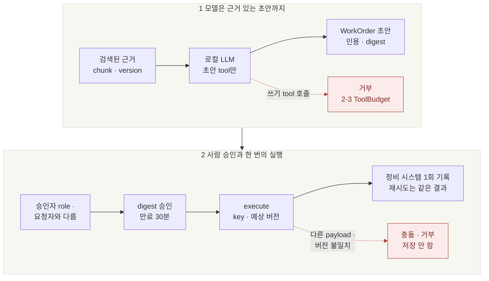

**[핵심 엔지니어링 분석 (Research & Considerations)]**

- **시스템 구성요소:** 모델이 부르는 초안 도구, 승인 UI와 승인 기록, 정비 시스템의 쓰기 API, idempotency 저장소로 나눈다. `draft_work_order`는 tenant와 요청자를 모델 인자가 아니라 gateway가 검증한 `Principal`에서 받고, 검색된 청크의 (ID, 버전)만 인용으로 받아 초안을 만들 뿐 아무것도 쓰지 않는다. 요청자를 모델이 적을 수 있으면 자기 승인 금지를 우회할 수 있기 때문이다. 승인자 identity와 role도 모델 출력이 아니라 IdP와 membership에서 오고(2-2 참조), 승인은 초안 전체를 정규화한 SHA-256 digest에 묶인다. 승인 뒤 단계 하나만 바뀌어도 digest가 달라져 실행이 거부된다.
- **핵심 고려사항과 과도한 권한:** OWASP는 LLM의 예상치 못한·모호한·조작된 출력에 반응해 피해를 주는 행동이 실행되는 취약점을 Excessive Agency로 정의하고, 원인으로 과도한 기능·권한·자율성을 든다. 대응으로 확장 기능과 권한의 최소화, 고영향 행동 전 사람 승인(human-in-the-loop), 허용 여부를 LLM이 아닌 downstream 시스템에서 판정하는 complete mediation을 제시한다. [OWASP Excessive Agency](https://genai.owasp.org/llmrisk/llm062025-excessive-agency/) 그래서 모델의 tool 목록에는 실행이 없고, 실행 API가 승인·역할·버전을 직접 다시 검사한다. 문서의 악성 지시가 모델을 움직여도 만들 수 있는 것은 승인 대기 초안뿐이다(2-3 참조).
- **멱등 실행의 규칙:** 같은 key와 같은 payload의 재시도는 저장된 결과를 돌려주고 두 번째 기록을 만들지 않으며, 같은 key에 다른 payload가 오면 충돌로 거부한다. IETF의 Idempotency-Key 작업 초안(-08)은 이 경우 422, 원 요청이 아직 처리 중이면 409, 필수 헤더가 없으면 400 응답을 권고(SHOULD)하고 UUID 같은 무작위 key를 권장한다. [IETF Idempotency-Key draft](https://datatracker.ietf.org/doc/draft-ietf-httpapi-idempotency-key-header/) Stripe API v1은 실행이 시작된 첫 요청의 상태 코드와 본문을 저장해 500 오류까지 그대로 돌려주고, 검증 실패나 동시 실행 충돌은 저장하지 않는다. [Stripe idempotent requests](https://docs.stripe.com/api/idempotent_requests) `fde/actions.py`도 거부된 요청은 저장하지 않아 원인을 고친 뒤 다시 보낼 수 있게 하고, 같은 key의 동시 요청은 lock으로 직렬화하므로 409 대신 저장된 결과를 돌려준다.
- **key 보존과 동시성:** Stripe API v1은 24시간 이상 지난 key를 자동 제거할 수 있고, 제거된 key가 다시 오면 새 요청으로 처리한다고 적는다. key만으로 중복을 막으면 보존 기간이 지난 재시도가 두 번째 작업 지시가 될 수 있으므로, 승인을 1회용으로 표시하고 초안의 기준 버전과 현재 객체 버전을 비교하는 두 번째 방어선을 둔다. 확인과 기록은 하나의 lock 안에서 수행한다. 테스트는 쓰기 단계에 20 ms 지연을 넣어 lock이 없으면 기록이 2건이 되는 조건을 만들고, 같은 key로 동시에 들어온 두 스레드가 기록 1건과 재생 1건으로 끝나는지 20회 반복해 확인한다. 실제 정비 시스템에서는 이 경계가 프로세스 lock이 아니라 DB 트랜잭션과 unique 제약이어야 한다(1-2 참조).
- **버전과 승인 만료:** 초안은 gateway가 설비 객체를 읽을 때의 버전(예: 7)을 담고 승인은 그 초안에 묶이므로, 그 사이 다른 작업이 객체를 9로 바꾸면 `StaleVersion`으로 거부된다. 같은 초안에 현재 버전만 바꿔 넣는 재시도도 막고 새 초안과 새 승인을 요구한다. 승인 유효 시간 30분은 제안값이며, 만료 전에 실행된 결과의 재시도는 만료 뒤에도 저장된 결과만 돌려준다. 요청자와 승인자가 같으면 승인 단계와 실행 단계 모두에서 `PermissionError`가 난다.
- **주장하지 않는 것:** `WorkOrderStore`는 정비 시스템의 쓰기 API를 흉내 낸 메모리 저장소이며 실제 연동이나 영속성을 증명하지 않는다. 운영에서는 승인 기록을 서버 쪽 승인 시스템에서 읽고 클라이언트가 넘긴 객체를 믿지 않는다. 2-3의 `ToolBudget`은 지금 `search`만 허용하므로 초안 도구를 gateway 허용 목록에 추가하는 일과, 실행 직전 인용 문서의 현재 권한·버전 재검증(2-2의 `revalidate_evidence`)은 통합 지점으로 남는다. 롤플레이 4처럼 첫 단계는 초안 제안과 기존 정비 시스템에서의 사람 확정으로 시작한다.

**[근거 데이터 (Evidence Data)]**

| 항목 | 값 | 근거 |
| --- | --- | --- |
| 같은 key·같은 payload 재시도 | 기록 1건 · `WO-000001` 재반환 | 코드: fde/actions.py |
| 같은 key 동시 실행 | 2 스레드 × 20회 · 매회 기록 1건 · 재생 1건 | 코드: fde/actions.py |
| 기준 버전 7 · 현재 버전 9 | `StaleVersion` · 기록 0건 | 코드: fde/actions.py |
| 모듈의 idempotency key 형식 | 16–255자 · `[A-Za-z0-9_-]` | 코드: fde/actions.py |
| Idempotency-Key 초안의 권고 응답 | 다른 payload 422 · 처리 중 409 · key 없음 400 | [IETF Idempotency-Key draft](https://datatracker.ietf.org/doc/draft-ietf-httpapi-idempotency-key-header/) |
| Stripe API v1 key 길이와 보존 | 최대 255자 · 24시간 이상 지난 key 제거 가능 | [Stripe idempotent requests](https://docs.stripe.com/api/idempotent_requests) |
| 승인 유효 시간 | 30분 | 제안값 · fde/actions.py에 고정 (현장 승인 절차 합의 후 조정) |

**[실전 코드 (Production-grade Code)]**

`fde/actions.py`의 `draft_work_order`, `approve`, `WorkOrderStore.execute`가 초안·승인·실행을 나눈다. 시각과 key는 재현 가능한 fixture이며, 저장소는 정비 시스템이 아니라 메모리 stand-in이다.

```python
from datetime import datetime, timedelta, timezone
from fde.actions import WorkOrderStore, approve, draft_work_order
from fde.retrieval import Chunk, Principal

step = "1. 펌프를 정지하고 잠금 표지를 단다."
evidence = [Chunk("manual-p101:v3:0002", 3, step, (1.0, 0.0))]   # 검색된 허용 근거
alice = Principal("acme", "alice")                                # gateway가 토큰에서 만든 값
draft = draft_work_order(alice, asset_id="P-101", asset_version=7, summary="P-101 반복 과열 점검",
                         steps=(step,), citations=(("manual-p101:v3:0002", 3),), evidence=evidence)
t0 = datetime(2026, 11, 17, 9, 0, tzinfo=timezone.utc)
ok = approve(draft, approver="park", roles={"maintenance_approver"}, now=t0)  # 30분 유효
store = WorkOrderStore("acme", {"P-101": 7})
key = "6f1c2a9e-0d4b-4c1e-9a57-3b2f8e1d4c60"
first = store.execute(draft, ok, key, expected_version=7, now=t0 + timedelta(minutes=2))
again = store.execute(draft, ok, key, expected_version=7, now=t0 + timedelta(minutes=3))
print(first, again.replayed, store.writes, store.version("P-101"))
# Result(work_order_id='WO-000001', asset_id='P-101', version=8, replayed=False) True 1 8
try:
    store.execute(draft, ok, key, expected_version=8, now=t0 + timedelta(minutes=4))
except ValueError as error:
    print(type(error).__name__, error)
# IdempotencyConflict idempotency key reused with a different payload
```

테스트는 자기 승인, 역할 없음, 만료 시각 경계, 승인 뒤 편집된 초안, 다른 tenant, 검색되지 않은 인용, 모델이 넘긴 요청자 인자, 새 key로 같은 초안을 다시 실행하는 경우를 각각 거부하는지 확인한다. 정비 시스템이 이 검사를 한 트랜잭션으로 지원하지 않으면 실행 경로를 열지 않는다.

**[발표자 노트 (Speaker Script)]**

“현장에서 작업 지시를 자동으로 만들어 달라는 요청은 자연스럽습니다. 하지만 모델에게 쓰기 도구를 주는 순간 문서 속 악성 지시나 잘못된 해석이 실제 작업 지시가 될 수 있습니다. 그래서 저는 쓰기를 세 단계로 나누겠습니다. 모델은 검색된 근거를 인용한 초안만 만들고, 정비 리더가 그 초안의 digest를 승인하고, 실행 API가 idempotency key와 예상 버전으로 한 번만 기록합니다. 네트워크가 끊겨 같은 요청이 다시 와도 저장된 결과를 돌려줄 뿐 두 번째 작업 지시를 만들지 않습니다. 같은 key에 다른 내용이 오면 충돌로 거부하고, 그사이 설비 객체가 바뀌었으면 실행하지 않고 새 초안과 새 승인을 받게 합니다. key 보존 기간이 지나도 승인이 1회용이라 같은 초안이 두 번 실행되지 않습니다. 첫 단계는 초안까지만 열고, 정비 시스템이 이 검사를 원자적으로 지원하는지 확인한 뒤에 실행 경로를 열겠습니다.”

## Frame 3-1 | Level 2 Topic Cluster | 폐쇄망을 독립적인 공급망과 운영 환경으로 설계하기

**[화면 핵심 (On-screen Message)]**

`Air-gapped Supply Chain` · **폐쇄망 공급망**

> 서명된 release manifest로 반입물의 승인 여부와 무결성을 검증한다.

- 번들 밖 신뢰 키와 승인 release ID
- 내부 OCI·모델·패키지 저장소
- 인터넷 없는 cold start 시험

**[화면 시각화 가이드 (Visual Layout)]**

전체 조감도를 거쳐 보라 영역으로 이동한다. 인터넷 연결 구역과 고객 폐쇄망 사이에 승인된 반입 지점을 하나만 둔다. 컨테이너 외에 모델·tokenizer·Python wheel·인증서·취약점 정보도 함께 이동하는 모습을 그린다. 발표 시간 2분.

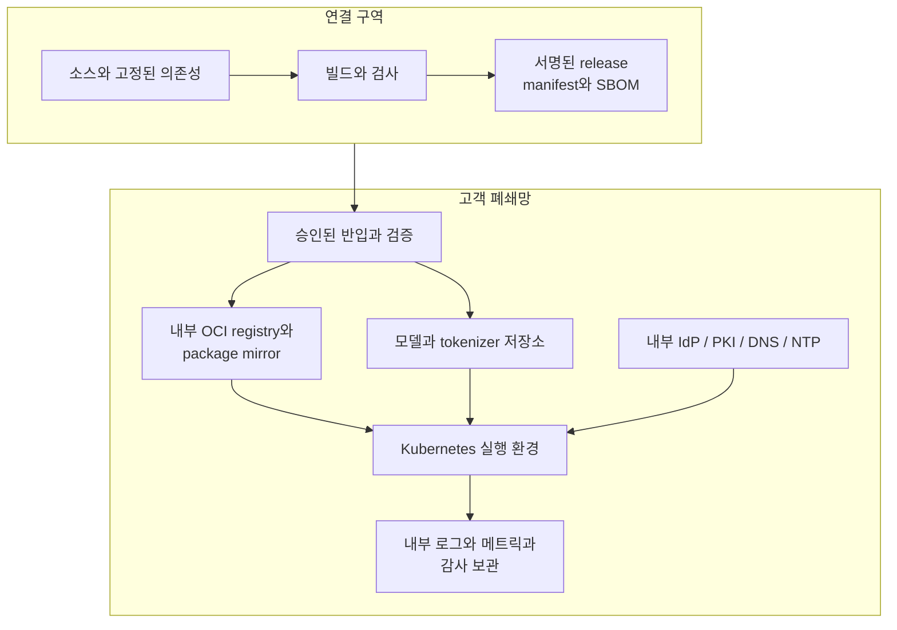

**[핵심 엔지니어링 분석 (Research & Considerations)]**

- **시스템 구성요소:** 내부 Kubernetes와 container runtime, OCI registry, package·OS mirror, 모델 저장소, 내부 인증·시간·인증서 체계, 모니터링, 백업과 복구 매체다. 클러스터 설치부터 업그레이드까지 필요한 이미지와 패키지를 포함한다.
- **핵심 고려사항:** 외부 호출을 제거해도 첫 실행에 tokenizer를 내려받거나, 인증서·라이선스 검증·telemetry가 인터넷을 요구할 수 있다. 네트워크를 실제 차단한 cold start와 재시작 시험으로 숨은 의존성을 확인한다. 모델 가중치뿐 아니라 tokenizer, config, quantization format과 라이선스도 버전 관리한다.
- **서명과 신뢰:** 해시만 번들에 같이 넣으면 공격자가 파일과 해시를 함께 바꿀 수 있다. 검증 키나 trust root는 번들 밖에서 고객에게 사전 배포한다. Sigstore를 선택하면 offline 검증에 필요한 bundle과 trust 자료를 함께 준비하고 승인된 signer identity·issuer를 확인한다. [Sigstore 검증](https://docs.sigstore.dev/cosign/verifying/verify/)
- **예제의 결정:** 실행 예제는 폐쇄망에서 테스트하기 쉬운 RSA-SHA256 서명 manifest를 OpenSSL로 확인한다. 승인된 release ID와 만료를 검사하고 각 파일의 크기·해시를 대조한다. OCI admission, 이미지 내 취약점 검사와 SBOM 검토는 별도의 배포 통제다. [OpenSSL dgst](https://docs.openssl.org/3.0/man1/openssl-dgst/)
- **용량과 운영:** 모델 크기와 KV cache, 동시 요청과 context 길이로 GPU 메모리를 산정한다. API replica를 늘리는 것만으로 추론 처리량이 늘지 않으므로 inference 큐와 GPU 사용률을 따로 본다. 패치 반입 주기, 키 철회, 인증서 만료와 비상 복구 책임자를 미리 정한다.

**[근거 데이터 (Evidence Data)]**

| 항목 | 값 | 근거 |
| --- | --- | --- |
| manifest 크기 상한 | 1,000,000 B | 코드: fde/bundle.py |
| 반입 파일 수 | 1–1,000개 | 코드: fde/bundle.py |
| manifest schema_version | 1 | 코드: fde/bundle.py |
| 파일 해시 | SHA-256 · 64 hex | 코드: fde/bundle.py |
| OpenSSL 서명 검증 시간 상한 | 10 s | 코드: fde/bundle.py |
| 테스트 서명 키 | RSA 2,048 bit | 코드: tests/test_core.py |

**[실전 코드 (Production-grade Code)]**

`fde/bundle.py`는 서명을 먼저 검증한 뒤 manifest를 파싱한다. 승인된 키와 기대 release ID는 운영자가 관리하는 별도 경로에서 읽는다. 승인되지 않은 묶음을 검증 통과시키기 위해 기대 ID를 자동으로 번들에서 가져오지 않는다.

```python
import os
from fde.bundle import verify_bundle

verified = verify_bundle(
    os.environ["RELEASE_BUNDLE_DIR"],
    public_key=os.environ["PROVISIONED_RELEASE_PUBLIC_KEY"],
    expected_release=os.environ["APPROVED_RELEASE_ID"],
)
print(verified["release_id"])
# 실제 서명 검증은 openssl dgst -sha256 -verify로 수행한다.
# manifest 서명, 만료, release ID, 파일 크기와 해시를 모두 검사한다.
# 절대 경로, 상위 경로 이탈, 중복 경로와 symlink도 거부한다.
```

반입 staging 디렉터리는 검증 중 쓰기가 차단되고, 배포는 검증된 manifest에 나열된 파일만 소비해야 한다. 해시가 맞는 파일의 안전성이나 라이선스 적합성까지 서명이 증명하는 것은 아니다.

**[발표자 노트 (Speaker Script)]**

“폐쇄망 고객에게 컨테이너 이미지를 전달했다고 배포 준비가 끝난 것은 아닙니다. 모델이 시작하면서 tokenizer를 찾거나, 인증서 갱신이 외부에 의존하면 현장에서 멈춥니다. 저는 실행에 필요한 전체 의존성 묶음과 내부 운영 서비스를 먼저 확인하겠습니다. 반입 시에는 고객이 이미 신뢰하는 키로 manifest를 검증합니다. 여기서 서명은 승인된 제작자가 이 바이트를 만들었다는 근거이고, 그 코드가 안전하다는 보증은 아닙니다. 취약점 검토와 라이선스, rollback 가능성은 별도 게이트로 두겠습니다.”

## Frame 3-2 | Level 3 Deep Dive and Code | 컨테이너 권한과 네트워크 경계를 실행 설정으로 고정하기

**[화면 핵심 (On-screen Message)]**

`Hardened Container Runtime` · **컨테이너 경계**

> 권한과 네트워크 경계를 설정으로 고정하고 실제 차단은 현장에서 확인한다.

- sha256 image digest 명시
- read-only root와 non-root 실행
- default-deny 기반 NetworkPolicy

**[화면 시각화 가이드 (Visual Layout)]**

폐쇄망의 Kubernetes 내부로 확대한다. gateway·API·DB·inference를 별도 상자로 그리고 허용된 포트만 선으로 연결한다. Internet 방향은 선을 없애고 default deny를 표시한다. API 컨테이너 안에는 non-root·read-only root·token 미마운트를 작은 태그로 붙인다. 발표 시간 3분.

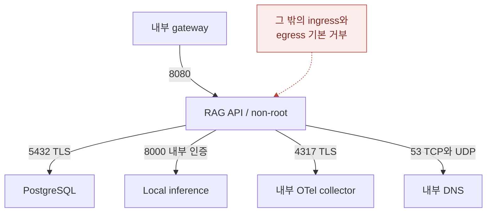

**[핵심 엔지니어링 분석 (Research & Considerations)]**

- **시스템 구성요소:** digest로 고정한 이미지, 제한된 ServiceAccount, securityContext, resource requests/limits, probes, Secret·모델 volume, default-deny NetworkPolicy와 명시적 allow 규칙이다.
- **핵심 고려사항:** Restricted Pod Security 기준의 non-root·권한 상승 금지·capability 제거·seccomp를 반영한다. read-only root filesystem도 적용하고 필요한 임시 쓰기는 제한된 emptyDir로 분리한다. Secret은 이미지나 Git에 넣지 않고 volume과 내부 자격증명 관리 체계로 전달한다. [Kubernetes Pod Security Standards](https://kubernetes.io/docs/concepts/security/pod-security-standards/)
- **네트워크와 암호화:** NetworkPolicy는 이를 구현하는 CNI가 있어야 효과가 있다. L3/L4 허용 목록은 사용자 인증이나 mTLS를 대신하지 않는다. DNS 허용만으로 외부 통신 차단의 전부를 증명하지 않으며 노드·외곽 방화벽과 내부 DNS 정책도 확인한다. [Kubernetes NetworkPolicy](https://kubernetes.io/docs/concepts/services-networking/network-policies/)
- **가용성:** liveness는 프로세스 자체의 복구 불가능 상태를 보고, 외부 DB나 inference 장애로 전체 API를 반복 재시작시키지 않는다. readiness는 새 트래픽 수용 여부를 보며 startup probe는 초기화 시간을 분리한다. GPU 모델 서버는 API와 분리해 독립적으로 큐·자원·warm-up을 관리한다.
- **배포 전제:** renderer는 이미 빌드된 API 이미지가 8080과 `/healthz`, `/readyz`를 제공한다고 가정한 배포 조각이다. 실제 IdP/gateway·DB·inference·OTel, DB TLS 자격증명 Secret `fde-db`, 모델 PVC `approved-models`, registry 인증과 상대 서비스의 운영 정책은 고객 플랫폼에 준비되어야 한다. default-deny가 적용되는 gateway의 ingress/egress와 DB 복제·백업 경로도 별도 검토한다.

**[근거 데이터 (Evidence Data)]**

| 항목 | 값 | 근거 |
| --- | --- | --- |
| 실행 UID | 10001 (non-root) | 코드: deploy/render.py |
| Restricted에서 다시 추가할 수 있는 capability | NET_BIND_SERVICE 1개 | [Kubernetes Pod Security Standards](https://kubernetes.io/docs/concepts/security/pod-security-standards/) |
| API 허용 포트 | ingress 8080 · egress 5432 · 8000 · 4317 · 53 TCP/UDP | 코드: deploy/render.py |
| requests / limits | CPU 500m · 512Mi / CPU 2 · 2Gi | 코드: deploy/render.py |
| /tmp emptyDir 상한 | 128Mi | 코드: deploy/render.py |
| startup probe 허용 시간 | 120 s | 계산: periodSeconds 5 × failureThreshold 24 (deploy/render.py) |

**[실전 코드 (Production-grade Code)]**

`deploy/render.py`는 검토된 실제 image digest를 입력받아 Namespace·ServiceAccount·Deployment·Service와 NetworkPolicy를 렌더링한다. 가짜 digest가 들어간 이미지를 실행 가능하다고 제시하지 않는다.

```python
import os
from pathlib import Path
import yaml
from deploy.render import render

documents = render(os.environ["APPROVED_IMAGE"])
Path("workload.yaml").write_text(
    yaml.safe_dump_all(documents, sort_keys=False), encoding="utf-8"
)
# APPROVED_IMAGE는 registry.internal/...@sha256:실제64자리digest 형태다.
# tag-only 입력은 거부한다. 생성물에 비밀 값은 포함하지 않는다.
# 승인된 고객 환경에서 server-side dry-run 후 배포하고 연결을 실측한다.
```

생성되는 컨테이너 설정의 핵심 부분은 다음과 같다. 전체 매니페스트는 renderer 출력에 포함된다.

```yaml
securityContext:
  allowPrivilegeEscalation: false
  readOnlyRootFilesystem: true
  capabilities:
    drop: [ALL]
resources:
  requests:
    cpu: 500m
    memory: 512Mi
  limits:
    cpu: "2"
    memory: 2Gi
```

**[발표자 노트 (Speaker Script)]**

“제가 이 YAML에서 먼저 설명할 것은 replica 수보다 경계입니다. API에는 Kubernetes 관리 권한이 필요하지 않으므로 ServiceAccount 토큰을 자동으로 넣지 않습니다. 컨테이너는 root로 실행하지 않고, 필요한 임시 경로 외에는 쓰기를 제한합니다. 네트워크도 목적지와 포트를 명시합니다. 다만 이 파일이 문법적으로 맞는 것과 CNI가 실제 통신을 차단하는 것은 다른 검증입니다. 고객 환경에서는 허용 경로가 연결되고 금지된 외부 경로가 실패하는지 직접 확인하겠습니다. probe도 의존 서비스 장애 때 재시작 폭풍을 만들지 않게 나누겠습니다.”

## Frame 3-3 | Level 3 Deep Dive and Code | PII를 줄이고 감사 추적을 업무 경계에 남기기

**[화면 핵심 (On-screen Message)]**

`Privacy Minimization and Auditing` · **PII와 감사**

> 필드 최소화와 HMAC 가명처리로 검색 projection과 감사 기록의 노출 위험을 줄인다.

- 정형 연락처 필드 마스킹
- 자유 텍스트 PII의 표본 평가
- 원문 없는 감사 outbox와 별도 보관소

**[화면 시각화 가이드 (Visual Layout)]**

문서가 검색 인덱스로 넘어가는 경계와 API가 감사 기록을 남기는 경계를 나란히 확대한다. 원문에는 연락처가 있고 검색 projection에는 마스킹된 값만 남게 한다. 로그에 원문 질문·응답·토큰이 들어가는 화살표는 차단한다. 발표 시간 3분.

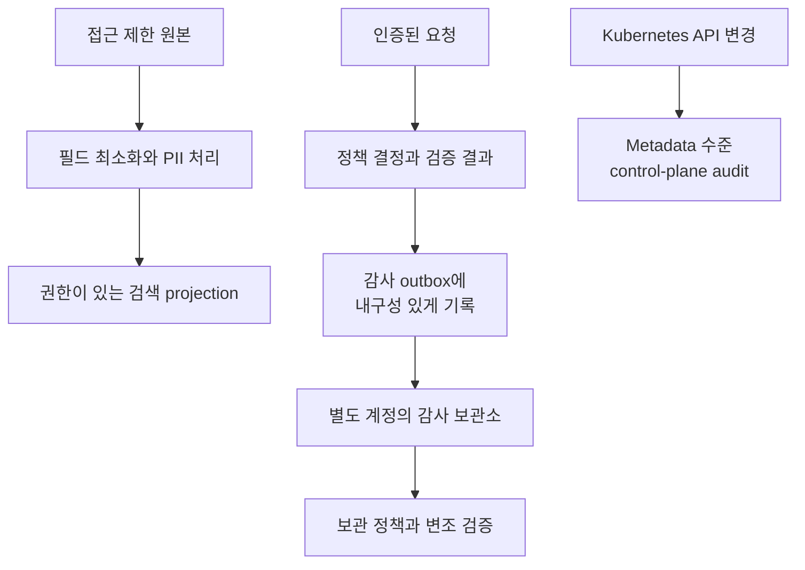

**[핵심 엔지니어링 분석 (Research & Considerations)]**

- **시스템 구성요소:** 데이터 분류, 구조화 필드 allowlist, 도메인별 PII recognizer, 암호화된 제한 원본, 검색 projection, application audit outbox, 별도 audit sink와 Kubernetes API audit를 구분한다.
- **핵심 고려사항:** 정형 연락처 필드는 처음부터 제외하거나 마스킹한다. 자유 텍스트는 recognizer·NER·도메인 룰로 검사하고 표본 평가한다. regex나 Presidio를 사용해도 모든 개인정보 탐지를 보장할 수 없다. 한국어 이름과 OCR 깨짐은 별도 검증 대상이다. [Presidio FAQ](https://github.com/data-privacy-stack/presidio/blob/main/docs/faq.md)
- **로그 최소화:** trace에는 latency·오류 코드·artifact version 등 허용된 항목만 남긴다. 질문·본문·응답·Authorization header를 기본 수집하지 않는다. 작은 식별자 공간의 단순 SHA256은 역추정될 수 있어, 예제는 별도 키와 key ID가 있는 HMAC을 사용한다. 이것은 익명화가 아닌 가명처리다. [OpenTelemetry 민감정보 처리](https://opentelemetry.io/docs/security/handling-sensitive-data/)
- **감사 설계:** 누가 어떤 정책·문서·모델 버전으로 무엇을 읽거나 거부당했는지 추적한다. 예제의 최소 이벤트에는 가명 actor·tenant, request ID, 판정과 artifact digest를 넣는다. 실제 문서 접근 이벤트를 추가할 때도 문서 ID·정책 버전을 allowlist로 확장하고 원문은 넣지 않는다.
- **내구성과 변조:** 수집 상태 변경은 outbox와 함께 commit한다. 민감한 업무 action이나 접근 응답도 정책상 감사 내구성이 필요하면 기록 실패 시 성공으로 응답하지 않는다. DB outbox는 WORM이 아니므로 exporter가 별도 계정의 보관소에 전달하고 수신 ACK 전에는 버리지 않는다. hash chain만으로 꼬리 삭제까지 탐지할 수 없으므로 외부에 보관한 서명 checkpoint나 WORM 정책이 필요하다.
- **계층 분리:** Kubernetes audit는 API server 작업을 기록하며 앱 내부 문서 조회의 대체물이 아니다. Secret 내용이 로그로 복제되지 않도록 Metadata 수준을 사용한다. [Kubernetes Auditing](https://kubernetes.io/docs/tasks/debug/debug-cluster/audit/)

**[근거 데이터 (Evidence Data)]**

| 항목 | 값 | 근거 |
| --- | --- | --- |
| HMAC 키 최소 길이 | 32 B | 코드: fde/privacy.py |
| key ID 형식 | 1–40자 `[A-Za-z0-9_-]` | 코드: fde/privacy.py · tests/test_field_kit.py |
| 가명 길이 | 64 hex (HMAC-SHA256) | 코드: fde/privacy.py · fde/provenance.py |
| 감사 decision 값 | 4종 (allow · deny · abstain · error) | 코드: fde/privacy.py |
| Kubernetes audit level | 4단계 (None · Metadata · Request · RequestResponse) | [Kubernetes Auditing](https://kubernetes.io/docs/tasks/debug/debug-cluster/audit/) |
| control-plane audit 규칙 | 3개, 모두 Metadata (RequestReceived stage 생략) | 코드: deploy/audit-policy.yaml |

**[실전 코드 (Production-grade Code)]**

아래는 최소화·가명처리의 실행 예다. key는 실습에서만 임시 생성하고, 운영에서는 KMS가 관리하는 키와 교체 절차를 사용한다. `audit_record`는 임의 payload를 받아 그대로 로그에 흘리지 않도록 인자를 제한한다.

```python
import secrets
from fde.privacy import audit_record, mask_contact_fields

projection = mask_contact_fields({
    "asset_id": "00000000-0000-0000-0000-000000000001",
    "contact_email": "engineer@example.com",
    "contact_phone": "010-1234-5678",
    "unapproved_notes": "이 필드는 projection에서 제외됩니다",
})
event = audit_record(
    key=secrets.token_bytes(32), key_id="lab-only-v1",
    tenant="acme", subject="engineer@example.com",
    request_id="00000000-0000-0000-0000-000000000002",
    decision="allow", artifact_digest="sha256:" + "a" * 64,
)
print(projection["contact_email"], event["decision"])
# digest는 검증용 fixture다. 운영에서는 현재 배포 artifact digest를 넣는다.
# audit event를 실제 저장하는 호출은 해당 업무 트랜잭션 안에서 수행한다.
```

**[발표자 노트 (Speaker Script)]**

“폐쇄망이라고 해서 내부 로그에 모든 데이터를 남겨도 되는 것은 아닙니다. 장애를 분석하려고 저장한 prompt나 문서 본문이 더 넓은 권한의 로그 시스템으로 복제될 수 있습니다. 저는 먼저 필요한 필드만 projection에 넣고, 감사 기록도 정해진 필드만 받게 하겠습니다. 연락처를 가린다고 모든 PII가 제거되는 것은 아니므로 자유 텍스트 탐지는 고객 언어와 문서로 평가합니다. 감사 기록은 일반 디버그 로그와 보관 권한을 분리하겠습니다. 그리고 중요한 작업은 감사 기록이 내구성 있게 저장되지 않으면 업무 처리도 성공으로 응답하지 않겠습니다.”

## Frame 3-4 | Level 3 Deep Dive and Code | SBOM과 VEX로 폐쇄망 안에서 취약점 영향을 판정하기

**[화면 핵심 (On-screen Message)]**

`Offline SBOM & VEX` · **오프라인 취약점**

> SBOM과 반입한 advisory를 대조하고, 판정할 수 없는 쌍은 미해결로 남긴다.

- purl@version과 SemVer 범위 대조
- not_affected에는 근거·영향 설명 필수
- 공개일 기준 기한과 초과 시 차단

**[화면 시각화 가이드 (Visual Layout)]**

보라 영역의 3-1 반입 지점에서 `서명된 release manifest와 SBOM` 상자로 확대한다. 첫 띠에는 서명된 묶음에서 꺼낸 CycloneDX SBOM과 오프라인 OSV feed가 purl과 SemVer 범위로 만나는 판정을, 둘째 띠에는 VEX 진술이 상태를 정하고 공개일 기준 기한이 release 차단으로 이어지는 흐름을 둔다. PyPI처럼 SemVer가 아닌 범위는 붉은 점선으로 `unevaluated` 상자에 보내 추측하지 않음을 보이고, 근거 없는 not_affected 진술도 붉은 상자에서 거부한다. 발표 시간 3분.

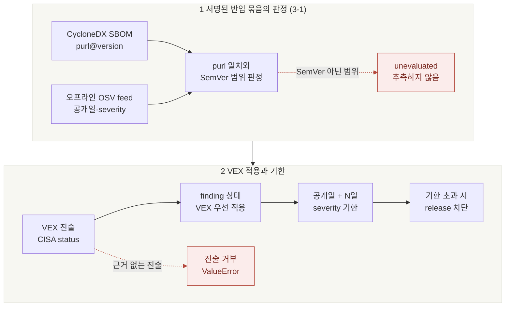

**[핵심 엔지니어링 분석 (Research & Considerations)]**

- **시스템 구성요소:** 3-1이 별도 배포 통제로 남긴 SBOM 검토를 반입 묶음 안에서 수행한다. 서명된 release 묶음에 CycloneDX SBOM, 같은 반입 주기에 들여온 OSV 형식 advisory feed, 공급자나 내부 보안팀이 작성한 VEX 진술을 함께 넣는다. `fde/sbom.py`는 CycloneDX 1.6의 `bomFormat`·`specVersion`과 component의 name·version·purl만 읽고, purl의 버전이 component 버전과 다르거나 중첩 component가 있으면 거부한다. CycloneDX는 component version이 semantic versioning을 따르기를 권하지만 강제하지 않으므로 버전 문자열을 그대로 믿고 비교하지 않는다. [CycloneDX 1.6 JSON](https://cyclonedx.org/docs/1.6/json/)
- **핵심 고려사항과 버전 비교:** OSV의 SEMVER 범위는 SemVer 2.0.0 11절의 우선순위를 따르며 앞에 `v`를 붙이지 않는다. 같은 스키마에서 ECOSYSTEM 범위는 생태계별 문자열이고, SemVer를 권장만 하고 강제하지 않는 생태계는 ECOSYSTEM을 쓰라고 한다. PEP 440으로 승인된 Python 배포판의 버전 명세는 SemVer의 hyphen pre-release와 plus build 표기를 public version에 허용하지 않으므로 SemVer 비교기로 대신할 수 없다. 예제 모듈은 SEMVER 범위만 계산하고, ECOSYSTEM·GIT 범위와 SemVer가 아닌 component 버전은 `versions` 목록에 정확히 있으면 affected, 없으면 `unevaluated`로 남긴다. 판정 불가를 not affected로 바꾸면 취약점이 기록 없이 사라지기 때문이다. [OSV schema](https://ossf.github.io/osv-schema/) · [SemVer 2.0.0](https://semver.org/spec/v2.0.0.html) · [Python version specifiers](https://packaging.python.org/en/latest/specifications/version-specifiers/)
- **범위 평가:** OSV 문서의 평가 의사코드처럼 event를 버전 순으로 정렬해 `introduced` 이상이면 영향, `fixed` 이상이면 해제, `last_affected` 초과면 해제한다. `introduced: "0"`은 모든 버전보다 앞서고, 한 범위에 `fixed`와 `last_affected`를 함께 둘 수 없다. 번호형 범위에 쓰지 말라는 `limit` event는 거부하고, 철회(withdrawn)된 advisory는 finding을 만들지 않는다. 범위 없이 `versions`만 나열한 항목은 의사코드대로 목록과 정확히 일치할 때만 affected다. 단위 테스트는 OSV 문서의 다중 범위 예인 [1.0.0, 1.0.2)·[3.0.0, 3.2.5)의 경계값을 고정한다.
- **VEX와 책임:** CISA 최소 요구사항의 status는 not_affected·affected·fixed·under_investigation 네 가지다. not_affected에는 다섯 가지 justification 중 하나를 권장하고, 없으면 impact statement가 반드시 있어야 하며, affected에는 action statement가 필요하다. 모듈은 이 규칙을 진술 생성 시점에 강제하고, 진술을 advisory ID와 purl@version 쌍에 묶어 버전이 바뀌면 다시 판정되게 한다. CycloneDX 1.6의 analysis justification은 `code_not_reachable` 등 9개 값으로 CISA의 5개 목록과 이름·개수가 다르므로 변환표를 따로 검토한다. [CISA VEX 최소 요구사항](https://www.cisa.gov/sites/default/files/2023-04/minimum-requirements-for-vex-508c.pdf) · [CycloneDX 1.6 JSON](https://cyclonedx.org/docs/1.6/json/)
- **기한과 반입 주기:** severity별 기한인 critical 7일, high 30일, medium 90일, low 180일과 등급 미상(unknown) 7일은 고객 보안 담당자와 합의할 제안값이며 표준 값이 아니다. 등급은 CVSS 벡터 등을 담는 OSV 표준 `severity`가 아니라, 의미를 각 DB가 정하는 `database_specific`에 feed 계약으로 둔 `severity` 값에서 읽는다. 기한은 반입일이 아니라 advisory의 `published`부터 세므로, feed를 한 달에 한 번 반입하면 critical 기한은 다음 반입 전에 이미 지날 수 있다. 따라서 반입 주기를 가장 짧은 기한보다 짧게 잡거나 긴급 반입 절차를 따로 합의한다. 기한이 지난 미해결 finding(affected·under_investigation·unevaluated)은 `report.blocking`으로 따로 나오며, release 승인 절차에서 보안 담당자가 확인하는 별도 차단 입력이 된다. 4-2의 품질 gate(`fde/release_gate.py`)는 이 입력을 받지 않으므로, 이 저장소는 두 판정을 하나의 승격 gate로 묶었다고 주장하지 않는다.
- **검증 범위와 한계:** 이 모듈은 이미지 안의 파일을 스캔해 SBOM을 만들지 않으므로 SBOM이 빠뜨린 component는 판정할 수 없다. purl은 문자열 그대로 비교하므로, SBOM 생성기와 feed 변환기의 purl 표기(대소문자, 이름 정규화, namespace 인코딩)가 다르면 finding 없이 일치를 놓친다. 두 누락은 실제 이미지 표본과 알려진 advisory로 대조해 따로 확인한다. 예제의 패키지와 `x_` 접두사 advisory는 가상이며 실제 취약점 정보가 아니고, OSV는 OSV.dev가 집계하지 않는 로컬 DB의 ID에 `x_` 접두사를 쓸 수 있게 한다.

**[근거 데이터 (Evidence Data)]**

| 항목 | 값 | 근거 |
| --- | --- | --- |
| VEX status | 4종 | [CISA VEX 최소 요구사항](https://www.cisa.gov/sites/default/files/2023-04/minimum-requirements-for-vex-508c.pdf) |
| not_affected 근거 | justification 5종 중 1개 또는 impact statement | [CISA VEX 최소 요구사항](https://www.cisa.gov/sites/default/files/2023-04/minimum-requirements-for-vex-508c.pdf) |
| SEMVER 범위 비교 | SemVer 2.0.0 11절 precedence | [OSV schema](https://ossf.github.io/osv-schema/) |
| critical · high 기한 | 7일 · 30일 | 제안값 · fde/sbom.py에 고정 (보안 담당자 합의 후 조정) |
| 예제 high finding 마감 | 2026-10-31 (공개일 + 30일) | 코드: fde/sbom.py |
| 예제 PyPI 미판정 마감 | 2026-12-30 (공개일 + 90일) | 코드: fde/sbom.py |

**[실전 코드 (Production-grade Code)]**

`fde/sbom.py`로 가상의 SBOM·feed·VEX를 판정한다. 세 advisory는 모두 2026-10-01에 공개됐다고 두었다. fixture의 판정일(`as_of`) 2026-11-16에는 high 기한이 지난 affected 한 건만 차단 대상이고, VEX로 근거를 댄 critical은 not_affected, PEP 440 버전을 쓰는 PyPI 패키지는 unevaluated로 남는다.

```python
import json
from datetime import date
from fde.sbom import VexStatement, assess, parse_feed, parse_sbom
def lib(name, version, kind="npm"):
    return {"type": "library", "name": name, "version": version,
            "purl": f"pkg:{kind}/{name}@{version}"}
def osv(vid, eco, name, kind, fixed, severity):   # x_ 접두사 = 로컬 DB용 가상 advisory
    package = {"ecosystem": eco, "name": name, "purl": f"pkg:{eco.lower()}/{name}"}
    return {"id": vid, "modified": "2026-10-01T00:00:00Z", "published": "2026-10-01T00:00:00Z",
            "database_specific": {"severity": severity}, "affected": [{"package": package,
            "ranges": [{"type": kind, "events": [{"introduced": "0"}, {"fixed": fixed}]}]}]}
sbom = parse_sbom(json.dumps({"bomFormat": "CycloneDX", "specVersion": "1.6", "components": [
    lib("fixture-pdf", "2.4.1"), lib("fixture-zip", "3.1.0"), lib("fixture-ocr", "1.8", "pypi")]}))
feed = parse_feed([osv("x_FIXTURE-0001", "npm", "fixture-pdf", "SEMVER", "2.4.3", "high"),
                   osv("x_FIXTURE-0002", "npm", "fixture-zip", "SEMVER", "3.2.0", "critical"),
                   osv("x_FIXTURE-0003", "PyPI", "fixture-ocr", "ECOSYSTEM", "1.9", "medium")])
vex = [VexStatement("x_FIXTURE-0002", "pkg:npm/fixture-zip@3.1.0", "not_affected",
                    justification="Vulnerable_code_not_in_execute_path")]
report = assess(sbom, feed, vex, as_of=date(2026, 11, 16))
for f in report.findings:
    print(f.advisory, f.status, f.due, f in report.blocking)
# x_FIXTURE-0001 affected 2026-10-31 True
# x_FIXTURE-0003 unevaluated 2026-12-30 False
# x_FIXTURE-0002 not_affected None False
```

모듈은 OSV 필수 필드(`id`·`modified`·package의 `ecosystem`·`name`)에 더해 `published`·`affected[].package.purl`·`database_specific.severity`가 없는 레코드를 거부한다. 그 밖의 필드는 읽지 않으므로 실제 feed는 반입할 때 OSV JSON schema로 전체를 검증한다. unevaluated가 기한 안에 해소되려면 PEP 440 비교기를 검토해 추가하거나 보안 담당자가 VEX 진술을 작성해야 한다.

**[발표자 노트 (Speaker Script)]**

“폐쇄망에서는 스캐너가 인터넷의 취약점 DB를 조회할 수 없으므로, 판정에 쓰는 자료도 실행물과 함께 반입해야 합니다. 저는 서명된 묶음에 SBOM과 오프라인 advisory feed, 그리고 VEX 진술을 함께 넣겠습니다. 판정은 purl과 버전으로 하되, SemVer가 아닌 버전을 SemVer처럼 비교하지 않겠습니다. 예를 들어 PyPI 패키지는 비교 규칙이 달라서 이 예제에서는 미판정으로 남기고, 그 상태도 기한이 흐르는 미해결로 셉니다. 영향이 없다는 진술에는 CISA가 정한 근거나 영향 설명을 요구하고, 버전이 바뀌면 그 진술을 자동으로 이어 쓰지 않습니다. 기한은 advisory 공개일부터 세기 때문에 한 달에 한 번 반입하면 critical 기한은 이미 지나 있을 수 있습니다. 그래서 반입 주기와 긴급 반입 절차를 고객 보안 담당자와 먼저 합의하겠습니다. 이 판정은 SBOM에 있는 component만 다루므로, SBOM 생성 누락은 실제 이미지 표본으로 따로 확인하겠습니다.”

## Frame 3-5 | Level 3 Deep Dive and Code | 가명처리 키와 서명 키를 회전해도 과거 기록을 검증하기

**[화면 핵심 (On-screen Message)]**

`Key Rotation` · **키 회전**

> 새 기록은 active 키 하나로 만들고, 과거 기록은 당시의 키로 검증한다.

- 목적별 active 키는 시점마다 하나
- 기록의 key ID와 당시 키로 가명 재계산
- 보관 기간이 끝난 뒤에만 키 파기

**[화면 시각화 가이드 (Visual Layout)]**

보라 영역의 3-3 감사 기록에서 `key_id` 필드로 확대한다. 첫 띠는 cryptoperiod 제안값으로 만든 회전 계획이 새 키를 활성화 14일 전까지 모든 replica에 배포하고, 시점마다 active 키 하나만 새 가명을 만드는 흐름이다. 둘째 띠는 과거 기록의 key ID와 event 시각으로 당시 키를 찾아 가명을 다시 계산하고, 보관 기간이 끝난 키만 파기하는 흐름이다. 회전 뒤에도 옛 키를 쓰는 replica와 당시 active가 아니던 키를 지목한 기록은 붉은 점선으로 거부 상자에 보낸다. 발표 시간 3분.

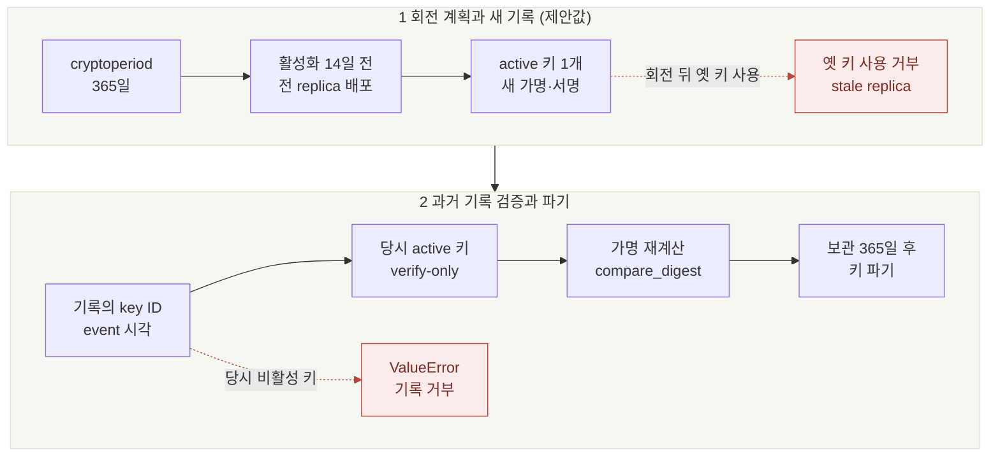

**[핵심 엔지니어링 분석 (Research & Considerations)]**

- **시스템 구성요소:** 키 원장(keyring)은 purpose별 key version의 시간표다. 각 항목은 key ID, 활성 시각, 새 보호를 멈추는 `retires_at`, 검증을 멈추는 `verify_until`과 실습용 키 바이트 또는 KMS·HSM reference를 갖는다. key ID는 `fde/privacy.py`와 `fde/provenance.py`가 검사하는 1~40자 형식과 같아서 3-3의 감사 이벤트와 5-2의 재현 기록에 그대로 남는다. 서명 purpose 항목에는 키 바이트를 넣을 수 없고, 3-1처럼 번들 밖 경로로 사전 배포한 공개 검증 키의 reference만 둔다.
- **핵심 고려사항과 사용 기간:** NIST SP 800-57은 키로 새 보호를 적용하는 originator-usage period와 보호된 정보를 처리하는 recipient-usage period를 나눈다. 대칭 MAC 키(symmetric authentication key)에는 originator-usage 2년 이하, recipient-usage는 그 종료 후 3년 이하를 권고하며, originator-usage가 끝난 키로 새 MAC을 계산하지 않는다. 비활성(deactivated) 상태의 대칭 키는 originator-usage 안에서 적용된 보호만 recipient-usage 끝까지 처리할 수 있고, `key_for_record`가 이 조건을 검사한다. HMAC 가명처리 키는 이 키 유형과 용도가 같지 않으므로 이 권고는 상한 참고로만 쓴다. [NIST SP 800-57 Part 1 Rev. 5](https://nvlpubs.nist.gov/nistpubs/SpecialPublications/NIST.SP.800-57pt1r5.pdf)
- **불변식:** purpose마다 활성 구간 `[activates_at, retires_at)`이 빈틈과 겹침 없이 이어져야 Keyring이 만들어지므로, 계획 구간 안의 어느 시점에도 새 가명을 만드는 키는 하나다. 계획이 끝나 active 키가 없으면 다른 키로 대신하지 않고 `PermissionError`로 멈춘다. 3-3의 원칙대로 감사 기록이 필요한 작업도 함께 멈추므로, 마지막 `retires_at` 전에 다음 계획을 반입하도록 경보를 건다. 회전 뒤에도 옛 키를 캐시해 쓰는 replica는 `require_active`가 거부한다.
- **회전 절차와 overlap:** Kubernetes의 저장 데이터 암호화 키 회전은 새 키를 모든 control plane에 두 번째 키로 추가하고 재시작한 뒤에야 첫 번째 키로 올려 새 쓰기에 사용하고, 기존 Secret을 새 키로 다시 쓴 다음에 옛 키를 제거한다. 같은 이유로 회전 계획은 새 키를 활성화 14일 전(제안값)까지 모든 replica와 검증자에 배포한다. 다만 가명 기록에는 원래 식별자가 없어 새 키로 다시 쓸 수 없으므로, 옛 키를 verify-only로 보관 기간 끝까지 유지한다. 4-3의 rollback 대상 release 묶음을 다시 검증하려면 그 서명 검증 키도 같은 방식으로 verify-only 기간 안에 있어야 한다. [Kubernetes 저장 데이터 암호화](https://kubernetes.io/docs/tasks/administer-cluster/encrypt-data/)
- **파기와 감사:** OWASP는 비밀 키와 개인 키가 복호화·복구에 더 이상 필요 없고 보관 요구도 충족되면 백업·보관 사본까지 모두 파기하고, 공개 검증 키는 보관된 서명의 검증을 위해 남길 수 있다고 설명한다. HMAC 가명 키를 파기하면 감사자를 포함한 누구도 그 키로 만든 가명을 다시 계산해 사용자와 연결할 수 없어서, “이 사용자의 지난해 접근” 같은 감사 질의에 답할 수 없게 된다. 그래서 `destroy`는 `verify_until` 이전의 파기를 거부하고, 보관이 끝난 키는 `due_for_destruction`으로 보여준다. 키 하나로 만든 첫 기록은 cryptoperiod 365일과 보관 365일을 더한 730일 동안 연결 가능하므로, 연결 가능 기간을 줄이려면 cryptoperiod를 줄인다. [OWASP Key Management](https://cheatsheetseries.owasp.org/cheatsheets/Key_Management_Cheat_Sheet.html)
- **검증 범위와 한계:** event 시각은 기록 자신의 주장이므로 감사 보관소의 수신 시각이나 서명 checkpoint와 대조해야 시각을 앞당긴 위조를 막는다(3-3 참조). 회전 경계를 넘는 사용자 이력은 기간별 키로 가명을 각각 계산해 합친다. 키 유출 시의 긴급 회전, KMS 연동, 3-1 manifest에 서명 key ID를 기록하는 일은 이 모듈 밖의 운영 절차다. 365일·14일·보관 365일은 모두 고객 감사 규정으로 교체할 제안값이다.

**[근거 데이터 (Evidence Data)]**

| 항목 | 값 | 근거 |
| --- | --- | --- |
| MAC 키 originator-usage 권고 | 2년 이하 | [NIST SP 800-57 Part 1 Rev. 5](https://nvlpubs.nist.gov/nistpubs/SpecialPublications/NIST.SP.800-57pt1r5.pdf) |
| MAC 키 recipient-usage 권고 | originator-usage 종료 후 3년 이하 | [NIST SP 800-57 Part 1 Rev. 5](https://nvlpubs.nist.gov/nistpubs/SpecialPublications/NIST.SP.800-57pt1r5.pdf) |
| 가명 키 최소 길이 | 32 B | 코드: fde/keyring.py |
| cryptoperiod · 보관 · 배포 리드 | 365일 · 365일 · 14일 | 제안값 · 고객 감사 규정으로 교체 |
| 예제 v1 verify_until | 2028-11-30 | 코드: fde/keyring.py |
| 첫 기록의 연결 가능 기간 | 730일 | 계산: cryptoperiod 365일 + 보관 365일 |

**[실전 코드 (Production-grade Code)]**

`fde/keyring.py`로 2026-12-01부터 365일 주기의 가명 키 두 개를 계획하고, `fde/privacy.py`의 `audit_record`로 감사 이벤트를 만든다. 2027-03-02의 기록은 v1로 만들어진다. 회전 뒤인 2028-02-01에는 새 기록이 v2를 쓰지만, 과거 기록은 verify-only 상태의 v1로 같은 가명을 다시 계산한다.

```python
import hmac
import secrets
from datetime import datetime, timedelta, timezone
from fde.keyring import Keyring, KeyVersion, plan_rotation
from fde.privacy import audit_record
def t(*ymd):
    return datetime(*ymd, tzinfo=timezone.utc)
day = timedelta(days=1)
steps = plan_rotation("pii-hmac", start=t(2026, 12, 1), count=2,       # 제안값
                      cryptoperiod=365 * day, retention=365 * day, lead=14 * day)
ring = Keyring(tuple(KeyVersion("pseudonym", s.key_id, s.activates_at, s.retires_at,
                                s.verify_until, material=secrets.token_bytes(32)) for s in steps))
def actor(key):   # 실습용 키. 운영에서는 KMS reference로 HMAC을 계산한다.
    return audit_record(key=key.material, key_id=key.key_id, tenant="busan",
                        subject="engineer-17", request_id="00000000-0000-0000-0000-000000000002",
                        decision="allow", artifact_digest="sha256:" + "a" * 64)
event = actor(ring.active_key("pseudonym", t(2027, 3, 2)))
now = t(2028, 2, 1)
old = ring.key_for_record("pseudonym", event["key_id"], t(2027, 3, 2), now=now)
same = hmac.compare_digest(actor(old)["actor_hash"], event["actor_hash"])
print(event["key_id"], ring.active_key("pseudonym", now).key_id, old.state(now), same)
print([s.verify_until.date().isoformat() for s in steps])
# pii-hmac-v1 pii-hmac-v2 verify-only True
# ['2028-11-30', '2029-11-30']
```

키 바이트는 실행마다 새로 만드는 실습용 값이며 출력의 key ID·상태·날짜만 고정된다. 고정 일수 365일을 쓰므로 2028년 2월 29일이 낀 구간은 달력보다 하루 일찍 끝난다. v1의 보관 기간과 v2의 활성 기간이 모두 2028-11-30에 끝나서 출력의 verify_until은 12월 1일이 아니라 11월 30일이다. 이 모듈은 키를 생성·보관하지 않으며, 운영에서는 고객 KMS가 키를 보관하고 HMAC 계산도 그 안에서 수행하는 구성을 검토한다.

**[발표자 노트 (Speaker Script)]**

“감사 기록의 가명은 키를 바꾸는 순간 과거 기록과 연결이 끊길 수 있습니다. 그래서 저는 기록마다 key ID를 남기고 키 원장을 시간표로 관리하겠습니다. 어느 시점이든 새 가명을 만드는 키는 하나뿐이고, 옛 키는 보관 기간 동안 검증 전용으로만 남깁니다. 과거 기록을 확인할 때는 그 기록 시각에 실제로 활성 상태였던 키인지부터 검사합니다. 새 키는 활성화 전에 모든 replica에 배포하고, 회전 뒤에도 옛 키를 쓰는 인스턴스는 거부합니다. 키를 파기하면 감사자도 그 기간의 가명을 사용자와 다시 연결할 수 없으므로, 보관 기간이 끝나기 전에는 파기하지 않겠습니다. 365일 주기와 보관 기간은 제가 정할 값이 아니라 고객 보안·감사 담당자와 합의할 제안값입니다.”

## Frame 4-1 | Level 2 Topic Cluster | 10일 안에 수직 MVP를 만들고 운영 조건을 합의하기

**[화면 핵심 (On-screen Message)]**

`Ten-day Vertical MVP` · **10일 수직 MVP**

> 범위는 단일 공장으로 줄이되 ACL과 provenance는 미루지 않는다.

- 첫날 접근권한과 데이터 owner 확인
- 일자별 진입 조건이 있는 10일 제안 일정
- 운영 owner·온콜·rollback 담당자에게 인계

**[화면 시각화 가이드 (Visual Layout)]**

조감도를 거쳐 주황 영역으로 이동한다. 10일 timeline을 1주차(범위·데이터·권한·검색)와 2주차(응답·배포·운영·공개) 두 띠로 나누어, 업무 성공 기준에서 작은 수직 경로·평가·제한 공개·운영 인계로 가는 순서를 일자별로 보인다. 마지막에는 사용 결과와 장애 피드백으로 범위를 다시 합의하는 다음 반복을 붙인다. scope를 넓히는 일과 운영 수준을 높이는 일을 같은 일정에 섞지 않는다. 발표 시간 2분.

```mermaid
flowchart TB
  subgraph W1["1주차 · 범위 · 데이터 · 권한 · 검색"]
    direction LR
    D1["D1<br/>과제 · owner<br/>접근 경로"] --> D2["D2<br/>표본 ·<br/>identity 매핑"] --> D3["D3<br/>멱등 수집 ·<br/>삭제 처리"] --> D4["D4<br/>IdP ·<br/>serving ACL"] --> D5["D5<br/>hybrid 비교 ·<br/>holdout"]
  end
  subgraph W2["2주차 · 응답 · 배포 · 운영 · 공개"]
    direction LR
    D6["D6<br/>인용 응답 ·<br/>read-only 도구"] --> D7["D7<br/>반입 묶음 ·<br/>내부 배포"] --> D8["D8<br/>관측 · 감사 ·<br/>복구 runbook"] --> D9["D9<br/>shadow ·<br/>현장 리뷰"] --> D10["D10<br/>제한 공개 ·<br/>운영 인계"]
  end
  N["다음 반복<br/>사용 결과와 장애 피드백으로 D1 범위 재합의"]
  W1 --> W2 --> N
  style W1 fill:#f7f7f2,stroke:#dedfd5,stroke-width:1px
  style W2 fill:#f7f7f2,stroke:#dedfd5,stroke-width:1px
```

**[핵심 엔지니어링 분석 (Research & Considerations)]**

- **시스템 구성요소:** 고객 업무 담당자, 데이터 owner, 보안·플랫폼 담당자, FDE가 같은 backlog와 수용 기준을 공유한다. 결정 기록에는 선택, 버린 대안, 이유와 재검토 조건을 적는다.
- **핵심 고려사항:** 속도를 위해 문서 범위를 줄일 수는 있지만 ACL과 데이터 provenance를 나중으로 미루지 않는다. 첫 주부터 실제 배포 경로와 평가용 질의를 사용해야 노트북 전용 데모에서 벗어날 수 있다.
- **고객 협업:** 첫날 접근권한과 데이터 owner가 확보되지 않으면 일정의 임계경로가 바뀐다. 합성 데이터로 UI·계약·배포를 진행하되 실제 데이터 통합 완료라고 부르지 않는다. 두 주는 제한 MVP의 시간 상자이며 전체 운영 승인의 마감 보장이 아니다.
- **전환 결정:** 앱 계층은 하나의 작고 관측 가능한 서비스로 시작하고 DB·모델 서버는 별도 경계로 둔다. 트래픽, 조직 소유권이나 배포 주기가 실제로 갈라질 때 서비스 분리를 재검토한다.

| 일자 | 현장에서 만드는 결과 | 다음 단계 진입 조건 |
| --- | --- | --- |
| 1 | 사용자 업무 1개, 기준 과제, 데이터·보안 owner, 접근 경로 | 성공·보류·거부의 의미와 범위 합의 |
| 2 | ERP·정비 API·문서 manifest의 작은 표본, identity 매핑 | 연결 대상과 authoritative source 확인 |
| 3 | 계약 검증·멱등 수집·삭제 처리 | 재전송·역순·복구 테스트 통과 |
| 4 | IdP 연계와 serving ACL | 다른 tenant와 role의 부정 접근 차단 |
| 5 | lexical 기준선과 hybrid 비교, 고정 holdout | 모델 선택 전 검색 실패 원인 분류 |
| 6 | 인용 응답·보류·read-only 도구 | 근거 없는 출력과 도구 인자 거부 |
| 7 | 반입 묶음과 내부 배포 설정 | 인터넷 차단 cold start와 재시작 확인 |
| 8 | 관측·감사·백업·복구 runbook | 실제 복구 시간과 누락 범위 기록 |
| 9 | shadow 실행과 현장 전문가 리뷰 | 업무 과제별 품질·지연 게이트 충족 |
| 10 | 제한 공개, 이관 자료, 다음 backlog | 운영 owner·온콜·rollback 담당자에게 인계 |

**[근거 데이터 (Evidence Data)]**

| 항목 | 값 | 근거 |
| --- | --- | --- |
| 수직 MVP 시간 상자 | 10일 (1주차 D1~D5 · 2주차 D6~D10) | 제안값 · 범위 합의 후 조정 |
| 일자별 다음 단계 진입 조건 | 10개 (D1~D10 각 1개) | 제안값 · 4-1 일정표 |
| 검사 job 제한 시간 | 10분 (`timeout-minutes: 10`) | 코드: .github/workflows/check.yml |
| 외부 action 고정 | 2개 · 각 40자 commit SHA | 코드: .github/workflows/check.yml |
| 파일럿 정확 검색 상한 | 허용 청크 5,000개 · 초과 시 ValueError | 코드: fde/retrieval.py |

**[실전 코드 (Production-grade Code)]**

다음은 `.github/workflows/check.yml`의 검사 job과 같은 흐름이다. 이 job은 예제를 검증하며 자동 운영 배포는 수행하지 않는다. 폐쇄망에서는 승인된 내부 Git runner·action mirror·package mirror로 같은 검증 DAG를 실행한다. 연결 구역에서 받은 의존성은 검토 후 해시 고정 wheelhouse에 반입한다.

```yaml
name: Verify engineering examples
on: [push, pull_request]
permissions:
  contents: read
jobs:
  verify:
    runs-on: ubuntu-24.04
    timeout-minutes: 10
    steps:
      - uses: actions/checkout@11bd71901bbe5b1630ceea73d27597364c9af683
      - uses: actions/setup-python@a26af69be951a213d495a4c3e4e4022e16d87065
        with:
          python-version: '3.12'
      - run: sudo apt-get update -qq && sudo apt-get install -y postgresql
      - run: python -m pip install -r requirements.txt -r requirements-pages.txt
      - run: python scripts/check.py --all
```

**[발표자 노트 (Speaker Script)]**

“저는 두 주 안에 모든 데이터를 통합하겠다고 약속하지 않겠습니다. 대신 첫날 사용자 과제 하나와 제한된 설비군을 정하고, 그 과제가 실제 권한과 배포 경로를 통과하게 만들겠습니다. 범위를 줄여도 중복 처리와 ACL은 처음부터 넣습니다. 이 부분을 생략하면 데모가 성공해도 운영 전환 때 구조를 다시 만들어야 합니다. 열흘째의 결과물은 화면만이 아니라 평가 결과, 복구 절차, 운영 owner가 함께 있는 제한 공개 서비스입니다. 접근 승인이 지연되면 무엇을 검증했고 무엇이 아직 실제 데이터로 연결되지 않았는지도 분명히 말하겠습니다.”

## Frame 4-2 | Level 3 Deep Dive and Code | 평균 점수에 숨지 않는 품질과 배포 게이트

**[화면 핵심 (On-screen Message)]**

`Evaluation and Promotion Gates` · **승격 게이트**

> 평균이 아닌 질문 유형별 슬라이스 기준으로 승격을 판정한다.

- 코드형·의미형 Hit@5 분리 평가
- support rate와 coverage 동시 충족
- ACL 누출 1건에도 승격 중단

**[화면 시각화 가이드 (Visual Layout)]**

승격 게이트로 확대한다. `코드 검사 → 데이터·모델 평가 → 내부 staging → canary → 운영`을 다섯 문으로 표시한다. 금지 접근 1건은 다른 품질 점수와 합산되지 않고 즉시 실패하는 별도 붉은 문으로 둔다. 발표 시간 3분.

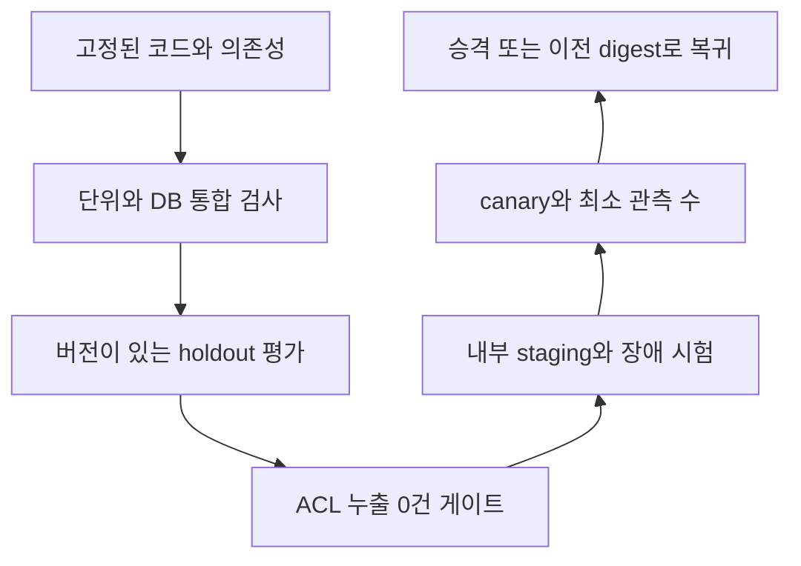

**[핵심 엔지니어링 분석 (Research & Considerations)]**

- **시스템 구성요소:** 소스·의존성·prompt·embedding·reranker·LLM·인덱스·정책·평가셋의 버전을 묶은 release manifest, 독립 라벨, 평가 runner와 승격 gate다. 같은 이미지라도 인덱스나 prompt가 바뀌면 다시 평가한다.
- **핵심 고려사항과 평가 분리:** 질문을 정확 코드형, 의미형, 근거 없음, 권한 없음으로 나눈다. 학습·튜닝 질의와 holdout을 분리하고, “근거 있음” 라벨은 답변한 모델 자신의 평점만으로 결정하지 않는다. 자동 출처 검사와 현장 전문가의 claim support 판정을 함께 사용한다.
- **분모 명시:** Hit@5는 정답 근거를 하나 이상 찾은 질의의 비율이다. 여러 정답 문서 중 얼마나 찾았는지 세는 Recall@5와 구분한다. support rate는 답변한 질의 중 모든 핵심 주장이 근거로 지지된 비율이며, coverage는 답변 가능한 질의 중 실제 답한 비율이다. 무조건 보류해서 support만 높이는 전략을 coverage로 막는다.
- **작은 표본의 한계:** 슬라이스당 30개는 gate가 빈 자료로 통과하는 일을 막는 최소값이다. 누출 0건 관측이 실제 누출 확률 0을 증명하지는 않는다. 운영 공개 범위와 영향에 따라 표본·공격 케이스·신뢰구간 검토를 확대한다.
- **승격과 비용:** 누출 0건은 협상하지 않는 고정 규칙이고(5-1), 나머지 표의 기준은 제안값이다. 실제 deadline·토큰 상한을 고정한 상태에서 평가하고, 전체 p95뿐 아니라 답변 가능한 슬라이스의 p95도 검사한다. canary는 예컨대 5%에서 시작하되 최소 관측 수와 시간, 보안·품질·오류 중단 기준을 모두 충족해야 다음 단계로 진행한다.

| 게이트 | 기준 (누출 0건만 고정, 나머지는 제안값) | 실패했을 때의 조치 |
| --- | --- | --- |
| 코드형·의미형 Hit@5 | 각각 90% 이상 | 청크·분석기·retrieval 조정 후 재평가 |
| 답변 support rate | 코드형·의미형 각 98% 이상 | context와 생성 정책 점검 |
| 답변 coverage | 답변 가능한 각 슬라이스 80% 이상 | 과도한 보류 원인 분석 |
| 근거 없는 질의의 보류율 | 95% 이상 | 근거 sufficiency 판정 조정 |
| 권한 없는 정보의 노출 | 전체 평가에서 누출 0건, 권한 없는 질의는 전건 보류 | 승격 중단과 권한 경계 수정 |
| 응답 p95 | 전체와 답변 가능한 각 슬라이스 5초 이하 | 추론 큐·context·reranker 비용 조정 |

**[근거 데이터 (Evidence Data)]**

| 항목 | 값 | 근거 |
| --- | --- | --- |
| 슬라이스당 최소 평가 예제 | 30개 | 제안값 · fde/release_gate.py에 고정 (고객 합의 후 조정) |
| 코드형·의미형 Hit@5 · support rate · coverage | 각 ≥ 90% · ≥ 98% · ≥ 80% | 제안값 · fde/release_gate.py에 고정 (고객 합의 후 조정) |
| 근거 없는 질의의 올바른 보류율 | ≥ 95% | 제안값 · fde/release_gate.py에 고정 (고객 합의 후 조정) |
| 허용 누출 건수 | 0건 (120건 중 1건 누출이면 불합격) | 코드: tests/test_core.py |
| 120건 중 코드형 6건이 7,000 ms일 때 | 전체 p95 1,000 ms · 슬라이스 검사로 불합격 | 코드: tests/test_core.py |
| canary 시작 트래픽 | 5% | 제안값 · 최소 관측 수와 함께 합의 (4-4) |

**[실전 코드 (Production-grade Code)]**

`fde/release_gate.py`는 누락·빈 자료·NaN·중복 ID를 거부하고 슬라이스별 기준을 검사한다. 이 함수는 모델을 실행하거나 정답을 자동 생성하는 evaluator가 아니라, **독립적으로 얻은 평가 결과의 승격 판정기**다.

```python
import json
import os
from fde.release_gate import evaluate

with open(os.environ["EVALUATION_REPORT"], encoding="utf-8") as stream:
    report = json.load(stream)
decision = evaluate(report)
print(json.dumps(decision, ensure_ascii=False, indent=2))
if not decision["pass"]:
    raise SystemExit(1)   # CI는 결과가 없거나 실패하면 승격하지 않는다.
```

report는 `dataset_version`, `artifact_digest`, `rows`를 가진다. 각 row는 고유 `id`, `kind`, `retrieval_hit`, `supported`, `abstained`, `leaked`, `latency_ms`를 담는다. `retrieval_hit`은 상위 5개 안에 승인된 정답 근거가 있는지를 evaluator가 판정한 boolean이다. unit test의 합성 row는 gate 계산만 검증하며 고객이나 실제 모델의 성능 결과가 아니다.

**[발표자 노트 (Speaker Script)]**

“전체 평균 하나만 보면 의미형 질문이 전부 실패해도 코드형 질문이 그 문제를 가릴 수 있습니다. 저는 질문 유형과 권한 조건을 분리해서 gate를 걸겠습니다. 답변 support만 높이면 모델이 모든 질문을 거절해서 통과할 수도 있으므로 coverage도 함께 봅니다. 보안 누출은 평균 점수로 상쇄하지 않습니다. 한 건이라도 나오면 승격을 중단합니다. 그리고 이 함수가 통과했다고 모델이 평가된 것은 아닙니다. 실제 모델과 고객 질의로 독립적으로 만든 결과가 먼저 있어야 gate가 의미를 가집니다.”

## Frame 4-3 | Level 3 Deep Dive and Code | 장애를 관측하고 복구 가능한 운영으로 전환하기

**[화면 핵심 (On-screen Message)]**

`Observability and Disaster Recovery` · **관측과 복구**

> 최신성·가용성·답변 품질을 나눠 보고 코드 rollback과 데이터 복구를 구분한다.

- 1시간·5분 window의 burn rate 경보
- 수집 지연과 GPU 추론 큐 관측
- 복구 훈련으로 제안 RPO·RTO 실측

**[화면 시각화 가이드 (Visual Layout)]**

운영 피드백으로 확대한다. 같은 사용자 요청을 trace의 수집·검색·추론 구간으로 나누고, 오른쪽에 원인별 복구 동작을 붙인다. 배포 rollback 화살표와 데이터 replay 화살표를 구분한다. 발표 시간 2분.

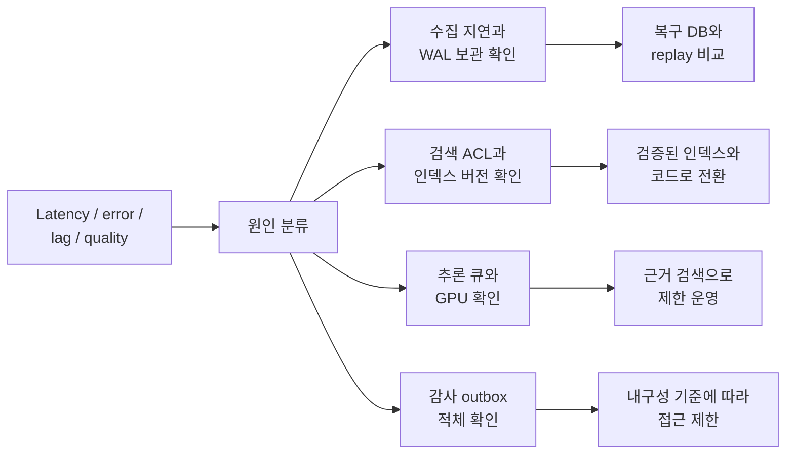

**[핵심 엔지니어링 분석 (Research & Considerations)]**

- **시스템 구성요소:** OpenTelemetry trace, Prometheus 메트릭, source offset·WAL·DLQ·audit outbox 지표, 온라인 보류·검증 실패율과 정기 holdout 평가, 백업·PITR·복구 runbook이다. 사용자 ID·질문·문서 ID를 metric label로 넣어 cardinality와 정보 노출을 키우지 않는다.
- **핵심 고려사항과 SLI 구분:** availability는 유효 요청 중 정상 응답 또는 정책에 맞는 보류·거부를 제공한 비율로 정한다. timeout·시스템 오류는 실패다. 의미적 정답률과 올바른 보류는 별도 품질 지표이므로 HTTP 200으로 대체하지 않는다.
- **알림 결정:** 30일 99.9% availability SLO의 예에서 burn rate 1은 허용 오류율 0.1%와 같다. 1시간과 5분을 함께 보는 14.4배 burn은 약 1.44% 오류율 기준이다. 하나의 긴 window가 끝날 때까지 기다리지 않고, 짧은 window로 현재도 문제가 이어지는지 확인한다. [Google SRE SLO alerting](https://sre.google/workbook/alerting-on-slos/)
- **트레이드오프:** 저트래픽에서는 비율이 불안정하다. 예제 fast-burn 알림은 1시간 요청 100건 이상에서 page하고, 저트래픽은 synthetic probe·오류 개수와 별도 ticket으로 보완한다. 지표 자체의 소실도 별도 알림으로 다룬다.
- **복구와 rollback:** 제안 목표 RPO 5분·RTO 60분은 백업 복구 훈련으로 실측해야 한다. DB는 복구용 별도 인스턴스에 복원해 source 위치·객체 수·표본·tombstone을 확인하고 replay한다. 앱 rollback은 파괴적 schema 변경을 자동으로 되돌리지 못하므로 expand/contract와 이전 인덱스 보관이 필요하다.
- **운영 이관:** 수집 중단 시 WAL 보관 초과, 모델 장애 시 근거만 제공, 감사 sink 장애 시 outbox 보관량과 접근 제한 기준을 runbook에 적는다. 경보에는 담당자·확인할 지표·첫 복구 행동을 연결한다. 서비스별 p95를 평균내지 않고 histogram bucket을 집계해 구한다. [Prometheus histograms](https://prometheus.io/docs/practices/histograms/)

**[근거 데이터 (Evidence Data)]**

| 항목 | 값 | 근거 |
| --- | --- | --- |
| fast-burn page 조건 | 14.4 × 0.1% 초과 (1h · 5m 동시) | 코드: deploy/alerts.yaml · tests/test_error_budget.py |
| 대응 오류율 | 1.44% | 계산: 14.4 × 0.1% |
| page 최소 요청 수 | 1시간 100건 | 제안값 · deploy/alerts.yaml에 고정 (트래픽 실측 후 조정) |
| 14.4배 1h · 5m 규칙이 울릴 때까지 쓴 예산 | 30일 예산의 2% | [Google SRE SLO alerting](https://sre.google/workbook/alerting-on-slos/) |
| 지표 소실 알림 | 10분 부재 → ticket | 제안값 · deploy/alerts.yaml에 고정 (고객 합의 후 조정) |
| 제안 복구 목표 | RPO 5분 · RTO 60분 | 제안값 · 복구 훈련으로 실측 |

**[실전 코드 (Production-grade Code)]**

`deploy/alerts.yaml`의 fast-burn 규칙이다. `rag_requests_total`은 API가 `outcome=ok|abstain|deny|error`로 기록하는 계약을 전제로 한다. 이 저장소는 해당 API exporter를 구현하지 않는다.

```yaml
groups:
  - name: fde-availability
    rules:
      - alert: RagFastBudgetBurn
        expr: |
          (
            sum(rate(rag_requests_total{outcome="error"}[1h]))
            / clamp_min(sum(rate(rag_requests_total[1h])), 0.000001) > 14.4 * 0.001
          )
          and
          (
            sum(rate(rag_requests_total{outcome="error"}[5m]))
            / clamp_min(sum(rate(rag_requests_total[5m])), 0.000001) > 14.4 * 0.001
          )
          and sum(increase(rag_requests_total[1h])) >= 100
        for: 2m
        labels:
          severity: page
        annotations:
          summary: "RAG availability budget is burning quickly"
```

**[발표자 노트 (Speaker Script)]**

“서비스를 운영할 때는 모델의 응답 속도만 보고 있으면 늦습니다. 수집 lag가 커져도 사용자는 오래된 근거로 답을 받을 수 있고, 감사 outbox가 쌓여도 HTTP는 정상일 수 있습니다. 저는 데이터 최신성, API availability, 답변 품질을 나눠 보겠습니다. 장애가 나면 코드 rollback과 데이터 복구도 구분해야 합니다. 이전 이미지를 띄워도 이미 바뀐 schema와 잘못된 인덱스는 돌아오지 않기 때문입니다. 마지막으로 백업이 있다는 말 대신 복원한 시간과 검증한 데이터 범위를 운영팀에 넘기겠습니다.”

## Frame 4-4 | Level 3 Deep Dive and Code | canary 판정을 관측 수와 신뢰구간으로 결정하기

**[화면 핵심 (On-screen Message)]**

`Statistical Canary` · **canary 판정**

> canary의 비율 지표는 최소 관측 수를 채운 뒤 신뢰구간으로 판정한다.

- 오류 3/200의 95% 구간 0.51~4.32%
- 오류 0건이어도 381건 전에는 승격 불가
- ACL 누출 1건은 통계 없이 즉시 rollback

**[화면 시각화 가이드 (Visual Layout)]**

4-2 승격 게이트의 `canary와 최소 관측 수` 문에서 확대해 들어간다. 첫 띠에서는 후보 manifest를 5%에 배포하고 같은 시간대의 canary와 control을 따로 세어 Wilson 95% 구간을 구하는 순서를 보이며, 3/200의 점 추정 1.5%와 구간 0.51~4.32%를 나란히 강조한다. 두 번째 띠에서는 checkpoint마다 ACL 누출 → 관측 수 → 구간 비교 순서로 판정이 계속 관측·승격·rollback으로 갈리는 과정을 따라가고, 구간이 아직 결론을 주지 않으면 계속 관측으로 돌아가는 실선을 보인다. 하한이 기준을 넘는 경로, 2,000건까지 미결인 경로, ACL 누출 경로는 붉은 점선으로 같은 rollback 상자에 모은다. 마지막에 오류 0건이어도 381건이 필요하다는 숫자로 window 연장을 설명한다. 발표 시간 3분.

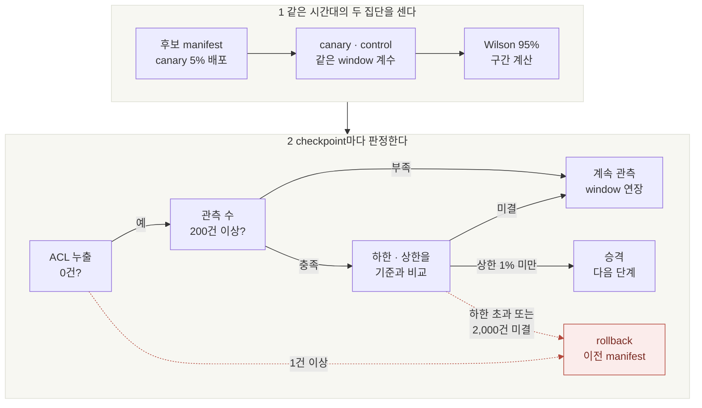

**[핵심 엔지니어링 분석 (Research & Considerations)]**

- **시스템 구성요소:** 4-2의 release manifest 단위로 트래픽을 canary와 control로 나누는 분배 설정, 4-3의 `outcome=ok|abstain|deny|error` 계수, checkpoint마다 실행되는 판정기 `fde/canary.py`, 이전 manifest로 돌아가는 rollback 경로다. Google SRE workbook은 canarying을 변경을 서비스 일부에 시간 제한을 두고 배포해 평가하는 일로 정의하고, 변경을 받은 쪽을 canary, 나머지를 control이라 부른다. [Google SRE canarying](https://sre.google/workbook/canarying-releases/) 판정 기록에는 두 manifest digest, 구간, 정책 버전을 함께 남긴다.
- **핵심 고려사항과 관측 수:** canary 200건 중 오류 3건은 점 추정 1.5%이지만 95% Wilson 구간이 0.51~4.32%여서, 200건으로는 실제 오류율이 1%인지 4%인지 구분할 수 없다. 같은 workbook은 질의가 다양한 시스템에서 몇 개의 질의만 받고 canary를 끝내면 유용한 신호가 되지 않는다고 설명한다. 그래서 canary와 control 모두 최소 200건(제안값)을 채우기 전에는 판정하지 않는다. NIST/SEMATECH e-Handbook은 Wilson 방법의 하한이 음수가 될 수 없다는 점을 흔히 쓰는 정규 근사 구간과 비교한 장점으로 든다. [NIST/SEMATECH 7.2.4.1](https://www.itl.nist.gov/div898/handbook/prc/section2/prc241.htm) 단위 테스트는 이 페이지의 단측 95% 예제 하한 0.09577을 같은 함수로 재현한다.
- **판정 규칙:** canary 하한이 같은 window control의 상한을 넘거나, 전면 배포였다면 `deploy/alerts.yaml`의 fast-burn page가 울릴 오류율인 절대 상한 1.44%(14.4 × 0.1%, 4-3 참조, 제안값)를 넘으면 rollback한다. workbook은 canary와 control이 backend를 공유해 함께 나빠질 수 있으므로 SLO 같은 절대 기준도 쓰라고 권한다. 승격은 모든 지표의 상한이 승격 기준(오류 1%, 제안값) 아래일 때만 한다. 보류율도 같은 규칙과 별도 기준으로 보아, HTTP 200 뒤에서 보류 증가로 나타나는 검색 회귀를 드러낸다(4-2 coverage 참조). 최대 관측 2,000건(제안값)까지 결론이 나지 않으면 승격하지 않고 되돌린다.
- **저트래픽과 window 길이:** 오류가 0건이어도 상한이 1% 아래로 내려가려면 381건이 필요하고, 1건이면 563건이 필요하다. 5-3의 가정인 동시 사용자 50명 × 인당 분당 1회, 즉 3,000 req/h가 계속 들어와도 5% canary는 시간당 150건을 받으므로 381건까지 2.54시간이 걸린다. canary 비율을 키우면 window는 짧아지지만, workbook의 예처럼 5% canary에서 20% 오류는 전체 1% 오류가 되듯 예산 영향은 노출된 트래픽에 비례한다. 그래서 짐작으로 승격하지 않고 window를 늘린다. 판정에 쓰는 지표의 집계 구간은 canary 기간과 같거나 짧아야 한다는 workbook의 조건도 지킨다.
- **보안과 반복 확인:** ACL 누출은 비율이 아니다. 관측 수와 무관하게 1건이면 즉시 rollback하며 4-2의 누출 0건 게이트와 같은 원칙이다. 요청마다 구간을 다시 보면 우연한 판정이 늘어나므로 checkpoint를 미리 정한 관측 수로 고정한다. workbook이 강하게 권하듯 canary는 한 번에 하나만 운영해 신호가 섞이지 않게 한다.
- **주장하지 않는 것:** 구간 비교는 p-value도, 오판 확률을 보장하는 순차 검정도 아니다. control과의 비교는 두 구간이 겹치지 않을 때만 rollback하므로 보수적이며 작은 회귀는 놓칠 수 있다. 같은 사용자의 재시도처럼 서로 독립이 아닌 요청은 구간을 실제보다 좁게 만든다. 승격 판정은 운영 신호의 확인이지 4-2 holdout 품질 평가를 대신하지 않는다.

**[근거 데이터 (Evidence Data)]**

| 항목 | 값 | 근거 |
| --- | --- | --- |
| 오류 3/200의 Wilson 95% 구간 | 0.51% ~ 4.32% | 코드: fde/canary.py |
| NIST 예제 단측 95% 하한 (p̂ 0.13 · n 200 · z 1.645) | 0.09577 | [NIST/SEMATECH 7.2.4.1](https://www.itl.nist.gov/div898/handbook/prc/section2/prc241.htm) |
| 오류 0건으로 상한 1% 미만이 되는 관측 수 | 381건 (오류 1건이면 563건) | 코드: fde/canary.py |
| 5% canary가 381건을 채우는 시간 | 2.54 h (152.4분) | 계산: 381 ÷ (3,000 req/h × 5%), 5-3 유입 가정 |
| 5% canary의 20% 오류가 만드는 전체 오류율 | 1% | [Google SRE canarying](https://sre.google/workbook/canarying-releases/) |
| rollback 절대 상한 | 1.44% | 계산: 14.4 × 0.1% (`deploy/alerts.yaml`) |
| 최소 관측 · 승격 기준 · 최대 관측 | 200건 · 상한 1% · 2,000건 | 제안값 · 파일럿 합의 후 교체 |

**[실전 코드 (Production-grade Code)]**

`fde/canary.py`는 Wilson 구간으로 canary와 같은 window의 control을 비교해 `continue`, `promote`, `rollback` 중 하나와 이유를 돌려준다. 지표 이름이 정책과 다르거나 건수가 정수가 아니면 판정하지 않고 오류로 멈춘다.

```python
from fde.canary import Limit, Policy, decide, observations_needed, wilson, window_hours

# 제안값: 오류 절대 상한 1.44%(4-3 fast burn), 승격은 상한 1% 미만, 관측 200~2,000건
policy = Policy({'error': Limit(ceiling=0.0144, promote_below=0.01)}, 200, 2_000)
control = {'error': (4, 3_800)}      # fixture: 같은 window의 control 95%

i = wilson(3, 200)
print(f"{i.low:.2%} ~ {i.high:.2%}")                     # 0.51% ~ 4.32%
for canary in ((3, 199), (3, 200), (0, 200), (0, 381)):
    verdict = decide({'error': canary}, control, policy)
    print(canary, verdict.action, verdict.reasons)
# (3, 199) continue ('error: insufficient observations',)
# (3, 200) rollback ('error: worse than baseline',)
# (0, 200) continue ('error: upper bound not below promote threshold',)
# (0, 381) promote ()
print(observations_needed(0.01), float(window_hours(381, 3_000, 5)))   # 381 2.54
print(decide({'error': (0, 10)}, control, policy, leaks=1).action)     # rollback
```

control의 4/3,800은 함수 동작을 보이는 fixture이며 고객 환경의 측정값이 아니다. 보류율처럼 지표를 추가하면 모든 지표가 승격 조건을 만족해야 `promote`가 나온다.

**[발표자 노트 (Speaker Script)]**

“4-2에서 canary는 최소 관측 수를 채워야 다음 단계로 간다고 말씀드렸는데, 여기서는 그 판정을 숫자로 고정하겠습니다. canary 200건 중 오류가 3건이면 1.5%로 보이지만, 95% Wilson 구간은 0.51%에서 4.32%까지 넓습니다. 그래서 관측 수가 부족하면 판정하지 않고 계속 관측합니다. 같은 시간대 control의 상한보다 canary의 하한이 높거나 fast-burn 경보 기준인 1.44%를 넘으면 rollback합니다. 승격은 상한이 1% 아래로 내려왔을 때만 하는데, 오류가 0건이어도 381건이 필요합니다. 5-3에서 가정한 시간당 3,000건이 계속 들어와도 5% canary로는 2시간 반 정도 걸리고, 트래픽이 적은 시간에는 더 오래 걸립니다. 이때 기준을 낮추거나 짐작으로 승격하지 않고 window를 늘리겠습니다. ACL 누출은 통계로 다루지 않고 한 건이라도 나오면 즉시 되돌립니다. 이 규칙은 오판 확률을 보장하는 검정이 아니며, 기준값은 고객과 합의할 제안값입니다.”

## Frame 4-5 | Level 3 Deep Dive and Code | 에러 예산 정책으로 배포 속도와 안정성을 합의하기

**[화면 핵심 (On-screen Message)]**

`Error Budget Policy` · **에러 예산 정책**

> 예산 소진율로 배포 속도를 정하고 그 기준을 고객과 미리 합의한다.

- 30일 99.9%의 예산은 정확히 43.2분
- 14.4·6·1배는 예산 비율과 window에서 유도
- 예산 초과 시 P0·보안 수정만 배포

**[화면 시각화 가이드 (Visual Layout)]**

4-3의 경보 프레임에서 이동해 같은 14.4배 규칙이 어디서 나왔는지 거슬러 올라간다. 첫 띠에서는 SLO 99.9%·30일을 43.2분 예산으로 바꾸고, burn rate가 page 두 단계와 ticket 한 단계로 나뉘는 순서를 보이며 `14.4 = 2% × 720시간 ÷ 1시간` 식을 확대한다. 두 번째 띠에서는 예산 소진율에 따라 normal → slow → freeze로 배포 권한이 줄어드는 과정을 보여주고, 예산 초과로 freeze에 들어가는 경로를 붉은 점선과 붉은 상자로 표시한다. 아래 줄에는 단일 장애가 예산 20%를 넘으면 postmortem으로 이어지는 별도 규칙을 둔다. 발표 시간 3분.

```mermaid
flowchart TB
  subgraph R1["1 예산과 소진 속도를 계산한다"]
    direction LR
    S["SLO 99.9% · 30일<br/>예산 43.2분"] --> B["burn rate<br/>오류율 ÷ 0.1%"]
    B --> A["page<br/>14.4배 1h · 5m<br/>6배 6h · 30m"]
    A -- "느린 소진" --> T["ticket<br/>1배 3d · 6h"]
  end
  subgraph R2["2 합의한 정책으로 배포를 정한다"]
    direction LR
    N["소진 50% 미만<br/>normal"] -- "50% 소진" --> W["slow<br/>canary 관측 2배"]
    W -. "예산 초과" .-> F["freeze<br/>P0 수정 · 보안만"]
    I["단일 장애가<br/>예산 20% 초과"] --> PM["postmortem<br/>P0 action item"]
  end
  R1 --> R2
  classDef fail fill:#fbeceb,stroke:#b4483c,color:#7a2a22
  class F fail
  linkStyle 4 stroke:#b4483c
  style R1 fill:#f7f7f2,stroke:#dedfd5,stroke-width:1px
  style R2 fill:#f7f7f2,stroke:#dedfd5,stroke-width:1px
```

**[핵심 엔지니어링 분석 (Research & Considerations)]**

- **시스템 구성요소:** 4-3의 availability SLI(정상 응답과 정책에 맞는 보류·거부는 good, timeout·시스템 오류는 bad), 예산 계산기 `fde/error_budget.py`, burn-rate 경보 `deploy/alerts.yaml`, 고객과 승인한 예산 정책, 4-4의 canary 판정기다. Google SRE workbook의 예시 정책은 작성자·검토자·승인자·승인일·재검토일을 문서 머리에 두고, 에러 예산을 1에서 SLO를 뺀 값으로 정의해 99.9% SLO의 예산을 0.1%로 둔다. [Example Error Budget Policy](https://sre.google/workbook/error-budget-policy/) 코드는 재검토일과 서로 다른 승인자 둘이 없는 정책을 만들지 않고, 재검토일이 지난 정책으로는 판정하지 않는다. 승인자가 고객 측 역할인지는 검사하지 않으므로, 예제는 5-4 지도의 고객 역할인 공장장(`plant_manager`)과 IT 운영(`it_ops`)을 승인자로 두고(제안값) FDE는 정책을 제안하는 쪽에 둔다.
- **핵심 고려사항과 예산 단위:** 30일 window는 43,200분이므로 99.9% SLO의 시간 예산은 정확히 43.2분이다. 요청 기준으로는 예시 정책의 계산처럼 4주에 1,000,000 요청이면 오류 1,000건이다. 0.999를 float로 받으면 이진 근사가 되므로 SLO는 `'0.999'` 문자열로 받아 분수로 계산하고 float는 거부한다. 나쁜 분과 나쁜 요청 중 어느 단위로 셀지는 SLI마다 SLO 문서에 고정하며, 코드는 둘 중 정확히 하나만 받는다.
- **burn rate 규칙의 유도:** workbook은 99.9% SLO의 시작점으로 1시간·5분 window의 14.4배(예산 2%)와 6시간·30분의 6배(5%)를 page로, 3일·6시간의 1배(10%)를 ticket으로 권하고 짧은 window를 긴 window의 1/12로 두라고 한다. [Google SRE SLO alerting](https://sre.google/workbook/alerting-on-slos/) 14.4는 2% × 720시간 ÷ 1시간에서 나온 값이라 window 길이에 묶여 있다. 고객이 예시 정책처럼 4주 window를 택하면 같은 14.4배 1시간은 예산의 2.14%를 쓰고, 2% 기준은 13.44배가 된다. 저장소의 `deploy/alerts.yaml`은 첫 번째 규칙만 1시간 100건 이상 조건과 함께 구현하며, 단위 테스트가 YAML의 window·배수·최소 요청 수를 모듈 값과 대조한다. 나머지 두 규칙은 추가할 제안이다.
- **정책 결정:** 예시 정책은 직전 4주 예산을 초과하면 SLO 안으로 돌아올 때까지 P0 문제와 보안 수정 외의 모든 변경과 릴리스를 멈춘다고 정한다. 여기에 예산 50% 소진 시점의 slow 단계를 더해(제안값) 릴리스당 변경 하나, 4-4 canary 관측 수 2배로 속도를 늦춘다. 예시 정책은 한 장애가 예산의 20%를 넘게 쓰면 postmortem과 최소 하나의 P0 action item을 요구하며, 같은 비율을 43.2분 예산에 적용하면 전면 장애 8.64분 초과가 기준이다(5-5 참조). 계산이나 조치에 이견이 생기면 예시 정책은 CTO에게 escalation하므로, 고객 현장에서 그 역할을 누가 맡는지 5-4의 결정 기록에 남긴다.
- **저트래픽:** workbook은 시간당 10건을 받는 서비스에서 실패 1건이 30일 예산의 13.9%를 쓰고 30일 동안 실패 7건만 허용된다고 설명한다. 단일 공장 파일럿도 야간처럼 요청이 적은 시간에는 같은 상황이 될 수 있다. 그래서 예제 fast-burn 경보는 1시간 100건 이상에서만 page하고, 그 아래는 synthetic probe와 ticket으로 보완한다(4-3 참조). 단건 실패로 page가 반복되면 경보를 끄지 않고, workbook이 선택지로 드는 SLO 하향이나 window 확대를 고객과 다시 합의한다.
- **주장하지 않는 것:** 99.9%, 30일, slow 50%는 고객 업무 영향으로 정할 제안값이다. 보류와 거부는 4-3 정의상 good event이므로 이 예산은 답변 품질 회귀를 잡지 못하며, 품질은 4-2 holdout과 4-4 canary 보류율로 본다. freeze는 보안 수정까지 막는 규칙이 아니다.

**[근거 데이터 (Evidence Data)]**

| 항목 | 값 | 근거 |
| --- | --- | --- |
| 30일 99.9% SLO의 시간 예산 | 43.2분 (43,200분 × 0.1%) | 코드: fde/error_budget.py |
| page · page · ticket burn rate | 14.4 · 6 · 1 (예산 2% · 5% · 10%) | [Google SRE SLO alerting](https://sre.google/workbook/alerting-on-slos/) |
| 4주 window에서 14.4배 1시간이 쓰는 예산 | 2.14% (3/140) | 코드: fde/error_budget.py |
| 시간당 10건 서비스의 실패 1건 | 30일 예산의 13.9% | [Google SRE SLO alerting](https://sre.google/workbook/alerting-on-slos/) |
| 예산 초과 시 허용 변경 | P0 수정 · 보안 수정 2종 | [Example Error Budget Policy](https://sre.google/workbook/error-budget-policy/) |
| postmortem 의무 기준 (전면 장애) | 8.64분 초과 | 계산: 43.2분 × 20% (예시 정책의 단일 장애 기준) |
| slow 전환 기준 | 예산 50% 소진 | 제안값 · fde/error_budget.py에 고정 (고객 합의 후 조정) |

**[실전 코드 (Production-grade Code)]**

`fde/error_budget.py`는 SLO를 분수로 계산해 43.2분, 14.4배 같은 값을 반올림 없이 만들고, 정책 상태가 허용하지 않는 변경 종류와 slow 상태에서 한 릴리스에 묶은 둘 이상의 변경을 `PermissionError`로 막는다. 단위 테스트는 `deploy/alerts.yaml`의 1h·5m window, `14.4 * 0.001`, 최소 100건을 이 모듈의 첫 규칙과 대조한다.

```python
from datetime import date
from fde.error_budget import RULES, Policy, Slo, decide, permit, requires_postmortem

slo = Slo('0.999', 30)               # 4-3·deploy/alerts.yaml과 같은 SLO (제안값)
print(float(slo.budget_minutes))                                  # 43.2
print([float(rule.threshold(slo)) for rule in RULES])             # [14.4, 6.0, 1.0]
print(float(Slo('0.999', 28).consumed_by_burn('14.4', 60)))       # 0.02142857142857143
print(RULES[0].fires(slo, (2, 100), (1, 9)), RULES[0].fires(slo, (2, 99), (1, 9)))  # True False

policy = Policy(slo, ('plant_manager', 'it_ops'), revisit=date(2027, 5, 31))  # 5-4 고객 역할
today = date(2026, 11, 17)
for minutes in (10, 25, 45):
    d = decide(policy, bad_minutes=minutes, today=today)
    print(minutes, d.state, f"{float(d.consumed):.1%}", d.allowed, d.canary_scale, d.max_changes)
# 10 normal 23.1% ('feature', 'config', 'fix', 'p0_fix', 'security') 1 None
# 25 slow 57.9% ('feature', 'config', 'fix', 'p0_fix', 'security') 2 1
# 45 freeze 104.2% ('p0_fix', 'security') 1 None
print(requires_postmortem(policy, 10), requires_postmortem(policy, 8))   # True False
try:
    permit(decide(policy, bad_minutes=45, today=today), 'fix')
except PermissionError as error:
    print(error)                     # fix change not allowed while freeze
```

`bad_minutes`는 SLI로 집계한 직전 30일의 나쁜 분이고, 4-3처럼 요청 기준 SLI라면 `bad_events=(나쁜 요청, 전체 요청)`을 넘긴다. 이 저장소는 그 집계기를 구현하지 않는다. freeze에서는 일반 `fix`도 막히고 `p0_fix`와 `security`만 통과한다. 승인자와 날짜는 예시이고, 실제 정책은 공장장과 IT 운영이 승인한 문서의 값으로 만든다.

**[발표자 노트 (Speaker Script)]**

“4-3의 경보에 있던 14.4라는 숫자를 이제 고객과 합의할 정책으로 바꿔 보겠습니다. 30일 99.9% SLO라면 한 달에 허용되는 전면 장애는 정확히 43.2분입니다. 14.4배는 이 예산의 2%를 1시간에 쓰는 속도인데, window를 4주로 바꾸면 같은 숫자가 2.14%를 뜻하므로 경보 규칙도 다시 계산해야 합니다. 저는 예산이 절반 이상 소진되면 릴리스마다 변경 하나만 배포하고 canary 관측 수를 두 배로 늘리겠습니다. 예산을 초과하면 P0 수정과 보안 수정만 배포하고 기능 배포는 SLO 안으로 돌아올 때까지 멈춥니다. 한 장애가 예산의 20%를 넘게 쓰면, 즉 전면 장애가 8.64분을 넘으면 postmortem을 반드시 작성합니다. 이 정책은 처벌이 아니라 배포 속도와 안정성 사이의 선택을 미리 합의해 두는 문서입니다. 그래서 저는 정책을 제안하고, 공장장과 IT 운영의 승인을 받아 재검토일을 정해 두겠습니다. 다만 보류와 거부는 이 예산에서 정상으로 세므로, 답변 품질은 holdout 평가와 canary 보류율로 따로 보겠습니다.”

## Frame 0-2 | Level 1 Overview | 네 기술 영역을 하나의 검증 가능한 서비스로 연결하기

**[화면 핵심 (On-screen Message)]**

`Integrated Production Architecture` · **통합 운영 구조**

> 코드 검증 뒤 고객 환경의 수용 시험을 통과한 범위만 확장한다.

- 재전송에도 보존되는 상태
- 권한과 출처를 검증한 근거 응답
- 검증된 실행물과 운영 가능한 책임

**[화면 시각화 가이드 (Visual Layout)]**

처음의 전체 카메라 위치로 돌아온다. 처음에는 흐름만 보였던 네 영역 위에 각각 **재생 가능한 상태 · 허용된 근거 · 검증된 실행물 · 운영 가능한 책임**을 한 문장씩 겹친다. customer outcome을 맨 위에 두고 기술 선택이 그 결과로 연결되게 한다. 발표 시간 2분.

```mermaid
flowchart BT
  %% Bottom-up: customer outcome on top. Invisible links (~~~) pin the feedback node beside the chain
  %% and the supply-chain node on the other side; their order decides the layout.
  S["원천 데이터와 고객 업무"] --> I["재전송에도 보존되는 상태"]
  I ~~~ E["업무 평가와 장애 피드백"]
  E --> S
  G["출처를 검증한 응답"] --> U["더 빠른 근거 탐색과 판단 지원"]
  I --> R["사용자가 볼 수 있는 근거"]
  D["검증된 실행물과 내부 운영"] --> I
  D --> G
  R --> G
  E ~~~ G
  U --> E
  I ~~~ D
```

**[핵심 엔지니어링 분석 (Research & Considerations)]**

- **시스템 구성요소:** 데이터 계약·identity·policy·release manifest·평가 결과·운영 책임자가 하나의 변경 관리 흐름으로 연결되어야 한다.
- **핵심 고려사항:** 기술 선택을 “일반적으로 좋다”는 말로 방어하지 않는다. 이 고객의 데이터 분포·보안 경계·장애 복구·현장 일정에서 왜 선택했는지, 어떤 관측 결과가 나오면 바꿀지 설명한다.
- **수용 기준:** 데이터 재처리, 잘못된 권한, 근거 없는 응답, 인터넷 의존성, 복구 실패를 각각 실패 시험으로 확인한다. 고객에게는 직접 측정한 업무 지표와 남은 운영 조건을 함께 제시한다.

**[근거 데이터 (Evidence Data)]**

| 항목 | 값 | 근거 |
| --- | --- | --- |
| 기록된 통합 검사(2026-11-17 실행) | 306 tests · 4.941 s | 코드: scripts/check.py --all · docs/test-output.txt |
| ACL 누출 허용 | 0건 | 코드: fde/release_gate.py |
| 유형별 응답 p95 상한 | 5,000 ms | 제안값 · fde/release_gate.py에 고정 (고객 합의 후 조정) |
| 유형별 최소 평가 예제 | 30개 | 제안값 · fde/release_gate.py에 고정 (고객 합의 후 조정) |
| 임시 PostgreSQL | port 55432 · Unix socket 전용 | 코드: scripts/check.py |

**[실전 코드 (Production-grade Code)]**

작업 폴더의 코드·DB 경계는 `scripts/check.py --all`로 검증한다. 실행기는 개인 Unix socket만 사용하는 임시 PostgreSQL과 비특권 LOGIN 계정을 만들고, 테스트가 끝나면 서버와 데이터를 제거한다. 아래는 네 영역의 불변식을 확인하는 테스트를 이름만 발췌한 2026년 11월 17일 실행 결과다. 전체 출력은 `docs/test-output.txt`에 있다. 테스트 통과가 실제 LLM 성능이나 고객 Kubernetes 배포 성공의 증거는 아니다.

```text
$ .venv/bin/python scripts/check.py --all
test_concurrent_redelivery_has_one_effect ... ok          # 1 재전송
test_stale_update_cannot_resurrect_tombstone ... ok       # 1 삭제
test_transaction_rolls_back_if_audit_outbox_fails ... ok  # 1·3 감사
test_rls_applies_before_python_ranking ... ok             # 2 권한
test_output_revalidation_rejects_revocation_during_generation ... ok
test_citation_bound_to_retrieved_version ... ok           # 2 인용
test_tampered_manifest_fails_signature ... ok             # 3 반입
test_quality_gate_baseline_and_leak_in_any_slice ... ok   # 4 게이트
----------------------------------------------------------------------
Ran 306 tests in 4.941s

OK
```

**[발표자 노트 (Speaker Script)]**

“전체 그림으로 돌아오면 네 영역이 따로 있는 기술 목록이 아니라 같은 사용자 신뢰를 지탱하는 경계라는 점이 보입니다. 데이터가 재처리에도 일관되어야 하고, 허용된 근거만 사용해야 하며, 그 로직을 고객 환경에서 검증된 실행물로 돌릴 수 있어야 합니다. 그리고 운영팀이 실패를 발견하고 복구할 수 있어야 합니다. FDE로서 제 역할은 이 제약을 고객의 업무 언어로 확인하고, 가장 작은 유효 범위에서 증명한 뒤 근거를 가지고 확장하는 것입니다. 다음 단계는 실제 고객 질의와 권한 조건으로 제한 공개의 수용 기준을 검증하는 일입니다.”

## Frame 5-1 | Level 2 Topic Cluster | 고객 Discovery로 업무·권한·수용 기준을 먼저 합의하기

**[화면 핵심 (On-screen Message)]**

`Customer Discovery` · **고객 Discovery**

> 첫 주 Discovery에서 합의한 권한과 수용 기준이 승격 게이트의 입력이 된다.

- 속성별 권위 소스와 role별 문서 권한 확정
- 정답·보류·거부 정의와 owner별 결정 기록
- 합의된 수용 기준의 4-2 승격 게이트 반영

**[화면 시각화 가이드 (Visual Layout)]**

0-2의 전체 조감도에서 바깥 궤도 왼쪽의 주제 5 ‘현장 플레이북(2부)’으로 카메라를 옮긴다. 왼쪽의 다섯 역할 이해관계자 맵에서 중앙의 첫 주 Discovery 질문 프레임으로 초점을 옮긴 뒤, 각 답변이 owner가 지정된 결정 기록과 수용 기준 제안표로 바뀌어 4-2 승격 게이트로 흘러가는 실선 경로를 확대한다. 접근 승인 지연과 합의되지 않은 범위 확장은 붉은 점선 분기로 정상 흐름과 분리하고, 범위 확장 분기는 결정 기록의 재검토 조건으로 되돌린다. 발표 시간 3분.

```mermaid
flowchart TB
  subgraph Discovery["1 첫 주 Discovery와 결정 기록"]
    direction LR
    S["업무 담당자 ·<br/>현장 엔지니어 · FDE"] --> Q["첫 주<br/>Discovery 질문"]
    O["데이터 · 보안 ·<br/>플랫폼 owner"] --> Q
    Q --> D["결정 기록<br/>선택 · 대안 · 재검토 · owner"]
    O -. "접근 승인<br/>owner 지연" .-> H["임계경로 변경<br/>통합 미완료로 보고"]
    Q -. "미합의 기준<br/>범위 확장" .-> R["재검토 조건으로<br/>범위 통제"]
    R --> D
  end
  subgraph Gate["2 합의한 기준을 게이트로"]
    direction LR
    A["합의된 수용 기준 제안값"] --> G["4-2 승격 게이트"]
  end
  Discovery --> Gate
  classDef fail fill:#fbeceb,stroke:#b4483c,color:#7a2a22
  class H,R fail
  linkStyle 3,4 stroke:#b4483c
  style Discovery fill:#f7f7f2,stroke:#dedfd5,stroke-width:1px
  style Gate fill:#f7f7f2,stroke:#dedfd5,stroke-width:1px
```

**[핵심 엔지니어링 분석 (Research & Considerations)]**

- **시스템 구성요소:** 첫 주 Discovery에는 업무 담당자(정비 리더), 데이터 owner(ERP·정비 시스템·문서), 보안·플랫폼 담당자, 현장 정비 엔지니어, FDE가 참여한다. 정비 리더는 과제 우선순위와 정답 기준을, 데이터 owner는 원천 책임과 스키마를, 보안·플랫폼 담당자는 IdP·ACL·반입 경로를 맡는다. 현장 정비 엔지니어는 실제 질의 표현과 라벨 검토를 제공하고, FDE는 이 입력을 데이터 계약·평가셋·승격 게이트로 연결한다.
- **핵심 고려사항:** FDE는 첫 주에 여섯 질문으로 모호함을 줄인다. 업무 성과를 무엇으로 비교할지(예: 기준 과제의 근거 탐색 시간과 정답 도달률), 속성별 authoritative source가 어느 시스템인지(예: 소유 공장은 ERP, 작업 완료는 정비 시스템, 점검 절차는 승인된 PDF 매뉴얼), “정답·보류·거부”가 각각 무엇인지, role별로 어떤 문서를 읽을 수 있는지, 응답 지연과 데이터 최신성 요구가 얼마인지, 온콜과 rollback 책임자가 누구인지 확인한다. “부산 공장 P-101의 반복 과열 원인과 점검 순서”도 이 답이 있어야 평가 가능한 과제가 된다.
- **결정 기록과 책임:** 각 답변은 4-1의 결정 기록 형식(선택·버린 대안·이유·재검토 조건)에 역할 기반 owner를 더해 바로 남긴다. owner가 없는 결정은 재검토 조건이 발동해도 누가 다시 판단할지 정할 수 없다. `fde/release_gate.py`는 누락·빈 자료·표본 부족·기준 미달을 기계적으로 거부하지만, 무엇을 “정답”으로 인정하고 누가 holdout을 독립 라벨링할지는 고객과의 합의로 정한다.
- **수용 기준 합의:** 합의한 품질·운영 요구는 4-2 승격 게이트의 입력이 된다. 출발점으로 제안하는 기준은 슬라이스당 최소 30건, 코드형·의미형 Hit@5 0.90, support rate 0.98, coverage 0.80, 근거 없는 질의의 보류율 0.95, 권한 누출 0건(권한 없는 질의는 모두 보류), 전체와 답변 가능한 슬라이스의 p95 5,000ms 이하다. 이 값은 예제 gate에 고정된 기준을 협의의 출발점으로 제안하는 것이다. 품질·지연 기준은 고객이 업무 위험과 비용에 따라 조정할 수 있지만, 권한 누출 0건과 권한 없는 질의의 전건 보류는 협상 대상이 아니다. 모든 변경은 새 결정 기록, gate 갱신과 재평가로 남긴다.
- **일정 위험과 범위 통제:** 4-1 일정에서 첫날 확인할 접근권한과 데이터 owner가 늦어지면 임계경로가 바뀐다. 대기 중에는 합성 데이터로 UI·계약·배포 경로를 검증할 수 있지만 이를 “통합 완료”나 품질 근거로 보고하지 않는다. 추가 공장·설비군·write 기능 같은 scope creep은 조용히 받아들이지 않고, 결정 기록의 재검토 조건에 따라 다음 단계 과제로 분리하고 별도 수용 기준을 정한다.

**[근거 데이터 (Evidence Data)]**

| 항목 | 값 | 근거 |
| --- | --- | --- |
| 슬라이스당 최소 평가 예제 | 30건 | 제안값 · fde/release_gate.py에 고정 (고객 합의 후 조정) |
| 최소 평가 예제 합계 | 120건 | 계산: 4 슬라이스 × 30건 |
| 코드형·의미형 Hit@5 · support rate · coverage 하한 | 0.90 · 0.98 · 0.80 | 제안값 · fde/release_gate.py에 고정 (고객 합의 후 조정) |
| 근거 없는 질의의 보류율 하한 | 0.95 | 제안값 · fde/release_gate.py에 고정 (고객 합의 후 조정) |
| 권한 누출 · 권한 없는 질의의 답변 | 0건 · 0건 (누출은 어느 슬라이스든 1건이면 실패) | 코드: fde/release_gate.py · tests/test_core.py |
| 전체·답변 가능 슬라이스의 응답 p95 상한 | 5,000 ms | 제안값 · fde/release_gate.py에 고정 (고객 합의 후 조정) |
| 첫 주 Discovery 질문 | 6개 | 제안값 · 고객 업무와 조직에 맞게 조정 |

**[실전 코드 (Production-grade Code)]**

아래는 첫 주 Discovery 결과를 정리한 결정 기록과 수용 기준 예시이며, 권한 누출 0건과 권한 없는 질의의 전건 보류를 뺀 모든 값은 고객 합의 전의 가정·제안값이다. `acceptance`의 metric 키는 `fde/release_gate.py`가 반환하는 `metrics` 이름과 맞췄고, `min_examples_per_slice`와 `forbidden_answered`는 gate가 metric 없이 직접 검사하는 조건이다.

```yaml
id: "DR-001"
status: "proposed"             # 역할별 승인 전 초안
basis: "가정·제안값, 고객 합의 전"
owner: "고객 정비 리더"
approvers: { scope: "고객 정비 리더", source: "데이터 owner",
             acl: "보안·플랫폼 담당자", release: "운영 owner" }
consulted: ["현장 정비 엔지니어", "FDE"]
choice: "한 공장·한 설비군의 read-only 정비 지원 MVP"
authoritative_source: { asset_site: "erp", work_order_status: "cmms-busan" }  # 1-1의 공장별 source
rejected_alternatives:
  - "전 공장·설비군 일괄 연동과 작업 지시 write 기능"
  - "합성 데이터 데모 통과만으로 승격"
reason: "원천 책임과 권한 경계를 먼저 고정해야 4-2 게이트로 검증할 수 있다"
review_when: "공장·설비군 추가, write 기능 요청, role 정책 변경 시"
acceptance:                    # 누출·전건 보류는 고정, 나머지는 제안값
  min_examples_per_slice: 30   # factoid·semantic·unanswerable·forbidden 각각
  factoid: { hit_at_5: 0.90, support_rate: 0.98, coverage: 0.80, p95_ms: 5000 }
  semantic: { hit_at_5: 0.90, support_rate: 0.98, coverage: 0.80, p95_ms: 5000 }
  correct_abstention: 0.95
  leak_count: 0                # 고정 규칙
  forbidden_answered: 0        # 고정 규칙: 권한 없는 질의는 전건 보류
  p95_ms: 5000
```

이 YAML은 저장소의 `fde/release_gate.py`가 읽는 설정 파일이 아니다. 현재 gate는 같은 기준값을 코드에 고정해 판정하므로, 합의로 기준을 바꾸면 새 결정 기록과 함께 gate 코드나 설정을 갱신하고 독립 라벨링된 holdout으로 다시 평가한다. 여기의 수치는 합의의 출발점이며 고객 환경에서 측정한 성능이 아니다.

**[발표자 노트 (Speaker Script)]**

“1부에서 기술 경계를 봤다면, 여기서부터는 2부 현장 플레이북으로 그 경계를 첫 주에 고객과 어떻게 합의하는지 보겠습니다. 저는 코드를 쓰기 전에 정비 리더, 데이터 owner, 보안·플랫폼 담당자, 현장 정비 엔지니어와 여섯 가지 질문부터 확인하겠습니다. 먼저 근거를 찾는 시간과 정답 도달률처럼 업무 성과를 무엇으로 비교할지 정하고, 설비 소유 공장은 ERP, 작업 완료는 정비 시스템처럼 속성별 authoritative source와 정답·보류·거부의 의미를 정의하겠습니다. role별 문서 권한, 허용 지연과 최신성, 온콜과 rollback 책임도 묻고, 답마다 owner와 재검토 조건이 있는 결정 기록으로 남기겠습니다. 화면의 Hit@5 0.90이나 p95 5초는 예제 gate에 고정된 값을 협의의 출발점으로 제안하는 것이고, 권한 누출 0건과 권한 없는 질의의 보류는 조정하지 않습니다. 코드는 평가 누락과 기준 미달을 승격 게이트에서 막아 줄 뿐, 무엇이 정답이고 누가 라벨링할지는 고객과 합의해야 합니다. 합의한 기준은 4-2의 승격 게이트에 반영하고, 기준이 바뀌면 gate를 고친 뒤 독립 평가 결과로 다시 판정하겠습니다.”

## Frame 5-2 | Level 3 Deep Dive and Code | 오답 신고를 재현 기록으로 파이프라인 경계까지 좁히기

**[화면 핵심 (On-screen Message)]**

`Incident Replay` · **오답 재현**

> 오답 조사는 답변 시점의 조건을 복원하고 처음 달라진 경계에서 시작한다.

- 답변 시점의 버전과 위치 기록
- 동일 권한의 격리된 replay
- 재현 창은 가장 짧은 보관 기간(예: 백업 7일)

**[화면 시각화 가이드 (Visual Layout)]**

현장 플레이북에서 오답 신고와 복구용 replay 사이를 확대한다. 답변 당시의 최소 기록을 왼쪽에 고정하고, 복원한 환경에서 만든 기록을 오른쪽에 나란히 놓는다. data → policy → retrieval → generation 순서로 비교하며 최초 차이만 주황색으로 강조한다. 입력이 같은데 답변이 달라지는 경로는 기록 누락을 확인하는 붉은 점선으로 표시한다. 발표 시간 4분.

```mermaid
flowchart TB
  subgraph Record["1 기록 찾기와 복원"]
    direction LR
    R["오답 신고와 request ID"] --> O["답변 시점의 최소 기록"] --> S["별도 snapshot · PITR 복원"]
  end
  subgraph Replay["2 조건 고정과 replay"]
    direction LR
    P["정책 · 검색 · 생성 artifact 고정"] --> E["ticket의 같은 질문 ·<br/>검증된 주체로 replay"] --> C["신고 기록과 replay 기록 localize 비교"]
  end
  subgraph Triage["3 경계별 조사"]
    direction LR
    B["data → policy → retrieval → generation"] --> H["최초 차이부터 조사 · 사람 검토"]
    B -. "입력 동일 · 답변 상이" .-> M["누락 필드 기록 보완"]
  end
  Record --> Replay --> Triage
  classDef fail fill:#fbeceb,stroke:#b4483c,color:#7a2a22
  class M fail
  linkStyle 5 stroke:#b4483c
  style Record fill:#f7f7f2,stroke:#dedfd5,stroke-width:1px
  style Replay fill:#f7f7f2,stroke:#dedfd5,stroke-width:1px
  style Triage fill:#f7f7f2,stroke:#dedfd5,stroke-width:1px
```

**[핵심 엔지니어링 분석 (Research & Considerations)]**

- **시스템 구성요소:** 답변을 만들 때 다음 필드를 재현 기록(`AnswerRecord`)으로 남긴다: request ID, tenant, HMAC으로 가명처리한 주체와 key ID, 서비스 DB의 복구 목표를 가리키는 snapshot ID, upstream 소스·epoch별 committed offset을 기록한다. 정책, index·embedding·reranker 버전, 생성에 전달한 순서 그대로의 `(chunk_id, version)`, decoding 파라미터를 포함한 prompt 버전, tokenizer와 양자화 형식까지 포함한 model digest를 함께 고정한다. 장애 뒤에는 현재 버전과 위치가 이미 이동하므로 “지금 다시 물어보기”로 당시 조건을 재현할 수 없다.
- **핵심 고려사항과 replay:** 서비스 DB는 별도 복구 인스턴스에 기록된 복구 목표까지 복원한다. PITR이 재생하는 것은 서비스 DB의 WAL이므로, 복원된 소스 위치를 기록과 대조해 모자라면 upstream을 기록된 offset까지 따로 replay하고, DB 밖의 검색 인덱스는 `index_version` 보관본을 다시 적재한다. 당시 정책·embedding·reranker·prompt·모델 artifact를 고정한 뒤, 같은 질문과 검증된 같은 principal로 실행해 replay 기록을 만들고 `localize(reported, replayed)`로 비교한다. HMAC 가명 자체를 인증 자격증명으로 사용하지 않는다. DB 복원에 쓰는 continuous archiving과 PITR은 선택한 목표 시점까지 복구하는 PostgreSQL 기능이다. [PostgreSQL PITR](https://www.postgresql.org/docs/current/continuous-archiving.html)
- **조사 순서와 증명의 한계:** 반환 순서는 data → policy → retrieval → generation이며 최초 차이부터 조사한다. 데이터나 권한 차이가 이후 검색·생성 차이를 만들 수 있으므로 첫 차이는 확정된 근본 원인이 아니다. 입력 차이가 없는데 답변이 달라지면 serving engine 버전·batch 설정 등 누락 필드를 기록에 보완한다. 같은 입력과 decoding 설정에서도 batch 구성이나 GPU 연산 순서에 따라 출력이 달라질 수 있으므로, 재현 대상은 답변 문자열이 아니라 근거와 권한 조건이다. 2-3의 인용 출처 검증은 의미적 정답을 보장하지 않으며, 4-2의 독립 평가와 중요한 점검 순서에 대한 사람 검토를 연결한다.
- **최소화와 접근 경계:** 3-3의 HMAC 가명처리를 따르고, 기록에는 식별자·버전·위치와 보류 여부만 남긴다. 원문 질문·답변·청크 본문·원시 사용자 식별자는 넣지 않는다. tenant는 사용자 식별자가 아닌 조직 경계 ID라 원문으로 두고 접근 범위와 비교 거부에 쓴다. 질문이 필요하면 신고자가 접근 제한 ticket 경로로 다시 제공한다. key ID를 함께 남겨 키를 교체한 뒤에도 당시 키로 같은 가명을 다시 계산한다. 비교는 tenant가 다르면 우선 거부하고 request ID·key ID·주체가 달라도 거부한다. HMAC 키와 당시 주체의 검증된 매핑은 제한된 별도 절차로 관리한다.
- **보관과 재현 창:** 재현 가능 기간의 상한은 기록 보관, snapshot·PITR용 WAL·백업 보관, upstream offset 보관, 이전 인덱스 보관, 모델·prompt 등 관련 artifact 보관 기간의 최솟값이다. 가정으로 기록은 90일, 백업은 7일이고 나머지가 충분해도 7일이 지나면 재현할 수 없다. 기록도 감사 이벤트처럼 고객의 보관·삭제 정책을 적용하며, 정기 복구 훈련으로 실제 복원 가능 범위를 확인한다.

**[근거 데이터 (Evidence Data)]**

| 항목 | 값 | 근거 |
| --- | --- | --- |
| 조사 경계 순서 | 4단계 (data → policy → retrieval → generation) | 코드: fde/provenance.py · tests/test_field_kit.py |
| 생성에 전달한 근거 상한 | 20개 (21개는 ValueError) | 코드: fde/provenance.py · tests/test_field_kit.py |
| 주체 가명 · model digest 형식 | 64 hex · sha256: + 64 hex | 코드: fde/provenance.py |
| key ID 형식 | 1–40자 `[A-Za-z0-9_-]` (fde/privacy.py와 동일) | 코드: fde/provenance.py · tests/test_field_kit.py |
| 근거 순서만 뒤집은 replay | 1개 경계 (retrieval) | 코드: tests/test_field_kit.py |
| 재현 창 (기록 90일 · 백업 7일 가정) | 7일 | 계산: min(90, 7) |

**[실전 코드 (Production-grade Code)]**

`fde/provenance.py`는 기록 형식을 검사하고 입력이 달라진 경계를 순서대로 반환한다. 아래 fixture는 snapshot 복원 뒤 소스 위치가 더 진행되고 근거 순서도 바뀐 replay를 의도적으로 만들며, model digest는 같다.

```python
from dataclasses import replace
from fde.provenance import AnswerRecord, localize

reported = AnswerRecord(
    request_id="12345678-1234-4abc-8def-1234567890ab",
    tenant="fixture-factory", subject_pseudonym="0" * 64, key_id="fixture-v1",
    snapshot_id="backup-v1", source_positions=(("erp", 120), ("manual", 8)),
    policy_version="policy-v1", index_version="index-v1",
    embedding_model="embedding-v1", reranker="reranker-v1",
    prompt_version="prompt-decoding-v1", model_digest="sha256:" + "a" * 64,
    evidence=(("manual-p1", 2), ("maintenance-p2", 1)),
    abstained=False,
)
replayed = replace(
    reported, source_positions=(("erp", 121), ("manual", 8)),
    evidence=tuple(reversed(reported.evidence)),
)
print(localize(reported, replayed))  # ['data', 'retrieval']
```

`"0" * 64` 가명과 `"a" * 64` digest는 형식 검사용 fixture다. 코드는 실제 snapshot 복원, artifact 무결성 검증이나 HMAC 생성 여부를 증명하지 않는다. 버전 문자열이 4-2 release manifest의 불변 artifact를 가리키는지도 이 절차와 함께 별도로 검증한다.

**[발표자 노트 (Speaker Script)]**

“부산 공장 P-101 답변이 틀렸다는 신고가 오면, 먼저 그 답변의 request ID로 당시 기록을 찾겠습니다. 질문은 제한된 ticket에서 다시 받고, 당시 snapshot과 정책·인덱스·모델을 별도 복구 환경에 맞추겠습니다. 같은 주체로 replay한 결과에서 data와 retrieval이 달라졌다면, 더 앞선 data 경계부터 확인하겠습니다. 이 차이는 조사 순서이며 원인이 확정됐다는 뜻은 아닙니다. 입력이 같은데 답변이 달라지면 serving 설정을 더 기록해야 하는지 보고, 문장이 똑같은지보다 근거와 권한이 같은지를 재현 기준으로 삼겠습니다. 근거를 정확히 인용했는지는 코드로 확인하고, 실제 점검 순서가 맞는지는 현장 전문가와 평가하겠습니다. 마지막으로 기록 90일·백업 7일이라는 보관 가정에서는 재현 창도 최대 7일이므로, 보관과 삭제 정책까지 함께 합의하겠습니다.”

## Frame 5-3 | Level 3 Deep Dive and Code | 용량 계산을 가정에서 측정으로 바꾸기

**[화면 핵심 (On-screen Message)]**

`Capacity Math` · **용량 산정**

> 사용자 수는 유입률과 동시 요청으로 환산하고, 가정은 부하 시험 실측으로 교체한다.

- 원시 벡터와 가중치·KV 분리
- 평균 동시 요청과 버스트 구분
- context·출력 상한과 부하 시험 실측

**[화면 시각화 가이드 (Visual Layout)]**

현장 플레이북의 용량 계산으로 이동한다. 사용자 수를 유입률과 체류시간으로 바꾸는 가지와 sequence당 KV를 구하는 가지를 나란히 확대한다. 두 가지가 GPU 메모리 예산에서 만나는 지점을 강조하고, 모든 숫자에는 가정 표식을 붙인다. 메모리 초과는 context·출력·동시성 상한을 조정한 뒤 예산 재계산으로 되돌리고, 마지막에 부하 시험 결과로 가정을 교체하는 화면을 보여준다. 발표 시간 3분.

```mermaid
flowchart TB
  A["가정: 동시 사용자 50명 ·<br/>인당 분당 1회"] --> L["W에 p95 목표 5초 대입<br/>λW ≈ 4.17건"]
  M["가정: 8B GQA · 8,192 tokens"] --> K["KV: sequence당 1GiB"]
  G["가정: GPU 48GiB ·<br/>이용률 0.9"] --> P["가중치 · overhead · KV 합산"]
  L --> P
  K --> P
  P --> T["피크 · 버스트 부하 시험"]
  T --> U["p95 · 큐 · 메모리로 가정 교체"]
  P -. "메모리 초과" .-> C["context · 출력 · 동시성 상한 조정"]
  C --> P
  classDef fail fill:#fbeceb,stroke:#b4483c,color:#7a2a22
  class C fail
  linkStyle 7 stroke:#b4483c
```

**[핵심 엔지니어링 분석 (Research & Considerations)]**

- **시스템 구성요소:** 청크 인덱스와 GPU 추론 서버를 분리 산정한다. 0-1의 규모 가정인 1,000,000개 × 768차원 × 4B는 정확히 3,072,000,000B, 약 3.07GB의 원시 벡터다. 인덱스·복제본·원문·메타데이터는 제외한다. 가정한 8B급 모델의 양자화 전 fp16 가중치는 8,000,000,000개 × 2B = 16GB이며, 양자화는 용량을 바꾸므로 품질 평가와 함께 결정한다. GB는 10의 거듭제곱, GiB는 2의 거듭제곱 단위로 구분한다.
- **핵심 고려사항과 KV cache:** K와 V를 합한 토큰당 바이트는 `2 × layers × kv_heads × head_dim × bytes_per_value`다. 가정한 8B급 GQA 모델을 32 layers, 8 KV heads, head_dim 128, fp16 2B로 두면 131,072B/token, 즉 128KiB다. context 8,192 tokens를 가정하면 sequence당 1,073,741,824B = 1GiB다. GQA에서는 여러 query head가 더 적은 수의 KV head를 공유하므로 수식에는 attention heads 대신 `kv_heads`를 넣는다.
- **유입률과 동시성:** Little's law `L = λW`는 정상 상태의 장기 평균이다. 사례 표(설계 입력)의 제안값인 동시 사용자 50명이 각자 분당 1회 질문한다고 가정하면 약 0.83req/s다. W는 큐를 포함한 평균 체류시간이므로, 같은 표와 4-2 게이트의 응답 p95 목표 5초를 대입한 약 4.17건(올림 5건)은 실측 평균 W로 교체할 거친 가정이다. 이 L은 검색 단계의 요청도 포함하므로 GPU에서 동시에 decode하는 sequence 수와 같지 않다. 동시 사용자 50명은 동시 요청 50건이 아니다. 평균은 피크가 아니므로 피크 유입률과 지연 예산으로 다시 산정하고 tail·큐 대기를 측정한다. 교대 시작에 50명이 한꺼번에 묻는 상황은 별도 버스트 시험이다.
- **context와 출력 상한:** sequence당 KV를 제한하도록 prompt와 출력을 합친 최대 context를 정하고 출력 토큰도 제한한다. 긴 PDF는 필요한 청크를 검색해 전달하며, context 길이 축소는 메모리를 줄이는 조정 수단이다. serving engine 예시인 vLLM의 `--max-model-len`은 prompt와 출력을 포함한 context 길이이며, `--gpu-memory-utilization`은 model executor가 사용할 GPU 메모리 비율이다. [vLLM engine args](https://docs.vllm.ai/en/latest/configuration/engine_args.html) · [vLLM 메모리 절감](https://docs.vllm.ai/en/latest/configuration/conserving_memory.html)
- **구현 차이와 실측 교체:** 가정한 48GiB GPU 1장과 이용률 0.9로 단일 GPU 예산을 계산한다. 이 사용 가능 메모리 안에서 activations·CUDA graphs·workspace를 합친 runtime overhead를 2GiB로 가정하며, 단편화와 paged KV block allocator는 산술식에 모델링하지 않는다. 실제 벡터·인덱스 크기로 저장량 가정, 적재한 가중치 바이트로 16GB 가정, 입력·출력 토큰 분포로 context 가정, 목표 동시성의 GPU 메모리와 runtime peak로 이용률·overhead 가정을 바꾼다. 피크 유입률·큐 대기·전체 응답 p95로 유입률·5초 목표·동시 요청 가정을 검증하고 조정한다. vLLM 문서는 KV cache 공간이 부족하면 요청을 preempt하고 나중에 재계산해 end-to-end 지연이 늘 수 있다고 설명한다. [vLLM 최적화와 preemption](https://docs.vllm.ai/en/latest/configuration/optimization.html)

**[근거 데이터 (Evidence Data)]**

| 항목 | 값 | 근거 |
| --- | --- | --- |
| 원시 벡터 (1,000,000 × 768 × 4 B) | 3,072,000,000 B | 코드: fde/capacity.py · tests/test_field_kit.py |
| KV cache (32 layers · 8 KV heads · head_dim 128 · 2 B) | 131,072 B/token | 코드: fde/capacity.py |
| context 8,192 tokens의 sequence당 KV | 1,073,741,824 B (1 GiB) | 코드: tests/test_field_kit.py |
| 평균 동시 요청 (50/60 req/s × 5 s) | 4.17건 · 올림 5건 | 코드: fde/capacity.py |
| 48 GiB × 0.9 사용 가능 메모리 | 46,385,646,796 B | 코드: fde/capacity.py |
| context 상한 기준 최대 sequence | 26개 (50개면 headroom −25,448,928,052 B) | 코드: tests/test_field_kit.py |

**[실전 코드 (Production-grade Code)]**

`fde/capacity.py`로 위 가정의 원시 벡터·KV·평균 동시 요청을 계산하고, 가정한 48GiB GPU 1장의 메모리 예산을 확인한다. `sequences=50`은 별도 버스트 가정이며, `fits`는 산술상 메모리 적합 여부만 나타낸다.

```python
import math
from fde.capacity import (
    gpu_plan, in_flight_requests, kv_cache_bytes_per_token, vector_bytes,
)

vectors = vector_bytes(1_000_000, 768, 4)
kv = kv_cache_bytes_per_token(32, 8, 128, 2)
in_flight = in_flight_requests(50 / 60, 5.0)
sequences = math.ceil(in_flight)
assumptions = dict(
    gpu_bytes=48 * 2**30, utilization=0.9,
    weights_bytes=8_000_000_000 * 2, overhead_bytes=2 * 2**30,
    kv_bytes_per_token=kv, context_tokens=8_192,
)
plan = gpu_plan(**assumptions, sequences=sequences)
burst = gpu_plan(**assumptions, sequences=50)
print(f"vectors={vectors} B, kv={kv} B/token, in_flight={in_flight:.2f}")
print(f"fits={plan.fits}, headroom={plan.headroom_bytes} B, max_sequences={plan.max_sequences}")
print(f"burst_fits={burst.fits}, headroom={burst.headroom_bytes} B")
```

`sequences`에 넣은 5는 검색 단계 요청까지 포함한 평균 L의 올림이며 GPU의 순간 동시 sequence 수가 아니다. 가정으로 계산된 `max_sequences`는 모든 sequence가 context 상한까지 찼을 때의 메모리 한도다. 처리량·p95·큐 대기나 실제 allocator의 수용량을 보장하지 않으므로, 목표 동시성 및 버스트에서 부하 시험으로 확인한다.

**[발표자 노트 (Speaker Script)]**

“동시 사용자 50명이라는 요구를 받으면, 먼저 한 분이 얼마나 자주 질문하고 교대 때 얼마나 몰리는지 확인하겠습니다. 가정한 인당 분당 한 번에 p95 목표 5초를 대입하면 평균 약 4.2건이지만, 이 평균이 버스트를 감당한다는 보장은 없습니다. 0-1에서 계산한 약 3.07GB도 원시 벡터만의 가정값이라서 인덱스와 원문은 별도로 측정하겠습니다. 가정한 GQA 구성에서는 context 상한을 채운 sequence 하나가 KV만 1GiB이므로, 긴 PDF를 통째로 넣기보다 필요한 청크와 출력 상한을 정하겠습니다. 코드의 fits는 가정한 가중치와 overhead를 뺀 산술 결과이며 응답 속도까지 보장하지는 않습니다. 실제 적재 메모리와 토큰 분포로 입력값을 바꾸고, 목표 동시성의 p95·큐 대기·GPU 메모리로 조정하겠습니다. 마지막으로 50명이 한꺼번에 묻는 시험을 따로 돌려서 상한과 대기 정책을 고객 운영팀과 합의하겠습니다.”

## Frame 5-4 | Level 2 Topic Cluster | 이해관계자 지도와 결정 기록으로 합의를 남기기

**[화면 핵심 (On-screen Message)]**

`Stakeholders & Decisions` · **결정 기록**

> 업무 영역마다 Accountable 한 명을 두고 바뀐 결정은 새 기록으로 대체한다.

- 업무 영역별 Accountable 정확히 한 명
- 수락된 결정은 고치지 않고 새 기록으로 대체
- owner 공백·이중 A·끊긴 대체 사슬 검출

**[화면 시각화 가이드 (Visual Layout)]**

5-1의 결정 기록 프레임(DR-001)에서 출발해 현장 플레이북 주제의 새 프레임으로 확대한다. 첫 띠는 이해관계자 지도에서 업무 영역별 RACI, 상태와 승인이 있는 결정 기록, 바뀐 결정을 대체하는 새 기록으로 이어지는 합의의 흐름이며, Accountable이 두 명이거나 비어 있는 영역은 붉은 점선으로 “결정 보류·권한자에게 상향” 상자에 보낸다. 둘째 띠는 `review()`가 돌려준 finding을 4-1 일정의 임계경로와 5-5·5-6 프레임으로 넘기는 흐름이고, 대상이 없는 supersedes 같은 끊긴 대체 사슬은 붉은 점선으로 기록 수리와 재검사로 돌린다. 코드를 확대하면 실행 결과 다섯 줄을 finding 종류별로 강조한다. 발표 시간 3분.

```mermaid
flowchart TB
  subgraph R1["1 누가 무엇을 결정하는가"]
    direction LR
    S["이해관계자 지도<br/>역할 · 담당자"] --> M["업무 영역별 RACI<br/>A 정확히 1명"]
    M --> L["결정 기록 DR-001<br/>상태 · 날짜 · 승인"]
    L --> N["바뀐 결정은<br/>새 기록이 대체"]
    M -. "A 2명 · A 공석" .-> X["결정 보류<br/>권한자에게 상향"]
  end
  subgraph R2["2 검사 결과를 일정과 운영으로"]
    direction LR
    V["review()<br/>finding 목록"] --> P["4-1 임계경로<br/>owner 확보"]
    P --> G["5-5 장애 대응<br/>5-6 운영 이관"]
    V -. "끊긴 대체 사슬" .-> Y["기록 수리 후<br/>재검사"]
  end
  R1 --> R2
  style R1 fill:#f7f7f2,stroke:#dedfd5,stroke-width:1px
  style R2 fill:#f7f7f2,stroke:#dedfd5,stroke-width:1px
  classDef fail fill:#fbeceb,stroke:#b4483c,color:#7a2a22
  class X,Y fail
  linkStyle 3,6 stroke:#b4483c
```

**[핵심 엔지니어링 분석 (Research & Considerations)]**

- **시스템 구성요소:** `fde/decisions.py`는 세 기록을 함께 검사한다. 이해관계자 지도(`Stakeholder`)는 역할과 고객이 지정한 담당자 별칭을 담고, 담당자가 아직 없으면 공석으로 남긴다. 사례의 역할은 5-1 Discovery의 다섯 역할을 결정 권한 기준으로 넓힌 일곱 가지로, 공장장, 정비 리더, 원천별 데이터 owner(ERP·정비 시스템·문서), 보안 담당자, IT 운영, 고객 sponsor, FDE다. 5-1의 보안·플랫폼 담당자는 권한을 정하는 보안 담당자와 배포·온콜을 맡는 IT 운영으로 나누고, 범위와 예산을 승인하는 공장장과 sponsor를 더했다. 현장 정비 엔지니어는 질의 표현과 라벨을 제공하는 C 역할이라 결정권자 지도에는 넣지 않았다. 업무 영역별 RACI(`Raci`)는 범위·수용 기준, 원천 계약, 권한(IdP·문서 ACL), 배포·rollback·온콜 같은 영역에 역할별 글자 하나를 붙이고, 결정 기록(`Decision`)은 5-1과 같은 `DR-001` 형식의 ID, 상태, 날짜, 영역, owner, 승인 역할, 대체 대상, 사유를 가진다. AWS Prescriptive Guidance는 R을 작업을 수행하는 역할, A를 작업 완료에 책임지며 선행 조건과 위임을 챙기는 역할, C를 의견을 구하는 역할, I를 진행을 통보받는 역할로 정의한다. [AWS RACI 매트릭스](https://docs.aws.amazon.com/prescriptive-guidance/latest/patterns/create-a-raci-or-rasci-matrix-for-a-cloud-operating-model.html)
- **핵심 고려사항과 Accountable 한 명:** 업무 영역마다 A가 정확히 한 명이어야 한다는 것은 이 발표의 규칙이며 AWS 문서의 문장이 아니다. 권한 영역에서 보안 담당자와 IT 운영이 모두 “우리가 결정한다”고 답하면 권한 철회 30초 목표 같은 결정을 아무도 닫지 못하고, A가 없으면 결정 자체가 생기지 않는다. AWS Well-Architected도 핵심 인프라의 소유권을 두 팀에 겹쳐 맡겨 장애 중 책임이 불분명해지는 것과, 거의 갱신하지 않는 문서에 소유권을 적어 지정이 낡는 것을 anti-pattern으로 든다. [AWS FND01-BP02](https://docs.aws.amazon.com/wellarchitected/latest/framework/fnd01-bp02.html) 그래서 `multiple_accountable`과 `no_accountable`은 sponsor에게 올려 정리할 안건으로 둔다. A 역할의 담당자가 비어 있으면 `vacant_accountable`이며, 예제의 정비 시스템 원천처럼 4-1에서 첫날 확인할 데이터 owner가 없다는 뜻이면 일정의 임계경로 위험으로 따로 보고한다.
- **결정 기록의 생명주기:** AWS의 ADR 절차에서 owner는 결정을 Proposed 상태로 올리고, 리뷰 회의는 ADR을 읽는 시간으로 시작하며 평균 10~15분이면 충분하다고 한다. 거부하면 같은 논의를 반복하지 않도록 사유를 남기고, 승인하면 시각·버전·이해관계자 목록을 더해 Accepted로 바꾸며, 수락된 ADR은 고치지 않고 새 ADR을 승인한 뒤 이전 ADR을 Superseded로 바꾼다. [AWS ADR 프로세스](https://docs.aws.amazon.com/prescriptive-guidance/latest/architectural-decision-records/adr-process.html) Nygard의 원 제안도 번호를 순차적으로 매기고 재사용하지 않으며 뒤집힌 결정은 지우지 않고 superseded로 남긴다(deprecated 상태도 두지만 모듈은 AWS 절차의 네 상태만 받는다). [Nygard ADR](https://www.cognitect.com/blog/2011/11/15/documenting-architecture-decisions) 모듈은 중복 ID를 `ValueError`로 거부하고, 사유 없는 거부와 해당 영역 A의 승인이 없는 수락 기록(`unsigned_decision`)을 finding으로 보고한다. FDE 혼자 승인한 범위 확장은 고객의 결정이 아니다.
- **대체 사슬 검사:** 5-1의 범위 통제처럼 설비군을 추가하면 DR-001을 고치지 않고 DR-002가 DR-001을 대체하며, 새 수용 기준과 4-2 재평가가 뒤따른다. 다시 바꾸면 DR-003이 DR-002를 대체하므로, 한때 수락됐다가 대체된 DR-002도 DR-001의 정당한 후속으로 센다. `review()`는 존재하지 않는 기록을 가리키는 supersedes, 순환, 수락된 후속이 없는 superseded 기록, 후속이 있는데 superseded로 바뀌지 않은 기록, 같은 기록을 대체하는 수락된 기록 두 개를 각각 보고한다. 아직 proposed이거나 거부된 후속은 이전 기록을 바꾸지 않는다. 결과는 정렬된 `(finding, 대상)` 목록이고 14종의 finding 코드를 쓰므로, 같은 입력이면 회의 자료에 같은 순서로 실린다.
- **주장하지 않는 것:** 이 검사는 기록의 구조를 확인할 뿐이며 결정의 품질이나 담당자 지정이 옳은지는 판단하지 않는다. 담당자 별칭은 고객 조직에서 받은 값이고 신원을 검증하지 않으며, finding이 없다는 것은 합의의 증거가 아니라 빠진 칸이 없다는 뜻이다. 회의록과 서명은 고객의 문서 체계에 남기고, 역할 이름과 영역 구분은 Discovery(5-1)에서 고객 조직도로 바꿀 제안값이다. 이어지는 5-5 장애 대응의 조치 owner와 5-6 운영 이관의 증적 owner는 이 지도에 있는 역할을 그대로 쓴다.

**[근거 데이터 (Evidence Data)]**

| 항목 | 값 | 근거 |
| --- | --- | --- |
| ADR 상태 | 4종 (Proposed · Accepted · Rejected · Superseded) | [AWS ADR 프로세스](https://docs.aws.amazon.com/prescriptive-guidance/latest/architectural-decision-records/adr-process.html) |
| ADR 리뷰 회의의 읽기 시간 | 평균 10–15분 | [AWS ADR 프로세스](https://docs.aws.amazon.com/prescriptive-guidance/latest/architectural-decision-records/adr-process.html) |
| 업무 영역별 Accountable (이 발표의 규칙) | 정확히 1명 | 코드: fde/decisions.py · tests/test_decisions.py |
| 검사 finding 코드 | 14종 | 코드: fde/decisions.py · tests/test_decisions.py |
| 예제 기록의 finding | 5건 | 코드: fde/decisions.py · tests/test_decisions.py |
| 예제 이해관계자 역할 | 7개 | 제안값 · Discovery에서 고객 조직도로 교체 |

**[실전 코드 (Production-grade Code)]**

`fde/decisions.py`로 정비 시스템 데이터 owner가 아직 없고, 권한 영역에 A가 둘이며, FDE 혼자 수락한 범위 변경과 존재하지 않는 기록을 대체하는 초안이 있는 결정 기록을 검사한다. 역할 이름과 날짜는 가정한 fixture다.

```python
from datetime import date
from fde.decisions import Decision, Raci, Stakeholder, review

people = tuple(Stakeholder(role, who) for role, who in (
    ("plant_manager", "busan-plant"), ("maintenance_lead", "busan-maint"),
    ("data_owner_cmms", None), ("security_officer", "sec-team"),   # 정비 시스템 owner 미정
    ("it_ops", "ops-team"), ("sponsor", "cio-office"), ("fde", "fde-1")))
matrix = (Raci("scope", (("maintenance_lead", "A"), ("fde", "R"), ("sponsor", "I"))),
          Raci("source_cmms", (("data_owner_cmms", "A"), ("fde", "R"), ("it_ops", "C"))),
          Raci("acl", (("security_officer", "A"), ("it_ops", "A"), ("fde", "R"))))
log = (  # DR-001은 5-1의 MVP 범위. 설비군 추가는 DR-001을 고치지 않고 DR-002로 대체한다.
    Decision("DR-001", "superseded", date(2026, 11, 16), "scope", "maintenance_lead",
             approved_by=("maintenance_lead",)),
    Decision("DR-002", "accepted", date(2026, 11, 20), "scope", "fde", supersedes="DR-001"),
    Decision("DR-003", "proposed", date(2026, 11, 20), "acl", None, supersedes="DR-009"))
for finding, subject in review(people, matrix, log):
    print(finding, subject)
# dangling_supersedes DR-003
# missing_owner DR-003
# multiple_accountable acl
# unsigned_decision DR-002
# vacant_accountable source_cmms
```

DR-002는 범위 영역의 A인 정비 리더의 승인 없이 FDE가 수락했으므로 `unsigned_decision`이 된다. 형식이 잘못된 ID·상태·날짜와 재사용된 ID는 finding이 아니라 `ValueError`로 즉시 거부한다.

**[발표자 노트 (Speaker Script)]**

“5-1에서 첫 주에 무엇을 물을지 정했다면, 여기서는 그 답을 누가 결정했는지 남기는 방법을 보겠습니다. 저는 범위, 원천 데이터, 권한, 배포와 온콜처럼 업무 영역을 나누고, 영역마다 최종 책임자인 Accountable을 정확히 한 분씩 확인하겠습니다. 보안팀과 IT 운영이 모두 권한 정책을 결정한다고 하면 권한 철회 같은 결정은 누구도 닫지 못하므로, 그 자리에서 sponsor께 정리를 요청드리겠습니다. 정비 시스템 데이터 owner가 아직 비어 있다면 4-1 일정의 임계경로가 바뀐다는 뜻이라서 따로 보고하겠습니다. 결정은 번호가 붙은 기록으로 남기고, 한 번 수락한 기록은 고치지 않습니다. 설비군을 추가하자는 요청이 오면 새 기록이 이전 기록을 대체하고, 새 수용 기준으로 다시 평가합니다. 코드는 owner가 빠졌거나 A가 둘이거나 대체 사슬이 끊긴 곳을 찾아 줄 뿐, 결정이 옳은지는 판단하지 않습니다. 이 지도에 있는 역할이 다음 두 장면, 장애 대응과 운영 이관에서 조치와 증적의 owner가 됩니다.”

## Frame 5-5 | Level 3 Deep Dive and Code | 타임라인과 blameless postmortem으로 장애 닫기

**[화면 핵심 (On-screen Message)]**

`Incident Response` · **장애 대응**

> 장애 시간은 출처가 붙은 타임라인으로 재고, 조치마다 owner와 기한을 붙여 닫는다.

- 출처가 붙은 단조 증가 타임라인
- 모르는 영향은 높은 등급으로 분류
- 기여 요인마다 owner·기한 있는 조치

**[화면 시각화 가이드 (Visual Layout)]**

4-3의 fast-burn 경보 규칙에서 출발해 현장 플레이북의 장애 프레임으로 확대한다. 첫 띠는 가정한 장애의 다섯 시점을 왼쪽에서 오른쪽으로 놓고 상자마다 시각과 출처(지표·경보·온콜 ack) 또는 조치를 붙이며, 탐지 7분·확인 5분은 이웃한 두 시점 사이이고 완화 40분·해결 125분은 영향 시작부터 잰 구간임을 차례로 강조한다. 둘째 띠는 등급 분류에서 postmortem 회의 기한과 기여 요인별 조치로 이어지고, 노출 여부를 모르는 장애는 붉은 점선으로 SEV1 처리 상자에, owner나 기한이 빠진 조치는 붉은 점선으로 미종결 상자에 보낸다. 화면 어디에도 사람 이름은 두지 않는다. 발표 시간 3분.

```mermaid
flowchart TB
  subgraph R1["1 출처가 붙은 타임라인 (가정 fixture)"]
    direction LR
    I["영향 시작<br/>09:00<br/>지표로 사후 추정"] --> D["탐지<br/>09:07<br/>fast-burn page"]
    D --> A["확인<br/>09:12<br/>온콜 ack"]
    A --> M["완화<br/>09:40<br/>근거 검색 제한"]
    M --> Z["해결<br/>11:05<br/>영향 후 125분"]
  end
  subgraph R2["2 등급과 postmortem 종결"]
    direction LR
    C["등급 분류<br/>20명 → SEV2"] --> W["회의 기한<br/>2026-12-14"]
    W --> P["기여 요인별 조치<br/>owner · 기한"]
    C -. "노출 여부 모름" .-> U["SEV1로 처리<br/>사후 재검토"]
    P -. "owner · 기한 누락" .-> O["postmortem<br/>미종결"]
  end
  R1 --> R2
  style R1 fill:#f7f7f2,stroke:#dedfd5,stroke-width:1px
  style R2 fill:#f7f7f2,stroke:#dedfd5,stroke-width:1px
  classDef fail fill:#fbeceb,stroke:#b4483c,color:#7a2a22
  class U,O fail
  linkStyle 6,7 stroke:#b4483c
```

**[핵심 엔지니어링 분석 (Research & Considerations)]**

- **시스템 구성요소:** `fde/incident.py`의 `Timeline`은 영향 시작·탐지·확인·완화·해결 다섯 시점을 이 순서의 앞부분으로만 받는다. 진행 중인 장애에는 해결 시점이 없고, 시각이 거꾸로 가거나 중간 시점이 빠지면 `ValueError`로 거부한다. 시점마다 그 시각을 가져온 출처(`alert:RagFastBudgetBurn`, `ticket:OPS-41` 등)를 반드시 적는다. PagerDuty 대응 가이드도 postmortem 타임라인의 항목마다 데이터가 나온 지표나 페이지를 밝히라고 한다. [PagerDuty postmortem 절차](https://docs.pagerduty.com/ops-guides/incident-response-guide/postmortem-process) 같은 모듈의 `classify`가 등급을, `review_due`가 postmortem 회의 기한을, `gaps`가 postmortem의 빈칸을 계산한다.
- **핵심 고려사항과 시간 정의:** 탐지 시간은 영향 시작부터 탐지까지, 확인 시간은 탐지부터 온콜 ack까지이고, 완화와 해결 시간은 영향 시작부터 잰다. 영향 시작은 보통 사후에 지표로 추정하므로 출처가 있어야 다시 계산할 수 있다. 4-3의 fast-burn 규칙에는 `for: 2m`이 있어 조건이 2분 동안 유지된 뒤에야 page하므로 탐지 시간에는 최소 2분의 대기가 들어간다. Prometheus는 `for` 절이 있으면 조건이 그 시간 동안 평가마다 계속 참인지 확인한 뒤 경보를 firing으로 센다. [Prometheus alerting rules](https://prometheus.io/docs/prometheus/latest/configuration/alerting_rules/) Google SRE workbook은 먼저 영향을 멈추고 근본 원인은 그다음에 찾으며 첫 대응자는 완화를 최우선으로 해야 한다고 하므로, 4-3의 근거 검색 제한 운영 같은 완화와 실제 해결을 따로 잰다. [Google SRE: Incident Response](https://sre.google/workbook/incident-response/)
- **등급과 모르는 값:** 등급표는 제안값이다. 데이터 노출(4-2의 ACL 누출)이나 안전과 관련된 점검 절차의 오답은 인원과 관계없이 SEV1이고, 사례의 동시 사용자 50명 전체가 영향을 받아도 SEV1, 10명 이상이면 SEV2, 그 밖은 SEV3다. 입력을 모르면(`None`) 더 나쁜 쪽으로 계산한다. PagerDuty 가이드는 등급이 불확실하면 높은 쪽으로 처리하고, 장애 중에는 등급을 다투지 말고 postmortem에서 검토하라고 한다. [PagerDuty 등급](https://docs.pagerduty.com/ops-guides/incident-response-guide/severity-levels) 대응 역할은 SRE workbook의 incident commander·communications lead·operations lead를 따르고, 누가 commander를 맡을 수 있는지는 5-4의 배포·온콜 영역 결정 기록으로 남긴다.
- **postmortem 완결성:** Google SRE 책은 일정 수준을 넘는 사용자 영향, 데이터 손실, rollback 같은 온콜 개입, 기준을 넘는 해결 시간, 모니터링 실패를 postmortem 기준의 예로 들고 이 기준을 장애 전에 정해 두라고 하므로, 이 등급표와 4-5 에러 예산 정책의 기준(한 장애가 예산의 20% 초과)을 미리 합의한다. blameless postmortem은 개인이나 팀을 탓하지 않고 기여 요인을 찾는 데 집중하며, 기준 밖의 사건도 이해관계자 누구나 postmortem을 요청할 수 있다. [Google SRE: Postmortem Culture](https://sre.google/sre-book/postmortem-culture/) SRE workbook은 조치 없는 postmortem은 효과가 없다고 하고, 더 나은 postmortem 예시의 특징으로 모든 조치에 owner와 추적 번호, 우선순위가 있다는 점을 든다. [Google SRE workbook: Postmortem Culture](https://sre.google/workbook/postmortem-culture/) `gaps`는 해결 전 종결, 기여 요인 없음, 조치 없음, owner나 기한이 없는 조치, 어떤 기여 요인에서 나왔는지(trigger) 연결되지 않은 조치, 조치가 하나도 없는 기여 요인을 보고한다. 기여 요인은 키로만 받아 사람 이름을 넣을 칸이 없지만, 문장이 blameless한지는 리뷰어가 판단한다.
- **회의 기한과 재현 창:** PagerDuty 가이드는 SEV-1/2 장애마다 postmortem을 하고 회의를 SEV-1은 3 calendar days, SEV-2는 5 business days 안에 잡으라고 한다. 문서가 기준 시점을 정하지 않으므로 `review_due`는 해결 시각의 현지 날짜부터 세며 공휴일은 모델링하지 않는다. 예제 SEV2는 월요일에 해결되어 기한이 2026-12-14, 달력으로 7일 뒤다. 5 business days는 달력으로 7일까지 걸리고 공휴일이 끼면 더 길어 5-2의 백업 7일 가정과 겹치므로, 오답 신고형 장애는 회의를 기다리지 않고 request ID의 재현 기록과 snapshot부터 보존한다(5-2 참조).
- **주장하지 않는 것:** 예제의 시각·인원·ticket은 가정한 fixture이며 고객 장애의 측정값이 아니다. 모듈은 누구에게도 page를 보내지 않고 조치가 기한 안에 끝났는지도 추적하지 않는다. 그 일은 고객의 ticket 시스템이 맡는다. 등급 기준과 회의 기한은 고객 운영팀과 합의해 5-4의 결정 기록으로 남길 제안값이다.

**[근거 데이터 (Evidence Data)]**

| 항목 | 값 | 근거 |
| --- | --- | --- |
| 예제 탐지 · 확인 시간 | 420 s · 300 s | 코드: fde/incident.py · tests/test_incident.py |
| 예제 완화 · 해결 시간 | 2,400 s · 7,500 s | 코드: fde/incident.py · tests/test_incident.py |
| postmortem 회의 기한 (SEV-1 · SEV-2) | 3 calendar days · 5 business days | [PagerDuty postmortem 절차](https://docs.pagerduty.com/ops-guides/incident-response-guide/postmortem-process) |
| 예제 SEV2 회의 기한 | 2026-12-14 (해결 후 7일) | 코드: fde/incident.py · tests/test_incident.py |
| fast-burn 경보의 firing 대기 | 2분 (`for: 2m`) | 제안값 · deploy/alerts.yaml에 고정 (고객 합의 후 조정) |
| 등급 기준 인원 | SEV1 50명 · SEV2 10명 | 제안값 · fde/incident.py에 고정 (사례의 동시 사용자 50명 기준, 고객 영향 기준으로 조정) |

**[실전 코드 (Production-grade Code)]**

`fde/incident.py`로 운영 이관(5-6, 2026-11-27) 뒤인 2026-12-07 월요일, 교대 시작 무렵 추론 큐가 포화되어 사용자 20명이 timeout을 겪은 가정 장애를 기록한다. 탐지는 4-3의 fast-burn page, 완화는 근거 검색 제한 운영, 해결은 동시성 상한 적용으로 둔다.

```python
from datetime import date, datetime, timedelta, timezone
from fde.incident import ActionItem, Entry, Postmortem, Timeline, classify, gaps, review_due

def at(hour, minute):   # 가정한 장애 fixture. 실제 고객 장애 기록이 아니다.
    return datetime(2026, 12, 7, hour, minute, tzinfo=timezone(timedelta(hours=9)))
timeline = Timeline((
    Entry("impact_start", at(9, 0), "metric:rag_requests_total"),  # 사후 지표로 추정
    Entry("detected", at(9, 7), "alert:RagFastBudgetBurn"),        # 4-3 fast-burn page
    Entry("acknowledged", at(9, 12), "page:oncall-ack"),
    Entry("mitigated", at(9, 40), "ticket:OPS-41"),                # 근거 검색 제한 운영
    Entry("resolved", at(11, 5), "ticket:OPS-41"),
))
severity = classify(users_affected=20, safety_relevant=False, data_exposure=False)
print(timeline.durations())
print(severity, classify(1, False, None), review_due(severity, timeline.time("resolved")))
report = Postmortem("INC-007", severity, timeline, causes=("queue-no-cap", "no-burst-test"),
                    actions=(ActionItem("OPS-42", "it_ops", date(2026, 12, 18), "queue-no-cap"),
                             ActionItem("OPS-43", None, None, "no-burst-test")))
print(gaps(report))
# {'detect': 420, 'acknowledge': 300, 'mitigate': 2400, 'resolve': 7500}
# SEV2 SEV1 2026-12-14
# [('missing_due', 'OPS-43'), ('missing_owner', 'OPS-43')]
```

기여 요인 `queue-no-cap`(추론 동시성 상한 없음)과 `no-burst-test`(5-3의 교대 시작 버스트 시험 미실시)는 사람이 아니라 시스템의 빈칸이다. 노출 여부를 모르는 한 명짜리 장애도 `classify(1, False, None)`처럼 SEV1로 계산되고, OPS-43에 owner와 기한이 붙기 전에는 postmortem이 닫히지 않는다.

**[발표자 노트 (Speaker Script)]**

“장애가 나면 저는 먼저 영향을 멈추고, 원인 분석은 그다음에 하겠습니다. 그래도 시간 기록은 처음부터 남깁니다. 영향이 언제 시작됐고, 언제 경보가 울렸고, 누가 언제 확인했고, 언제 완화와 해결이 됐는지를 시각마다 출처와 함께 적습니다. 이 예에서는 탐지까지 7분이 걸렸는데, 그중 최소 2분은 경보 규칙이 조건이 이어지는지 확인하며 기다린 시간입니다. 데이터 노출 여부를 아직 모르면 등급을 놓고 다투지 않고 가장 높은 등급으로 처리한 뒤 postmortem에서 다시 보겠습니다. postmortem은 사람을 탓하지 않고 시스템의 빈칸을 기여 요인으로 적으며, 기여 요인마다 owner와 기한이 있는 조치가 붙어야 닫습니다. 회의 기한은 SEV2라면 5 business days로 제안드리지만, 오답 신고라면 백업 보관 7일 안에 재현 기록부터 확보하겠습니다. 등급 기준과 기한은 제가 정하는 값이 아니라 고객 운영팀과 합의할 제안값입니다.”

## Frame 5-6 | Level 3 Deep Dive and Code | 운영 이관 준비도를 날짜가 있는 증적으로 판정하기

**[화면 핵심 (On-screen Message)]**

`Operational Handover` · **운영 이관**

> 운영 이관은 차단 항목마다 owner·날짜·참조가 있는 최신 증적을 갖춘 뒤에 한다.

- 주장 대신 owner·날짜·참조가 있는 증적
- 항목별 유효 기간과 복원 RTO 상한
- 차단 공백이 하나라도 있으면 이관 보류

**[화면 시각화 가이드 (Visual Layout)]**

4-1 일정의 D10 프레임(제한 공개·운영 인계)에서 출발해 현장 플레이북의 이관 프레임으로 확대한다. 첫 띠는 runbook 검토·경보 훈련·복원 훈련·온콜 명단·접근 검토·알려진 문제의 증적이 owner·날짜·참조와 함께 `assess()`로 모이는 흐름이며, 복원 실측 75분처럼 RTO 상한을 넘은 값은 붉은 점선으로 재훈련 상자에 보낸다. 둘째 띠는 차단 공백이 0건일 때만 운영 owner가 인수하고 주기적 재검토로 이어지는 흐름이고, 오래된 증적과 owner가 없는 항목은 붉은 점선으로 이관 보류와 backlog 등록에 보낸다. 코드를 확대하면 차단 세 줄과 경고 한 줄을 구분해 강조한다. 발표 시간 3분.

```mermaid
flowchart TB
  subgraph R1["1 증적 수집 · owner · 날짜 · 참조"]
    direction LR
    K["runbook 검토<br/>경보 훈련"] --> B["복원 훈련<br/>RTO 60분 이하"]
    B --> O["온콜 · 접근 검토<br/>알려진 문제"]
    O --> J["assess()<br/>유효 기간 검사"]
    B -. "실측 75분" .-> Y["over_limit<br/>복원 재훈련"]
  end
  subgraph R2["2 이관 판정 (4-1 D10)"]
    direction LR
    T["차단 공백<br/>0건 확인"] --> H["운영 owner<br/>it_ops 인수"]
    H --> C["주기적 재검토<br/>postmortem 반영"]
    T -. "차단 공백 3건" .-> X["이관 보류<br/>backlog 등록"]
  end
  R1 --> R2
  style R1 fill:#f7f7f2,stroke:#dedfd5,stroke-width:1px
  style R2 fill:#f7f7f2,stroke:#dedfd5,stroke-width:1px
  classDef fail fill:#fbeceb,stroke:#b4483c,color:#7a2a22
  class X,Y fail
  linkStyle 3,6 stroke:#b4483c
```

**[핵심 엔지니어링 분석 (Research & Considerations)]**

- **시스템 구성요소:** `fde/handover.py`의 `Requirement`는 항목 키, 차단 여부, 유효 기간(일), 선택적 상한을 갖고, `Evidence`는 항목 키, owner 역할, 수집 날짜, 증적 참조(ticket·훈련 보고서·명단·결정 기록 ID), 선택적 실측값을 갖는다. `assess(requirements, evidence, on)`은 판정일 기준의 차단 공백과 경고를 정렬해 `Readiness`로 돌려주며, 차단 공백이 하나도 없을 때만 `ready`가 참이다. 기본 요구사항 8개는 제안값이다. runbook 검토 180일, 경보 훈련 90일, 복원 훈련 90일과 RTO 60분 이하, 온콜 명단 30일, 접근 검토 90일, 에러 예산 정책 365일(4-5), 알려진 문제 목록 30일을 차단 항목으로, 대시보드 검토 180일을 경고 항목으로 둔다.
- **핵심 고려사항과 증적:** “백업이 있다”는 말은 증적이 아니다. Google SRE 책은 아무도 백업 자체를 원하지 않고 원하는 것은 복원이며, 복구 절차를 평상시 운영의 일부로 계속 시험하라고 한다. [Google SRE: Data Integrity](https://sre.google/sre-book/data-integrity/) 그래서 복원 훈련 증적에는 4-3의 제안 RTO 60분과 비교할 실측 분이 있어야 하고, 실측이 없으면 `unmeasured`, 상한을 넘으면 `over_limit`다. 경보 훈련은 4-3의 `RagFastBudgetBurn`(page)과 `RagTelemetryMissing`(ticket)이 훈련에서 실제 수신자에게 도달했다는 기록이다. 참조가 없는 주장은 `no_reference`, owner가 없으면 `no_owner`, 판정일보다 뒤 날짜는 `future_dated`로 막고, owner에는 5-4 지도에 있는 역할 이름을 쓴다.
- **유효 기간:** 경과일은 판정일에서 수집일을 뺀 일수이며 유효 기간을 넘으면 `stale`이다. 경계는 포함이어서 90일은 유효하고 91일은 stale이다. 예제의 접근 검토는 2026-08-20에 했으므로 2026-11-27 판정일에는 99일이 지나 stale이다. 온콜 명단과 알려진 문제처럼 자주 바뀌는 항목은 30일로 짧게 두었다. 유효 기간은 측정 결과가 아니라 고객 운영 owner와 합의할 제안값이다.
- **PRR·ORR과의 관계:** Google SRE 책의 Production Readiness Review(PRR)는 서비스의 세부 사항에 맞춰 신뢰성 요구를 찾아내는 절차이며, SRE 팀이 서비스의 production 책임을 넘겨받기 위한 전제 조건이다. PRR이 다루는 production 측면은 시스템 구조와 서비스 간 의존성, 계측·지표·모니터링, 비상 대응, 용량 계획, 변경 관리, 성능(가용성·지연·효율)의 여섯 가지다. [Google SRE: Evolving SRE Engagement Model](https://sre.google/sre-book/evolving-sre-engagement-model/) AWS Well-Architected는 ORR을 정식 출시 전에 하고 이후 주기적으로 다시 하며, 첫 반복의 항목을 약 30개로 제한하라고 한다. 완화책이 이미 있는 발견은 통과할 수 있고 완화책이 없는 발견은 backlog에 올려 출시 전에 해결한다. [AWS OPS05-BP04](https://docs.aws.amazon.com/wellarchitected/latest/framework/ops05-bp04.html) 8개 항목은 이 출발점을 파일럿에 맞게 줄인 것이며, 완화책을 근거로 차단 공백을 받아들이는 일은 코드의 예외 플래그가 아니라 5-4의 결정 기록으로 남긴다.
- **주장하지 않는 것:** `assess`는 증적의 존재·날짜·owner·참조·실측값만 확인한다. 훈련을 올바른 환경과 4-2 release manifest의 버전에서 했는지, runbook 내용이 맞는지는 리뷰어가 판정하며, 모듈은 참조된 ticket이나 보고서를 열지 않는다. `ready`가 참이어도 운영 안정성을 보장하지 않는다. AWS 문서처럼 사후 분석이 점검 항목을 키우게 하려면, 이관 뒤에도 주기적으로 다시 판정하고 5-5 postmortem의 조치에서 새 요구사항을 추가한다.

**[근거 데이터 (Evidence Data)]**

| 항목 | 값 | 근거 |
| --- | --- | --- |
| 차단 · 경고 요구사항 | 7개 · 1개 | 제안값 · fde/handover.py에 고정 (고객 합의 후 조정) |
| 복원 훈련 유효 기간 · RTO 상한 | 90일 · 60분 | 제안값 · fde/handover.py에 고정 (4-3의 RTO 목표, 고객 합의로 조정) |
| 예제 접근 검토 경과 | 99일 (> 90일, stale) | 코드: fde/handover.py · tests/test_handover.py |
| 예제 판정 | 차단 3건 · 경고 1건 · ready False | 코드: fde/handover.py · tests/test_handover.py |
| ORR 첫 반복의 항목 수 상한 | 약 30개 | [AWS OPS05-BP04](https://docs.aws.amazon.com/wellarchitected/latest/framework/ops05-bp04.html) |
| PRR이 다루는 production 측면 | 6개 | [Google SRE: Evolving SRE Engagement Model](https://sre.google/sre-book/evolving-sre-engagement-model/) |

**[실전 코드 (Production-grade Code)]**

`fde/handover.py`로 4-1 일정의 D10에 운영 이관 준비도를 판정한다. D1(파일럿 시작일)을 2026-11-16 월요일로 두고 평일만 세면 D10은 2026-11-27이다. 증적 날짜·참조·실측값은 가정한 fixture이며, 대시보드 검토 증적은 일부러 넣지 않았다.

```python
from datetime import date
from fde.handover import DEFAULT_REQUIREMENTS, Evidence, assess

def d(month, day):
    return date(2026, month, day)
evidence = tuple(Evidence(*row) for row in (   # (key, owner, 날짜, 참조, 측정값) · 가정 fixture
    ("runbook_review", "it_ops", d(11, 25), "OPS-50", None),
    ("alert_drill", "it_ops", d(11, 24), "DRILL-3", None),
    ("restore_drill", "it_ops", d(11, 24), "DRILL-4", 75),       # 복원 실측 75분
    ("oncall_roster", None, d(11, 26), "ROSTER-1", None),
    ("access_review", "security_officer", d(8, 20), "SEC-12", None),
    ("error_budget_policy", "it_ops", d(11, 20), "DR-005", None),  # 5-4 결정 기록
    ("known_issues", "fde", d(11, 26), "KI-1", None),
))
result = assess(DEFAULT_REQUIREMENTS, evidence, on=d(11, 27))    # 4-1 D10
print(result.ready)
print(*result.blocking)
print(*result.warnings)
# False
# ('access_review', 'stale') ('oncall_roster', 'no_owner') ('restore_drill', 'over_limit')
# ('dashboards', 'missing')
```

대시보드 검토는 경고라서 이관을 막지 않지만, 접근 검토 재실시·온콜 명단 owner 지정·RTO 60분 이내 복원 재훈련은 이관 전에 끝내야 한다. 같은 항목에 공백이 여러 개면 모두 나열되고, 알 수 없는 항목 키나 중복 증적은 `ValueError`로 거부한다.

**[발표자 노트 (Speaker Script)]**

“열흘째에 운영팀에 서비스를 넘길 때, 저는 준비됐다는 말 대신 증적 목록을 드리겠습니다. 항목마다 누가 했는지, 언제 했는지, 어떤 ticket이나 보고서에 남았는지가 있어야 하고, 오래된 증적은 없는 것으로 봅니다. 백업이 있다는 말도 증적이 아니어서, 복원 훈련에서 실제로 걸린 시간을 RTO 목표 60분과 비교하겠습니다. 이 예에서는 복원에 75분이 걸렸고, 접근 검토는 99일 전이고, 온콜 명단에는 owner가 없어서 이관을 보류합니다. 대시보드 검토가 빠진 것은 경고로 보여드리되 이관을 막지는 않습니다. 완화책이 있다는 이유로 차단 항목을 예외로 두려면 그 판단도 결정 기록으로 남기겠습니다. 이 판정은 증적이 있다는 것만 확인할 뿐 운영 안정성을 보장하지 않으므로, 이관 뒤에도 주기적으로 다시 판정하고 장애에서 배운 항목을 추가하겠습니다.”

## Frame 6-1 | Level 2 Topic Cluster | 한 공장 파일럿을 전 공장으로 넓힐 때 첫 병목 찾기

**[화면 핵심 (On-screen Message)]**

`Scale-out Roadmap` · **확장 로드맵**

> 예상치를 한도와 비교해 사용률이 가장 높은 자원부터 바꾼다.

- 설계·계산·가정 한도의 구분
- 역할 범위가 바꾸는 허용 청크 수
- 가정 한도는 구성요소별 부하 시험으로 교체

**[화면 시각화 가이드 (Visual Layout)]**

3부 규모 확장 주제의 제목 원에서 시작한다. 위 띠에서 파일럿 공장 하나의 수치에 공장 ×10과 역할 범위 배수를 곱하고, 한도 근거(설계·계산·가정)와 함께 사용률을 계산하는 과정을 왼쪽에서 오른쪽으로 보여준다. 아래 띠에는 자원을 사용률 순서로 늘어놓아 첫 병목이 맨 왼쪽에 오게 하고, 정확 검색의 설계 한도 초과를 붉은 점선으로 6-2·6-3 프레임에 연결한다. 가정 한도에는 “부하 시험으로 교체” 표식을 붙인다. 발표 시간 3분.

```mermaid
flowchart TB
  subgraph R1["1 파일럿 수치를 확장 규모로 투영"]
    direction LR
    P["파일럿 1개 공장<br/>측정 · 가정 수치"] --> G["공장 ×10<br/>역할 범위 배수"]
    G --> J["예상치 ÷ 한도<br/>사용률 순 정렬"]
    L["한도 근거<br/>설계 · 계산 · 가정"] --> J
  end
  subgraph R2["2 첫 병목부터 다음 프레임으로"]
    direction LR
    E["정확 검색<br/>40,000 / 5,000"] --> I["수집 버스트(건/초)<br/>5,000 / 2,000"]
    I --> Q["GPU sequence<br/>42 / 26 · 6-4"]
    Q --> V["원시 벡터 · 감사<br/>한도 이내"]
    E -. "설계 한도 초과" .-> X["6-2 필터 검색<br/>6-3 공장 파티션"]
  end
  R1 --> R2
  style R1 fill:#f7f7f2,stroke:#dedfd5,stroke-width:1px
  style R2 fill:#f7f7f2,stroke:#dedfd5,stroke-width:1px
  classDef fail fill:#fbeceb,stroke:#b4483c,color:#7a2a22
  class X fail
```

**[핵심 엔지니어링 분석 (Research & Considerations)]**

- **시스템 구성요소:** `fde/scaleout.py`는 공장 하나의 파일럿 수치(`Pilot`), 자원별 한도(`Limits`), 공장 배수와 역할 범위 배수를 받아 정확 검색·원시 벡터·수집 버스트·GPU sequence·감사 로그 다섯 자원의 예상치를 계산한다. 원시 벡터는 `vector_bytes`, GPU 한도는 `gpu_plan`을 그대로 재사용하고, 평균 동시 요청은 `in_flight_requests`와 같은 Little's law를 쓰되 올림 직전 값을 정확한 분수로 계산한다. 한도마다 근거 종류를 붙인다. 설계 한도는 코드가 실패시키는 정확 검색 5,000개(2-1), 계산 한도는 5-3의 가정으로 구한 GPU 1장의 KV 메모리를 sequence 수로 바꾼 26개(context 8,192 tokens를 채운 경우), 가정 한도는 벡터 메모리 32GiB·수집 처리량 2,000건/초·감사 1GiB/일 같은 제안값이다.
- **핵심 고려사항과 증가 배수:** 청크 수·변경 버스트·사용자 수는 공장 수에 비례한다고 가정하고, 버스트는 공장들의 버스트가 같은 순간에 겹치는 최악의 경우로 둔다. 요청 하나가 읽는 허용 청크 수는 공장 수가 아니라 가장 넓은 역할의 범위를 따른다. 파일럿의 가장 넓은 역할이 4,000개(가정)를 읽는다면, 공장 로컬 역할만 있을 때는 ×10 뒤에도 4,000개로 한도의 0.80이지만 본사 역할이 10개 공장을 모두 읽으면 40,000개로 한도의 8배다. 같은 확장에서도 권한 설계가 첫 병목을 바꾸므로 고객과 역할 범위를 먼저 확인한다.
- **결과와 3부의 순서:** ×10 공장과 본사 역할 가정에서 순서는 정확 검색 8.00, 수집 버스트 2.50, GPU 42/26 ≈ 1.62, 원시 벡터 0.89(인덱스·복제본 제외, 5-3), 감사 로그 0.69다. 정확 검색 초과는 허용 비율에 따른 필터 ANN(6-2)과 공장 파티션·RLS(6-3)로, GPU 초과는 대기열 근사와 부하 시험(6-4)으로 다룬다. 규모가 커진 뒤 embedding 모델이나 인덱스를 바꾸는 일은 무중단 재인덱싱(6-5)으로, GPU·저장소를 늘리는 결정은 고정비와 질의당 비용(6-6)으로 이어진다. 수집 버스트는 1-2의 멱등 수집이 worker를 늘려 감당하는지 부하 시험으로 확인한다.
- **가정 한도의 교체:** Google SRE 책은 capacity planning을 서비스가 실패하는 부하를 찾는 성능 시험과 결합해야 하며, 구성요소마다 breaking point가 다르므로 각각 따로 부하 시험하라고 권한다. [Google SRE: Addressing Cascading Failures](https://sre.google/sre-book/addressing-cascading-failures/) 그래서 이 표의 순서는 가정 한도 세 개를 파일럿 공장의 구성요소별 시험값으로 바꾼 뒤에만 신뢰한다. 측정 후 순서가 바뀌는 것은 정상이다. 설계 한도 5,000은 측정과 무관하게 코드가 실패시키는 값이므로, 본사 역할을 열기 전에 6-2·6-3의 경로가 먼저 필요하다.
- **주장하지 않는 것:** 공장 수에 비례한 증가와 버스트 동시 발생은 고객 확장 계획으로 바꿀 가정이며, 공장마다 문서량과 사용자가 다르면 순서도 바뀐다. 감사 행은 같은 질의율이 24시간 이어진다고 본 상한이다. GPU 행은 검색 단계 요청까지 세고 모든 sequence가 context 상한을 채운다고 보아 크게 잡히지만, 평균 L이므로 교대 시작 같은 피크는 따로 시험한다(5-3, 6-4). vLLM 문서는 KV cache 공간이 부족하면 요청을 preempt했다가 재계산하며, 이 과정이 end-to-end 지연을 늘릴 수 있다고 설명한다. [vLLM 최적화와 preemption](https://docs.vllm.ai/en/latest/configuration/optimization.html) 그래서 GPU 한도 초과는 오류보다 지연 증가로 먼저 나타날 수 있어 p95와 preemption 수를 함께 관측하며, 이 표는 무엇을 먼저 측정할지 정하는 도구일 뿐 용량 보장이 아니다.

**[근거 데이터 (Evidence Data)]**

| 항목 | 값 | 근거 |
| --- | --- | --- |
| 정확 검색 허용 청크 한도 | 5,000 chunks | 코드: fde/retrieval.py |
| ×10 본사 역할 허용 청크 | 40,000 chunks | 코드: fde/scaleout.py |
| GPU 1장 sequence 한도 | 26 sequences | 코드: fde/capacity.py |
| ×10 평균 동시 요청 L(41.67의 올림) | 42 requests | 코드: fde/scaleout.py |
| ×10 원시 벡터 | 30,720,000,000 B | 코드: fde/scaleout.py |
| 수집 처리량 한도 | 2,000건/초 | 제안값 · 파일럿 부하 시험으로 교체 |
| 확장 공장 수 | 10개 | 제안값 · 고객 확장 계획으로 교체 |

**[실전 코드 (Production-grade Code)]**

`fde/scaleout.py`로 공장 10개, 본사 역할이 모든 공장을 읽는 경우를 계산한다. 사례 표의 규모(청크 1,000,000개, 버스트 500건/초, 동시 사용자 50명)를 공장 하나의 파일럿 수치로 가정했고, GPU 한도는 5-3의 가정을 `gpu_plan`에 넣어 구한다. 벡터·수집·감사 한도는 제안값이다.

```python
from fde.capacity import kv_cache_bytes_per_token
from fde.scaleout import Limits, Pilot, gpu_sequence_limit, project

pilot = Pilot(chunks=1_000_000, dims=768, bytes_per_value=4, widest_allowed_chunks=4_000,
              burst_changes_per_second=500, users=50, questions_per_user_per_minute=1,
              latency_seconds=5.0, audit_bytes_per_request=1_024)  # 4,000·1,024: 가정
gpu = gpu_sequence_limit(gpus=1, gpu_bytes=48 * 2**30, utilization=0.9,  # 5-3 가정
                         weights_bytes=16_000_000_000, overhead_bytes=2 * 2**30,
                         kv_bytes_per_token=kv_cache_bytes_per_token(32, 8, 128, 2),
                         context_tokens=8_192)
limits = Limits(gpu_sequences=gpu, vector_bytes=32 * 2**30,  # 아래 세 한도는 제안값
                ingest_per_second=2_000, audit_bytes_per_day=2**30)
for row in project(pilot, limits, factories=10, allowed_growth=10):
    print(f"{row.resource:<13} {row.projected:>14,} / {row.limit:<14,} {row.basis:<10} "
          f"{float(row.utilization):.2f}")
# exact_search          40,000 / 5,000          design     8.00
# ingest_burst           5,000 / 2,000          assumption 2.50
# gpu_sequences             42 / 26             derived    1.62
# raw_vectors   30,720,000,000 / 34,359,738,368 assumption 0.89
# audit_log        737,280,000 / 1,073,741,824  assumption 0.69
```

`allowed_growth=1`(공장 로컬 역할)로 바꾸면 정확 검색은 4,000개(0.80)로 내려가고 수집 버스트가 첫 행이 된다. 첫 행이 바뀌는 조건을 고객과 함께 확인하는 것이 이 표의 용도다.

**[발표자 노트 (Speaker Script)]**

“여기서부터는 파일럿이 성공한 다음의 질문, 즉 전 공장으로 넓히면 어디가 먼저 깨지는가를 다룹니다. 저는 감으로 답하지 않고 자원마다 예상치와 한도를 나란히 놓고 사용률 순서로 줄을 세우겠습니다. 이때 한도가 코드가 강제하는 값인지, 가정으로 계산한 값인지, 아직 측정하지 않은 제안값인지 함께 표시합니다. 가정대로라면 10개 공장으로 넓힐 때 GPU보다 먼저 정확 검색의 5,000개 한도가 깨집니다. 다만 이것은 본사 역할이 모든 공장 문서를 읽는다는 조건에서만 그렇고, 공장별 역할만 있다면 순서가 바뀝니다. 그래서 확장 회의에서 제가 먼저 여쭙는 것은 서버 대수가 아니라 역할 범위입니다. 가정 한도 세 개는 파일럿 공장에서 구성요소별 부하 시험으로 바꾸고, 그 결과로 다시 줄을 세우겠습니다. 이어지는 다섯 프레임은 이 표에서 시작한 검색·격리·대기열 문제와, 규모가 커진 뒤의 재인덱싱과 비용 결정을 차례로 다룹니다.”

## Frame 6-2 | Level 3 Deep Dive and Code | ACL 선택도에 따라 근사 검색의 탐색량을 정하기

**[화면 핵심 (On-screen Message)]**

`Filtered ANN` · **필터 검색**

> 허용 비율로 탐색량과 전략을 정하고, 권한 범위는 넓히지 않는다.

- 허용 5,000개 이하는 정확 검색
- 기대 일치 = ef_search × 허용 비율
- 탐색 상한 초과 시 파티션·별도 인덱스

**[화면 시각화 가이드 (Visual Layout)]**

6-1의 첫 병목에서 남색 규모 확장 영역 안의 6-2로 이어지고, 2-1의 검색 경계를 이 프레임 안에 다시 그린다. 위 띠에서 RLS가 정한 허용 청크 수가 정확 검색과 공장 파티션으로 갈라지는 두 번의 판정을 보여주고, 아래 띠에서 공유 인덱스의 첫 스캔이 k개에 못 미칠 확률이 커서 iterative scan으로 넘어가는 본사 역할(허용 비율 0.4%)의 경로를 강조한다. 탐색 상한을 넘는 경우는 붉은 점선으로 오류와 파티션·별도 인덱스 요구로 보내며, ACL을 완화하는 화살표는 그리지 않는다. 발표 시간 3분.

```mermaid
flowchart TB
  subgraph R1["1 허용 집합의 크기와 위치"]
    direction LR
    A["RLS가 정한<br/>허용 청크 수"] --> B{"허용 ≤ 5,000"}
    B -- "예" --> C["정확 검색<br/>fde/retrieval"]
    B -- "아니오" --> D{"필터가<br/>파티션 키"}
    D -- "예" --> P["공장 파티션<br/>인덱스만 탐색"]
  end
  subgraph R2["2 아니오: 공유 인덱스의 탐색량"]
    direction LR
    E["기대 일치<br/>ef_search × 비율"] -- "k 미달 확률 ≤ 1%" --> F["post-filter<br/>iterative off"]
    E -- "그 밖" --> G["iterative scan<br/>relaxed_order"]
    G -. "k ÷ 비율 > 20,000" .-> X["오류: 파티션 ·<br/>별도 인덱스"]
  end
  R1 --> R2
  style R1 fill:#f7f7f2,stroke:#dedfd5,stroke-width:1px
  style R2 fill:#f7f7f2,stroke:#dedfd5,stroke-width:1px
  classDef fail fill:#fbeceb,stroke:#b4483c,color:#7a2a22
  class X fail
```

**[핵심 엔지니어링 분석 (Research & Considerations)]**

- **시스템 구성요소:** `fde/ann.py`의 `plan_search`는 전체 행 수, 허용 행 수, k와 (필터가 파티션 키이면) 파티션 행 수를 받아 전략과 `SET LOCAL`로 걸 값을 반환한다. 허용 비율(선택도)은 허용 행 수 ÷ 탐색하는 인덱스의 행 수다. 허용 집합 자체는 2-2의 RLS와 membership이 정하고, 이 모듈은 그 크기만 입력으로 받는다. 전략은 정확 검색(허용 5,000개 이하, `fde/retrieval.py`), 공장 파티션, post-filter, iterative scan 네 가지다.
- **핵심 고려사항과 사후 필터:** pgvector는 근사 인덱스에서 필터가 인덱스 스캔 *뒤에* 적용되며, 조건이 10% 행에 맞으면 HNSW와 기본 `hnsw.ef_search` 40에서 평균 4행만 맞는다고 설명한다. [pgvector filtering](https://github.com/pgvector/pgvector#filtering) 모듈은 같은 산술로 기대 일치 = ef_search × 허용 비율을 계산한다. 6-1의 ×10 가정(10,000,000개)에서 본사 역할 40,000개는 비율 0.004, 기대 일치 0.16개로 k=5에 한참 못 미치고, 확장 뒤 공장 하나 전체(1,000,000개)를 읽는 역할을 새로 둔다면(가정) 비율 0.1, 기대 일치 4개로 문서의 예와 같다. 기대 일치가 k와 같아도 첫 스캔이 k개에 못 미칠 확률은 크므로(비율 0.125, 기대 5개에서 약 43%), 모듈은 같은 독립 가정의 이항분포로 이 확률을 계산해 1%(제안값) 이하일 때만 iterative scan을 끈다.
- **iterative scan과 탐색 상한:** pgvector 0.8.0부터 iterative index scan은 결과가 충분해지거나 기본값 20,000인 `hnsw.max_scan_tuples`(근사값, 첫 스캔에는 미적용)에 닿을 때까지 인덱스를 더 탐색한다. [pgvector iterative scan](https://github.com/pgvector/pgvector#iterative-index-scans) 모듈은 k개의 허용 행을 얻으려고 인덱스가 내놓아야 할 행 수의 기대값 k ÷ 비율을 상한과 비교하는데, pgvector는 이 상한을 그래프 탐색에서 방문한 원소 수로 세므로 이 값은 방문 수의 하한이다. [pgvector hnswutils.c](https://github.com/pgvector/pgvector/blob/master/src/hnswutils.c) 본사 역할은 1,250, 공장 전체 역할은 50이며, 비율이 5 ÷ 20,000 = 0.00025보다 낮으면 하한조차 상한을 넘으므로 오류를 내고 파티션이나 별도 인덱스를 요구한다. relaxed_order는 거리순이 약간 어긋날 수 있는 대신 recall이 낫다고 문서화되어 있으므로, 후보를 거리로 다시 정렬한 뒤 RRF에 넣는다(2-1).
- **파티션이 바꾸는 것:** pgvector는 많은 값으로 필터하면 partitioning을, tenant 격리에는 list partitioning이나 별도 테이블을 권한다. 공유 근사 인덱스에서는 한 tenant의 벡터가 다른 tenant의 recall과 속도에 영향을 줄 수 있기 때문이다. [pgvector multitenancy](https://github.com/pgvector/pgvector#multitenancy) 필터가 공장(파티션 키)이면 그 파티션의 인덱스만 탐색하므로 공장 전체 역할의 허용 비율이 0.1에서 1이 되고, 기대 일치가 40으로 올라 iterative scan이 필요 없다. 파티션과 RLS를 함께 거는 6-3에서는 요청마다 한 공장만 읽으므로 본사 역할은 공장별 요청 10개(각각 허용 4,000개, 정확 검색)로 나뉘고, 요청 수만큼 늘어난 지연과 결과 병합은 따로 측정한다.
- **주장하지 않는 것과 보안 불변식:** 기대값은 허용 행이 벡터 거리와 독립적으로 퍼져 있다는 가정이다. 실제 ACL은 공장·설비군처럼 주제와 상관되어 결과가 더 좋거나 나쁠 수 있으므로 문서·버전·구간 라벨로 recall과 지연을 다시 측정한다(2-4, 4-2). pgvector 소스에서 `hnsw.iterative_scan`의 기본값은 `off`이고 `hnsw.ef_search`의 허용 범위는 1~1000이므로, 모듈은 세션 기본값에 기대지 않고 계획마다 값을 `SET LOCAL`로 건다. [pgvector hnsw.c](https://github.com/pgvector/pgvector/blob/master/src/hnsw.c) 결과 수는 ef_search 후보 목록 크기로 제한되므로 k가 ef_search보다 크면 거부하고, iterative scan은 메모리 한도(`hnsw.scan_mem_multiplier`)에서도 멈출 수 있어 상한 안의 계획도 k개를 보장하지 않는다. [pgvector 결과 수 제한](https://github.com/pgvector/pgvector#why-are-there-less-results-for-a-query-after-adding-an-hnsw-index) · [pgvector scan options](https://github.com/pgvector/pgvector#iterative-scan-options) recall이 부족하면 탐색량·파티션·인덱스를 바꾸며, 허용 집합을 넓히거나 필터를 LLM 앞으로 미루지 않는다(2-1).

**[근거 데이터 (Evidence Data)]**

| 항목 | 값 | 근거 |
| --- | --- | --- |
| hnsw.ef_search 기본값 | 40 | [pgvector query options](https://github.com/pgvector/pgvector#query-options) |
| 10% 조건의 평균 일치 행 | 4 rows | [pgvector filtering](https://github.com/pgvector/pgvector#filtering) |
| hnsw.max_scan_tuples 기본값 | 20,000 tuples | [pgvector scan options](https://github.com/pgvector/pgvector#iterative-scan-options) |
| 본사 역할 기대 일치(10,000,000개 중 40,000개 허용) | 0.16 rows | 코드: fde/ann.py |
| 본사 역할 필요 결과 수(방문 하한) | 1,250 tuples | 코드: fde/ann.py |
| 기대 일치 5개(비율 0.125, k=5)의 k 미달 확률 | 0.4287 | 코드: fde/ann.py |
| 기본 상한의 최소 허용 비율(k=5) | 0.00025 | 계산: 5 ÷ 20,000 |

**[실전 코드 (Production-grade Code)]**

`fde/ann.py`의 `plan_search`는 허용 수와 인덱스 크기에서 전략, 기대 일치, k 미달 확률, 필요 결과 수와 `SET LOCAL` 값을 계산한다. 아래는 6-1의 ×10 가정에서 네 역할을 비교한 실행 예다. 열은 전략, 기대 일치, 필요 결과 수(방문 하한), `hnsw.iterative_scan` 값이다.

```python
from fde.ann import plan_search

cases = {  # 6-1 가정: 10개 공장 × 1,000,000 청크. 허용 수는 RLS가 정한 결과다.
    "factory engineer": dict(allowed=4_000),
    "headquarters": dict(allowed=40_000),
    "whole factory, shared": dict(allowed=1_000_000),
    "whole factory, partition": dict(allowed=1_000_000, partition_rows=1_000_000),
}
for name, case in cases.items():
    plan = plan_search(total=10_000_000, k=5, **case)
    tuples = "-" if plan.expected_tuples is None else f"{float(plan.expected_tuples):g}"
    print(f"{name:<25} {plan.strategy:<11} {float(plan.expected_matches):>6g} "
          f"{tuples:>6} {plan.iterative_scan}")
# factory engineer          exact         4000      - off
# headquarters              iterative     0.16   1250 relaxed_order
# whole factory, shared     iterative        4     50 relaxed_order
# whole factory, partition  partition       40      5 off
```

`plan.settings()`는 `hnsw.ef_search`와 `hnsw.iterative_scan`을, iterative scan을 켤 때는 `hnsw.max_scan_tuples`까지 돌려주며 요청 트랜잭션 안에서 `SET LOCAL`로 건다. `plan.shortfall`은 첫 스캔의 k 미달 확률이다. 정확 검색은 허용 행을 모두 비교하므로 4000은 비교 수다. 이 저장소의 테스트 DB에는 pgvector가 없으므로 실제 인덱스의 recall과 지연은 고객 데이터와 라벨로 측정한다.

**[발표자 노트 (Speaker Script)]**

“규모가 커지면 2-1에서 쓴 정확 검색을 모든 역할에 유지할 수 없습니다. 그렇다고 전체 top-k를 뽑은 뒤 권한으로 거르면 허용 문서가 후보에서 빠져 recall이 무너집니다. pgvector 문서도 근사 인덱스는 필터를 스캔 뒤에 적용하고, 10%만 맞는 조건이면 기본 설정에서 평균 4행만 남는다고 설명합니다. 그래서 저는 RLS가 정한 허용 수를 먼저 보고, 5,000개 이하면 정확 검색, 공장이 필터면 공장 파티션, 그 밖에는 iterative scan의 탐색량을 계산합니다. 본사 역할은 허용 비율이 0.4%라 기대 일치가 0.16개뿐이어서 iterative scan이 필요하고, 다섯 개를 얻는 데 필요한 결과 수 1,250은 기본 상한 20,000 안에 있습니다. 다만 이것은 방문 수의 하한이라 상한 안이라고 해서 다섯 개가 보장되지는 않습니다. 상한으로도 닿지 않으면 코드가 오류를 내고 파티션이나 별도 인덱스를 요구하게 했습니다. 이 숫자들은 허용 문서가 고르게 퍼져 있다는 가정의 기대값이라서 실제 recall은 라벨로 다시 측정하겠습니다. 어떤 경우에도 recall을 올리려고 권한 범위를 넓히지는 않습니다.”

## Frame 6-3 | Level 3 Deep Dive and Code | 공장별 tenant를 파티션과 RLS로 함께 나누기

**[화면 핵심 (On-screen Message)]**

`Tenant Partitioning` · **공장 파티션**

> 공장별 파티션은 parent의 RLS로만 읽고 직접 접근은 막는다.

- RLS 조건이 곧 pruning 조건
- 파티션마다 RLS 켜고 권한 주지 않기
- 등록·분리로 공장 온보딩과 철수

**[화면 시각화 가이드 (Visual Layout)]**

6-2의 파티션 갈래에서 남색 영역 안의 6-3으로 이동해, 2-2의 DB 경계(RLS)를 이 프레임 안에 다시 그린다. 위 띠에서 부산 요청이 parent 정책을 지나 부산 파티션만 스캔하고 울산 파티션은 실행 초기화 단계에서 제거되는 장면을 보여주고, RLS 없는 파티션을 이름으로 직접 조회해 parent 정책을 건너뛰는 경로를 붉은 점선으로 표시한다. 아래 띠에서는 새 공장 등록, 점검 뷰 0건 확인, 울산 분리와 반출 후 삭제를 순서대로 보인다. 발표 시간 3분.

```mermaid
flowchart TB
  subgraph R1["1 parent 정책으로만 읽기"]
    direction LR
    U["gateway<br/>tenant=busan"] --> P["parent chunks<br/>RLS · FORCE"]
    P --> B["chunks_busan<br/>만 스캔"]
    P --> S["chunks_ulsan<br/>실행 초기화 때 제거"]
    U -. "파티션 직접 조회" .-> G["RLS 없는 파티션<br/>직접 GRANT 시 노출"]
  end
  subgraph R2["2 공장 등록과 철수"]
    direction LR
    A["add_factory<br/>RLS · 권한 없음"] --> C["unguarded<br/>0건 확인"]
    C --> D["DETACH<br/>울산 철수"]
    D --> E["반출 후<br/>DROP TABLE"]
  end
  R1 --> R2
  style R1 fill:#f7f7f2,stroke:#dedfd5,stroke-width:1px
  style R2 fill:#f7f7f2,stroke:#dedfd5,stroke-width:1px
  classDef fail fill:#fbeceb,stroke:#b4483c,color:#7a2a22
  class G fail
```

**[핵심 엔지니어링 분석 (Research & Considerations)]**

- **시스템 구성요소:** `sql/partitioning.sql`은 별도 스키마 `fde_part`에 `memberships`와, 공장(`factory`)으로 LIST 분할한 `chunks`를 만든다. 정책은 2-2의 `fde.chunks`와 같은 형태이며 tenant 자리에 공장 ID를 둔다. 공장 등록은 `fde_part.add_factory` 프로시저가, 릴리스 전 점검은 하위 파티션까지 모든 단계를 보는 `fde_part.unguarded_partitions` 뷰가 맡고, reader에게는 parent의 SELECT 권한만 준다.
- **핵심 고려사항과 정책 적용 위치:** 선언적 파티션은 내부적으로 상속으로 parent에 연결된다. [PostgreSQL 파티션 제한](https://www.postgresql.org/docs/current/ddl-partitioning.html#DDL-PARTITIONING-DECLARATIVE-LIMITATIONS) 상속 질의는 parent에서만 접근 권한을 검사하고 parent의 row security 정책을 자식 행에 적용하며, 자식을 이름으로 직접 조회하면 자식의 정책만 적용되고 parent 정책은 무시된다. [PostgreSQL 상속](https://www.postgresql.org/docs/current/ddl-inherit.html) 이 저장소 테스트에서 `PARTITION OF`로 만든 파티션은 parent의 RLS 플래그를 물려받지 않았고, 그 파티션에 GRANT를 주자 부산 엔지니어가 다른 공장의 HR 청크를 직접 읽었다. 그래서 모든 파티션에 정책 없이 RLS를 ENABLE·FORCE한다. RLS가 켜져 있고 적용할 정책이 없으면 default deny다. [PostgreSQL CREATE POLICY](https://www.postgresql.org/docs/current/sql-createpolicy.html)
- **pruning:** 정책의 `factory = current_setting('app.tenant', true)`가 그대로 pruning 조건이 된다. reader로 `EXPLAIN`하면 WHERE가 없어도 부산 파티션만 남고 `Subplans Removed: 1`이 표시된다. 실행 초기화 단계에서 제거된 파티션은 EXPLAIN에 나오지 않고 Subplans Removed로만 확인된다. [PostgreSQL partition pruning](https://www.postgresql.org/docs/current/ddl-partitioning.html#DDL-PARTITION-PRUNING) identity가 비면 두 파티션이 모두 제거되어 0행이고, 애플리케이션이 `WHERE factory = 'busan'`을 함께 쓰면 계획 시점에 잘린다. 다른 공장 값을 WHERE에 넣어도 RLS 때문에 0행이다.
- **온보딩과 철수:** DEFAULT 파티션을 두지 않아, 기존 파티션에 대응하지 않는 행의 삽입은 오류가 된다. [PostgreSQL 파티션 예제](https://www.postgresql.org/docs/current/ddl-partitioning.html#DDL-PARTITIONING-DECLARATIVE-EXAMPLE) 미리 적재한 테이블을 ATTACH하면 파티션 제약을 어기는 행이 있을 때 실패하고, 일치하는 CHECK 제약을 미리 두면 검증 scan을 피할 수 있다. DETACH한 파티션은 독립 테이블로 남는다. [PostgreSQL ALTER TABLE](https://www.postgresql.org/docs/current/sql-altertable.html) 그래서 철수는 분리, 고객 반출, DROP 순서로 하고, 미리 만들어 ATTACH한 테이블도 스스로 RLS를 켜지 않았으면 플래그가 없으므로 `unguarded_partitions`가 빌 때만 릴리스한다.
- **주장하지 않는 것:** 파티션은 같은 DB 안의 논리 분리다. 관리자·superuser·BYPASSRLS 계정이나 `app.tenant`를 바꿀 수 있는 침해된 gateway는 막지 못한다(2-2). 기본 키에는 파티션 키가 포함되어야 하므로 `chunk_id`는 공장 안에서만 유일하고, 공장 간 참조는 (factory, chunk_id)로 한다. 여러 공장 membership을 가진 사용자도 요청마다 한 공장만 보므로, 교차 공장 검색은 공장별 요청 결과를 합치는 별도 설계로 다룬다. 관리 경계·백업·보존 기간을 공장별로 분리해야 하면 DB나 클러스터를 나눈다.

**[근거 데이터 (Evidence Data)]**

| 항목 | 값 | 근거 |
| --- | --- | --- |
| 부산 요청에서 실행 초기화 때 제거된 파티션 | 1개 (Subplans Removed: 1) | 코드: tests/test_partitioning.py |
| identity 없는 요청 | 2개 제거 · 0 rows | 코드: tests/test_partitioning.py |
| GRANT된 보호 파티션 직접 조회 | 0 rows | 코드: tests/test_partitioning.py |
| RLS 없는 파티션 직접 조회(GRANT 후) | 1 row 노출 | 코드: tests/test_partitioning.py |
| DETACH 뒤 울산 요청 | 0 rows · 분리된 표 1 row 보존 | 코드: tests/test_partitioning.py |
| 공장 ID 길이 | 1~40자 | 코드: sql/partitioning.sql |

**[실전 코드 (Production-grade Code)]**

`sql/partitioning.sql`은 `sql/schema.sql` 다음에 실행하며 그 `fde_reader` 역할을 재사용한다. `tests/test_partitioning.py`는 `scripts/check.py --all`의 임시 PostgreSQL에서 테스트마다 이 파일을 적재하고 비특권 LOGIN 계정으로 13개 경우를 확인한다. 아래는 같은 DB에 관리자 계정으로 `sql/partitioning.sql`을 적재한 뒤 reader가 WHERE 없이 실행한 EXPLAIN의 요약이다.

```python
import os
import re
import psycopg
from psycopg.conninfo import make_conninfo

reader = make_conninfo(os.environ["FDE_TEST_DSN"], user="fde_test_reader")
with psycopg.connect(reader) as conn:  # 블록 끝에서 commit, 트랜잭션 로컬 설정도 사라진다
    conn.execute("SELECT set_config('app.tenant', 'busan', true),"
                 " set_config('app.subject', 'kim', true)")
    plan = [row[0] for row in conn.execute(
        "EXPLAIN (COSTS OFF) SELECT chunk_id FROM fde_part.chunks")]  # WHERE 없음
scanned = sorted({name for line in plan for name in re.findall(r" on (chunks_\w+) chunks", line)})
print(scanned, [line.strip() for line in plan if "Subplans Removed" in line])
# ['chunks_busan'] ['Subplans Removed: 1']
```

정책과 공장 등록의 핵심은 아래와 같다(`sql/partitioning.sql` 발췌).

<!-- deck -->
```sql
CREATE TABLE fde_part.chunks (
    factory text NOT NULL,
    chunk_id text NOT NULL,
    -- document_version, content, embedding, allowed_roles, deleted
    PRIMARY KEY (factory, chunk_id)               -- 파티션 키 포함
) PARTITION BY LIST (factory);                    -- DEFAULT 파티션 없음
ALTER TABLE fde_part.chunks ENABLE ROW LEVEL SECURITY;
ALTER TABLE fde_part.chunks FORCE ROW LEVEL SECURITY;

CREATE POLICY readable_chunks ON fde_part.chunks FOR SELECT TO fde_reader
USING (
    factory = current_setting('app.tenant', true) -- 정책이자 pruning 조건
    AND NOT deleted
    AND EXISTS (
        SELECT 1 FROM fde_part.memberships m
        WHERE m.factory = chunks.factory
          AND m.subject = current_setting('app.subject', true)
          AND m.roles && chunks.allowed_roles
    )
);
-- 파티션 생성 + RLS ENABLE·FORCE(정책 없음 = default deny), 직접 GRANT 없음
CALL fde_part.add_factory('busan');
CALL fde_part.add_factory('ulsan');
```

철수는 `ALTER TABLE fde_part.chunks DETACH PARTITION fde_part.chunks_ulsan`으로 분리한 뒤 반출하고 DROP한다. `DETACH ... CONCURRENTLY`는 트랜잭션 블록 안에서 실행할 수 없고 DEFAULT 파티션이 있으면 허용되지 않는다. 실제 고객 DB에서는 공장별 행 수와 인덱스 크기로 pruning 효과와 지연을 다시 측정한다.

**[발표자 노트 (Speaker Script)]**

“공장마다 데이터를 나누는 가장 쉬운 방법은 파티션이지만, 파티션은 성능 도구이지 그 자체로 권한 경계가 아닙니다. PostgreSQL은 parent를 통해 읽을 때 parent의 RLS 정책을 모든 파티션 행에 적용하지만, 파티션을 이름으로 직접 조회하면 그 파티션의 정책만 봅니다. 실제로 테스트에서 RLS를 켜지 않은 파티션에 권한을 주자 부산 엔지니어가 다른 공장의 HR 문서를 읽었습니다. 그래서 모든 파티션에 정책 없는 RLS를 켜서 기본 거부로 두고, reader에게는 parent 권한만 줍니다. 좋은 점은 정책의 공장 조건이 그대로 pruning 조건이 된다는 것입니다. 부산 요청은 WHERE 없이도 부산 파티션만 스캔하고, 울산 파티션은 실행을 시작할 때 제거됩니다. 새 공장은 등록 프로시저로만 만들고, 점검 뷰가 비어 있어야 릴리스합니다. 공장이 빠질 때는 파티션을 분리해 고객에게 반출한 뒤 삭제합니다. 다만 같은 DB 안의 논리 분리이므로 관리 경계가 더 강해야 하면 DB를 따로 두겠습니다.”

## Frame 6-4 | Level 3 Deep Dive and Code | GPU 대기열을 M/M/c로 근사하고 부하 시험으로 교정하기

**[화면 핵심 (On-screen Message)]**

`Queueing for Inference` · **서빙 대기열**

> slot 수는 Erlang C로 잡고 측정한 서비스 시간으로 다시 계산한다.

- P(대기 > 1초) ≤ 5%를 만족하는 최소 slot
- 유입 2배면 최소 slot은 5개에서 7개
- slot 수별 실측 RUNNING 시간으로 재계산

**[화면 시각화 가이드 (Visual Layout)]**

5-3의 Little's law 프레임에서 3부 규모 확장 영역으로 이동해 같은 λ 0.83 req/s가 대기열로 들어가는 장면에서 시작한다. 첫 띠에서는 가정한 서비스 시간으로 Erlang C를 계산해 4 slot의 7.6%와 5 slot의 1.7%를 나란히 강조하고, 두 번째 띠에서는 slot 수를 바꾼 부하 시험의 측정값이 가정을 교체하는 순서를 따라간다. 마지막 띠에서는 slot 상한과 대기열 상한을 확정하고, 상한을 넘는 유입이 조기 거절과 근거 목록 반환으로 빠지는 경로를 붉은 점선으로 표시한다. 모든 수치에는 가정 또는 fixture 표식을 붙인다. 발표 시간 3분.

```mermaid
flowchart TB
  subgraph R1["1 가정으로 slot 수 잡기"]
    direction LR
    A["λ 0.83 req/s<br/>사례 제안값"] --> S["S 2.4초 가정<br/>a = 2.0 Erlang"]
    S --> E["Erlang C<br/>P(대기 > 1초)"]
    E --> C["최소 5 slot<br/>4 slot은 7.6%"]
  end
  subgraph R2["2 부하 시험으로 교정하기"]
    direction LR
    L["slot 수별<br/>부하 시험"] --> M["대기 · RUNNING<br/>시간 측정"]
    M --> R["측정 S(c)로<br/>재계산 · 예 6 slot"]
  end
  subgraph R3["3 상한을 두고 운영하기"]
    direction LR
    D["slot 상한과<br/>대기열 상한 확정"] -. "상한 초과 유입" .-> X["조기 거절 ·<br/>근거 목록만 반환"]
  end
  R1 --> R2
  R2 --> R3
  classDef fail fill:#fbeceb,stroke:#b4483c,color:#7a2a22
  class X fail
  linkStyle 5 stroke:#b4483c
  style R1 fill:#f7f7f2,stroke:#dedfd5,stroke-width:1px
  style R2 fill:#f7f7f2,stroke:#dedfd5,stroke-width:1px
  style R3 fill:#f7f7f2,stroke:#dedfd5,stroke-width:1px
```

**[핵심 엔지니어링 분석 (Research & Considerations)]**

- **시스템 구성요소:** API의 요청 deadline(0-1), 추론 서버 앞의 대기열, 동시에 decode하는 slot의 상한, 대기열 상한과 조기 거절 경로다. 여기서는 slot 하나를 M/M/c의 server 하나로 근사한다. serving engine 예시인 vLLM의 `--max-num-seqs`는 한 iteration에서 처리할 최대 sequence 수이며, 이 값이 slot 상한 c의 후보가 된다. [vLLM engine args](https://docs.vllm.ai/en/latest/configuration/engine_args.html)
- **핵심 고려사항과 근사의 한계:** M/M/c는 Poisson 도착, 지수 분포 서비스 시간, FCFS와 부하에 무관한 서비스율을 가정한다. continuous batching에서는 함께 도는 sequence가 늘수록 요청 하나의 RUNNING 시간도 늘 수 있으므로 S는 상수가 아니다. vLLM 문서는 chunked prefill을 켜면 대기 중인 decode 요청을 prefill보다 먼저 batch에 넣고, KV cache가 부족하면 요청을 preempt한 뒤 재계산해 end-to-end 지연이 나빠질 수 있다고 설명한다. [vLLM 최적화와 preemption](https://docs.vllm.ai/en/latest/configuration/optimization.html) 그래서 이 모델은 첫 크기를 잡는 도구로만 쓰고 실측으로 교체한다.
- **사례 계산:** 사례 표의 50명 × 분당 1회를 λ ≈ 0.83 req/s로, slot당 평균 RUNNING 시간을 2.4초로 가정하면 제공 부하 a = λS = 2.0 Erlang이다. Erlang C로 4 slot은 대기 확률 17.4%, P(대기 > 1초) 7.6%이고, 5 slot은 각각 6.0%와 1.7%다. 제안 목표 P(대기 > 1초) ≤ 5%를 만족하는 최소값은 5 slot이며 5-3 가정으로 구한 메모리 한도 26 sequence(6-1) 안에 있다. 유입이 2배가 되면 같은 5 slot에서 36.5%로 뛰고 필요한 slot은 7개다. 이용률이 1에 가까워질수록 대기가 비선형으로 늘기 때문이다.
- **실측 교정:** 부하 시험은 slot 상한을 4·5·6처럼 바꿔 가며 각 조건의 평균 RUNNING 시간과 대기 시간을 잰다. vLLM은 요청별 WAITING 단계 시간과 RUNNING 단계 시간을 `vllm:request_queue_time_seconds`와 `vllm:request_inference_time_seconds` histogram으로 노출한다. [vLLM metrics](https://docs.vllm.ai/en/latest/usage/metrics.html) 예제 fixture처럼 slot이 늘며 S가 2.4·3.0·3.6초로 늘면 답은 5가 아니라 6 slot이다. 측정하지 않은 slot 수로는 외삽하지 않고 오류로 멈추며, 예측 대기와 실측 queue time이 어긋나면 측정을 기준으로 삼는다. 6-1의 ×10 가정(λ ≈ 8.33 req/s)에 S 2.4초를 그대로 넣으면 최소 25 slot으로 GPU 1장의 26 sequence 한도에 바짝 붙으므로, 이 값은 GPU 1장으로 충분하다는 근거가 아니라 그 규모의 부하 시험을 먼저 하라는 신호다.
- **대기열 상한과 과부하:** Google SRE는 대기열에 쌓인 요청이 메모리를 쓰고 지연을 늘리며, 트래픽이 꾸준한 시스템은 대기열 길이를 thread pool의 50% 이하처럼 작게 두어 감당할 수 없는 요청을 일찍 거절하는 편이 낫다고 설명한다. 같은 문서는 버스트가 큰 부하에는 처리 시간과 버스트의 크기·빈도를 고려한 대기열 크기를 권한다. [Google SRE cascading failures](https://sre.google/sre-book/addressing-cascading-failures/) 이 기준을 slot에 옮긴 5 slot의 대기열 상한 2건은 출발점일 뿐이며(제안값), 교대 시작 버스트 시험(5-3)으로 다시 정한다. 상한을 두면 모델은 일부 요청이 거절되는 M/M/c/K가 되어 Erlang C 값은 근사가 되고, 상한을 넘거나 남은 deadline 안에 끝낼 수 없는 요청은 조기 거절해 0-1의 실패 동작대로 승인된 근거 목록만 반환한다.
- **주장하지 않는 것:** 이 계산은 응답 p95를 보장하지 않는다. 대기 시간의 분포만 다루며 서비스 시간의 꼬리, prompt 길이 분포, preemption과 재시도로 늘어나는 유입은 반영하지 않는다. 지수 분포 가정을 그대로 믿으면 RUNNING 시간의 p95가 2.4 × ln 20 ≈ 7.2초로 0-1의 추론 deadline 4,000ms를 넘으므로, 출력 토큰 상한으로 잘리는 실제 분포는 histogram으로 따로 확인한다. 전체 응답 p95 5초는 버스트를 포함한 부하 시험으로만 확인한다(4-2, 5-3, 6-1 참조).

**[근거 데이터 (Evidence Data)]**

| 항목 | 값 | 근거 |
| --- | --- | --- |
| 평균 유입률 λ | 0.8333 req/s | 계산: 50명 × 1회 ÷ 60초 (사례 제안값) |
| slot당 평균 RUNNING 시간 S | 2.4 s | 제안값 · slot 수별 부하 시험 실측으로 교체 |
| P(대기 > 1초), 4 slot → 5 slot | 0.0756 → 0.0171 | 코드: fde/queueing.py |
| 유입 2배일 때 최소 slot | 7 slot | 코드: fde/queueing.py |
| S가 3.0·3.6초로 늘 때 최소 slot | 6 slot | 코드: fde/queueing.py (fixture 입력) |
| 꾸준한 트래픽의 대기열 길이 예 | thread pool의 50% 이하 | [Google SRE cascading failures](https://sre.google/sre-book/addressing-cascading-failures/) |
| 5 slot의 대기열 상한 | 2건 | 제안값 · 계산: ⌊5 × 0.5⌋, 교대 버스트 시험(5-3) 후 조정 |

**[실전 코드 (Production-grade Code)]**

`fde/queueing.py`는 Erlang B 점화식으로 Erlang C를 계산해 큰 slot 수에서도 factorial overflow 없이 대기 확률, 평균 대기, P(대기 > t)를 구한다. `smallest_servers`에 slot 수별 측정값 mapping을 넣으면 측정한 slot 수만 후보로 쓴다.

```python
from fde.queueing import mmc, smallest_servers

arrival = 50 / 60          # 사례 제안값: 50명 × 분당 1회
service = 2.4              # 가정: slot당 평균 RUNNING 시간(초)
target = dict(wait_seconds=1, max_probability=0.05)   # 제안값: P(대기 > 1초) ≤ 5%

for slots in (4, 5):
    q = mmc(arrival, service, slots)
    print(slots, round(q.wait_probability, 4), round(q.wait_exceeds(1), 4))
# 4 0.1739 0.0756
# 5 0.0597 0.0171
print(smallest_servers(arrival, service, **target).servers)       # 5
print(smallest_servers(2 * arrival, service, **target).servers)   # 7

# fixture: 부하 시험에서 slot 수별로 측정할 평균 RUNNING 시간(실측값 아님)
measured = {4: 2.4, 5: 3.0, 6: 3.6}
print(smallest_servers(arrival, measured, **target).servers)      # 6
try:
    smallest_servers(arrival, {4: 2.4, 5: 3.0}, **target)
except ValueError as error:
    print(error)  # no allowed or measured slot count meets the wait target
```

`measured`는 함수 동작을 보이는 fixture이며 고객 환경이나 특정 GPU의 측정 결과가 아니다. 결과는 대기 시간에 대한 근사이고, 처리량·응답 p95·preemption 빈도는 부하 시험의 histogram과 `vllm:num_preemptions` 같은 지표로 확인한다.

**[발표자 노트 (Speaker Script)]**

“5-3에서는 평균 동시 요청을 Little's law로 구했지만, 그 숫자만으로는 사용자가 얼마나 기다릴지 알 수 없습니다. 그래서 동시에 decode하는 slot 하나를 서버 하나로 보고 Erlang C로 대기 확률을 계산하겠습니다. 사례 가정에서는 4 slot이면 1초 넘게 기다릴 확률이 약 7.6%, 5 slot이면 약 1.7%라서 5 slot에서 시작합니다. 유입이 두 배가 되면 필요한 slot은 10개가 아니라 7개지만, 5 slot을 그대로 두면 1초 초과 대기가 36.5%로 뜁니다. 다만 continuous batching에서는 slot이 늘수록 요청 하나의 처리 시간도 길어질 수 있으므로 이 계산을 그대로 믿지 않겠습니다. slot 상한을 바꿔 가며 부하 시험을 하고, 측정한 처리 시간으로 다시 계산하겠습니다. 측정하지 않은 slot 수로는 외삽하지 않습니다. 대기열은 작게 두고, deadline 안에 끝낼 수 없는 요청은 일찍 거절해 승인된 근거 목록만 돌려드리겠습니다. 응답 p95 5초는 이 모델이 아니라 버스트를 포함한 부하 시험 결과로만 약속하겠습니다.”

## Frame 6-5 | Level 3 Deep Dive and Code | embedding 모델 교체를 무중단 재인덱싱으로 전환하기

**[화면 핵심 (On-screen Message)]**

`Blue/Green Reindex` · **무중단 재인덱싱**

> green은 같은 source 위치에서 parity와 평가를 통과해야만 전환한다.

- snapshot 이후 삭제·ACL 변경까지 replay
- chunk별 version·tombstone·ACL 비교
- rollback 창 동안 blue도 계속 갱신

**[화면 시각화 가이드 (Visual Layout)]**

2-1의 “embedding 모델 교체는 새 인덱스를 만들어 평가 후 전환한다”는 문장에서 출발해 세 띠의 전환 절차로 확대한다. 첫 띠에서 snapshot의 source 위치를 고정하고 green 구축과 replay를 따라가며, 삭제와 ACL 변경이 replay에 포함되는 지점을 강조한다. 두 번째 띠에서는 같은 source 위치에서 개수, chunk별 parity, green digest에 묶인 4-2 평가 gate를 차례로 통과시키고, 하나라도 어긋나면 전환을 멈추는 경로를 붉은 점선으로 보인다. 마지막 띠에서 alias가 한 번에 바뀐 뒤에도 blue가 계속 갱신되는 rollback 창을 표시한다. 발표 시간 3분.

```mermaid
flowchart TB
  subgraph R1["1 green 구축과 따라잡기"]
    direction LR
    P["snapshot<br/>source 위치 기록"] --> B["새 embedding으로<br/>green 구축"]
    B --> C["snapshot 이후<br/>변경 replay<br/>삭제 · ACL 포함"]
  end
  subgraph R2["2 같은 source 위치에서 검증"]
    direction LR
    N["live와<br/>tombstone 개수"] --> V["chunk별 parity<br/>version · ACL"]
    V --> G["4-2 평가 gate<br/>green digest"]
    G -. "불일치 · 미달" .-> X["전환 중단<br/>수정 후 재검증"]
  end
  subgraph R3["3 원자 전환과 rollback 창"]
    direction LR
    S["alias 원자 전환"] --> K["blue도 계속 갱신<br/>창 종료 후 폐기"]
  end
  R1 --> R2
  R2 --> R3
  classDef fail fill:#fbeceb,stroke:#b4483c,color:#7a2a22
  class X fail
  linkStyle 4 stroke:#b4483c
  style R1 fill:#f7f7f2,stroke:#dedfd5,stroke-width:1px
  style R2 fill:#f7f7f2,stroke:#dedfd5,stroke-width:1px
  style R3 fill:#f7f7f2,stroke:#dedfd5,stroke-width:1px
```

**[핵심 엔지니어링 분석 (Research & Considerations)]**

- **시스템 구성요소:** 현재 serving 중인 blue 인덱스, 새 embedding 모델로 만드는 green 인덱스, 위치가 있는 하나의 변경 로그(1-2), 두 인덱스를 가리키는 alias 또는 활성 버전 포인터(1-3), release manifest(4-2)다. embedding 모델과 인덱스 버전은 manifest에 포함되므로 green은 새 release digest를 가진다. 평가 결과도 그 digest에 묶어야 다른 인덱스의 통과 기록을 재사용하지 못한다.
- **핵심 고려사항과 따라잡기:** green은 snapshot의 source 위치를 기록한 뒤 구축하고, 그 이후 변경을 위치 순서대로 빠짐없이 replay한다. 삭제와 ACL 변경이 빠지면 철회된 문서가 green에서 검색 후보로 되살아난다(1-3, 2-2 참조). 재임베딩 처리량을 200 chunks/s로 가정하면 1,000,000 chunks 구축에 5,000초가 걸리고, 평시 50건/s로 그동안 250,000건이 쌓인다. replay가 200건/s면 약 1,666.7초에 따라잡지만, 500건/s 버스트가 이어지면 영원히 따라잡지 못하므로 코드는 오류로 멈춘다. 변경 1건을 chunk 1개의 replay로 본 단순화이며, ACL·삭제만 바뀐 변경은 재임베딩이 없어 더 빠르고 문서 하나가 여러 chunk를 바꾸면 더 느리다.
- **같은 위치에서의 검증:** 개수 비교는 빠른 1차 검사이고, 판정은 같은 source 위치에서 chunk별 version·tombstone·ACL digest를 비교한 parity다. 벡터 값은 새 모델에서 달라지는 것이 정상이므로 비교하지 않는다. 품질은 4-2의 holdout 평가와 ACL 누출 0건 gate로 판정하며, 코드는 report의 `artifact_digest`가 green release와 같은지 확인한 뒤 `fde/release_gate.py`로 직접 판정한다. 하나라도 어긋나면 전환하지 않고 원인을 고친 뒤 다시 검증한다.
- **원자 전환과 구축:** Elasticsearch는 aliases API 한 요청의 여러 action을 원자적으로 수행하며, remove와 add로 alias를 바꾸는 동안 중단이 없고 두 대상을 동시에 가리키지 않는다고 설명한다. [Elastic aliases](https://www.elastic.co/docs/manage-data/data-store/aliases) PostgreSQL과 pgvector 파일럿이라면 green을 별도 테이블이나 컬럼으로 만들고 활성 버전 포인터를 한 트랜잭션에서 바꾼다. 전환 단위는 인덱스만이 아니라 질의 embedding 모델까지 묶은 release이므로, 옛 모델로 임베딩한 질의가 green을 검색하는 순간이 없어야 한다. pgvector는 초기 데이터를 적재한 뒤 인덱스를 추가하고, 운영 환경에서는 쓰기를 막지 않도록 인덱스를 concurrently 생성하라고 안내한다. [pgvector performance](https://github.com/pgvector/pgvector#performance)
- **rollback 창:** 전환 뒤에도 blue를 제안값 7일 동안 보관하고 같은 변경 로그를 계속 적용한다. 새 변경은 옛 embedding 모델로도 임베딩해야 하므로 이 기간에는 두 embedding 모델을 함께 운영한다. 뒤처진 blue로 되돌리면 그 사이 삭제되거나 권한이 철회된 chunk가 다시 검색되므로, 코드는 두 쪽 위치가 다르면 rollback을 거부한다. green 구축부터 이 창이 끝날 때까지 두 벌을 보관하므로, 새 모델도 768차원이라고 가정하면 원시 벡터만 2 × 3,072,000,000B를 저장 예산에 넣는다(5-3 참조). 창이 끝나기 전에는 blue를 폐기하지 않는다.
- **주장하지 않는 것:** 상태 기계는 전이 순서와 조건을 강제할 뿐 실제 인덱스 구축 시간, recall, 지연을 측정하지 않는다. 200 chunks/s는 재임베딩 처리량의 제안값이며 고객 GPU와 모델로 실측해 교체한다. 예제는 위치가 연속인 단일 변경 로그만 다루며, 여러 partition의 로그는 partition별 위치를 따로 추적해야 한다(1-2 참조).

**[근거 데이터 (Evidence Data)]**

| 항목 | 값 | 근거 |
| --- | --- | --- |
| 재임베딩 처리량 | 200 chunks/s | 제안값 · 고객 GPU와 모델에서 실측 후 교체 |
| green 구축 시간 | 5,000 s | 계산: 1,000,000 chunks ÷ 200 chunks/s |
| 구축 중 쌓인 변경 | 250,000건 | 계산: 50건/s × 5,000 s (사례 평시 변경률) |
| 따라잡기 시간 (replay 200건/s) | 1,666.7 s | 코드: fde/reindex.py |
| blue·green 원시 벡터 (768차원 2벌) | 6,144,000,000 B | 계산: 2 × 3,072,000,000 B (5-3, 새 모델도 768차원 가정) |
| rollback 창 | 7일 | 제안값 · 고객 변경 관리 정책으로 확정 |
| alias 교체 | action 2개를 1회 원자 요청으로 | [Elastic aliases](https://www.elastic.co/docs/manage-data/data-store/aliases) |

**[실전 코드 (Production-grade Code)]**

`fde/reindex.py`는 전환 절차를 불변 상태 기계로 표현하고, 순서가 틀린 전이와 조건 미충족을 `ValueError`로 거부한다. 아래 green은 ACL 철회와 삭제를 replay하지 않은 상태이며, 연속 위치 replay는 `apply_changes`가 검사한다.

```python
from datetime import datetime, timedelta, timezone
from fde.reindex import ChunkRow, Reindex, catch_up_seconds, parity

build = 1_000_000 / 200          # 가정: 재임베딩 200 chunks/s → 5,000초
print(catch_up_seconds(50 * build, replay_per_second=200, change_per_second=50))
# 1666.6666666666667
acl, revoked = "sha256:" + "a" * 64, "sha256:" + "b" * 64
blue = {"c1": ChunkRow(3, False, revoked), "c2": ChunkRow(2, True, acl)}
green = {"c1": ChunkRow(3, False, acl), "c2": ChunkRow(2, False, acl)}  # 철회·삭제 누락
print(parity(blue, green))               # ('acl:c1', 'tombstone:c2')
job = Reindex(blue="sha256:" + "1" * 64, green="sha256:" + "2" * 64)
job = job.built(snapshot_position=1_000).caught_up(1_250)
report = {"artifact_digest": job.green}  # fixture: 실제로는 green을 평가한 report 전체
try:
    job.verify(blue_rows=blue, green_rows=green, blue_position=1_250, report=report)
except ValueError as error:
    print(error)                         # parity failed: acl:c1, tombstone:c2
try:
    job.switch(now=datetime.now(timezone.utc), rollback_window=timedelta(days=7),
               blue_position=1_250, green_position=1_250)
except ValueError as error:
    print(error)                         # illegal transition: caught_up -> switched
print(job.serving == job.blue)           # True
```

`verify`는 parity가 맞으면 report의 `artifact_digest`가 green release인지 확인하고 `fde/release_gate.py`의 `evaluate`로 판정하므로, blue나 다른 release의 통과 기록은 재사용되지 않는다. 예제의 report는 parity에서 먼저 멈추는 fixture이며, 형식이 불완전한 report는 `evaluate`가 `ValueError`로 거부한다. 변경률이 replay 처리량 이상이면 `catch_up_seconds`도 `ValueError`로 멈춘다.

**[발표자 노트 (Speaker Script)]**

“embedding 모델을 바꾸면 100만 개 청크의 벡터를 모두 다시 만들어야 하고, 그동안에도 정비 이력과 문서 권한은 계속 바뀝니다. 그래서 저는 현재 인덱스를 blue로 두고 새 모델의 green을 snapshot 위치에서 따로 만들겠습니다. 구축이 끝나면 snapshot 이후의 변경을 순서대로 replay하는데, 삭제와 권한 철회가 빠지면 철회된 문서가 새 인덱스에서 되살아납니다. 가정한 처리량으로는 구축에 5,000초, 따라잡기에 약 1,667초가 걸리지만 500건/s 버스트가 이어지면 따라잡지 못하므로 그 계산부터 확인하겠습니다. 전환 전에는 같은 source 위치에서 chunk별 버전·삭제·권한을 비교하고, green release에 묶인 평가 gate를 통과해야 합니다. 전환은 alias나 활성 포인터를 한 번에 바꾸는 원자적 동작으로 합니다. 전환 뒤 7일 동안은 blue도 계속 갱신해서, 되돌릴 때 오래된 권한으로 검색되는 일이 없게 하겠습니다. 코드는 순서와 조건을 강제할 뿐이고, 실제 구축 시간과 recall은 고객 환경에서 측정하겠습니다.”

## Frame 6-6 | Level 3 Deep Dive and Code | 폐쇄망 TCO를 고정비와 질의당 비용으로 나누기

**[화면 핵심 (On-screen Message)]**

`TCO Model` · **비용 모델**

> 폐쇄망 답변 단가는 고정비를 측정한 처리량으로 나눠 정한다.

- 상각·전력×PUE·지원·인력 몫 분리
- GPU-초는 busy 시간 ÷ 답변 수로 측정
- 파일럿 단가로 전사 단가를 외삽하지 않음

**[화면 시각화 가이드 (Visual Layout)]**

면접 Q&A의 “운영 비용은 어떻게 산정하고 통제합니까” 질문에서 이 프레임으로 들어온다. 위 띠에서는 서버 상각·전력·지원 계약이 서버 1대의 월 고정비로, 운영 인력 몫과 함께 월 고정비 합계로 모이는 과정을 금액과 함께 보이고, 모든 금액에 자리표시자 표식을 붙인다. 아래 띠에서는 측정한 GPU busy 시간과 답변 수가 답변당 GPU-초가 되어 이용률 상한 안의 서버 수를 정하고, 월 고정비를 답변 수로 나눈 단가로 이어지는 경로를 따라가며, 월 1만 건과 100만 건의 단가 차이를 강조한다. 이용률 상한을 넘는 유입은 서버 추가와 6-4 대기 재계산으로 가는 붉은 점선으로 분리한다. 발표 시간 3분.

```mermaid
flowchart TB
  subgraph R1["1 월 고정비를 정수 원으로 합산"]
    direction LR
    H["서버 상각 · 전력<br/>× PUE · 지원 계약"] --> N["서버 1대<br/>3,216,000원"]
    N --> F["월 고정비<br/>5,216,000원"]
    T["운영 인력 몫<br/>2,000,000원"] --> F
  end
  subgraph R2["2 GPU-초로 서버 수, 답변 수로 단가"]
    direction LR
    G["GPU busy 시간<br/>÷ 답변 수"] --> U["답변당 GPU-초<br/>0.5 가정"]
    U --> S["이용률 상한 0.5<br/>안의 서버 수"]
    S --> C["월 고정비 ÷ 답변 수<br/>10만 건 52.16원"]
    S -. "상한 초과" .-> X["서버 추가와<br/>6-4 대기 재계산"]
  end
  R1 --> R2
  classDef fail fill:#fbeceb,stroke:#b4483c,color:#7a2a22
  class X fail
  linkStyle 6 stroke:#b4483c
  style R1 fill:#f7f7f2,stroke:#dedfd5,stroke-width:1px
  style R2 fill:#f7f7f2,stroke:#dedfd5,stroke-width:1px
```

**[핵심 엔지니어링 분석 (Research & Considerations)]**

- **시스템 구성요소:** 폐쇄망 비용은 GPU 서버의 취득가 상각, 전력, 유지보수·지원 계약 같은 서버별 고정비와, 운영 인력처럼 서비스가 나눠 쓰는 고정비로 나뉜다. 외부 API처럼 토큰당 청구서가 오지 않으므로 질의당 비용은 고정비를 실제 처리한 답변 수로 나눠야 드러난다. 모든 금액은 정수 원으로 계산하고, 월 항목은 원 단위로 올림해 비용을 낮춰 보고하지 않는다.
- **핵심 고려사항과 전력:** 전력비는 평균 kW × 월 시간 × kWh 단가 × PUE다. 미국 에너지부 가이드는 PUE를 데이터센터 시설 운영의 연간 총에너지와 IT 장비 전체가 쓴 연간 에너지의 비율로 정의하며, 1.0이면 들어온 전력이 모두 IT 장비에 쓰인다는 뜻이다. [DOE 데이터센터 설계 가이드](https://www.energy.gov/sites/default/files/2024-07/best-practice-guide-data-center-design_0.pdf) 서버 전력은 PDU 같은 계량값으로 넣는다. nvidia-smi의 power draw는 GPU 보드 전체의 전력이므로 CPU·메모리·팬을 포함한 서버 전력을 대신하지 않는다. [nvidia-smi](https://docs.nvidia.com/deploy/nvidia-smi/index.html)
- **GPU-초의 측정:** continuous batching에서는 여러 요청이 같은 GPU 시간을 나눠 쓰므로 요청별 RUNNING 시간을 더하면 GPU 시간을 중복 계산한다(6-4 참조). 그래서 답변당 GPU-초는 측정 구간의 GPU busy 시간을 같은 구간의 답변 수로 나눈 값으로 정의하고, 보류·거부 질의가 쓴 GPU 시간도 답변 단가에 포함한다. 같은 이유로 이 값은 batch가 커지는 높은 부하에서 작아질 수 있으므로 목표 부하 근처에서 잰다. nvidia-smi의 GPU utilization은 표본 구간 중 커널이 하나 이상 실행된 시간의 비율이므로 처리량 포화도와 같은 뜻이 아니다. [nvidia-smi](https://docs.nvidia.com/deploy/nvidia-smi/index.html) busy 시간의 정의와 측정 도구는 고객과 먼저 합의한다.
- **사례 계산:** 자리표시자 값으로 서버 1대의 월 고정비는 상각 2,000,000원, 전력 216,000원, 지원 1,000,000원을 합한 3,216,000원이고, 운영 인력 몫 2,000,000원을 더하면 5,216,000원이다. 답변당 0.5 GPU-초와 이용률 상한 0.5를 가정하면 월 10,000건은 답변당 521.60원, 100,000건은 52.16원, 1,000,000건은 5.22원이고, 3,000,000건은 상한을 넘어 서버가 2대가 되며 답변당 2.81원이다. 이 모델의 비용은 모두 고정비이므로 서버 수가 같은 구간의 단가는 월 고정비 ÷ 답변 수이고, 답변당 GPU-초는 단가 식에서 약분되어 서버를 늘리는 시점만 정한다. 이용률 상한은 GPU busy 시간의 비율이며 6-4의 slot 이용률 a/c와 다른 값이므로, 6-4의 대기 목표를 지킨 부하 시험 구간에서 측정한 busy 비율로 바꾼다.
- **비용 통제:** 서버 수가 같은 구간에서는 답변당 GPU-초를 줄여도 답변 단가가 내려가지 않는다. context·출력 토큰 상한(5-3), 청크 해시로 불필요한 재임베딩 줄이기(0-1), reranker 채택 기준으로 GPU-초를 줄이는 효과는 같은 서버로 더 많은 답변을 처리해 증설 시점을 늦추는 데서 나온다. 재임베딩·평가·재인덱싱(6-5) 같은 batch 작업도 같은 GPU를 쓰지만 이 예제 코드는 답변만 GPU를 쓴다고 보므로, 그 busy 시간은 서버 수와 원가 배분에 따로 더한다. 서버 증설은 6-4의 대기 목표나 이용률 상한을 넘을 때 판단한다.
- **주장하지 않는 것:** 표의 금액·전력 단가·PUE·인력 몫·GPU-초는 모두 고객 값으로 바꿀 자리표시자이며 시장 가격이나 견적이 아니다. 파일럿의 낮은 처리량에서 나온 단가로 전사 확대 후 단가를 외삽하지 않고, 확대 계획(6-1)의 유입 가정과 부하 시험으로 다시 계산한다. 네트워크·스토리지·백업·소프트웨어 라이선스처럼 빠진 항목은 고객 원가 구조에 맞춰 추가한다.

**[근거 데이터 (Evidence Data)]**

| 항목 | 값 | 근거 |
| --- | --- | --- |
| 서버 1대 월 고정비 | 3,216,000원 | 코드: fde/cost.py |
| 월 고정비 합계 (서버 1대 + 인력 몫) | 5,216,000원 | 코드: fde/cost.py |
| 답변당 비용 (월 10,000건 → 1,000,000건) | 521.60원 → 5.22원 | 코드: fde/cost.py |
| 월 3,000,000건 (서버 2대) | 2.81원/답변 | 코드: fde/cost.py |
| 취득가 · 전력 단가 · PUE | 72,000,000원 · 200원/kWh · 1.5 | 제안값 · 고객 원가와 계량값으로 교체, 시장 가격 아님 |
| 답변당 GPU-초 · 이용률 상한 | 0.5 GPU-s · 0.5 | 제안값 · busy 시간 ÷ 답변 수로 실측, 6-4 대기 목표로 조정 |
| PUE의 하한 | 1.0 (전력 전부가 IT 장비) | [DOE 데이터센터 설계 가이드](https://www.energy.gov/sites/default/files/2024-07/best-practice-guide-data-center-design_0.pdf) |

**[실전 코드 (Production-grade Code)]**

`fde/cost.py`는 금액을 정수 원으로, 비율을 int·Fraction·Decimal로만 받아 float 반올림 오차를 막는다. 월 항목은 올림하고, 답변 단가는 정확한 분수에서 0.01원 단위 half-up으로 반올림해 보고한다.

```python
from decimal import Decimal
from fde.cost import node_monthly_cost, staff_monthly_cost, unit_cost

# 모든 금액·비율은 고객 값으로 바꿀 자리표시자(제안값)이며 시장 가격이 아니다.
node = node_monthly_cost(hardware_krw=72_000_000, amortization_months=36,
                         average_power_w=1_000, hours_per_month=720, krw_per_kwh=200,
                         pue=Decimal("1.5"), support_yearly_krw=12_000_000)
staff = staff_monthly_cost(10_000_000, Decimal("0.2"))
print(node.total_krw, staff)                     # 3216000 2000000
for answered in (10_000, 100_000, 1_000_000, 3_000_000):
    cost = unit_cost(node_krw=node.total_krw, shared_krw=staff, answered_per_month=answered,
                     gpu_seconds_per_answer=Decimal("0.5"), seconds_per_month=720 * 3_600,
                     max_utilization=Decimal("0.5"))
    print(answered, cost.nodes, cost.monthly_total_krw, cost.krw_per_answer)
# 10000 1 5216000 521.60
# 100000 1 5216000 52.16
# 1000000 1 5216000 5.22
# 3000000 2 8432000 2.81
```

출력은 자리표시자 입력의 산술 결과이며 견적이나 시장 가격이 아니다. 실측 단계에서는 `gpu_seconds_per_answer(busy_gpu_seconds, answered)`로 측정 구간의 값을 만들어 넣고, 이용률 상한은 6-4의 부하 시험 결과로 바꾼다.

**[발표자 노트 (Speaker Script)]**

“폐쇄망에서는 외부 API처럼 토큰당 청구서가 오지 않기 때문에, 질의당 비용을 물으시면 고정비부터 나눠 보겠습니다. 서버 취득가의 상각, PUE를 반영한 전력, 지원 계약, 운영 인력의 몫을 정수 원 단위로 따로 적고, 월 항목은 올림해 비용을 낮춰 보고하지 않습니다. 화면의 금액은 모두 자리표시자이고, 실제 계산은 고객의 원가와 계량값으로 바꿉니다. 답변당 GPU 시간은 요청별 처리 시간을 더하지 않고, 측정 구간의 GPU busy 시간을 답변 수로 나눠 정합니다. 배치 처리에서는 여러 요청이 같은 GPU 시간을 나눠 쓰기 때문입니다. 같은 가정에서 월 1만 건이면 답변당 약 522원이지만 100만 건이면 약 5원이므로, 서버 수가 같다면 단가는 처리한 답변 수가 결정합니다. 그래서 파일럿 단가로 전 공장 확대 후 비용을 외삽하지 않고, 확대 계획의 유입 가정과 부하 시험으로 다시 계산하겠습니다. 이용률 상한을 넘으면 서버를 추가하되, 그 전에 토큰 상한과 재임베딩 예산으로 답변당 GPU 시간을 줄일 수 있는지 먼저 보겠습니다.”

## 면접 후속 질문과 설계 판단의 근거

| 질문 | 답변의 중심 논리 |
| --- | --- |
| 왜 처음부터 Kafka와 복잡한 스트리밍 체계를 모두 도입하지 않습니까 | 변경량·최신성·재생 요구가 선택 기준이다. 작은 pilot은 내구성 있는 batch manifest로도 가능하다. CDC가 필요하면 소스 부하·WAL 보관·offset 복구를 운영할 수 있어야 한다. (1-2, 1-3 참조) |
| 온톨로지와 일반적인 정규화 테이블의 차이는 무엇입니까 | 저장 형태보다 업무 의미, 관계, source 책임, action의 불변식과 권한을 재사용 가능한 계약으로 만드는 점을 설명한다. 제품 기능이 필요해지기 전부터 거대한 그래프 플랫폼을 강제하지 않는다. (1-1 참조) |
| 권한을 필터하면 recall과 응답시간이 나빠지지 않습니까 | 실제로 그럴 수 있다. 보안 경계를 고정한 상태에서 ACL 선택도별로 정확 검색·partition·ANN 탐색량을 비교한다. 보안 조건을 낮춰 성능 문제를 해결하지 않는다. (2-1, 2-2, 6-2, 6-3 참조) |
| 인용이 있는데도 잘못된 답변이면 어떻게 합니까 | 인용 provenance와 semantic support를 구분한다. 원문과 연결돼도 의미를 반대로 말할 수 있으므로 claim별 독립 평가와 고영향 결정의 사람 검토가 필요하다. (2-3, 4-2 참조) |
| 도구가 두 번 호출되어 작업 지시가 중복되면 어떻게 합니까 | read-only MVP에서 시작한다. 쓰기 도입 시 업무 action의 idempotency key·예상 객체 버전·승인 상태를 하나의 트랜잭션 경계로 강제한다. 네트워크 재시도를 곧바로 업무 재실행으로 해석하지 않는다. (2-3, 2-5 참조) |
| 공장별 데이터가 커지면 무엇부터 바꿉니까 | 수집 lag, 허용 후보 수, 검색 지연, inference 큐를 나눠 본다. 원인이 검색이면 인덱스와 partition, 추론이면 토큰·배치·GPU 용량을 조정한다. (2-1, 4-3, 5-3 참조) |
| 두 주 후 바로 전체 운영을 약속할 수 있습니까 | 범위가 합의된 제한 MVP와 전체 운영 승인은 다른 결과다. 실제 데이터 접근·보안·복구·평가 게이트를 통과한 범위만 공개하고 미통과 항목의 owner와 다음 행동을 명확히 한다. (4-1, 4-2 참조) |
| 외부 API를 쓸 수 없는 폐쇄망에서 로컬 LLM은 어떤 기준으로 고릅니까 | 라이선스와 반입 검증 통과 여부, 한국어·설비 용어 처리 품질, 양자화에 따른 품질 손실, 가중치·KV cache·런타임 여유분을 포함한 GPU 메모리와 목표 context 길이·동시 요청 수에서의 p95를 함께 본다. 유력 모델을 임의로 단정하지 않고 동일한 튜닝용 검증셋과 deadline 조건에서 support rate, coverage, p95를 비교해 후보를 좁히고, 최종 후보만 고정 holdout으로 확인한다. 선정 후에는 가중치뿐 아니라 tokenizer·config·라이선스까지 서명된 release manifest로 반입하고 인터넷 차단 cold start를 검증한다(3-1, 4-2, 5-3 참조). |
| 청크 크기와 분할 전략은 어떻게 정합니까 | 고정 글자 수나 토큰 수를 정답으로 두지 않고 매뉴얼의 절·표·점검 단계와 설비 코드 맥락이 끊기지 않게 문서 구조 기준으로 나눈다. 후보 전략은 동일한 튜닝용 검증셋에서 코드형·의미형 Hit@5와 context 예산 내 support rate를 비교해 고르며, 정답 근거는 청크 ID가 아니라 문서 버전과 절·페이지 구간으로 라벨링해야 청크 경계가 달라도 같은 기준으로 비교할 수 있다. 청크 전략 변경은 곧 검색 단위 변경이므로 인덱스 재생성과 고정 holdout 재평가를 거쳐 승격한다(1-4, 2-1, 2-4, 4-2 참조). |
| 평가셋은 누가 어떻게 라벨링합니까 | 실제 질의를 바탕으로 설비·안전 의미를 아는 현장 전문가가 라벨 가이드에 따라 정답 근거와 핵심 주장별 support를 판정하고, 권한 없음 질의의 허용 여부는 보안·플랫폼 담당자가 정책 기준으로 정한다. 사전에 정한 표본은 두 사람이 독립 라벨링해 조정 전 일치율과 불일치 유형을 기록하고 가이드를 보완하며, 답변 모델의 자기 평가만으로 support나 정답 여부를 확정하지 않는다. 튜닝용 검증셋과 분리된 holdout은 버전을 고정해 최종 승격과 회귀 판정에만 사용한다(4-2, 5-1 참조). |
| 운영 비용은 어떻게 산정하고 통제합니까 | 폐쇄망에는 토큰당 청구서가 없으므로 비용을 서버 상각, PUE를 반영한 전력, 지원 계약 같은 서버별 고정비와 운영 인력 몫으로 나누고, 답변 단가는 월 고정비를 실제 처리한 답변 수로 나눠 정한다. GPU에서 실행하는 OCR·embedding·reranker·추론과 재임베딩은 따로 청구되는 비용이 아니라 같은 GPU의 busy 시간이며(재임베딩 같은 batch 작업은 예제 코드가 세지 않으므로 서버 수와 원가 배분에 따로 더한다), 답변당 GPU-초(측정 구간의 busy 시간 ÷ 답변 수)는 이용률 상한 안에서 서버를 늘리는 시점을 정한다. 벡터·원문·감사 로그 저장처럼 예제 모델에 없는 항목은 고객 원가 구조에 맞춰 고정비에 더하고, 큐 대기는 비용 단위가 아니라 용량 부족 신호로 관리한다. 초기에는 동시 사용자 수와 실제 동시 요청 수를 구분해 일일 질의량·토큰 길이·배치 효율 가정으로 제안 계산을 세우고, 파일럿에서 관측한 토큰·지연·busy 시간 측정치로 교체한다. 요청별 context·토큰 상한, 요청률·재시도·재임베딩 작업 예산과 청크 해시 비교로 줄인 GPU-초는 서버 수가 같은 구간의 단가를 바로 낮추지 않고 증설 시점을 늦춘다(0-1, 5-3, 6-6 참조). |
| 고객의 데이터 접근 승인이 늦어지면 일정은 어떻게 관리합니까 | 접근 요청마다 승인 담당자·필요 증적·막힌 작업·다음 확인 시점을 기록해 데이터 접근과 owner 확보가 임계경로의 어디를 막는지 드러낸다. 일정은 승인 대기와 구현 작업을 분리해 관리하고, 승인 시점에 따라 가능한 검증 범위와 목표 일자를 다시 제안한다. 합성 데이터 검증과 실제 데이터 검증 결과는 별도 항목으로 보고하고, 미연결 구간의 owner와 재개 조건을 명시한다(4-1, 5-1 참조). |
| 한국어 형태소와 영문 혼합 매뉴얼은 어떻게 검색합니까 | `fde/retrieval.py`의 단순 정규식 tokenizer는 “펌프를” 같은 어절을 조사째 한 토큰으로 두는 예제용이며 실제 한국어 검색 성능의 근거로 쓰지 않는다. 현장 적용에서는 한국어 형태소 분석과 동의어 사전, `P-101`·`ZX-19` 같은 설비·에러 코드 원형 보존을 결합하고 혼합 언어 매뉴얼과 질의에 맞는 한국어·다국어 embedding 모델을 검증한다. 모든 변경은 질의와 문서에 동일 버전 분석기를 적용해 인덱스를 다시 만들고, 코드형·의미형 튜닝용 검증셋으로 비교한 뒤 고정 holdout으로 승격을 판정한다(2-1, 4-2 참조). |
| reranker 도입 여부는 어떻게 판단합니까 | reranker 없는 hybrid(BM25+dense+RRF) 결과를 기준선으로 먼저 측정하고, 도입 시에도 RLS·ACL을 통과한 허용 후보만 rerank한다. 같은 튜닝용 검증셋과 예컨대 200ms 같은 제안 지연 예산 안에서 Hit@5·support rate 개선 폭이 추가 GPU 자원과 p95 증가 비용을 정당화할 때만 채택한다. 개선이 미미하거나 전체 5초 제안 deadline을 위협하면 끄거나 상위 후보 수만 조정한다(0-1, 2-1, 4-2 참조). |
| 프롬프트나 모델 설정만 바꿔도 새 릴리스로 취급합니까 | 같은 코드 이미지라도 prompt·모델·embedding·인덱스·정책 버전이 달라지면 별도 릴리스로 다룬다. 모든 구성 버전을 하나의 release manifest로 묶고 고정 holdout 평가와 ACL 누출 0건 게이트를 다시 통과해야 승격한다. 운영 반영도 canary 최소 관측 수와 중단 기준을 거쳐 진행하고, 중단 시에는 schema 호환성과 현재 ACL·삭제 상태 반영이 확인된 이전 manifest로 복귀한다(4-2, 4-3, 4-4 참조). |
| 전 공장으로 확대하면 어떤 자원이 가장 먼저 한계에 닿습니까 | 자원마다 예상치를 한도로 나눈 사용률로 줄을 세우고, 그 한도가 코드가 강제하는 설계 한도인지 가정으로 계산한 값인지 측정 전 제안값인지 함께 표시한다. 파일럿의 가장 넓은 역할이 4,000개를 읽는다고 가정하고 공장 10개에서 본사 역할이 모든 공장 문서를 읽으면 정확 검색 허용 청크가 40,000개로 설계 한도 5,000개의 8배가 되어, GPU sequence(42/26)보다 먼저 깨진다. 공장 로컬 역할만 있으면 허용 청크는 4,000개(사용률 0.80)로 한도 안에 남고 수집 버스트가 첫 병목이 되므로, 확장 회의에서는 서버 대수보다 역할 범위를 먼저 확인한다. 가정 한도는 파일럿 공장의 구성요소별 부하 시험값으로 바꾼 뒤에만 이 순서를 신뢰하며, 측정 후 순서가 바뀌는 것은 정상이다. (6-1, 5-3 참조) |
| 허용 문서가 전체의 일부뿐일 때 HNSW 근사 검색의 탐색량은 어떻게 정합니까 | [pgvector](https://github.com/pgvector/pgvector#filtering)는 근사 인덱스를 스캔한 뒤에 필터를 적용하므로, 기대 일치 수를 ef_search × 허용 비율로 먼저 계산한다. 기본 ef_search 40에서 ×10 가정의 본사 역할은 허용 비율 0.004로 기대 일치가 0.16개뿐이라 k=5를 채우지 못하므로 iterative scan을 켜고, 방문 수의 하한인 필요 결과 수 1,250(k ÷ 허용 비율)을 [max_scan_tuples 기본값](https://github.com/pgvector/pgvector#iterative-scan-options) 20,000과 비교한다. 허용 5,000개 이하는 정확 검색, 필터가 공장이면 파티션 인덱스를 쓰고, 허용 비율이 0.00025보다 낮아 상한으로도 닿지 않으면 오류를 내 파티션이나 별도 인덱스를 요구한다. 이 값은 허용 행이 벡터 거리와 무관하게 퍼져 있다는 가정의 기대값이고 상한 안이어도 k개를 보장하지 않으므로 recall은 구간 라벨로 다시 측정하며, recall을 위해 허용 집합을 넓히지 않는다. (6-2, 2-1, 2-4 참조) |
| 공장별로 파티션을 나누면 RLS를 따로 걸지 않아도 됩니까 | 파티션은 pruning을 위한 성능 도구이며 그 자체로 권한 경계가 아니다. [PostgreSQL](https://www.postgresql.org/docs/current/ddl-inherit.html)은 parent를 통한 질의에는 parent의 정책을 자식 행에 적용하지만 자식 테이블을 이름으로 직접 조회하면 자식의 정책만 적용하며, 이 저장소 테스트에서도 RLS 없는 파티션에 GRANT를 주자 다른 공장의 행이 노출됐다. 그래서 모든 파티션에 정책 없는 RLS를 ENABLE·FORCE해 기본 거부로 두고 reader에게는 parent 권한만 주며, 정책의 공장 조건이 그대로 pruning 조건이 되어 부산 요청은 WHERE 없이도 부산 파티션만 스캔한다. 새 공장은 등록 프로시저로만 만들어 점검 뷰가 비어 있을 때만 릴리스하고, superuser·BYPASSRLS 계정까지 분리해야 하는 관리 경계라면 DB를 나눈다. (6-3, 2-2 참조) |
| 본사 사용자가 여러 공장 문서를 한 번에 검색해야 하면 파티션 구조와 어떻게 맞춥니까 | 파티션 설계에서는 요청마다 공장 identity 하나만 설정하므로, 여러 공장 membership을 가진 사용자도 한 요청에서는 한 공장만 본다. 교차 공장 검색은 공장별 요청을 각자의 RLS로 실행한 뒤 결과를 합치는 별도 설계로 다루며, ×10 가정의 본사 역할은 공장별 요청 10개(각각 허용 4,000개, 정확 검색)로 나뉘므로 요청 수만큼 늘어난 지연과 결과 병합을 따로 측정한다. 공유 인덱스에서 본사 역할을 한 번에 검색하면 기대 일치가 0.16개라 iterative scan과 탐색 상한을 검토해야 하므로, 두 방식을 같은 구간 라벨의 recall과 지연으로 비교한다. 합친 결과의 근거는 chunk_id가 공장 안에서만 유일하므로 (factory, chunk_id)로 가리키고, 어느 쪽이든 recall을 높이려고 허용 집합을 넓히거나 공장 identity 검사를 생략하지 않는다. (6-3, 6-2, 2-4 참조) |
| 평균 동시 요청을 알면 추론 slot 수와 대기열 크기는 어떻게 정합니까 | Little's law의 평균 동시 요청만으로는 사용자가 얼마나 기다릴지 알 수 없으므로, 동시에 decode하는 slot 하나를 server 하나로 보는 M/M/c 근사로 첫 크기를 잡는다. 사례 가정인 λ 0.83 req/s와 slot당 RUNNING 2.4초에서 P(대기 > 1초)는 4 slot이 7.6%, 5 slot이 1.7%여서 제안 목표 5% 이하를 만족하는 최소값은 5 slot이고, 유입이 2배가 되면 7 slot이 필요하다. continuous batching에서는 slot이 늘수록 요청 하나의 처리 시간도 늘 수 있으므로 slot 수별 부하 시험으로 잰 RUNNING 시간으로 다시 계산하고, 측정하지 않은 slot 수로 외삽하지 않는다. 대기열은 작게 두고 deadline 안에 끝낼 수 없는 요청은 조기 거절해 승인된 근거 목록만 반환하며, 응답 p95 5초는 버스트를 포함한 부하 시험으로만 약속한다. (6-4, 5-3, 0-1 참조) |
| embedding 모델을 바꿀 때 서비스를 멈추지 않고 어떻게 전환합니까 | 현재 blue 인덱스를 그대로 두고 snapshot의 source 위치를 기록한 뒤 새 모델로 green을 만들며, 그 이후 변경을 삭제와 ACL 변경까지 위치 순서대로 replay한다. 재임베딩 200 chunks/s 가정이면 1,000,000 chunks 구축에 5,000초, 그동안 쌓인 250,000건을 replay 200건/s로 따라잡는 데 약 1,666.7초가 걸리지만, 500건/s 버스트가 이어지면 따라잡지 못하므로 그 계산부터 확인한다. 전환 전에는 같은 source 위치에서 chunk별 version·tombstone·ACL digest parity와 green release digest에 묶인 평가 게이트를 통과해야 하고, alias나 활성 버전 포인터는 질의 embedding 모델과 함께 한 번에 바꾼다. 전환 뒤 rollback 창 7일(제안값) 동안 blue도 계속 갱신해, 되돌릴 때 철회된 권한이나 삭제된 청크가 되살아나지 않게 한다. (6-5, 4-2, 1-3 참조) |
| 폐쇄망에서 답변당 비용은 어떻게 계산하고 파일럿 단가를 전사 확대에 그대로 쓸 수 있습니까 | 외부 API처럼 토큰당 청구서가 오지 않으므로 서버 상각, PUE를 반영한 전력, 지원 계약, 운영 인력 몫을 정수 원으로 합한 월 고정비를 실제 처리한 답변 수로 나눈다. 자리표시자 값으로 월 고정비 5,216,000원은 월 10,000건이면 답변당 521.60원, 1,000,000건이면 5.22원이어서 서버 수가 같은 구간의 단가는 처리량이 결정한다. 답변당 GPU-초는 요청별 RUNNING 시간을 더하지 않고 측정 구간의 GPU busy 시간을 답변 수로 나눠 정하며, 이 값과 이용률 상한은 단가보다 서버를 늘리는 시점을 정한다. 파일럿의 낮은 처리량에서 나온 단가로 전사 비용을 외삽하지 않고 확장 계획의 유입 가정과 부하 시험으로 다시 계산하며, 모든 금액은 고객 원가로 바꿀 제안값이다. (6-6, 6-1, 6-4 참조) |
| 점검 절차나 표가 토큰 예산보다 길면 어떻게 처리합니까 | 번호가 붙은 점검 절차와 머리글이 있는 표는 쪼개지 않는 원자 단위로 두고, 예산을 넘으면 앞부분만 남기지 않고 ValueError로 멈춘다. 예제에서 45 tokens인 3단계 절차는 예산 40에서 실패하며, 분할을 명시적으로 허용할 때만 단계·행 경계에서 나누고 표는 part마다 머리글을 반복한다. 모든 청크에 문서 버전·절 경로·페이지 구간을 남기고 경계는 문장·단계·행 사이에만 생기므로 P-101·ZX-19 같은 코드가 잘리지 않는다. 토큰 수는 모듈의 결정적 추정값이라 실제 embedding tokenizer로 표본을 재어 여유를 두며, 512 tokens 같은 시작 제안값도 코드형·의미형 평가 결과로 교체한다. (1-4, 2-4 참조) |
| 원천 시스템이 단위나 형식을 바꿔 보내면 어떻게 막습니까 | 소스마다 형식·enum·단위·범위·ID 패턴과 허용 schema_version을 적은 계약을 두고, 위반 레코드는 값을 고치지 않고 원문·사유 코드·소스 위치와 함께 격리한다. 화씨 온도를 섭씨로 바꿔 넣거나 모르는 필드를 버리면 하류 지표가 정상처럼 보이므로, 모르는 schema 버전이나 계약에 없는 필드가 오면 배치 전체를 SchemaBreak로 멈추고 offset을 ACK하지 않는다. 늦게 온 정상 데이터는 30초(제안값)를 넘어도 경고와 함께 수용하고, 계약이 틀렸다면 owner 승인으로 revision을 올린 뒤 격리 기록을 원래 수집 시각으로 다시 판정한다. 계약 통과는 값이 맞다는 증명이 아니므로 범위 안의 잘못된 값은 매핑 검토와 원천 표본 대조로 따로 확인한다. (1-5, 1-2, 1-3 참조) |
| 검색이 좋아졌다고 말하려면 어떤 지표와 비교 방법이 필요합니까 | 정답을 청크 ID가 아니라 문서·버전·절·쪽 구간으로 라벨링해 청킹 전략이 바뀌어도 같은 라벨로 다시 채점하고, Hit@5·Recall·MRR·nDCG의 분모를 구분한다. 예제에서 고정 길이 청킹은 Recall 1.0·MRR 0.3333, 구조 보존 청킹은 Recall 0.5·MRR 1.0으로 지표마다 우열이 뒤집히므로 승격 지표는 슬라이스별 Hit@5로 미리 고정한다. 전체 평균 0.93 뒤에 의미형 0.80이 숨을 수 있어 판정은 슬라이스별로 하고, 두 전략은 같은 질의를 짝지어 복원추출하는 paired bootstrap으로 비교한다. 의미형 30개에서 +0.10 차이는 95% 구간이 [-0.0333, +0.2333]으로 0을 포함해 개선이라고 말하지 않으며, 최종 승격은 고정 holdout과 게이트로 판정한다. (2-4, 4-2 참조) |
| idempotency key만 있으면 에이전트의 중복 작업 지시를 막을 수 있습니까 | 모델은 검색된 근거의 (chunk ID, 버전)을 인용한 WorkOrder 초안만 만들고, 요청자가 아니면서 역할이 확인된 승인자가 초안 전체의 digest를 승인하며, 실행 API가 승인·역할·버전을 다시 검사한다. 같은 key와 같은 payload의 재시도는 저장된 결과를 돌려주고 같은 key의 다른 payload는 충돌로 거부하지만, [Stripe API v1](https://docs.stripe.com/api/idempotent_requests)처럼 24시간 이상 지난 key를 제거할 수 있는 저장소에서는 제거된 뒤의 같은 재시도가 새 요청으로 처리된다. 그래서 승인을 1회용으로 표시하고 초안의 기준 객체 버전을 현재 버전과 비교해, 버전 7로 읽은 초안은 객체가 9로 바뀌면 StaleVersion으로 거부한다. 운영에서는 이 확인과 기록이 프로세스 lock이 아니라 정비 시스템의 DB 트랜잭션과 unique 제약이어야 하며, 그 지원이 확인되기 전에는 실행 경로를 열지 않는다. (2-5, 2-3 참조) |
| 인터넷이 없는 환경에서 취약점 영향은 어떻게 판정하고 언제 배포를 막습니까 | 서명된 반입 묶음에 CycloneDX SBOM, 같은 주기에 반입한 OSV 형식 advisory feed, VEX 진술을 함께 넣고 purl과 버전으로 대조한다. 예제 모듈은 SemVer 범위만 계산하고 PyPI처럼 비교 규칙이 다른 생태계는 추측하지 않고 unevaluated로 남겨 기한이 흐르는 미해결로 세며, not_affected 진술에는 [CISA 최소 요구사항](https://www.cisa.gov/sites/default/files/2023-04/minimum-requirements-for-vex-508c.pdf)대로 justification이나, 그것이 없으면 impact statement를 요구한다. 기한은 advisory 공개일부터 세는 제안값(critical 7일, high 30일)이고, 기한이 지난 affected·under_investigation·unevaluated finding은 `report.blocking`으로 나와 release 승인의 별도 차단 입력이 된다. 4-2의 품질 gate 코드는 이 입력을 받지 않으므로 승인 절차에서 두 결과를 함께 확인한다. 한 달 주기 반입이면 critical 기한이 다음 반입 전에 지날 수 있으므로 반입 주기와 긴급 반입 절차를 보안 담당자와 먼저 합의하고, SBOM 생성 누락은 실제 이미지 표본으로 따로 확인한다. (3-4, 3-1 참조) |
| critical 취약점을 고친 이미지는 얼마나 빨리 운영에 반영할 수 있습니까 | 패치 이미지도 새 SBOM 판정, 서명된 release manifest 반입, 검토된 sha256 digest로 고정한 배포라는 같은 경로를 거치며 tag만 지정한 이미지는 배포하지 않는다. 에러 예산 freeze 중에도 보안 수정은 허용되지만, ACL 누출 0건 게이트와 canary의 최소 관측 수·rollback 조건은 같은 기준으로 적용하므로 반영 속도는 관측 수가 정하며, 오류 0건이어도 승격까지 381건이 필요해 사례 가정(시간당 3,000건, 5% canary)에서는 약 2.54시간이 걸린다. 관측을 기다리는 동안의 위험은 취약 component가 쓰이는 기능 차단이나 네트워크 경로 제한 같은 완화로 줄이고, non-root·read-only root·default-deny 설정은 그대로 유지해 노출 면을 넓히지 않는다. 긴급 반입 절차와 승인자는 사고 전에 보안 담당자와 결정 기록으로 합의해 둔다. (3-4, 3-2, 4-4, 4-5 참조) |
| 가명처리 키를 회전하면 과거 감사 기록과 재현 기록은 어떻게 검증합니까 | 이벤트마다 key ID를 남기고 키 원장을 purpose별 시간표로 관리해, 어느 시점에도 새 가명을 만드는 active 키는 하나뿐이게 한다. 과거 기록은 그 event 시각에 실제로 active였던 키인지 확인한 뒤 verify-only 상태의 당시 키로 가명을 다시 계산해 비교하며, 오답 재현 기록도 같은 key ID로 당시 가명을 다시 만든다. 새 키는 활성화 14일 전(제안값)까지 모든 replica와 검증자에 배포하고, 가명 기록은 원래 식별자가 없어 새 키로 다시 쓸 수 없으므로 옛 키를 보관 기간 끝까지 유지한다. 키를 파기하면 감사자도 그 기간의 가명을 사용자와 연결할 수 없으므로 보관 기간이 끝나기 전의 파기를 거부하며, cryptoperiod 365일과 보관 365일은 고객 감사 규정으로 바꿀 제안값이다. (3-5, 3-3, 5-2 참조) |
| 서명 키를 바꾸면 rollback할 이전 release 묶음은 어떻게 검증합니까 | 서명 purpose의 키 원장에는 키 바이트를 넣지 않고, 번들 밖 경로로 사전 배포한 공개 검증 키의 reference만 둔다. 회전 뒤에도 rollback 대상인 이전 release 묶음을 다시 검증해야 하므로 이전 검증 키를 verify-only 기간 안에 유지하고, 그 기간이 rollback 창과 보관 요구보다 먼저 끝나지 않게 계획한다. 계획이 끝나 active 키가 없으면 다른 키로 대신하지 않고 PermissionError로 멈추므로, 마지막 retires_at 전에 다음 계획을 반입하도록 경보를 건다. manifest에 서명 key ID를 기록하는 일과 키 유출 시 긴급 회전은 모듈 밖의 운영 절차로 runbook에 둔다. (3-5, 3-1, 4-3 참조) |
| canary 트래픽이 적으면 승격과 rollback은 어떻게 판단합니까 | 비율 지표는 최소 관측 수를 채운 뒤 Wilson 구간으로 판정하며, 200건 중 오류 3건은 점 추정 1.5%이지만 95% 구간이 0.51~4.32%여서 실제 오류율이 1%인지 4%인지 구분하지 못한다. canary 하한이 같은 window control의 상한을 넘거나 fast-burn 기준에서 가져온 절대 상한 1.44%(제안값)를 넘으면 rollback하고, 승격은 상한이 승격 기준 1%(제안값) 아래일 때만 한다. 오류가 0건이어도 상한이 1% 아래로 내려가려면 381건이 필요해 시간당 3,000건 가정의 5% canary로도 약 2.54시간이 걸리므로, 기준을 낮추지 않고 window를 늘린다. ACL 누출은 비율로 다루지 않고 관측 수와 무관하게 1건이면 즉시 rollback하며, 이 규칙은 오판 확률을 보장하는 순차 검정이 아니다. (4-4, 4-2, 4-3 참조) |
| 에러 예산 정책은 무엇을 기준으로 고객과 합의하고 예산을 넘으면 무엇을 멈춥니까 | 30일 99.9% SLO(제안값)의 예산은 정확히 43.2분이고, [Google SRE workbook](https://sre.google/workbook/alerting-on-slos/)의 14.4·6·1배 burn rate는 예산 2%·5%·10%와 window 길이에서 나오므로 고객이 4주 window를 택하면 같은 14.4배 1시간이 2.14%를 뜻해 규칙을 다시 계산한다. 예산 50% 소진(제안값)에서는 릴리스당 변경 하나와 canary 관측 수 2배로 속도를 늦추고, 예산을 초과하면 [예시 정책](https://sre.google/workbook/error-budget-policy/)처럼 SLO 안으로 돌아올 때까지 P0 수정과 보안 수정만 배포한다. 한 장애가 예산의 20%를 넘게 쓰면, 즉 전면 장애가 8.64분을 넘으면 postmortem과 최소 하나의 P0 action item을 요구한다. 정책은 FDE가 제안하고 고객 측의 공장장과 IT 운영이 승인하며 재검토일을 둔다. 코드는 서로 다른 승인자 둘만 확인하고 어느 쪽 역할인지는 검사하지 않으며, 보류와 거부는 good event라서 답변 품질은 holdout과 canary 보류율로 따로 본다. (4-5, 4-3, 5-5 참조) |
| 고객 쪽에서 누가 결정권자인지 불분명하면 어떻게 합니까 | 범위·원천 계약·권한·배포와 온콜처럼 업무 영역을 나누고, 영역마다 Accountable이 정확히 한 명인 RACI를 만든다. 보안 담당자와 IT 운영이 모두 권한 정책을 결정한다고 하면 권한 철회 30초 목표 같은 결정을 아무도 닫지 못하므로 A가 둘이거나 없는 영역은 sponsor에게 정리를 요청하고, A 역할의 담당자가 공석이면 일정의 임계경로 위험으로 따로 보고한다. 결정은 번호가 붙은 기록으로 남기되 수락된 기록은 고치지 않으며, 설비군 추가처럼 바뀐 결정은 새 기록이 이전 기록을 대체하고 새 수용 기준으로 다시 평가한다. 검사 코드는 owner 공백·이중 A·끊긴 대체 사슬·A 승인 없는 수락을 찾을 뿐 결정이 옳은지는 판단하지 않는다. (5-4, 5-1, 4-1 참조) |
| 운영 중 장애가 나면 무엇부터 하고 언제 닫았다고 봅니까 | [Google SRE workbook](https://sre.google/workbook/incident-response/)처럼 먼저 영향을 멈추는 완화를 하고 근본 원인은 그다음에 찾되, 영향 시작·탐지·확인·완화·해결 시각을 출처와 함께 단조 증가하는 타임라인으로 남긴다. 예제의 탐지 7분에는 fast-burn 규칙의 `for: 2m`에 따른 최소 2분의 대기가 들어 있으므로, 경보 조건을 고칠지는 이런 기록을 보고 판단한다. 데이터 노출 여부를 모르면 [PagerDuty 가이드](https://docs.pagerduty.com/ops-guides/incident-response-guide/severity-levels)처럼 등급을 다투지 않고 높은 쪽인 SEV1로 처리한 뒤 postmortem에서 재검토하며, 등급 기준 자체는 고객 운영팀과 합의할 제안값이다. postmortem은 사람이 아니라 시스템의 빈칸을 기여 요인으로 적고 모든 조치에 owner·기한·연결된 기여 요인이 있어야 닫으며, 오답 신고형 장애는 회의를 기다리지 않고 백업 7일(가정) 안에 재현 기록과 snapshot부터 보존한다. (5-5, 5-2, 4-3 참조) |
| 원문 질문과 답변을 로그에 남기지 않으면 오답은 어떻게 재현합니까 | 재현 대상은 답변 문자열이 아니라 당시의 근거와 권한 조건이므로, 재현 기록에는 request ID, tenant(사용자 식별자가 아닌 조직 경계 ID라 원문으로 두고 비교 거부에 쓴다), HMAC 가명 주체와 key ID, snapshot과 소스 위치, 정책·인덱스·embedding·reranker·prompt·model 버전, 생성에 전달한 근거의 (chunk ID, 버전)과 보류 여부만 남긴다. 질문이 필요하면 신고자가 접근 제한 ticket 경로로 다시 제공하고, 검증된 같은 주체로 replay한 뒤 data → policy → retrieval → generation 순서로 처음 달라진 경계부터 조사한다. 일반 trace에는 질문·본문·응답·Authorization header를 기본 수집하지 않고 필드 allowlist로 남기며, 작은 식별자 공간에서 역추정될 수 있는 단순 해시 대신 key ID가 있는 HMAC을 쓴다. 재현 창은 기록·백업·offset·이전 인덱스 보관 기간의 최솟값이어서 백업 7일 가정이면 7일이므로, 보관 정책을 함께 합의한다. (5-2, 3-3 참조) |
| 운영팀에 이관해도 된다는 판단은 무엇으로 합니까 | 준비됐다는 주장 대신 runbook 검토·경보 훈련·복원 훈련·온콜 명단·접근 검토·에러 예산 정책·알려진 문제 목록마다 owner·날짜·참조가 있는 증적을 받고, 유효 기간이 지난 증적은 없는 것으로 본다. [Google SRE 책](https://sre.google/sre-book/data-integrity/)의 말처럼 원하는 것은 백업이 아니라 복원이므로 복원 훈련의 실측 시간을 제안 RTO 60분과 비교하고, 예제처럼 75분이 걸리면 over_limit으로 이관을 막는다. 차단 공백이 하나라도 있으면 이관을 보류하며, 완화책을 근거로 예외를 두려면 그 판단도 결정 기록으로 남긴다. 판정은 증적의 존재·날짜·owner·참조·실측값만 확인하고 운영 안정성을 보장하지 않으므로, 이관 뒤에도 주기적으로 다시 판정하고 postmortem 조치에서 새 요구사항을 추가한다. (5-6, 4-3, 4-5, 5-4 참조) |

## 고객 상황 롤플레이

FDE 면접과 현장 대응에서 마주치기 쉬운 고객 압박·보안·장애·권한 요구 상황을 발표 프레임과 연결해 정리한 연습 시나리오다. 각 답변은 가능한 범위와 검증 조건, 책임 경계를 숨기지 않고 30초 안에 전달하는 데 초점을 둔다.

### 1. 고객 임원이 2주 안에 전 공장 확대를 요구한다

- **상황:** 파일럿 초기에 고객 임원이 두 주 안에 모든 공장과 설비로 서비스를 확대해 달라고 요구한다. 아직 공장별 데이터 owner, 접근 권한 체계, 현장 평가 기준도 확정되지 않은 상태다.
- **먼저 확인할 질문:**
  - 2주 뒤에 임원께서 확인하고 싶은 업무 결과는 무엇입니까?
  - 공장별로 ERP·정비 시스템의 데이터 owner와 보안 승인 담당자가 이미 지정되어 있습니까?
  - 공장마다 문서 권한(ACL) 체계와 정답 기준이 같습니까, 다릅니까?
- **30초 답변:** “전 공장으로 확대하려는 목표에는 저도 공감합니다. 다만 두 주는 합의된 단일 공장과 설비군에서 권한·근거·배포 경로가 끝까지 도는 제한 MVP를 검증하는 시간 상자이지, 전 공장 전체 운영 승인을 보장하는 기간이 아닙니다. 저는 첫날 공장별 데이터 owner와 수용 기준을 먼저 확인하고, 1차 공장에서 holdout 품질·ACL 누출 0건 게이트와 복구 시험을 통과한 뒤 다음 공장으로 단계적으로 확장하겠습니다. 접근 승인이 늦어지는 공장은 미연결 상태와 일정을 투명하게 분리해 보고드리겠습니다.” (4-1, 4-2, 5-1 참조)
- **피해야 할 답변:** ‘네, 2주면 전 공장 다 됩니다’처럼 권한·데이터 통합·운영 게이트 검증 없이 일정을 무조건 약속해 나중에 일정 붕괴와 보안 생략을 부른다.

### 2. 보안팀이 원문(문서·로그) 반출을 거부한다

- **상황:** 고객 보안팀이 정비 매뉴얼 원문, 작업 이력, 사용자 질문·응답 로그가 고객사 폐쇄망 밖으로 나가는 것을 전면 거부한다. 원격 디버깅이나 외부 클라우드 모델 평가도 허용되지 않는다.
- **먼저 확인할 질문:**
  - 원문과 로그는 고객 경계 안에 두고, 서명된 실행물을 내부 레지스트리로 반입해 안에서 실행·평가하는 방식은 허용됩니까?
  - 문제 분석이나 품질 보고를 위해 집계 지표나 오류 코드·버전 정보 중 어디까지 반출할 수 있습니까?
  - 로그 필드 allowlist와 HMAC 가명처리 정책을 함께 검토해 주실 보안 담당자는 누구입니까?
- **30초 답변:** “보안팀 원칙대로 원문과 로그를 밖으로 꺼내 달라고 요청하지 않겠습니다. 서명된 release manifest와 검증된 이미지를 내부 레지스트리로 반입해 수집·검색·평가·추론을 모두 고객 폐쇄망 안에서 실행하겠습니다. 내부 로그에도 질문·본문·응답·Authorization header는 기본 수집하지 않고, latency·오류 코드·버전 같은 운영 기록과 HMAC으로 가명처리한 감사 이벤트를 필드 allowlist로 나눠 남기겠습니다. 밖으로는 재식별 위험을 검토해 고객이 승인한 집계 지표와 오류 코드·버전만 공유하고, 원문 확인은 고객 경계 안에서만 하겠습니다.” (3-1, 3-3 참조)
- **피해야 할 답변:** 원문이나 프롬프트 로그를 빼줘야만 모델을 튜닝할 수 있다고 맞서거나, 임시 디버깅을 이유로 보안 경계를 우회하는 예외를 요구한다.

### 3. 데모 중 모델이 P-101 질문에 틀린 답을 한다

- **상황:** 현장 엔지니어 대상 데모에서 “부산 공장 P-101의 반복 과열 원인과 점검 순서는?”이라는 질문에 모델이 잘못된 설비 상태나 구버전 점검 절차를 답한다. 현장에서 즉시 신뢰가 흔들리는 상황이다.
- **먼저 확인할 질문:**
  - 현장에서 보시기에 방금 답변에서 틀린 부분은 설비 매핑, 최신 정비 이력·문서 버전, 아니면 모델의 해석 중 어느 쪽입니까?
  - 이 요청의 trace와 재현 기록(snapshot·소스 위치, 정책·인덱스·모델·prompt 버전, 근거 청크)을 바로 확인해 어느 경계에서 처음 달라졌는지 함께 보시겠습니까?
  - 재시연 전에 이 사례를 회귀 평가 세트에 추가하고 다시 확인하는 일정으로 잡아도 되겠습니까?
- **30초 답변:** “방금 답변은 점검 판단에 사용하지 말아 주십시오. 점검 순서는 승인된 최신 매뉴얼을 현장 담당자와 함께 확인하겠습니다. 그다음 이 요청의 재현 기록으로 당시 snapshot·소스 위치와 정책·인덱스·embedding·reranker·모델·prompt 버전을 고정해 replay하고, data → policy → retrieval → generation 순서로 처음 달라진 경계부터 조사하겠습니다. 이 질문과 기대 근거는 회귀 평가 세트에 추가하고, 수정 후에는 손대지 않은 고정 holdout과 전체 게이트를 다시 통과한 뒤에 재시연하겠습니다.” (0-1, 4-2, 5-2 참조)
- **피해야 할 답변:** LLM 특성상 가끔 틀릴 수 있다며 넘기거나, 원인 경계와 버전 추적 없이 프롬프트만 즉흥 수정해 다시 데모하려 한다.

### 4. 현장 팀이 agent에게 작업 지시 생성(쓰기) 권한을 요구한다

- **상황:** 현장 정비 팀이 근거 조회에 만족하며 AI agent가 곧바로 정비 시스템에 작업 지시(WorkOrder)를 생성하고 확정까지 해 주기를 요구한다. 현재 아키텍처는 `search`만 허용하는 read-only MVP다.
- **먼저 확인할 질문:**
  - 작업 지시를 자동 생성할 때 잘못된 입력이나 중복 호출이 발생하면 현장 안전과 비용에 어떤 영향이 있습니까?
  - 기존 정비 시스템에서 작업 지시 쓰기를 허용할 별도 API 권한, idempotency key, 예상 객체 버전 검증 지원이 준비되어 있습니까?
  - 1단계로 agent가 작업 지시 초안과 근거만 만들어 주고, 최종 확정은 현장 담당자가 기존 시스템에서 승인하는 흐름으로 시작할 수 있습니까?
- **30초 답변:** “현장의 입력 부담을 줄이려는 요구는 충분히 이해합니다. 다만 현재 MVP는 읽기 전용 검색 도구만 허용해 환각이나 문서 내 악성 지시가 설비·작업 변경으로 번지지 않게 막고 있습니다. 저는 1단계로 agent가 근거가 붙은 작업 지시 초안만 제안하고 사람이 기존 정비 시스템에서 최종 승인하는 방식을 권하겠습니다. 실제 쓰기 경로는 정비 시스템이 별도 action 권한, 사람 승인 상태, 예상 객체 버전과 idempotency key를 한 번의 원자적 처리로 검증할 수 있는지 확인하고, 중복·재시도 시험을 통과한 뒤에 도입하겠습니다.” (2-3, 2-5, 5-1 참조)
- **피해야 할 답변:** 에이전트에게 정비 시스템 쓰기 도구나 임의 API 호출 권한을 바로 열어 주면서 프롬프트 지시만으로 중복이나 오작동을 막겠다고 장담한다.

### 5. 보안팀이 운영 이미지의 critical CVE를 찾고 즉시 중단을 요구한다

- **상황:** 고객 보안팀이 반입된 API 이미지의 SBOM에서 critical 등급 CVE를 찾아내고, 영향 분석이 끝나기 전이라도 운영 서비스를 즉시 중단하라고 요구한다. 현장 엔지니어들은 이미 매일 점검 절차 조회에 서비스를 쓰고 있다.
- **먼저 확인할 질문:**
  - 해당 advisory의 영향 범위가 반입된 SBOM의 component와 버전(purl@version)에 정확히 일치합니까?
  - 중단 기준은 취약 component가 포함된 것 자체입니까, 아니면 실행 경로나 외부 노출이 확인된 경우입니까?
  - 운영 중단, 기능 차단 같은 완화, 패치 이미지의 긴급 반입은 각각 누가 승인합니까?
- **30초 답변:** “운영 중단은 보안 담당자께서 결정하실 사항이고, 결정하시면 바로 따르겠습니다. 그 판단을 돕도록 반입한 SBOM과 advisory로 해당 component와 버전이 실제로 들어 있는지 지금 대조하겠습니다. 영향이 확인되면 패치 이미지를 서명된 묶음으로 긴급 반입하고, canary에서 오류율과 ACL 누출을 확인한 뒤 전환하겠습니다. 영향이 없다고 판단되면 그 근거를 VEX 진술로 남기고, 판정할 수 없는 항목은 미해결로 두고 계속 추적하겠습니다.” (3-4, 4-4 참조)
- **피해야 할 답변:** 아직 악용 사례가 없다며 운영 지속을 고집하거나, 판정할 수 없는 버전을 영향 없음으로 보고하거나, 서명 검증과 canary를 건너뛰고 패치 이미지를 곧바로 전체 배포하겠다고 약속한다.

### 6. 공장장이 지금 GPU 1장으로 다음 달 10개 공장 전체 운영을 요구한다

- **상황:** 부산 공장 파일럿 반응이 좋자 생산 총괄 공장장이 다음 달까지 10개 공장 전체를 지금의 GPU 1장으로 열어 달라고 요구한다. 추가 서버 예산은 아직 없고, 본사 품질팀도 모든 공장 문서를 한 번에 검색하고 싶어 한다.
- **먼저 확인할 질문:**
  - 공장 사용자는 자기 공장 문서만 봅니까, 아니면 본사 역할처럼 여러 공장 문서를 함께 검색해야 합니까?
  - 공장별 교대 시작 시각이 겹쳐 질문이 한꺼번에 몰립니까, 그리고 현장에서 받아들일 수 있는 대기 시간은 얼마입니까?
  - 월 질의량 목표와 GPU 증설·운영 인력 비용을 판단할 예산 owner는 누구입니까?
- **30초 답변:** “확대 방향에는 동의합니다. 다만 지금의 사례 가정으로 계산하면 열 개 공장에서는 GPU보다 먼저 본사 역할의 정확 검색 한도 5,000개가 깨지고, GPU 1장도 계산상 평균 동시 요청 42건이 sequence 한도 26개를 넘습니다. 그래서 다음 달에는 먼저 역할 범위를 확정하고, 일부 공장으로 부하 시험을 해 slot 수와 대기 시간을 실측하겠습니다. 그 결과로 증설 여부와 답변당 비용을 숫자로 정리해 보고드리고, 검증을 통과한 공장부터 단계적으로 열겠습니다.” (6-1, 6-4, 6-6 참조)
- **피해야 할 답변:** 지금 GPU로도 충분하다고 감으로 약속하거나, 반대로 측정 없이 GPU 증설부터 요청하거나, 성능을 맞추려고 본사 역할의 권한 필터를 느슨하게 하겠다고 제안한다.

### 7. 운영팀이 runbook과 복원 훈련 기록이 없다며 인수를 거부한다

- **상황:** D10 운영 이관 회의에서 고객 IT 운영팀이 runbook이 검토되지 않았고 복원 훈련 기록도 없다며 서비스 인수를 거부한다. 현업은 이미 서비스를 쓰고 있고, sponsor는 FDE가 당분간 운영까지 맡아 주기를 바란다.
- **먼저 확인할 질문:**
  - 운영팀이 인수 조건으로 보는 항목과 항목별 증적 기준(owner·날짜·참조·실측값)은 무엇입니까?
  - 복원 훈련에 쓸 별도 복구 인스턴스와 훈련 시간은 언제 확보할 수 있습니까?
  - 이관 전까지 온콜과 배포 중단 결정은 누가 맡고, 에러 예산 정책은 누가 승인합니까?
- **30초 답변:** “운영팀 판단이 맞습니다. 증적 없이 넘기는 것은 이관이 아닙니다. 차단 항목마다 owner와 날짜, 참조가 있는 증적 목록을 만들고 runbook은 운영팀과 함께 검토하겠습니다. 복원 훈련은 백업이 있다는 말 대신 복구 인스턴스에서 실제 걸린 시간을 재서 RTO 목표 60분과 비교하겠습니다. 이관 전까지 누가 온콜을 맡을지는 기한과 함께 결정 기록으로 남기고, 배포는 함께 승인한 에러 예산 정책을 따르며, 남은 공백과 새 목표일은 sponsor께 보고드리겠습니다.” (5-6, 4-5, 5-4 참조)
- **피해야 할 답변:** 백업은 설정되어 있으니 문제없다고 말로 보증하거나, 기한과 인수 조건 없이 FDE가 비공식 운영을 계속 떠맡아 owner 없는 운영 상태를 만든다.

### 8. ERP owner가 예고 없이 스키마를 바꿔 밤사이 답변이 깨졌다

- **상황:** ERP 담당 부서가 예고 없이 설비 원장의 필드 이름과 상태 코드를 바꿨다. 밤사이 수집이 계약 위반으로 멈추고 일부 레코드가 격리되어, 아침에 엔지니어들이 P-101 상태가 어제 값에 머물러 있고 답변이 틀렸다고 신고한다.
- **먼저 확인할 질문:**
  - 바뀐 필드와 상태 코드의 목록, 적용 시각, 새 의미를 확인해 주실 ERP 데이터 owner는 누구입니까?
  - 수집이 멈춘 위치 이후의 변경이 소스에 남아 있어 그 위치부터 다시 받을 수 있습니까?
  - 오래된 상태로 답변이 나간 범위를 현장에 어떻게 알리고, 다음 스키마 변경의 사전 통지 절차는 누구와 합의합니까?
- **30초 답변:** “먼저 영향을 줄이겠습니다. 계약 검사가 잘못된 값의 유입은 막았지만 설비 상태가 멈춰 있으므로, 화면에 상태 시각을 표시하고 이 상태로는 점검 판단을 하지 말아 달라고 알리겠습니다. ERP owner와 새 형식을 확인해 계약 revision과 어댑터를 올리고, 멈춘 위치부터 다시 수집하며 격리 기록도 다시 판정하겠습니다. 이후 사람이 아닌 절차의 빈칸을 postmortem으로 남기고, 사전 통지를 결정 기록으로 합의하겠습니다.” (1-5, 1-3, 5-5 참조)
- **피해야 할 답변:** 계약 검사를 잠시 끄거나 모르는 필드를 버린 채 수집을 재개해 지표만 정상처럼 보이게 하거나, ERP 담당자 개인의 실수로 책임을 돌린다.

## 실행 코드와 검증 범위

코드는 Python 3.12, PostgreSQL 16과 고정된 Python 의존성으로 검증한다. 실제 고객 배포 전체가 아니라 **실행 가능한 핵심 로직과 통합 경계 예제**다. 코드 전문은 작업 폴더의 `fde/`, `sql/`, `deploy/`, `tests/`에서 확인할 수 있다.

| 구현 | 파일 | 검증하는 사실 |
| --- | --- | --- |
| 정규화와 멱등 수집 | `fde/ingestion.py`, `sql/schema.sql` | 중복·역순·tombstone·동시 재전송·감사 실패 rollback |
| 권한과 hybrid retrieval | `fde/retrieval.py`, `sql/schema.sql` | 실제 비특권 role, tenant/role 경계, 철회·삭제·연결 풀 identity, BM25·cosine·RRF |
| 출력과 도구 제한 | `fde/guardrails.py` | citation ID·버전·원문 대조, schema·도구·인자·횟수 제한 |
| PII 최소화와 감사 이벤트 | `fde/privacy.py` | 필드 allowlist, 알려진 패턴 처리, HMAC 가명처리와 key ID |
| 오프라인 반입 검증 | `fde/bundle.py` | 실제 서명 검증, manifest·파일 변조, 만료·release 재생·경로 이탈 거부 |
| 배포와 관측 예제 | `deploy/render.py`, `deploy/audit-policy.yaml`, `deploy/alerts.yaml` | digest 요구·YAML 생성·제한된 pod와 네트워크 규칙 |
| 품질 게이트 | `fde/release_gate.py` | 누락·NaN·중복·slice 회귀·과도한 보류·전체 및 유형별 p95·누출 실패 |
| 오답 재현 기록 | `fde/provenance.py` | 기록 형식·가명·digest 검증, 경계 순서의 차이 반환, 다른 tenant·요청·주체·key 비교 거부 |
| 용량 산정 | `fde/capacity.py` | 원시 벡터·KV cache 바이트, Little's law 평균 동시 요청, 단일 GPU 메모리 예산과 입력 검증 |
| 구조 보존 청킹 | `fde/chunking.py` | 결정적 token 추정의 정확값, 점검 절차·표의 비분할과 머리글 동반, 예산 초과 ValueError, 명시적 분할의 단계·행·문장 경계와 part 번호, 설비 코드 보존, 절 경계 미월경, 파서 손상 8종 거부, 결정적 청크 ID·content hash, 재현 기록 evidence 형식 호환 |
| 데이터 계약과 격리 | `fde/contracts.py` | 사유 코드별 격리 건수와 수용 레코드 무변경, 문자열 수치·범위·단위·enum·null·시각·ID 형식·필수 필드 누락의 무변환 격리, bool·float 정수 거부, 버전·미지 필드·비객체 레코드의 SchemaBreak 중단, 시계 오차 초과 미래 시각 격리, 수용 지연 p95(nearest-rank), 같은 소스의 더 높은 revision에서만 원래 수집 시각으로 replay, 계약 정의 검증 |
| 검색 지표 | `fde/metrics.py` | scikit-learn `ndcg_score` 문서 예제 재현, 문서·버전·절·쪽 구간 일치 규칙, 청크 ID가 바뀌어도 같은 점수, 중복 청크나 두 라벨을 덮는 한 청크에서도 1을 넘지 않는 nDCG, cutoff와 Hit·Recall·MRR 분모, 질의 집합 불일치 거부, 전체 평균에 숨은 의미형 슬라이스, 고정 seed paired bootstrap 구간(n=30 판정 불가·n=120 개선) |
| 승인된 쓰기 | `fde/actions.py` | 같은 key·payload의 1회 기록과 결과 재반환, 다른 payload 충돌, 기준 버전 불일치 StaleVersion, 요청자·tenant를 검증된 Principal에서만 받음, 자기 승인·역할 없음·위조·만료 경계·다른 tenant 거부, 승인 뒤 편집된 초안의 digest 불일치, 검색된 현재 인용만 허용, 새 key로도 1회용인 승인, 만료 뒤 재시도의 저장 결과 반환, 쓰기 구간을 넓힌 store에서 두 스레드 동시 실행 20회 반복의 단일 기록 |
| 오프라인 취약점 판정 | `fde/sbom.py` | SemVer 2.0.0 11절 우선순위 예와 비SemVer 문자열 거부, OSV 다중 범위의 반열림 경계·`introduced: "0"`·포함 `last_affected`, ECOSYSTEM 범위의 unevaluated, feed·CycloneDX 1.6 계약 위반 거부, 철회 advisory 제외, CISA VEX status 4종·justification 5종 규칙, 정확한 버전에 묶인 VEX, 공개일 기준 제안 기한과 차단 finding |
| 키 회전 | `fde/keyring.py` | 회전 계획의 배포·활성·은퇴·검증 종료 날짜, 목적별 active 키 하나(겹침·틈 거부), pending·active·verify-only·retired 상태, 당시 키로 가명 재계산, 기록 시점에 active가 아니던 키 거부, 은퇴 키의 새 보호 거부와 계획 종료 시 정지, 보관 종료 전 파기 거부, 키 바이트·ID 검증과 repr 비노출, 서명 항목의 검증 키 reference 전용 |
| canary 판정 | `fde/canary.py` | 표준정규 z값, Wilson 95% 구간 정확값(3/200 → 0.51~4.32%), NIST e-Handbook 단측 예제 하한 0.09577, 0건 closed form, 승격 가능 최소 관측 수(381·563), 저트래픽의 window 시간, 최소 관측 전 판정 보류, control 대비·절대 상한 rollback, ACL 누출 즉시 rollback, 최대 관측 미결 rollback, 모든 지표 통과 시에만 승격 |
| 에러 예산 정책 | `fde/error_budget.py` | 30일 99.9% 예산 43.2분의 분수 계산, SRE workbook의 burn rate 14.4·6·1과 window·소진 시간, 4주 window의 14.4배 의미, 요청 기준 예산과 저트래픽 13.9%, `deploy/alerts.yaml` fast-burn 규칙 대조, 두 window·최소 100건 발화 조건, normal·slow·freeze 상태별 변경 허용, 20% 초과 postmortem, float SLO 거부 |
| 결정 기록 검사 | `fde/decisions.py` | 영역별 Accountable 정확히 1명과 Responsible 존재, A 공석 보고(C 공석은 통과), 모르는 역할·영역, owner 누락과 A 승인 없는 수락, 사유 없는 거부, 끊긴 supersedes·순환·후속 없는 superseded·경쟁 후속, 거부된 후속은 대체로 세지 않고 긴 사슬의 대체된 후속은 인정, 형식 오류와 ID 재사용 ValueError, finding 14종의 정렬된 결과 |
| 장애 타임라인과 postmortem | `fde/incident.py` | 예제 탐지·확인·완화·해결 시간(420·300·2,400·7,500초), 진행 중 장애의 미정 구간, 탐지 시간에 포함된 fast-burn `for: 2m` 대기(`deploy/alerts.yaml` 대조), 단조 증가와 단계 접두 순서, 시각 출처 형식, 제안 등급표와 미상 입력의 SEV1, SEV1 3일·SEV2 5 business days 회의 기한, owner·기한·trigger 누락과 조치 없는 기여 요인 검출 |
| 운영 이관 준비도 | `fde/handover.py` | 제안 요구사항 8개(차단 7·경고 1)의 유효 기간·상한, 유효 기간 경계 포함, 미래 날짜·날짜 없음·참조 없음·owner 없음 증적의 공백 판정, RTO 상한 이하 실측 요구, 한 항목의 공백 전부 나열, 차단 공백만 이관 보류, 모르는·중복 항목 ValueError, 판정일이 10 영업일 일정의 D10, 경보 훈련 대상이 `deploy/alerts.yaml`의 page·ticket 규칙 |
| 확장 병목 투영 | `fde/scaleout.py` | 정확 검색 상한과 `retrieve` 기본값 일치, `fde/capacity.py`를 재사용한 GPU sequence 한도 26, ×10 공장 예상치·사용률 정확값, 부동소수 오차 없는 동시 요청 올림, 사용률 순 첫 병목, 역할 범위에 따른 순서 변화, GPU 증설이 GPU 행만 바꿈, 한도 근거(design·derived·assumption) 명시, 입력 검증 |
| 필터 ANN 계획 | `fde/ann.py` | pgvector 기본값(ef_search 40·max_scan_tuples 20,000)과 정확 검색 상한, README의 10% → 평균 4행 예, 허용 5,000개 이하 정확 검색, 본사 역할 iterative scan(기대 일치 0.16·필요 결과 1,250), 이항분포 k 미달 확률(기대 일치가 k와 같을 때 0.4287)과 1% 기준, post-filter·partition 전략, 탐색 상한 초과 시 ACL을 넓히지 않는 오류, k > ef_search 거부 |
| 공장 파티션과 RLS | `sql/partitioning.sql` | 임시 실제 DB의 비특권 role로 공장별 parent 정책, RLS 조건의 실행 초기화 pruning(Subplans Removed), WHERE의 계획 시점 pruning, identity 없는 요청 0행, 파티션 직접 조회 거부와 GRANT 뒤에도 0행, RLS 없는 파티션의 직접 GRANT 누출, 하위 파티션과 열 단위 GRANT까지 잡는 릴리스 점검 뷰, 미등록 공장 거부, 등록·ATTACH 검증·DETACH 철수, 파티션 키를 포함한 기본 키 |
| 서빙 대기열 근사 | `fde/queueing.py` | Erlang B·C의 손계산 분수와 closed form 일치, 2,000 server에서도 factorial 없는 유한 값, 불안정 대기열 거부, 사례 부하의 4·5 slot P(대기 > 1초), 최소 slot 5·유입 2배 7·×10 공장 25, 측정 서비스 시간 대체와 측정 범위 밖 외삽 거부 |
| 무중단 재인덱싱 | `fde/reindex.py` | 따라잡기 시간과 버스트 미수렴 오류, 두 벌 원시 벡터 바이트, 삭제·ACL 변경 replay, 위치 공백·역순·버전 역행·같은 버전 부활 거부, parity 차이 종류, 상태 기계 불법 전이, 같은 위치·green digest에 묶인 평가 gate 통과, 전환 위치 barrier, rollback 창과 blue 최신성 조건 |
| 폐쇄망 TCO | `fde/cost.py` | 자리표시자 서버 월 고정비 정확값, 전력 = kWh × 단가 × PUE, 월 항목 올림과 인력 몫, 답변 수별 단가와 서버 수 단계, GPU-초가 단가가 아니라 서버 수를 정함, 정확한 이용률, 측정 입력의 일관성, 0.01원 half-up 반올림, 금액·비율의 float 거부 |
| 발표 빌드 | `scripts/build_pages.py`, `scripts/atlas.py`, `web/atlas.js`, `tests/test_pages.py` | 프레임 구조·화면 문구·근거 데이터 형식, 주제·프레임·창의 중첩 배치와 카메라 대상, 여섯 경로, 질문·롤플레이·용어집·출처 개수 |
| 자동 검증 | `scripts/check.py`, `.github/workflows/check.yml` | 임시 실제 DB를 포함한 반복 가능한 로컬 검사 |

실제 고객 연결에서 추가로 검증할 항목은 IdP 토큰 검증과 tenant 매핑, 실제 embedding·reranker·LLM, 대규모 ACL 검색 backend, 원천 수집 connector와 quarantine, chunk·권한 변경 전파와 실제 응답 경로의 재검증 연결, outbox exporter·WORM 보관, 내부 TLS와 CNI 통신, cold start, backup/PITR, canary 운영이다. 각각 위 프레임의 설계와 수용 조건에 연결되며, 로컬 코드 테스트가 그 완료를 대신하지 않는다.

## 용어집

34개 프레임에서 반복해 쓰는 용어를 프레임에서 쓰인 뜻 그대로 정리했으며, 정의 안의 숫자는 공식 문서가 밝힌 기본값·권고값, 사례의 제안값, 동봉 코드가 계산한 값 중 하나이고 고객 환경의 실측이 아니다.

| 용어 | 뜻 | 프레임 |
| --- | --- | --- |
| authoritative source(권위 소스) | 속성마다 값을 결정할 책임이 있는 원천 시스템이다. 예컨대 자산 소유 공장은 ERP, 작업 완료 상태는 정비 시스템이 책임지며, 다른 소스의 벽시계 timestamp로 덮어쓰지 않는다. | 1-1, 1-2, 1-5, 4-1, 5-1 |
| canonical ID | 여러 소스 키(ERP 설비 ID, 정비 시스템 장비 코드, PDF의 `P-101`)를 고객이 승인한 매핑으로 묶은 업무 객체의 단일 식별자(UUID)다. tenant·site·source 범위는 canonical ID가 아니라 source key에 붙으며, 매핑의 기본 키 (tenant_id, source, source_key)에서 site는 `cmms-busan`처럼 source 이름에 넣는다. source 계약과 분리된 canonical 계약이 그 의미를 고정한다. | 1-1, 1-3 |
| entity resolution | 서로 다른 소스의 레코드가 같은 실물 객체를 가리키는지 판정하는 일이다. 문자열 유사도만으로 합치면 다른 공장의 동일 코드가 하나의 객체가 되므로, 불확실한 매칭은 자동 확정하지 않고 후보·근거·승인자를 기록해 검토 대기열에 둔다. | 1-1 |
| CDC(change data capture) | 원천 DB의 변경을 로그에서 읽어 이벤트로 전달하는 방식이다. 장애 복구 중 마지막으로 기록된 offset부터 재개하며 중복 이벤트가 생길 수 있으므로 sink가 재전송을 견뎌야 한다. | 1-1, 1-2 |
| 소스 위치 (epoch, offset, sequence) | 같은 authoritative source의 한 객체 안에서만 비교하는 순서 키다. 더 큰 위치일 때만 상태를 갱신해 재전송과 역순 도착을 견디고, 격리 기록과 재인덱싱 replay도 이 위치로 순서를 지킨다. | 1-2, 1-5, 6-5 |
| 멱등 수집(idempotent ingestion) | 같은 이벤트를 여러 번 적용해도 한 번 적용한 결과와 같아지는 수집이다. event_id와 payload hash로 중복을, 소스 위치 비교로 역순 도착을 막고 상태·receipt·outbox를 한 트랜잭션에 쓴다. | 0-2, 1-2 |
| at-least-once와 exactly-once | at-least-once는 메시지가 한 번 이상 전달되어 중복이 가능한 보장이고, exactly-once는 효과가 정확히 한 번 일어난다는 보장이다. 이 발표는 DB와 Kafka 사이의 전역 exactly-once를 주장하지 않고 원자적 기록과 재시도로 효과를 멱등화한다. | 1-2 |
| outbox(감사 outbox) | 상태 변경과 같은 DB 트랜잭션에 함께 기록하는 전달 대기 테이블이다. exporter가 별도 계정의 보관소로 옮기고 수신 ACK 전에는 버리지 않으며, DB outbox 자체는 WORM이 아니다. | 0-1, 1-2, 3-3, 4-3 |
| offset ACK | consumer가 처리를 끝낸 위치를 메시지 시스템에 확정하는 동작이다. DB COMMIT 이후에만 ACK하고, SQL timeout이나 SchemaBreak처럼 처리하지 못한 배치는 ACK하지 않아 다시 받게 한다. | 1-2, 1-5 |
| tombstone | 삭제를 행 제거 대신 버전이 있는 삭제 표시로 남긴 것이다. 늦게 도착한 오래된 backfill이 객체를 되살리는 일을 막고, 검색 제외와 재인덱싱 parity에서도 삭제 여부를 비교한다. | 1-3, 4-3, 6-5 |
| schema evolution(BACKWARD·transitive) | 원천 스키마가 바뀌어도 consumer가 과거와 현재 데이터를 계속 읽도록 호환성을 관리하는 일이다. BACKWARD는 새 consumer가 과거 데이터를 읽는 방향이고 transitive는 직전 버전뿐 아니라 과거 전체와 비교하며, 단위·범위 같은 의미 변화는 이 검사로 잡히지 않는다. | 1-3, 1-5 |
| expand/contract | 새 필드를 먼저 추가하고(expand) 모든 consumer가 옮긴 뒤 rollback 기간이 끝나면 옛 필드를 제거하는(contract) schema 변경 순서다. 앱 rollback은 파괴적 schema 변경을 되돌리지 못하므로 이 순서와 이전 인덱스 보관이 필요하다. | 1-3, 4-3 |
| 검색 projection | 정규화 저장소에서 검색에 필요한 필드만 옮겨 만든 읽기용 사본(청크와 인덱스)이다. 원문은 접근 제한 저장소에 두고 projection으로 갈수록 필드를 줄이며, 삭제와 권한 변경이 projection까지 전달됐는지 확인한다. | 0-1, 1-3, 3-3 |
| 데이터 계약(data contract) | 소스별로 필수 필드·타입·enum·단위·범위·ID 형식·허용 schema_version·최대 수집 지연을 정한 검사 규칙이다. 위반 레코드는 고치지 않고 사유 코드와 함께 격리하며, 계약 통과가 값이 맞다는 증명은 아니다. | 0-1, 1-2, 1-5, 5-1 |
| 격리(quarantine) | 계약을 위반한 레코드를 원문·사유 코드·소스 위치와 함께 내구성 있게 보관해 정상 경로에서 분리하는 것이다. 같은 소스의 더 높은 계약 revision에서만 원래 수집 시각으로 replay하고, 원문에 PII가 섞일 수 있어 제한 원본과 같은 보관 기준을 적용한다. | 1-2, 1-3, 1-5 |
| SchemaBreak | 모르는 schema_version, 계약에 없는 필드, 객체가 아닌 레코드처럼 형식 자체가 바뀌었을 때 레코드 격리 대신 배치 전체를 멈추는 판정이다. 필드를 버리고 진행하지 않으며 offset을 ACK하지 않는다. | 1-5 |
| event time과 수집 지연(lag) | event time은 원천에서 사건이 일어난 시각이고, 수집 지연은 수집 시각에서 event time을 뺀 값이다. 지연이 30초(제안값)를 넘으면 `late_event` 경고와 함께 수용하고, 시계 오차 상한을 넘는 미래 시각만 격리한다. | 1-1, 1-5, 4-3 |
| 구조 보존 청킹(structure-aware chunking) | 고정 길이 대신 매뉴얼의 절, 번호 붙은 점검 절차, 머리글이 있는 표를 원자 단위로 두고 절 경계를 넘지 않게 청크를 만드는 방식이다. 예산을 넘는 단위는 앞부분만 남기지 않고 실패하며, 명시할 때만 단계·행·문장 경계에서 나누고 표 머리글을 반복한다. | 1-4, 2-4 |
| heading path(절 경로) | 청크가 속한 제목 계층을 `5 정비 > 5.2 과열`처럼 이은 문자열이다. 청크 메타데이터와 평가의 구간 라벨이 같은 형식을 써서 청크 경계가 바뀌어도 절 단위로 정답을 비교할 수 있다. | 1-4, 2-4 |
| 결정적 token 추정 | `fde/chunking.py`의 예산 계산으로, 공백으로 나눈 단어마다 ASCII 4자당 1 token(올림)과 비ASCII 문자당 1 token을 더한다. 어떤 모델의 tokenizer와 같다고 주장하지 않으므로 실제 임베딩 모델 tokenizer로 표본을 재서 여유를 둔다. | 1-4 |
| content hash(청크 해시) | 청크의 절 경로와 본문으로 계산한 해시다. embedding 모델이 같으면 해시가 같은 청크의 재임베딩을 건너뛸 수 있어 GPU 계산량을 줄인다. | 0-1, 1-4, 6-6 |
| RLS(row-level security)와 FORCE | PostgreSQL이 행마다 정책 조건을 적용해 읽기 범위를 제한하는 기능이다. superuser·BYPASSRLS 계정과 FORCE 없는 table owner는 정책을 우회하므로 FORCE를 켜고 비특권 reader로 서비스하며, RLS가 켜졌는데 적용할 정책이 없으면 default deny로 아무 행도 보이지 않는다. | 2-1, 2-2, 6-2, 6-3 |
| RBAC와 ABAC | RBAC는 업무 role로 권한을 정하고, ABAC는 프로젝트·지역·보안등급 같은 속성으로 정책을 확장한다. 이 발표는 role을 DB의 membership에서 읽고 요청자가 보낸 role이나 tenant 파라미터를 권한 근거로 신뢰하지 않는다. | 2-2 |
| membership | 주체가 tenant(공장) 안에서 어떤 role을 갖는지 기록한 DB 테이블이다. RLS 정책이 요청마다 이 테이블을 조회하므로 변경은 다음 요청부터 적용되고, 쓰기 승인자의 role도 모델 출력이 아니라 여기서 온다. | 2-2, 2-5, 6-3 |
| 트랜잭션 로컬 identity | 요청마다 `set_config(..., true)`로 tenant와 subject를 그 트랜잭션에만 설정하는 방식이다. 연결 풀을 돌려 써도 이전 요청의 identity가 남지 않으며, 설정이 없으면 정책 조건이 성립하지 않아 0행이다. | 2-2, 6-3 |
| BM25 | 질의어의 출현 빈도와 문서 길이를 반영하는 lexical 검색 점수다. `ZX-19` 같은 에러 코드와 부품 번호에 유리할 수 있으며, 예제는 허용 문서 안에서만 IDF를 계산한다(k1 1.2, b 0.75). | 2-1 |
| dense 검색과 cosine | 질의와 청크를 embedding 벡터로 바꿔 방향의 유사도(cosine)로 찾는 검색이다. “과열”과 “온도 상승”처럼 표현이 다른 질문을 도울 수 있지만 원시 cosine을 BM25 점수와 임의로 더하지 않는다. | 2-1 |
| RRF(reciprocal rank fusion) | 여러 검색 결과를 점수가 아닌 순위로 결합하는 방법으로, 경로별 1 / (60 + rank)를 더한다. 결합 점수는 정답 확률이 아니며 동률은 chunk ID로 정해 재현성을 확보한다. | 2-1, 2-3, 6-2 |
| reranker | 1차 후보를 더 정밀한 모델로 다시 정렬하는 단계다. RLS·ACL을 통과한 허용 후보만 받으며, 지연 예산 안에서 Hit@5와 support rate 개선이 추가 GPU 비용을 정당화할 때만 채택한다. | 0-1, 2-1, 4-2, 5-2 |
| ACL 선택도(허용 비율) | 요청자에게 허용된 행 수를 탐색하는 인덱스의 행 수로 나눈 비율이다. 선택도가 낮을수록 사후 필터 ANN에서 남는 결과가 줄어 정확 검색·파티션·iterative scan을 비교해야 한다. | 2-1, 6-1, 6-2 |
| 정확 검색 상한(5,000 chunks) | 파일럿 경로가 RLS로 허용된 청크를 모두 읽어 정확 BM25+cosine+RRF를 수행하는 최대 개수다. 초과하면 조용히 자르지 않고 ValueError로 실패하며, 규모 확장에서는 이 설계 한도가 첫 병목이 된다. | 2-1, 4-1, 6-1, 6-2 |
| HNSW와 사후 필터 | HNSW는 그래프 기반 근사 최근접(ANN) 인덱스이고, pgvector는 근사 인덱스에서 필터를 인덱스 스캔 뒤에 적용한다. 그래서 조건이 10% 행에 맞으면 기본 설정에서 평균 4행만 남는다. | 2-1, 6-2 |
| ef_search | HNSW 검색이 유지하는 동적 후보 목록의 크기로, pgvector 기본값은 40이고 허용 범위는 1~1000이다. 사후 필터 뒤의 기대 일치는 ef_search × 허용 비율이며, 6-2는 k가 ef_search보다 크면 거부한다. | 2-1, 6-2 |
| iterative index scan과 max_scan_tuples | pgvector 0.8.0부터 결과가 충분해지거나 `hnsw.max_scan_tuples`(기본 20,000, 근사값)에 닿을 때까지 인덱스를 더 탐색하는 기능이다. 6-2는 k개의 허용 행을 얻는 데 필요한 결과 수 k ÷ 허용 비율(방문 수의 하한)이 상한을 넘으면 ACL을 넓히지 않고 오류로 파티션이나 별도 인덱스를 요구한다. | 2-1, 6-2 |
| k 미달 확률(shortfall) | 사후 필터 ANN의 첫 스캔이 허용 행을 k개보다 적게 돌려줄 확률로, 6-2는 허용 행이 거리와 독립이라는 가정의 이항분포로 계산한다. 기대 일치가 k와 같아도(비율 0.125, 기대 5개) 약 43%이므로 1%(제안값) 이하일 때만 iterative scan을 끈다. | 6-2 |
| Hit@k | 정답 근거를 상위 k개 안에서 하나 이상 찾은 질의의 비율이다. 승격 게이트는 코드형·의미형 슬라이스마다 Hit@5 90% 이상(제안값)을 요구한다. | 1-4, 2-4, 4-2, 5-1 |
| Recall@k | 한 질의의 정답 근거 중 상위 k개 안에서 찾은 비율이다. Hit@k와 분모가 달라 정답 구간이 여러 개인 질의에서 두 값이 갈리고, 지표마다 전략의 우열이 뒤집힐 수 있다. | 2-4, 4-2 |
| MRR(mean reciprocal rank) | 질의마다 첫 정답이 나온 순위의 역수를 평균한 값이다. 첫 정답이 3위면 1/3이므로 정답을 앞으로 당긴 효과를 Hit@k보다 민감하게 보여준다. | 2-4 |
| nDCG | 등급이 있는 정답을 log2(순위 + 1)로 할인해 더한 DCG를 라벨로 만든 ideal DCG로 나눈 0~1 값이다. 2-4는 같은 라벨을 덮는 중복 청크의 이득을 처음 일치한 순위에서 한 번만 세어 1을 넘지 않게 한다. | 2-4 |
| 구간 라벨(span label) | 정답 근거를 청크 ID가 아니라 문서 ID·버전·절 경로·쪽 구간과 등급으로 적은 라벨이다. 같은 문서·버전이고 쪽 구간이 겹치며 같은 절이나 하위 절이면 일치로 보므로, 청킹 전략을 바꿔도 같은 라벨로 다시 채점한다. | 1-4, 2-4 |
| 슬라이스(slice) | 질의를 코드형(factoid)·의미형(semantic)·근거 없음·권한 없음처럼 유형별로 나눈 평가 단위다. 전체 평균 0.93 뒤에 의미형 0.80이 숨을 수 있어 게이트는 슬라이스마다 건다. | 2-4, 4-2, 5-1 |
| paired bootstrap | 두 전략을 같은 질의끼리 짝지어 질의 ID를 복원추출하고 차이의 분포로 구간을 구하는 방법이다. 2-4는 seed를 고정한 9,999회 percentile 구간을 쓰며, 구간이 0을 포함하면 개선이라고 말하지 않는다. | 2-4 |
| holdout | 튜닝에 쓰지 않고 버전을 고정해 최종 승격과 회귀 판정에만 쓰는 평가셋이다. 청크 전략·분석기·embedding·인덱스 변경도 고정 holdout 재평가와 게이트를 거쳐 승격한다. | 1-4, 2-1, 2-4, 4-2, 5-1, 6-5 |
| support rate와 coverage | support rate는 답변한 질의 중 모든 핵심 주장이 근거로 지지된 비율이고, coverage는 답변 가능한 질의 중 실제로 답한 비율이다. 무조건 보류해 support만 높이는 전략을 coverage로 막는다. | 1-4, 4-2, 4-4, 5-1 |
| provenance와 semantic support | provenance는 인용한 chunk ID·버전·원문 문장이 실제로 검색된 근거와 일치한다는 출처 사실이고, semantic support는 그 근거가 주장의 의미를 실제로 뒷받침하는지다. 코드는 provenance만 보장하며 support는 독립 라벨·평가와 전문가 검토로 확인한다. | 2-3, 4-2, 5-2 |
| prompt injection | 검색 문서나 입력에 담긴 지시가 모델의 행동을 바꾸는 공격이다. RAG만으로 간접 prompt injection이 해결되지 않으므로, 모델이 문서의 악성 지시를 따라도 검색이나 초안 이상의 권한이 생기지 않게 도구를 제한한다. | 2-3, 2-5 |
| Excessive Agency | OWASP가 정의한, LLM의 예상치 못하거나 조작된 출력에 반응해 피해를 주는 행동이 실행되는 취약점이다. 원인은 과도한 기능·권한·자율성이며, 2-5는 모델에게 초안 도구만 주고 실행 API가 승인·역할·버전을 다시 검사한다. | 2-5 |
| ToolBudget(도구 예산) | 모델이 호출할 수 있는 도구 이름·정확한 인자·호출 횟수·남은 시간을 서버에서 제한하는 장치다. 예제는 `search(query)` 하나만 허용하고 쓰기 tool 호출은 거부한다. | 2-3, 2-5 |
| idempotency key | 같은 업무 요청의 재시도를 식별하는 클라이언트 생성 키다. 같은 key와 같은 payload는 저장된 결과를 돌려주고 다른 payload는 충돌로 거부하며, key 보존 기간이 지난 재시도는 1회용 승인과 예상 객체 버전이 막는다. | 2-3, 2-5 |
| 예상 객체 버전(expected version) | 쓰기 요청이 기준으로 삼은 업무 객체의 버전이다. 실행 시점의 현재 버전과 다르면 `StaleVersion`으로 거부하고 새 초안과 새 승인을 요구한다. | 2-3, 2-5 |
| digest 승인 | 사람의 승인을 초안 전체를 정규화한 SHA-256 digest에 묶는 방식이다. 승인 뒤 단계 하나만 바뀌어도 digest가 달라져 실행이 거부되고, 요청자와 승인자가 같거나 승인이 만료되면 PermissionError다. | 2-5 |
| release manifest | 소스·의존성·prompt·embedding·reranker·LLM·인덱스·정책·평가셋 버전을 하나로 묶은 서명된 배포 단위 목록이다. 같은 이미지라도 구성 버전이 바뀌면 새 release로 보고 평가 게이트와 canary를 다시 거친다. | 3-1, 3-4, 4-2, 4-4, 5-2, 6-5 |
| cold start 시험 | 외부 인터넷을 실제로 차단한 상태에서 처음 기동과 재시작을 해 숨은 외부 의존성을 찾는 시험이다. 첫 실행의 tokenizer 다운로드, 인증서·라이선스 검증, telemetry가 대표적인 대상이다. | 3-1, 4-1 |
| image digest | 컨테이너 이미지 내용의 sha256 해시로 이미지를 고정하는 참조다. tag만 준 입력은 거부하고 검토된 digest만 배포한다. | 3-2 |
| Pod Security Restricted | Kubernetes Pod Security Standards의 가장 엄격한 수준으로 non-root, 권한 상승 금지, capability 제거, seccomp를 요구한다. 예제는 read-only root filesystem과 제한된 emptyDir도 함께 적용한다. | 3-2 |
| NetworkPolicy와 default deny | Pod 간 L3/L4 통신을 허용 목록으로 제한하는 Kubernetes 리소스로, 명시하지 않은 ingress·egress를 막는 정책 위에 필요한 경로만 연다. 이를 구현하는 CNI가 있어야 효과가 있고 사용자 인증이나 mTLS를 대신하지 않는다. | 3-2 |
| probe(liveness·readiness·startup) | liveness는 프로세스의 복구 불가능 상태, readiness는 새 트래픽 수용 여부, startup은 초기화 시간을 보는 Kubernetes 검사다. 외부 DB나 inference 장애로 API 전체가 반복 재시작되지 않도록 셋을 나눈다. | 3-2 |
| SBOM(software bill of materials) | 실행물에 포함된 component의 이름·버전·purl 목록이다. 3-4는 서명된 반입 묶음 안의 CycloneDX 1.6 SBOM으로 판정하며, SBOM이 빠뜨린 component는 판정할 수 없다. | 3-1, 3-4 |
| purl(package URL) | `pkg:npm/fixture-zip@3.1.0`처럼 생태계·이름·버전으로 패키지를 가리키는 식별자다. 3-4는 purl을 문자열 그대로 비교하므로 SBOM 생성기와 feed 변환기의 표기 차이는 일치를 놓치는 원인이 된다. | 3-4 |
| OSV와 advisory feed | OSV는 취약 패키지와 영향 버전 범위(introduced·fixed·last_affected)를 기술하는 공개 스키마다. 폐쇄망에서는 OSV 형식 feed를 실행물과 함께 반입하고, SemVer가 아닌 범위는 추측하지 않고 unevaluated로 남긴다. | 3-4 |
| SemVer | `MAJOR.MINOR.PATCH`에 pre-release(`-`)와 build(`+`) 표기를 붙이는 버전 규칙이며 2.0.0 11절이 우선순위를 정한다. PyPI의 PEP 440 버전은 이 규칙과 달라 SemVer 비교기로 대신하지 않는다. | 3-4 |
| VEX | 특정 제품·버전이 특정 취약점의 영향을 받는지 공급자나 보안팀이 진술한 문서다. CISA 최소 요구사항의 status는 not_affected·affected·fixed·under_investigation 네 가지이고, not_affected에는 justification 또는 impact statement가 필요하다. | 3-4 |
| HMAC 가명처리 | 별도 비밀 키로 식별자의 HMAC을 계산해 원래 값 대신 남기는 방식이다. 작은 식별자 공간의 단순 SHA256과 달리 키 없이 역추정하기 어렵지만 익명화가 아닌 가명처리이며, 키를 파기하면 그 키로 만든 가명은 누구도 다시 연결할 수 없다. | 3-3, 3-5, 5-2 |
| key ID | 가명이나 서명을 만든 키 버전을 가리키는 1~40자 식별자다. 감사 이벤트와 재현 기록에 함께 남아, 과거 기록을 검증할 때 그 시점에 active였던 키를 찾는 열쇠가 된다. | 3-3, 3-5, 5-2 |
| cryptoperiod | 한 키를 허가된 용도로 쓸 수 있는 기간이다. 3-5는 새 보호를 만드는 기간 365일과 보관 365일(모두 제안값)을 더해 한 키의 첫 기록이 730일 동안 연결 가능하다고 계산한다. | 3-5 |
| originator-usage·recipient-usage period | NIST SP 800-57이 나눈 키 사용 기간으로, originator-usage는 새 보호(MAC 계산 등)를 적용하는 기간이고 recipient-usage는 이미 보호된 정보를 처리·검증하는 기간이다. 대칭 MAC 키에는 각각 2년 이하와 그 종료 후 3년 이하를 권고한다. | 3-5 |
| verify-only 상태 | 새 가명이나 서명은 만들지 않고 과거 기록의 검증에만 쓰는 키 상태다. 3-5의 키 원장은 pending·active·verify-only·retired 순으로 바뀌고 파기 뒤에는 destroyed이며, verify_until 전에는 키를 파기하지 않는다. | 3-5 |
| WORM과 서명 checkpoint | WORM은 한 번 쓰면 수정·삭제할 수 없는 보관 정책이고, 서명 checkpoint는 외부에 보관한 감사 로그 특정 시점의 서명이다. hash chain만으로는 꼬리 삭제를 탐지할 수 없어 둘 중 하나가 필요하다. | 3-3, 3-5 |
| Kubernetes audit(Metadata 수준) | API server 작업을 기록하는 control-plane 감사로, 앱 내부 문서 조회 기록을 대체하지 않는다. Secret 내용이 로그로 복제되지 않도록 요청·응답 본문을 남기지 않는 Metadata 수준을 쓴다. | 3-3 |
| SLI와 SLO | SLI는 서비스 수준을 재는 지표이고 SLO는 그 목표값이다. 4-3의 availability SLI는 정상 응답과 정책에 맞는 보류·거부를 good, timeout과 시스템 오류를 bad로 세며, 예시 SLO는 30일 99.9%(제안값)다. | 4-3, 4-4, 4-5 |
| error budget(에러 예산) | 1에서 SLO를 뺀, window 동안 허용되는 실패의 양이다. 30일 99.9%면 43.2분이고, 4-5는 소진율에 따라 normal·slow·freeze로 배포 속도를 정하는 정책을 고객과 미리 합의한다. | 4-3, 4-4, 4-5, 5-6 |
| burn rate | 에러 예산을 소진하는 속도로, 관측 오류율을 허용 오류율(1 − SLO)로 나눈 배수다. burn rate 1이면 window가 끝날 때 예산을 정확히 다 쓰고, 30일 window에서 14.4는 예산의 2%를 1시간에 쓰는 속도다. | 4-3, 4-4, 4-5, 5-5 |
| multi-window 경보 | 긴 window(예: 1시간)와 그 1/12인 짧은 window(5분)가 모두 기준을 넘을 때만 울리는 경보 규칙이다. 긴 window로 예산 소진을 확인하고 짧은 window로 문제가 지금도 이어지는지 확인한다. | 4-3, 4-5 |
| synthetic probe | 실제 사용자 대신 미리 정한 요청을 주기적으로 보내 서비스를 확인하는 검사다. 저트래픽에서는 비율 경보가 불안정하므로 1시간 100건 미만 구간을 synthetic probe와 ticket으로 보완한다. | 4-3, 4-5 |
| `for` 절(경보 대기) | Prometheus 경보 규칙에서 조건이 정한 시간 동안 계속 참이어야 firing으로 세는 설정이다. 4-3의 fast-burn 규칙은 `for: 2m`이므로 탐지 시간에 이 대기가 포함된다. | 4-3, 5-5 |
| canary와 control | canary는 변경을 서비스 일부에 시간 제한을 두고 배포해 평가하는 일 또는 그 변경을 받은 부분이고, control은 나머지다. 4-4는 같은 window의 두 집단을 따로 세어 비교하고 한 번에 canary 하나만 운영한다. | 4-2, 4-4, 4-5 |
| Wilson 구간 | 이항 비율의 신뢰구간을 검정을 뒤집어 구하는 방법으로, 하한이 음수가 되지 않는다. 오류 3/200의 95% 구간은 0.51~4.32%이며, 4-4는 하한·상한을 기준과 비교해 계속·승격·rollback을 정한다. | 4-4 |
| 최소 관측 수 | 비율 지표로 판정하기 전에 채워야 하는 관측 건수다. 4-4는 200건(제안값) 전에는 판정하지 않으며, 오류 0건이어도 95% 상한이 1% 아래로 내려가려면 381건이 필요하다. | 4-2, 4-4 |
| RPO와 RTO | RPO는 복구 때 잃어도 되는 데이터의 최대 시간 폭이고, RTO는 서비스를 복구하기까지의 목표 시간이다. 제안 목표 RPO 5분·RTO 60분은 복구 훈련으로 실측하며, 복원 훈련 실측이 60분을 넘으면 운영 이관을 막는다. | 4-3, 5-6 |
| PITR(point-in-time recovery) | base backup과 WAL 재생으로 PostgreSQL을 선택한 시점까지 복구하는 기능이다. 5-2는 별도 복구 인스턴스에 답변 당시 snapshot을 복원해 replay하며, DB 밖의 검색 인덱스는 보관본을 따로 적재한다. | 4-3, 5-2 |
| shadow 실행 | 사용자에게 결과를 노출하지 않고 새 경로를 운영 입력으로 함께 실행해 기존 결과와 비교하는 검증이다. 1-3은 projection의 활성 포인터를 바꾸기 전에, 4-1은 D9에 현장 전문가 리뷰와 함께 쓴다. | 1-3, 4-1 |
| 재현 기록(AnswerRecord) | 답변마다 request ID, tenant(조직 경계 ID, 원문), 가명 주체와 key ID, snapshot ID, 소스 위치, 정책·인덱스·embedding·reranker·prompt 버전, model digest, 생성에 전달한 `(chunk_id, version)`과 보류 여부를 남긴 기록이다. 원문 질문·답변·청크 본문은 넣지 않는다. | 1-4, 3-5, 5-2, 5-5 |
| 경계별 조사 순서(localize) | 신고 기록과 replay 기록을 data → policy → retrieval → generation 순서로 비교해 처음 달라진 경계부터 조사하는 절차다. 첫 차이는 조사 순서일 뿐 확정된 근본 원인이 아니다. | 5-2 |
| 요청 deadline 배분 | 전체 요청 deadline 5,000ms를 인증·검색·재순위·추론·검증·여유분으로 나누고 각 I/O 호출에 남은 시간을 넘기는 방식이다. 단계별 p95를 더해 전체 p95라고 계산하지 않고, 재시도에 새 deadline을 주지 않는다. | 0-1, 2-3, 6-4 |
| Little's law | 정상 상태의 장기 평균에서 평균 체류 수 L이 유입률 λ와 평균 체류시간 W의 곱(L = λW)이라는 관계다. 사례 가정 0.83 req/s × 5초는 약 4.17건이지만 대기 확률이나 버스트는 알려주지 않는다. | 5-3, 6-4 |
| KV cache | 생성 중인 sequence마다 이전 토큰의 attention K·V를 GPU 메모리에 보관한 것이다. 토큰당 바이트는 2 × layers × kv_heads × head_dim × 값 바이트이며, 사례 가정에서 131,072 B/token, context 8,192 tokens면 sequence당 1 GiB다. | 3-1, 5-3, 6-1, 6-4 |
| GQA(grouped-query attention) | 여러 query head가 더 적은 수의 KV head를 공유하는 attention 구조다. 그래서 KV cache 계산에는 attention head 수 대신 kv_heads(사례 가정 8)를 넣는다. | 5-3 |
| GB와 GiB | GB는 10의 거듭제곱(10^9 B), GiB는 2의 거듭제곱(2^30 B) 단위다. 원시 벡터 3,072,000,000 B는 약 3.07GB이고, GPU 48 GiB는 51,539,607,552 B다. | 0-1, 5-3, 6-1 |
| preemption | KV cache 공간이 부족할 때 vLLM이 요청을 중단했다가 공간이 생기면 재계산하는 동작이다. 오류보다 end-to-end 지연 증가로 먼저 나타날 수 있어 p95와 preemption 수를 함께 본다. | 5-3, 6-1, 6-4 |
| continuous batching | 추론 서버가 iteration마다 실행 중인 sequence 묶음을 바꿔 가며 여러 요청을 함께 처리하는 방식이다. 함께 도는 sequence가 늘면 요청 하나의 RUNNING 시간도 늘 수 있어, 6-4는 서비스 시간을 상수로 두지 않고 6-6은 요청별 시간을 더해 GPU 시간을 세지 않는다. | 6-4, 6-6 |
| M/M/c와 Erlang C | M/M/c는 Poisson 도착, 지수 분포 서비스 시간, c개 server를 가정한 대기열 모형이고, Erlang C는 그 모형에서 도착한 요청이 기다려야 할 확률이다. 6-4는 decode slot 하나를 server 하나로 근사하고 Erlang B 점화식으로 큰 c에서도 factorial 없이 계산한다. | 6-4 |
| slot | 추론 서버가 동시에 decode하는 sequence 자리 하나로, vLLM의 `--max-num-seqs`가 그 상한의 후보다. 사례 가정(λ 0.83 req/s, S 2.4초)에서 P(대기 > 1초) ≤ 5%를 만족하는 최소 slot은 5개다. | 6-4, 6-6 |
| 대기열 상한과 조기 거절 | 대기열 길이를 작게 제한하고, 상한을 넘거나 남은 deadline 안에 끝낼 수 없는 요청을 일찍 거절하는 과부하 대응이다. 거절된 요청은 0-1의 실패 동작대로 승인된 근거 목록만 반환한다. | 0-1, 6-4 |
| 첫 병목과 사용률 | 6-1은 자원마다 예상치를 한도로 나눈 사용률을 계산해 큰 순서로 정렬하고 맨 앞을 첫 병목으로 본다. ×10 공장과 본사 역할 가정에서는 GPU보다 정확 검색 상한이 사용률 8.00으로 먼저 깨진다. | 6-1 |
| 설계·계산·가정 한도 | 6-1이 한도마다 붙이는 근거 종류다. 설계 한도는 코드가 실패시키는 값(정확 검색 5,000), 계산 한도는 가정에서 유도한 값(GPU sequence 26), 가정 한도는 부하 시험으로 교체할 제안값이다. | 6-1 |
| LIST 파티셔닝 | 열 값 목록(여기서는 공장 ID)으로 테이블을 나누는 PostgreSQL 선언적 파티셔닝이다. 파티션은 내부적으로 상속으로 parent에 연결되고, DEFAULT 파티션이 없으면 대응 파티션이 없는 행의 삽입은 오류다. | 6-2, 6-3 |
| partition pruning | 질의 조건으로 읽을 필요가 없는 파티션을 계획 단계나 실행 초기화 단계에서 제외하는 기능이다. 6-3에서는 RLS 정책의 공장 조건이 그대로 pruning 조건이 되어, 실행 초기화 때 제외된 파티션이 EXPLAIN의 `Subplans Removed`로만 보인다. | 6-3 |
| ATTACH와 DETACH PARTITION | ATTACH는 미리 적재한 테이블을 파티션으로 붙이며 파티션 제약을 어기는 행이 있으면 실패하고, DETACH는 파티션을 독립 테이블로 분리한다. 6-3은 공장 철수를 분리 → 반출 → DROP 순서로 하고, 스스로 RLS를 켜지 않은 채 ATTACH한 테이블은 플래그가 없으므로 점검 뷰가 빌 때만 릴리스한다. | 6-3 |
| blue/green 재인덱싱 | serving 중인 blue 인덱스를 그대로 두고 새 embedding 모델로 green 인덱스를 따로 만든 뒤 검증을 통과하면 전환하는 방식이다. snapshot 이후의 삭제와 ACL 변경까지 replay해야 철회된 문서가 green에서 되살아나지 않는다. | 2-1, 6-5 |
| alias와 활성 버전 포인터 | 검색이 가리키는 인덱스나 projection 버전을 한 요청 또는 한 트랜잭션으로 원자적으로 바꾸는 간접 참조다. Elasticsearch aliases API는 remove와 add를 한 요청에서 수행해 중단 없이, 두 대상을 동시에 가리키지 않고 바꾼다. | 1-3, 6-5 |
| parity | 같은 source 위치에서 blue와 green의 chunk별 version·tombstone·ACL digest를 비교한 일치 여부다. 벡터 값은 새 모델에서 달라지는 것이 정상이라 비교하지 않고, 차이가 하나라도 있으면 전환하지 않는다. | 6-5 |
| rollback 창 | 전환 뒤 이전 버전(옛 projection이나 blue 인덱스)을 보관하며 되돌릴 수 있게 둔 기간이다. 6-5는 이 기간(7일, 제안값)에도 blue에 같은 변경 로그를 계속 적용하고, 위치가 뒤처진 blue로의 rollback은 거부한다. | 1-3, 6-5 |
| TCO(total cost of ownership) | 서버 취득가 상각, 전력, 유지보수·지원 계약, 운영 인력 몫처럼 소유와 운영에 드는 비용 전체다. 폐쇄망에서는 토큰당 청구서가 없으므로 월 고정비를 실제 처리한 답변 수로 나눠 답변 단가를 드러낸다. | 6-6 |
| PUE(power usage effectiveness) | 데이터센터 시설 전체의 연간 에너지를 IT 장비가 쓴 연간 에너지로 나눈 비율로, 하한은 1.0이다. 6-6은 전력비를 평균 kW × 월 시간 × kWh 단가 × PUE로 계산한다. | 6-6 |
| GPU-초와 busy 시간 | 답변당 GPU-초는 측정 구간의 GPU busy 시간을 같은 구간의 답변 수로 나눈 값이다. 요청별 RUNNING 시간을 더하면 batch가 나눠 쓴 GPU 시간을 중복 계산하고, nvidia-smi의 GPU utilization은 커널이 하나라도 실행된 시간 비율이라 처리량 포화도와 같지 않다. | 6-6 |
| 이해관계자 지도 | 현장에서 누가 무엇을 결정하는지 역할과 고객이 지정한 담당자로 정리한 표다. 5-1 Discovery는 정비 리더·데이터 owner·보안·플랫폼 담당자·현장 정비 엔지니어·FDE의 다섯 역할로 시작하고, 5-4는 이를 결정 권한 기준의 일곱 역할(공장장·정비 리더·원천별 데이터 owner·보안 담당자·IT 운영·고객 sponsor·FDE)로 넓히며, 담당자가 없으면 공석으로 남긴다. | 5-1, 5-4 |
| Discovery | 첫 주에 업무 성과 기준, 속성별 authoritative source, 정답·보류·거부의 정의, role별 문서 권한, 지연·최신성 요구, 온콜·rollback 책임자를 고객과 확인하는 과정이다. 합의한 기준은 4-2 승격 게이트의 입력이 된다. | 5-1, 5-4 |
| RACI | 업무마다 수행(Responsible), 최종 책임(Accountable), 의견 제공(Consulted), 통보(Informed) 역할을 표시한 행렬이다. 5-4는 업무 영역마다 A를 정확히 한 명 두는 이 발표의 규칙을 검사하고, A가 둘이거나 없으면 sponsor에게 올린다. | 5-4 |
| ADR(결정 기록) | 선택·버린 대안·이유·재검토 조건·owner·상태(proposed·accepted·rejected·superseded)를 남긴 번호 붙은 결정 문서다. 수락된 기록은 고치지 않고, 바꿔야 하면 새 기록이 이전 기록을 대체(supersede)하며 끊기거나 순환하는 대체 사슬은 finding이 된다. | 4-1, 5-1, 5-4, 5-6 |
| 임계경로(critical path) | 늦어지면 전체 일정이 늦어지는 작업 사슬이다. 첫날 데이터 접근 권한과 owner가 확보되지 않으면 임계경로가 바뀌므로 승인 대기와 구현 작업을 나눠 보고한다. | 4-1, 5-1, 5-4 |
| scope creep | 합의 없이 범위가 조금씩 늘어나는 현상이다. 공장·설비군·write 기능 추가는 조용히 받지 않고 결정 기록의 재검토 조건에 따라 별도 과제와 수용 기준으로 분리한다. | 5-1, 5-4 |
| postmortem과 blameless | postmortem은 장애의 영향·타임라인·기여 요인·조치를 남기는 사후 분석이고, blameless는 개인이나 팀을 탓하지 않고 기여 요인에 집중하는 원칙이다. 5-5는 모든 조치에 owner·기한·연결된 기여 요인이 붙어야 postmortem을 닫는다. | 4-5, 5-5, 5-6 |
| 탐지·확인·완화·해결 시간 | 5-5가 장애 하나에 대해 출처가 붙은 시각으로 재는 네 구간이다. 탐지는 영향 시작부터 탐지까지, 확인은 탐지부터 온콜 ack까지, 완화와 해결은 영향 시작부터 재며, 예제 값은 420·300·2,400·7,500초다. | 5-5 |
| SEV 등급 | 장애의 심각도 구분으로 숫자가 작을수록 긴급하다. 5-5의 제안 등급표는 데이터 노출·안전 관련 오답·동시 사용자 50명 전체 영향을 SEV1, 10명 이상을 SEV2로 두고, 모르는 입력은 더 나쁜 쪽으로 계산한다. | 5-5 |
| incident commander | 장애 대응을 지휘하는 역할로, communications lead와 operations lead가 그에게 보고한다. 고객 현장에서 누가 이 역할을 맡을 수 있는지는 5-4의 배포·온콜 영역 결정 기록으로 남긴다. | 5-5 |
| PRR과 ORR | PRR(Production Readiness Review)은 SRE 팀이 서비스 운영 책임을 넘겨받기 전에 운영 준비 기준을 확인하는 검토이고, ORR(Operational Readiness Review)은 AWS Well-Architected의 같은 성격의 점검이다. 5-6은 이 출발점을 파일럿에 맞게 증적 8개 항목으로 줄였다. | 5-6 |
| 운영 이관 준비도와 증적 유효 기간 | 운영 owner에게 넘기기 전에 항목마다 owner·수집 날짜·참조·실측값이 있는 최신 증적을 갖췄는지 판정한 결과다. 유효 기간 경계는 포함이어서 90일은 유효하고 91일은 stale이며, 차단 공백이 하나라도 있으면 이관을 보류한다. | 4-1, 5-6 |

## 주요 공식 자료와 활용 위치

| 자료 | 발표에 사용한 사실과 위치 |
| --- | --- |
| [Palantir Ontology](https://www.palantir.com/docs/foundry/ontology/overview) | 객체·속성·관계와 action의 연결 관점, 1-1 |
| [Debezium PostgreSQL connector](https://debezium.io/documentation/reference/stable/connectors/postgresql.html) | snapshot·CDC와 장애 복구 시 중복 가능성, 1-2와 1-3 |
| [Confluent Schema Evolution](https://docs.confluent.io/platform/current/schema-registry/fundamentals/schema-evolution.html) | 호환성 방향과 transitive 검사, 1-3 |
| [Elastic RRF](https://www.elastic.co/docs/reference/elasticsearch/rest-apis/reciprocal-rank-fusion) | 서로 다른 검색 결과의 순위 결합, 2-1 |
| [pgvector](https://github.com/pgvector/pgvector#filtering) | 근사 인덱스 필터와 iterative scan의 관계, 2-1 |
| [PostgreSQL Row Security](https://www.postgresql.org/docs/current/ddl-rowsecurity.html) | owner·superuser·BYPASSRLS의 예외와 FORCE, 2-2 |
| [OWASP Prompt Injection](https://genai.owasp.org/llmrisk/llm01-prompt-injection/) | 외부 문서의 지시와 RAG의 방어 한계, 2-3 |
| [Sigstore Verification](https://docs.sigstore.dev/cosign/verifying/verify/) | signer 검증과 offline bundle 자료, 3-1 |
| [OpenSSL dgst](https://docs.openssl.org/3.0/man1/openssl-dgst/) | 서명·검증 명령의 구현 근거, 3-1 |
| [Kubernetes Pod Security](https://kubernetes.io/docs/concepts/security/pod-security-standards/) | non-root와 권한 제한, 3-2 |
| [Kubernetes NetworkPolicy](https://kubernetes.io/docs/concepts/services-networking/network-policies/) | CNI 필요조건과 default deny, 3-2 |
| [Kubernetes Auditing](https://kubernetes.io/docs/tasks/debug/debug-cluster/audit/) | control-plane 감사와 Metadata 수준, 3-3 |
| [Presidio FAQ](https://github.com/data-privacy-stack/presidio/blob/main/docs/faq.md) | 자동 PII 탐지의 누락과 오탐, 3-3 |
| [OpenTelemetry Sensitive Data](https://opentelemetry.io/docs/security/handling-sensitive-data/) | 텔레메트리 최소화와 단순 해시의 한계, 3-3 |
| [Google SRE SLO Alerting](https://sre.google/workbook/alerting-on-slos/) | multi-window burn rate와 저트래픽 고려, 4-3 |
| [Prometheus Histograms](https://prometheus.io/docs/practices/histograms/) | histogram 기반 지연시간 집계, 4-3 |
| [PostgreSQL PITR](https://www.postgresql.org/docs/current/continuous-archiving.html) | base backup과 WAL 재생으로 선택한 시점까지 복구, 5-2 |
| [vLLM engine args](https://docs.vllm.ai/en/latest/configuration/engine_args.html) | `--max-model-len`의 범위와 `--gpu-memory-utilization`의 의미, 5-3 |
| [vLLM 메모리 절감](https://docs.vllm.ai/en/latest/configuration/conserving_memory.html) | context 길이와 동시 sequence 상한으로 메모리 사용 축소, 5-3 |
| [vLLM 최적화와 preemption](https://docs.vllm.ai/en/latest/configuration/optimization.html) | KV cache 부족 시 preemption과 재계산에 따른 지연 증가, 5-3 |
| [Prezi 이미지 형식](https://support.prezi.com/hc/en-us/articles/8285064300183-Adding-and-using-the-Bynder-integration) | Present로 옮길 도식의 PNG 선택 |
| [Azure AI Search chunking](https://learn.microsoft.com/en-us/azure/search/vector-search-how-to-chunk-documents) | 고정 크기 분할 시작점 512 tokens·overlap 25%(128 tokens), heading 구문 기반 절 분할, 구조화 데이터의 적은 overlap, 문자 수와 LLM token 수의 차이, 1-4 |
| [Azure Text Split skill](https://learn.microsoft.com/en-us/azure/search/cognitive-search-skill-textsplit) | `maximumPageLength` 기본 5,000자(최소 300·최대 50,000), 1-4 |
| [Unstructured chunking](https://docs.unstructured.io/open-source/core-functionality/chunking) | `by_title`의 절 경계 보존과 Table 비결합, 기본 `max_characters` 500자, 큰 표의 TableChunk text-splitting, 1-4 |
| [dbt model contracts](https://docs.getdbt.com/docs/mesh/govern/model-contracts) | enforce된 계약의 모든 열 이름·data_type 요구, 형태가 맞지 않으면 빌드하지 않음, breaking change 4종, 1-5 |
| [dbt source freshness](https://docs.getdbt.com/reference/resource-properties/freshness) | 가장 최근 적재 데이터의 `warn_after`·`error_after`(count와 period) 검사, 1-5 |
| [Elastic rank evaluation](https://www.elastic.co/docs/reference/elasticsearch/rest-apis/search-rank-eval) | Recall@k와 MRR(첫 관련 문서 순위의 역수) 정의, 2-4 |
| [Elastic rank evaluation API](https://www.elastic.co/docs/api/doc/elasticsearch/operation/operation-rank-eval) | precision·recall·MRR·DCG 지표의 기본 k 10, 2-4 |
| [scikit-learn ndcg_score](https://scikit-learn.org/stable/modules/generated/sklearn.metrics.ndcg_score.html) | 로그 할인 뒤 ideal DCG로 나눈 0~1 값과 문서 예제 0.69·0.49·0.35(k=4), 2-4 |
| [SciPy bootstrap](https://docs.scipy.org/doc/scipy/reference/generated/scipy.stats.bootstrap.html) | `paired=True`의 같은 인덱스 재추출, 기본 9,999회·신뢰수준 0.95·BCa, percentile 방법의 드문 실무 사용, 2-4 |
| [OWASP Excessive Agency](https://genai.owasp.org/llmrisk/llm062025-excessive-agency/) | 과도한 기능·권한·자율성이 원인인 취약점 정의와 사람 승인·complete mediation 대응, 2-5 |
| [IETF Idempotency-Key draft](https://datatracker.ietf.org/doc/draft-ietf-httpapi-idempotency-key-header/) | 다른 payload 422·처리 중 409·key 없음 400 권고와 UUID 같은 무작위 key 권장(-08), 2-5 |
| [Stripe idempotent requests](https://docs.stripe.com/api/idempotent_requests) | API v1의 첫 응답 저장(500 오류 포함), key 최대 255자, 24시간 이상 지난 key 제거 가능, 2-5 |
| [CycloneDX 1.6 JSON](https://cyclonedx.org/docs/1.6/json/) | component version의 SemVer 권장(강제 아님)과 analysis justification 9개 값, 3-4 |
| [OSV schema](https://ossf.github.io/osv-schema/) | SEMVER 범위의 SemVer 2.0.0 11절 우선순위와 `v` 접두사 금지, 비강제 생태계의 ECOSYSTEM 범위, 로컬 DB용 `x_` 접두사, 3-4 |
| [SemVer 2.0.0](https://semver.org/spec/v2.0.0.html) | pre-release·build 표기와 11절 우선순위 예, 3-4 |
| [Python version specifiers](https://packaging.python.org/en/latest/specifications/version-specifiers/) | SemVer의 hyphen pre-release와 plus build를 public version에 허용하지 않음, 3-4 |
| [CISA VEX 최소 요구사항](https://www.cisa.gov/sites/default/files/2023-04/minimum-requirements-for-vex-508c.pdf) | VEX status 4종, not_affected의 justification 5종 또는 impact statement, affected의 action statement, 3-4 |
| [NIST SP 800-57 Part 1 Rev. 5](https://nvlpubs.nist.gov/nistpubs/SpecialPublications/NIST.SP.800-57pt1r5.pdf) | 대칭 MAC 키의 originator-usage 2년 이하·recipient-usage 그 종료 후 3년 이하 권고, originator-usage 종료 뒤 새 MAC 금지, 3-5 |
| [Kubernetes 저장 데이터 암호화](https://kubernetes.io/docs/tasks/administer-cluster/encrypt-data/) | 새 키를 두 번째로 추가·재시작한 뒤 첫 번째로 올리고 기존 Secret을 다시 쓴 다음 옛 키를 제거하는 회전 순서, 3-5 |
| [OWASP Key Management](https://cheatsheetseries.owasp.org/cheatsheets/Key_Management_Cheat_Sheet.html) | 필요 없고 보관 요구를 충족한 비밀·개인 키의 백업·보관 사본까지 파기, 공개 검증 키는 보관 서명 검증용으로 유지 가능, 3-5 |
| [Google SRE canarying](https://sre.google/workbook/canarying-releases/) | canary·control 정의, 소수 질의로 끝낸 canary의 한계, 5% canary의 20% 오류가 전체 1%, SLO 같은 절대 기준 병행, 한 번에 canary 하나, 4-4 |
| [NIST/SEMATECH 7.2.4.1](https://www.itl.nist.gov/div898/handbook/prc/section2/prc241.htm) | Wilson 구간 하한이 음수가 되지 않는 장점과 단측 95% 예제 하한 0.09577, 4-4 |
| [Example Error Budget Policy](https://sre.google/workbook/error-budget-policy/) | 정책 머리의 승인자·재검토일, 예산 초과 시 P0·보안 수정 외 변경 중단, 단일 장애 20% 초과 시 postmortem과 P0 action item, CTO escalation, 4-5 |
| [AWS RACI 매트릭스](https://docs.aws.amazon.com/prescriptive-guidance/latest/patterns/create-a-raci-or-rasci-matrix-for-a-cloud-operating-model.html) | R·A·S·C·I 역할 정의, 5-4 |
| [AWS FND01-BP02](https://docs.aws.amazon.com/wellarchitected/latest/framework/fnd01-bp02.html) | 핵심 인프라의 소유권을 두 팀에 겹쳐 맡기는 것과 거의 갱신하지 않는 문서의 소유권 기록을 anti-pattern으로 듦, 5-4 |
| [AWS ADR 프로세스](https://docs.aws.amazon.com/prescriptive-guidance/latest/architectural-decision-records/adr-process.html) | Proposed·Accepted·Rejected·Superseded 상태, 리뷰 회의 읽기 시간 평균 10~15분, 수락 뒤 불변과 새 ADR에 의한 대체, 5-4 |
| [Nygard ADR](https://www.cognitect.com/blog/2011/11/15/documenting-architecture-decisions) | 순차 번호의 비재사용과 뒤집힌 결정의 superseded 보존, 5-4 |
| [PagerDuty postmortem 절차](https://docs.pagerduty.com/ops-guides/incident-response-guide/postmortem-process) | SEV-1/2 postmortem, 회의 기한 SEV-1 3 calendar days·SEV-2 5 business days, 타임라인 항목별 데이터 출처, 5-5 |
| [PagerDuty 등급](https://docs.pagerduty.com/ops-guides/incident-response-guide/severity-levels) | 등급이 불확실하면 높은 쪽으로 처리하고 장애 중 등급 논쟁을 postmortem으로 미룸, 5-5 |
| [Prometheus alerting rules](https://prometheus.io/docs/prometheus/latest/configuration/alerting_rules/) | `for` 절이 firing으로 세기 전에 기다리는 시간, 5-5 |
| [Google SRE: Incident Response](https://sre.google/workbook/incident-response/) | IC·CL·OL 역할과 첫 대응자의 완화 최우선 원칙, 5-5 |
| [Google SRE: Postmortem Culture](https://sre.google/sre-book/postmortem-culture/) | postmortem 기준의 예, 이해관계자 누구나 요청 가능, blameless의 기여 요인 집중, 5-5 |
| [Google SRE workbook: Postmortem Culture](https://sre.google/workbook/postmortem-culture/) | 조치 없는 postmortem의 무효과와 모든 조치의 owner·추적 번호·우선순위, 5-5 |
| [Google SRE: Data Integrity](https://sre.google/sre-book/data-integrity/) | 원하는 것은 백업이 아니라 복원이며 복구 절차를 평상시 운영에서 계속 시험, 5-6 |
| [Google SRE: Evolving SRE Engagement Model](https://sre.google/sre-book/evolving-sre-engagement-model/) | SRE 책임 인수의 전제인 PRR과 검토 영역 6개, 5-6 |
| [AWS OPS05-BP04](https://docs.aws.amazon.com/wellarchitected/latest/framework/ops05-bp04.html) | 정식 출시 전과 주기적 ORR, 첫 반복 약 30개 항목, 완화책 없는 발견의 backlog 등록, 5-6 |
| [Google SRE: Addressing Cascading Failures](https://sre.google/sre-book/addressing-cascading-failures/) | 성능 시험과 결합한 capacity planning과 구성요소별 부하 시험, 꾸준한 트래픽의 대기열 길이 thread pool 50% 이하와 조기 거절, 6-1·6-4 |
| [pgvector query options](https://github.com/pgvector/pgvector#query-options) | `hnsw.ef_search` 기본값 40, 6-2 |
| [pgvector iterative scan](https://github.com/pgvector/pgvector#iterative-index-scans) | 0.8.0부터의 iterative index scan과 relaxed_order의 더 나은 recall, 6-2 |
| [pgvector scan options](https://github.com/pgvector/pgvector#iterative-scan-options) | `hnsw.max_scan_tuples` 기본 20,000(근사값, 첫 스캔에는 미적용)과 `hnsw.scan_mem_multiplier` 메모리 한도, 6-2 |
| [pgvector hnswutils.c](https://github.com/pgvector/pgvector/blob/master/src/hnswutils.c) | 탐색 상한을 tuple이 아니라 방문한 그래프 원소 수로 셈, 6-2 |
| [pgvector 결과 수 제한](https://github.com/pgvector/pgvector#why-are-there-less-results-for-a-query-after-adding-an-hnsw-index) | HNSW 결과 수가 `hnsw.ef_search` 후보 목록 크기로 제한되고 필터로 더 줄 수 있음, 6-2 |
| [pgvector multitenancy](https://github.com/pgvector/pgvector#multitenancy) | 공유 근사 인덱스에서 tenant 간 recall·속도 영향과 list partitioning·별도 테이블 권장, 6-2 |
| [pgvector hnsw.c](https://github.com/pgvector/pgvector/blob/master/src/hnsw.c) | `hnsw.iterative_scan` 기본 off와 `hnsw.ef_search` 허용 범위 1~1000, 6-2 |
| [pgvector performance](https://github.com/pgvector/pgvector#performance) | 초기 데이터 적재 뒤 인덱스 생성과 운영 환경의 concurrently 생성, 6-5 |
| [PostgreSQL 파티션 제한](https://www.postgresql.org/docs/current/ddl-partitioning.html#DDL-PARTITIONING-DECLARATIVE-LIMITATIONS) | 파티션의 상속 기반 연결과 파티션 키를 포함해야 하는 unique·primary key, 6-3 |
| [PostgreSQL 상속](https://www.postgresql.org/docs/current/ddl-inherit.html) | 상속 질의의 parent 권한 검사와 parent RLS 정책 적용, 자식을 직접 조회하면 자식 정책만 적용, 6-3 |
| [PostgreSQL CREATE POLICY](https://www.postgresql.org/docs/current/sql-createpolicy.html) | RLS가 켜져 있고 적용할 정책이 없으면 default deny, 6-3 |
| [PostgreSQL partition pruning](https://www.postgresql.org/docs/current/ddl-partitioning.html#DDL-PARTITION-PRUNING) | 실행 초기화 단계에서 제거된 파티션의 `Subplans Removed` 표시, 6-3 |
| [PostgreSQL 파티션 예제](https://www.postgresql.org/docs/current/ddl-partitioning.html#DDL-PARTITIONING-DECLARATIVE-EXAMPLE) | 대응 파티션이 없는 행의 삽입 오류, 6-3 |
| [PostgreSQL ALTER TABLE](https://www.postgresql.org/docs/current/sql-altertable.html) | ATTACH의 제약 검증 scan과 CHECK 제약에 의한 생략, DETACH 뒤 독립 테이블, DETACH CONCURRENTLY 제약, 6-3 |
| [vLLM metrics](https://docs.vllm.ai/en/latest/usage/metrics.html) | WAITING·RUNNING 단계 시간 histogram과 preemption 지표, 6-4 |
| [Elastic aliases](https://www.elastic.co/docs/manage-data/data-store/aliases) | aliases API 여러 action의 원자적 수행과 중단 없는 alias 교체, 6-5 |
| [DOE 데이터센터 설계 가이드](https://www.energy.gov/sites/default/files/2024-07/best-practice-guide-data-center-design_0.pdf) | PUE 정의(시설 연간 총에너지 ÷ IT 장비 연간 에너지)와 하한 1.0, 6-6 |
| [nvidia-smi](https://docs.nvidia.com/deploy/nvidia-smi/index.html) | GPU utilization(커널이 실행된 시간 비율)과 보드 전체 power draw의 정의, 6-6 |
| [RFC 6585](https://www.rfc-editor.org/rfc/rfc6585) | HTTP 429 rate limiting 응답과 선택(MAY)인 Retry-After, 1-1 |
