# FDE 면접과 온보딩을 위한 엔터프라이즈 AI 아키텍처 발표안

고객의 레거시 데이터를 안전하게 연결하고, 근거를 제시하는 AI를 배포하며, 현장 프로토타입을 운영 서비스로 전환하는 설계를 다룬다. 발표의 중심 질문은 **“이 답변을 어떤 데이터와 권한으로 만들었고, 장애가 난 뒤에도 같은 사실을 재현할 수 있는가?”**다. 거시적 파이프라인에서 출발해 네 기술 영역의 실패 지점과 코드로 확대하고, 마지막에 하나의 운영 체계로 돌아온다. 2부 현장 플레이북은 고객 Discovery, 오답 신고의 재현, 용량 산정으로 이 설계를 현장에서 합의하고 지키는 방법을 다룬다.

기준일은 2026년 11월 16일이다. 공식 문서가 설명하는 동작에는 해당 링크를 붙였다. 아래 규모, 지연시간, 품질 기준과 일정은 **제조업 고객을 가정한 제안값**이며 특정 기업의 내부 구현이나 실제 고객 측정치가 아니다.

## 사례와 발표 사용법

고객은 ERP의 설비 원장, 정비 API의 작업 이력, 파일 서버의 PDF 매뉴얼을 갖고 있다. 정비 엔지니어는 “부산 공장 P-101의 반복 과열 원인과 점검 순서는?”이라고 묻는다. 1차 목표는 **권한이 있는 근거와 설비 상태를 함께 보여주는 정비 지원**이다. 실제 설비 제어나 작업 지시 확정은 별도 승인된 업무 시스템에서 수행한다.

| 설계 입력 | 가정과 검증 방법 |
| --- | --- |
| 데이터 규모 | 매뉴얼 10만 건, 청크 100만 개, 평시 변경 50건/초, 버스트 500건/초. 실제 분포와 문서별 ACL 선택도로 부하 시험한다. |
| 현장 MVP | 공장 하나, 설비군 하나, 승인된 문서 집합. 코드의 정확 검색 경로는 요청자에게 허용된 청크 최대 5,000개까지 지원한다. |
| 사용자 경험 | 동시 사용자 50명, 전체 응답 p95 5초 이내를 제안한다. 인증·검색·추론을 분리 측정한다. |
| 정합성 | 상태 변경의 source-to-serving 지연 p95 60초 이내, 권한 철회의 serving 반영 30초 이내를 목표로 별도 관리한다. 대기 중인 응답의 최대 수명과 재검증 정책도 합의한다. |
| 업무 성과 | 정비 근거를 찾는 시간과 정답 도달률을 동일 과제의 전후 비교로 측정한다. 다운타임 감소를 작은 파일럿만으로 인과적으로 주장하지 않는다. |
| 환경 | 외부 인터넷 없는 온프레미스. 내부 IdP, DNS, NTP, PKI, 레지스트리, 모델 저장소와 관측 시스템을 사용한다. |

본편은 **14개 프레임, 약 39분**, 2부 현장 플레이북은 **3개 프레임, 약 10분**이며 질의응답을 따로 둔다. 15분 면접에서는 0-1 → 1-1 → 1-2 → 2-1 → 2-2 → 2-3 → 3-1 → 4-1 → 0-2를 사용하고 각 코드의 핵심 불변식 하나만 설명한다. 온보딩에서는 본편과 플레이북의 모든 프레임을 따라가며 동봉한 코드를 실행한다. 플레이북만 따로 진행하면 면접 뒤 심화 질문이나 온보딩 2부로 쓸 수 있다. 마지막의 면접 Q&A와 고객 상황 롤플레이는 발표자 노트의 Q&A 탭에서도 바로 열린다.

## Prezi 캔버스와 카메라 경로

저장소의 줌 캔버스(`index.html`)가 이 구성을 실제로 구현한다. 좌표는 CSS 픽셀 단위의 제작 좌표이며 Prezi API 파라미터가 아니다. 본편 섬은 14,820 × 11,220이고, 오른쪽에 Part 2 현장 플레이북 섬을 따로 둔다. 본편 중앙에는 **Identity · Policy · Lineage · Observability**를 세로 기둥으로 둔다. 데이터(1→2)와 피드백(4→1) 연결선은 기둥을 가로지르고, 응답(2→4)과 실행 환경(3→1) 연결선은 좌우 열 안에서 세로로 잇는다.

| 영역 | 캔버스 위치 | 구성 |
| --- | --- | --- |
| 표지와 0-1 · 0-2 | 본편 상단 띠 | 제목, 중심 질문, 사례 질문. 오른쪽에 0-1과 0-2 카드 |
| 1 데이터 통합과 온톨로지 | 왼쪽 위 | 장 표지와 1-1 · 1-2 · 1-3 카드의 2 × 2 격자 |
| 2 RAG와 에이전트 | 오른쪽 위 | 장 표지와 2-1 · 2-2 · 2-3 카드 |
| 3 폐쇄망과 거버넌스 | 왼쪽 아래 | 장 표지와 3-1 · 3-2 · 3-3 카드 |
| 4 현장 MVP와 운영 | 오른쪽 아래 | 장 표지와 4-1 · 4-2 · 4-3 카드 |
| 5 현장 플레이북 | 본편 오른쪽의 별도 섬 | 장 표지와 5-1 · 5-2 · 5-3 카드 |

각 영역은 6,060 × 3,700, 카드는 2,700 × 1,520이다. 카드에는 프레임 번호, 제목, **화면 핵심** 한 문장, 요점 세 개, 도식, 대표 코드 하나만 올린다. 카메라는 카드 → 도식 → 코드 순서로 한 단계씩 확대한다. 카드 전체 화면에서는 메시지와 요점이 읽히고, 도식과 코드는 확대했을 때 읽히는 크기로 배치한다. 긴 분석과 전체 코드는 발표자 노트와 핸드아웃으로 보낸다.

| 경로 | 순서 | 용도 |
| --- | --- | --- |
| 면접 15분 | 표지 → 조감도 → 0-1 → 1-1 → 1-2 → 2-1 → 2-2 → 2-3 → 3-1 → 4-1 → 0-2 → 0-2 조감도 | 21단계. Level 1·2는 도식, Level 3는 코드 하나만 확대해 핵심 불변식을 설명 |
| 온보딩 전체 | 표지 → 조감도 → 0-1 → 1-1~1-3 → 조감도 → 2-1~2-3 → 조감도 → 3-1~3-3 → 조감도 → 4-1~4-3 → 0-2 → 0-2 조감도 → 5-1~5-3 → 전체 캔버스 | 모든 프레임의 카드·도식·코드와 동봉 코드 실행 |
| 현장 플레이북 | 5-1 → 5-2 → 5-3 → 전체 캔버스 | 온보딩 2부 또는 면접 심화 질문 대비 |

조감도 복귀는 같은 카메라 위치를 재사용하는 전환이며 추가 콘텐츠 프레임이 아니다. 0-2 조감도에서는 네 영역 위에 **재생 가능한 상태 · 허용된 근거 · 검증된 실행물 · 운영 가능한 책임**을 겹쳐 보인다. 먼 거리 이동은 잠깐 축소했다가 다시 확대하는 경로로 움직여 지금 어디에 있는지 잃지 않게 한다. Level 1에서는 전체 흐름, Level 2에서는 시스템 간 계약, Level 3에서는 실패를 막는 코드만 읽히도록 한다.

색은 데이터 통합 파랑, AI 청록, 보안 보라, 운영 주황, 현장 플레이북 올리브로 고정한다. 실패 경로는 붉은 점선과 붉은 상자, 정상 경로는 실선으로 표시하고 색 외에 라벨도 붙인다. 프레임 회전은 사용하지 않는다. 도식은 16:9 카드 안에서 확대해 읽히도록 가로세로비 약 1.3~2.4로 다시 배치했다.

발표 중에는 `→`·Space로 다음 단계, `Shift + →`로 다음 프레임, `O`로 전체 캔버스(다시 `O`나 `Esc`로 복귀), `N`으로 발표자 노트(대본·분석·화면 구성·Q&A 탭, 프레임별 시간 예산과 타이머), `P`로 별도 발표자 창을 연다. 발표자 창과 청중 화면은 같은 브라우저의 두 창으로 동기화된다. 주소의 `#/경로/단계`로 특정 단계를 바로 공유한다.

Mermaid는 편집 가능한 도식 원본이다. 줌 캔버스는 확대해도 선명하도록 SVG를 인라인으로 넣고, 핸드아웃과 Prezi Present 이관에는 PNG를 사용한다. Prezi로 옮길 때는 각 도식을 PNG로 가져오고, 제목·화면 핵심·코드는 네이티브 텍스트로 유지한다. Present와 Infographics의 이미지 지원 범위는 다르므로 여기서는 PNG를 사용한다. [Prezi 이미지 형식 안내](https://support.prezi.com/hc/en-us/articles/8285064300183-Adding-and-using-the-Bynder-integration)

## Frame 0-1 | Level 1 Overview | 고객 질문에서 운영 피드백까지

**[화면 핵심 (On-screen Message)]**

`End-to-End Architecture Overview`

> 답변에 쓰인 데이터·권한·버전을 추적해 실패를 경계별로 분해한다.

- 수집·계약과 허용 문서 검색
- 폐쇄망 공급망과 평가 피드백
- 단계별 요청 deadline 배분

**[화면 시각화 가이드 (Visual Layout)]**

전체 캔버스를 보여준다. 고객 질문과 ERP를 양끝에 놓고, 그 사이에 네 영역을 배치한다. 질문이 데이터와 권한을 거쳐 근거가 붙은 응답이 되는 경로를 한 번만 애니메이션으로 따라간다. 카메라는 마지막에 수집과 정규화 사이의 경계에 멈춘다. 발표 시간 3분.

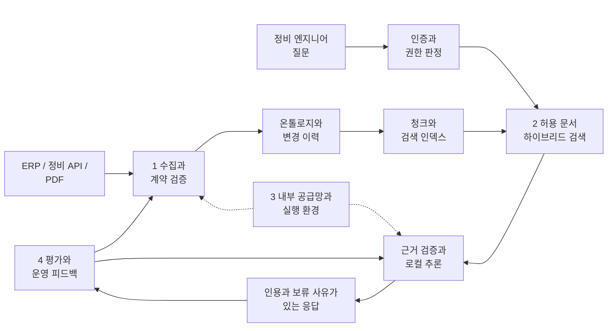

**[핵심 엔지니어링 분석 (Research & Considerations)]**

- **시스템 구성요소:** 소스 어댑터, 내구성 있는 원본 보관, 계약 검증기, 정규화 저장소, 검색 projection, 정책 저장소, 로컬 모델 서버, API, 감사 outbox와 관측 시스템이다. 데이터 plane과 배포·정책을 다루는 control plane의 자격증명을 분리한다.
- **핵심 고려사항:** “모델이 틀렸다”는 현상을 수집 누락, 오래된 데이터, 잘못된 identity 연결, 권한 필터, 검색 recall, 생성의 근거 이탈로 분해한다. 요청 trace와 문서·모델·정책 버전이 있어야 어느 경계가 원인인지 판별할 수 있다.
- **설계 결정:** 처음부터 모든 시스템을 실시간 연결하지 않는다. 데이터 정합성·접근 경계를 공유하는 작은 수직 경로를 완성한다. UI가 표시하는 설비 상태 시각과 문서 버전을 분리해 최신성의 의미를 드러낸다.
- **병목과 비용:** 예컨대 100만 개 × 768차원 × 4바이트는 원시 벡터만 약 3.07GB다. 인덱스, 복제본, 원문과 메타데이터는 별도다. LLM의 요청당 입력·출력 토큰, GPU 처리량과 큐 대기시간을 함께 측정하고, 청크 변경 해시로 불필요한 재임베딩을 줄인다.
- **실패 시 동작:** 검색은 성공하고 추론이 늦으면 승인된 근거 목록을 반환한다. ACL 서비스가 불확실하면 검색을 허용하지 않는다. 서로 다른 실패를 모두 “답변 없음”으로 집계하지 않는다.

**[실전 코드 (Production-grade Code)]**

아래는 측정 결과가 아닌 요청 deadline 배분이다. 각 I/O 호출에 남은 시간을 전달하고, 전체 요청 deadline을 상한으로 둔다. 단계별 p95를 더해 전체 p95라고 계산하지 않는다.

```python
# 단위 ms. 실제 값은 현장 부하 시험으로 조정한다.
stage_deadlines_ms = {
    "authentication": 50,
    "retrieval": 250,
    "reranking": 200,
    "inference": 4000,
    "validation": 200,
    "margin": 300,
}
if sum(stage_deadlines_ms.values()) > 5000:
    raise ValueError("요청 전체 deadline을 초과했습니다")
```

**[발표자 노트 (Speaker Script)]**

“고객은 설비가 과열되는 이유를 물었지만, 우리가 실제로 해결할 문제는 훨씬 구체적입니다. 같은 P-101이 어느 공장의 설비인지 알아야 하고, 매뉴얼과 정비 이력이 같은 대상을 가리켜야 합니다. 그다음 이 사용자가 볼 수 있는 문서만 모델에 전달해야 합니다. 저는 이 경계들을 먼저 설계하겠습니다. 문제가 생겼을 때 어느 데이터와 정책, 모델 버전으로 답했는지 재현할 수 있어야 현장 팀이 이 서비스를 신뢰할 수 있기 때문입니다. 먼저 가장 왼쪽, 서로 다른 소스가 같은 설비를 가리키는 지점으로 들어가겠습니다.”

## Frame 1-1 | Level 2 Topic Cluster | 레거시 통합에서 객체의 의미와 책임을 정하기

**[화면 핵심 (On-screen Message)]**

`Legacy Entity Resolution`

> 속성별 권위 소스(authoritative source)를 고객과 합의해 업무 객체를 정의한다.

- 소스 키와 canonical ID 매핑
- 설비·작업·근거의 관계와 책임
- 불명확한 매칭의 검토 대기열 격리

**[화면 시각화 가이드 (Visual Layout)]**

파랑 영역으로 확대한다. ERP 설비 ID, 정비 시스템의 장비 코드, PDF의 문자열 P-101을 각각 표시하고, 승인된 매핑만 하나의 Asset에 연결한다. 확신이 없는 연결은 회색 검토 대기열에 둔다. `Asset → WorkOrder → Evidence`를 업무 의미의 골격으로 강조한다. 발표 시간 2분.

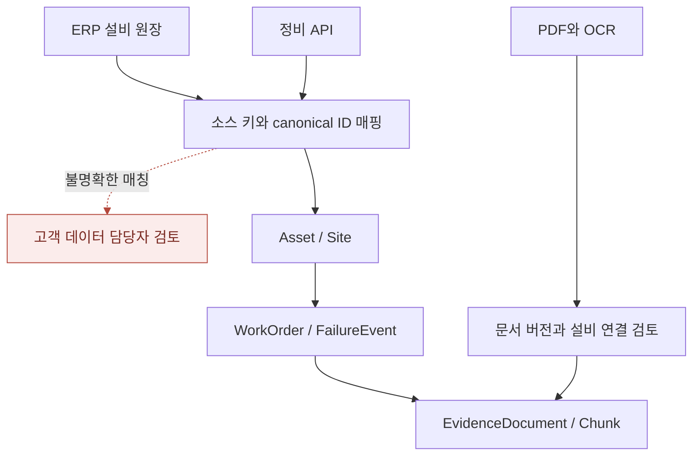

**[핵심 엔지니어링 분석 (Research & Considerations)]**

- **시스템 구성요소:** ERP는 snapshot+CDC, API는 pagination·cursor·rate limit을 가진 poller, 비정형 문서는 파일 manifest·parser·OCR 경로로 다룬다. 원본 URI, 체크섬, source schema, event time, 수집 시각과 접근 분류를 보존한다.
- **핵심 고려사항:** 문자열 유사도만으로 설비를 합치면 다른 공장의 동일 코드가 하나의 객체가 된다. 키는 최소한 tenant·site·source 범위를 포함한다. 불확실한 entity resolution은 자동 확정하지 않고 후보, 근거와 승인자를 기록한다.
- **온톨로지 결정:** Asset의 소유 공장과 상태, WorkOrder의 상태 전이, Evidence의 유효 버전, 관계의 cardinality를 명시한다. 객체·속성·관계와 업무 action을 연결하는 관점은 Palantir의 Ontology 설명과도 연결된다. 여기의 SQL 구현은 해당 제품 자체를 재현한다는 의미가 아니다. [Palantir Ontology](https://www.palantir.com/docs/foundry/ontology/overview)
- **충돌 해결:** 속성별 authoritative source를 합의한다. 예컨대 자산 소유 공장은 ERP, 작업 완료 상태는 정비 시스템이 책임진다. 서로 다른 소스의 벽시계 timestamp를 비교해 무조건 최신 값을 택하지 않는다. 코드의 Asset projection은 상태를 쓰는 authoritative source 하나로 범위를 고정한다.
- **보안과 확장성:** 원문은 격리 저장소에서 제한적으로 열고, 정규화·검색 projection으로 갈수록 필요한 필드만 이동한다. API 429는 지수 backoff와 jitter, cursor의 내구성 있는 저장으로 대응한다. PDF parser는 크기·페이지·실행시간 상한과 격리 실행이 필요하다.

**[실전 코드 (Production-grade Code)]**

`sql/schema.sql`의 매핑 테이블과 제약을 사용한다. 아래 두 source key가 같은 설비라는 판단은 고객 담당자가 승인했다고 가정한다. 정비 시스템의 비권위 매핑은 Asset 상태를 덮어쓸 수 없다.

```sql
INSERT INTO fde.identity_map
    (tenant_id, source, source_key, asset_id, authoritative)
VALUES
    ('acme', 'erp', 'A1',
     '00000000-0000-0000-0000-000000000001', true),
    ('acme', 'cmms', 'P-101',
     '00000000-0000-0000-0000-000000000001', false);

-- schema.sql에는 tenant와 asset별 권위 소스를 하나로 제한하는
-- 부분 UNIQUE 인덱스가 있다. 매핑 변경 권한은 ingest 계정에 주지 않는다.
```

**[발표자 노트 (Speaker Script)]**

“저는 첫 인터뷰에서 테이블 목록만 받지 않겠습니다. ‘이 설비의 소유 공장은 누가 결정하고, 어떤 시스템이 정비 완료를 확정합니까?’를 묻겠습니다. 두 시스템의 값이 다를 때 어느 쪽을 선택할지 정하지 않으면 통합은 성공해도 업무 결과는 틀릴 수 있습니다. 처음에는 고객이 확인한 매핑을 사용하고, 모호한 대상은 연결을 보류하겠습니다. 그 위에 객체와 관계를 만들면 검색뿐 아니라 향후 작업 지시 승인 같은 업무에도 같은 의미를 재사용할 수 있습니다.”

## Frame 1-2 | Level 3 Deep Dive and Code | 재전송과 역순 이벤트에도 상태를 보존하기

**[화면 핵심 (On-screen Message)]**

`Idempotent Event Ingestion`

> 소스 위치가 더 클 때만 갱신해 재전송과 역순 도착을 견딘다.

- event_id와 payload hash 검사
- receipt·상태·outbox의 원자적 기록
- COMMIT 이후 consumer offset ACK

**[화면 시각화 가이드 (Visual Layout)]**

CDC consumer와 materialized Asset 사이로 확대한다. `offset 10 → 20 → 10 재전송`을 순서대로 보여주고 DB 상태가 20에서 유지되는 장면을 강조한다. receipt·state·audit outbox를 하나의 트랜잭션 테두리로 묶는다. 발표 시간 4분.

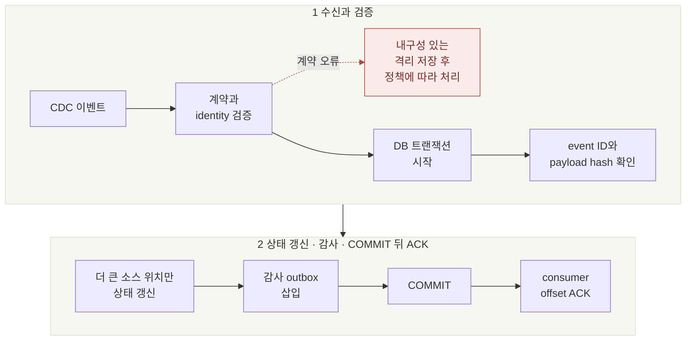

**[핵심 엔지니어링 분석 (Research & Considerations)]**

- **시스템 구성요소:** snapshot의 기준 위치와 CDC 연결, partition별 consumer, receipt 저장소, 버전 조건부 upsert, outbox exporter가 필요하다. DB commit 이후 offset ACK 전에 죽으면 같은 이벤트를 다시 처리할 수 있어야 한다.
- **핵심 고려사항:** Debezium은 장애 복구 중 마지막으로 기록된 offset부터 재개하면서 중복 이벤트를 만들 수 있다. sink가 재전송을 견뎌야 한다. [Debezium PostgreSQL 장애 복구](https://debezium.io/documentation/reference/stable/connectors/postgresql.html)
- **정합성 결정:** `event_id`는 tenant·source·source_key·epoch·offset·sequence로 만든다. 같은 식별자에 다른 payload가 오면 데이터 계약 위반으로 실패시킨다. 단순 중복 제거만으로는 처음 도착한 오래된 이벤트가 새 상태를 덮는 일을 막지 못하므로 버전 비교도 필요하다.
- **순서의 범위:** `(epoch, offset, sequence)`는 동일 authoritative source의 객체 안에서만 비교한다. PostgreSQL LSN 하나를 모든 소스의 전역 시계로 사용하지 않는다. 한 트랜잭션에 여러 변경이 있으면 별도 순번을 보존한다. repartition이나 소스 교체는 부트스트랩과 epoch 전환 절차를 요구한다.
- **운영 트레이드오프:** DB와 Kafka 사이의 전역 exactly-once를 주장하지 않는다. 상태·receipt·outbox를 원자적으로 쓰고 재시도하는 방식으로 효과를 멱등화한다. SQL timeout이나 일시 장애는 ACK하지 않는다. 계약 오류는 제한된 격리 저장소에 원문·오류 코드·소스 위치를 내구성 있게 기록한 뒤 partition 진행 정책을 적용한다.

**[실전 코드 (Production-grade Code)]**

전체 트랜잭션은 `fde/ingestion.py`의 `apply_event`에 있다. 아래 코드는 `sql/schema.sql`과 1-1의 권위 매핑이 준비된 실습 DB에서 실행한다. `FDE_INGEST_DSN`은 ingest 권한의 전용 연결이다.

```python
import os
from dataclasses import replace
import psycopg
from fde.ingestion import Event, apply_event

event = Event("acme", "erp", "A1", 1, 10, 0, 2, "upsert",
              {"name": "Pump A1", "status": "running"})
with psycopg.connect(os.environ["FDE_INGEST_DSN"], autocommit=True) as conn:
    print(apply_event(conn, event))                         # applied
    print(apply_event(conn, event))                         # duplicate
    newer = replace(event, offset=20,
                    payload={"name": "Pump A1", "status": "stopped"})
    print(apply_event(conn, newer))                         # applied
    older = replace(event, offset=9)
    print(apply_event(conn, older))                         # stale
# 각 함수는 commit을 마치고 반환한다. consumer ACK는 그 이후에 수행한다.
```

핵심 SQL은 `ON CONFLICT ... DO UPDATE ... WHERE (현재 위치) < (입력 위치)`다. receipt insert와 이 SQL, 감사 outbox insert 중 하나라도 실패하면 전부 rollback한다. 이미 열린 외부 트랜잭션 안에서 호출하면 조기 ACK 위험이 있어 함수가 거부한다.

**[발표자 노트 (Speaker Script)]**

“consumer가 데이터를 쓴 직후 죽으면, 재시작한 프로세스는 같은 이벤트를 다시 받을 수 있습니다. 저는 이 상황을 예외로 취급하지 않고 정상적인 복구 경로로 설계합니다. 여기서 receipt만 넣으면 중복은 막지만 역순 도착은 못 막습니다. 그래서 소스 위치가 더 클 때만 상태를 갱신합니다. 그리고 상태와 감사 이벤트는 같은 트랜잭션에 씁니다. 테스트에서는 감사 insert를 일부러 실패시켜 상태와 receipt까지 되돌아가는지 확인했습니다. 이 방식이면 복구 후의 최종 상태를 설명할 수 있습니다.”

## Frame 1-3 | Level 3 Deep Dive and Code | 스키마 변경과 삭제를 검색까지 전달하기

**[화면 핵심 (On-screen Message)]**

`Schema Evolution and Tombstones`

> source와 canonical 계약을 분리하고 삭제는 tombstone으로 남긴다.

- 정규화 어댑터와 알 수 없는 버전 격리
- 오래된 backfill로 인한 부활 차단
- 검색 제외와 캐시 무효화

**[화면 시각화 가이드 (Visual Layout)]**

오른쪽 미시 프레임으로 이동한다. `v1 asset_name/state → canonical → v2 name/status/criticality`를 위에 놓고, 아래에는 `삭제 → tombstone → 인덱스 비활성화 → 캐시 무효화`를 그린다. 오래된 backfill이 tombstone에 막히는 화살표를 강조한다. 발표 시간 3분.

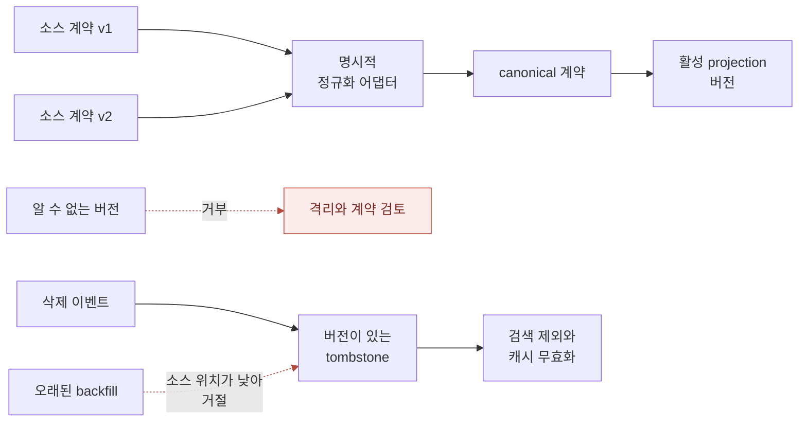

**[핵심 엔지니어링 분석 (Research & Considerations)]**

- **시스템 구성요소:** source schema registry, 버전별 adapter, canonical schema, 이중 projection과 활성 버전 포인터, 삭제 전파 작업을 구분한다. 파일은 본문 해시와 ACL 버전을 따로 기록해 권한 변경만 발생한 경우도 잡는다.
- **핵심 고려사항:** Schema Registry의 BACKWARD는 새 consumer가 과거 데이터를 읽는 방향이며, transitive는 직전 버전뿐 아니라 과거 버전까지 검사한다. 형식과 optional/default 선언에 따라 허용되는 변경이 달라진다. 필드 이름을 바꾸거나 단위를 바꾸는 것을 단순 호환 변경으로 가정하지 않는다. [Confluent 스키마 호환성](https://docs.confluent.io/platform/current/schema-registry/fundamentals/schema-evolution.html)
- **의미의 변화:** `temperature=70`의 단위가 섭씨에서 화씨로 바뀌면 JSON 타입 검사는 통과해도 의미가 깨진다. 단위·enum·null의 의미를 계약에 넣고, source와 canonical 버전을 각각 기록한다. 신규 버전을 모르면 값을 추측해 통과시키지 않는다.
- **배포 순서:** 새 consumer가 과거 계약을 읽도록 먼저 배포하고, 확장된 canonical 필드와 새 projection을 채운다. shadow 비교 후 활성 포인터를 바꾸고, rollback 기간이 끝난 뒤 옛 필드를 제거한다. 규격 호환성만으로 잘못 연결된 identity나 업무 의미까지 검증되지는 않는다.
- **삭제와 보관:** tombstone은 역순 재생으로 객체가 부활하는 일을 막는다. 검색 projection과 관련 캐시에서 삭제를 확인하고, 개인정보 원문 제거는 별도 보관 정책에 맞춰 수행한다. receipt·tombstone GC 기준은 최대 replay·backfill 기간보다 짧게 잡지 않는다. 증분 snapshot 중 DDL 허용 여부도 connector 버전과 절차로 확인한다.

**[실전 코드 (Production-grade Code)]**

아래는 새 offset의 삭제가 과거 upsert를 이기는 실행 예다. `normalize()`는 v1과 v2를 명시적으로 매핑하고 v3 등 알 수 없는 계약을 거부한다. 삭제 객체의 payload는 빈 객체만 허용한다.

```python
import os
import psycopg
from fde.ingestion import Event, apply_event

deleted = Event("acme", "erp", "A1", 1, 30, 0, 2, "delete", {})
backfill = Event("acme", "erp", "A1", 1, 8, 0, 1, "upsert",
                 {"asset_name": "Pump A1", "state": "running"})
with psycopg.connect(os.environ["FDE_INGEST_DSN"], autocommit=True) as conn:
    print(apply_event(conn, deleted))                       # applied
    print(apply_event(conn, backfill))                      # stale
# 검색 인덱스도 버전 조건과 deleted 상태를 반영해야 한다.
# 동봉 코드는 Asset tombstone과 RAG chunk의 삭제 제외를 각각 검증한다.
```

**[발표자 노트 (Speaker Script)]**

“스키마 진화에서 중요한 질문은 필드를 추가할 수 있느냐보다 기존 consumer가 과거 의미를 계속 읽을 수 있느냐입니다. 저는 source와 canonical 계약을 분리하겠습니다. 그러면 고객이 필드 이름을 바꿔도 아래 업무 모델은 안정적으로 유지할 수 있습니다. 삭제도 같은 원칙입니다. 행을 지우고 잊어버리면 늦게 도착한 backfill이 데이터를 되살릴 수 있습니다. 그래서 작은 tombstone을 남기고, 검색까지 삭제가 전달됐는지 확인합니다. 이제 이 정리된 데이터가 사용자 질문에 답하는 경로로 이동하겠습니다.”

## Frame 2-1 | Level 2 Topic Cluster | 권한이 있는 근거 안에서 하이브리드 검색하기

**[화면 핵심 (On-screen Message)]**

`Authorized Hybrid Retrieval`

> 허용된 문서 집합 안에서 BM25와 dense 벡터를 RRF로 결합한다.

- DB 권한과 문서 ACL의 사전 적용
- 키워드형·의미형 holdout 분리
- 허용 청크 5,000개 한도의 파일럿 정확 검색

**[화면 시각화 가이드 (Visual Layout)]**

전체 조감도를 거쳐 청록 영역으로 확대한다. 인증된 요청에서 시작해 권한 경계를 지난 뒤 lexical·dense 두 갈래로 나뉘게 한다. 두 화살표가 RRF에서 합쳐지고 reranker·context assembler로 이어진다. 비허용 문서가 LLM 앞에서 뒤늦게 제거되는 그림은 사용하지 않는다. 발표 시간 2분.

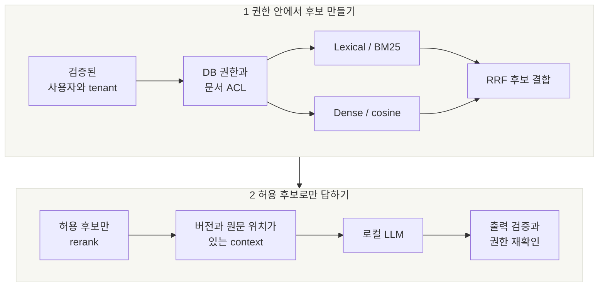

**[핵심 엔지니어링 분석 (Research & Considerations)]**

- **시스템 구성요소:** 검증된 주체, 정책 저장소, 문서·청크 ACL, lexical index, embedding index, fusion, 선택적 reranker, context budgeter와 모델 서버다. 문서의 검색 권한과 실제 업무 action 수행 권한은 별도다.
- **핵심 고려사항과 검색 트레이드오프:** 에러 코드 `ZX-19`와 부품 번호는 lexical 검색이 유리할 수 있고, “과열”과 “온도 상승”처럼 표현이 다른 질문은 dense가 도울 수 있다. 어느 쪽이 우월한지 미리 결론내리지 않고, 키워드형과 의미형 holdout을 분리한다. 원시 BM25 점수와 cosine을 임의로 더하지 않고 순위 기반 RRF를 기준선으로 쓴다. [Elastic RRF](https://www.elastic.co/docs/reference/elasticsearch/rest-apis/reciprocal-rank-fusion)
- **보안 결정:** 허용 집합에서 후보를 만들고, reranker와 LLM도 그 후보만 받는다. “전체 top-5를 가져와 나중에 ACL 필터”는 누출뿐 아니라 허용 문서가 top-5 밖으로 밀리는 recall 손실도 만든다. 문서 요약·청크·원문 링크에 같은 권한 의미를 적용한다.
- **물리 실행의 주의점:** 논리적으로 ACL을 적용해도 ANN 엔진이 물리적으로 전역 후보를 먼저 훑을 수 있다. pgvector는 근사 인덱스의 필터와 iterative scan 동작을 문서화한다. 선택도가 높은 ACL에서는 tenant partition, 별도 인덱스, iterative scan 또는 작은 허용 집합의 정확 검색을 비교한다. [pgvector filtering](https://github.com/pgvector/pgvector#filtering)
- **확장 결정:** 동봉한 코드는 RLS로 허용된 최대 5,000개 청크를 읽은 뒤 정확 BM25+cosine+RRF를 수행하는 **제한된 파일럿 경로**다. 100만 개 전체의 검색 엔진으로 사용하지 않는다. 대규모 경로는 ACL을 적용하는 검색 backend로 교체하고 recall·지연·권한을 다시 검증한다. 범위 초과 시 조용히 자르지 않고 실패시킨다.
- **한국어와 비용:** 단순 정규식 tokenizer와 테스트용 2차원 벡터로 한국어 검색 성능을 주장하지 않는다. 형태소 분석·동의어·설비 코드 보존, 한국어 embedding과 reranker는 고객 질의로 선택한다. embedding 모델 교체는 새 인덱스를 만들어 평가 후 전환한다.

**[실전 코드 (Production-grade Code)]**

아래는 서로 다른 검색 경로를 같은 API로 결합하는 실행 예다. 벡터는 알고리즘 확인용 fixture이며 실제 모델 출력이 아니다. `fde/retrieval.py`에 BM25·cosine·RRF 구현과 차원·NaN·0 벡터 검사가 들어 있다.

```python
from fde.retrieval import Chunk, rank

authorized_chunks = [
    Chunk("code-manual", 1, "ZX-19 trip code inspection", (0.0, 1.0)),
    Chunk("heat-manual", 1, "An overheated pump should be shut down.", (1.0, 0.0)),
]
results = rank("ZX-19", (1.0, 0.0), authorized_chunks, k=2)
print([chunk.id for chunk in results])
# 두 후보가 반환된다. 순위 동률은 chunk ID로 결정해 재현성을 확보한다.
# RRF의 1 / (60 + rank)는 순위 결합 점수이며 정답 확률이 아니다.
```

**[발표자 노트 (Speaker Script)]**

“현장 질문에는 자연어와 정확한 식별자가 섞여 있습니다. ‘P-101에서 ZX-19가 반복되는 이유’라는 질문을 벡터 검색만으로 처리하면 중요한 코드가 약해질 수 있습니다. 그래서 lexical과 dense를 함께 평가하겠습니다. 다만 보안은 검색 뒤에 붙이는 필터가 아닙니다. 허용된 문서 집합 안에서 두 검색을 수행하고, 그 후보만 reranker와 모델로 보냅니다. 작은 파일럿은 정확 검색으로 시작할 수 있지만, 실제 규모로 넓힐 때는 ACL 선택도가 검색 recall에 미치는 영향까지 다시 측정하겠습니다.”

## Frame 2-2 | Level 3 Deep Dive and Code | RBAC와 테넌트 경계를 DB에서 강제하기

**[화면 핵심 (On-screen Message)]**

`Database Row-level Security`

> 요청자가 보낸 role 대신 DB의 membership과 RLS로 읽기 범위를 제한한다.

- 요청마다 트랜잭션 범위의 identity 설정
- 소유자·reader 분리와 FORCE RLS
- 응답 직전 권한·버전·본문 재검증

**[화면 시각화 가이드 (Visual Layout)]**

검색 후보가 만들어지는 경계로 확대한다. Alice·Acme·Engineer 토큰과 Acme·HR 문서, Beta 문서를 나란히 놓고 뒤의 두 문서가 DB 조회 결과에 포함되지 않는 장면을 보여준다. 코드의 `set_config(..., true)`와 비특권 DB 계정을 강조한다. 발표 시간 4분.

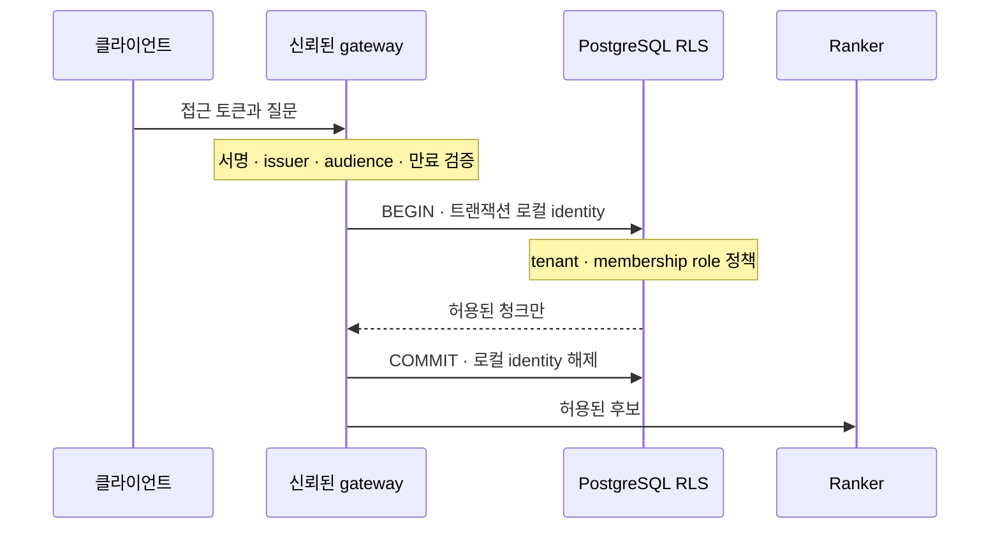

**[핵심 엔지니어링 분석 (Research & Considerations)]**

- **시스템 구성요소:** IdP 토큰 검증, 서버에서 tenant를 결정하는 gateway, membership 테이블, chunk ACL과 읽기 전용 DB role이다. 클라이언트가 보낸 `roles=[admin]`이나 tenant 파라미터를 권한 근거로 신뢰하지 않는다.
- **핵심 고려사항:** RBAC는 업무 role을 정의하고 문서 ACL과 tenant 조건으로 실제 읽기 범위를 제한한다. 더 복잡한 프로젝트·지역·보안등급은 ABAC 정책으로 확장할 수 있지만 정책 충돌과 deny 우선순위를 명시해야 한다.
- **DB 경계:** table owner, superuser, BYPASSRLS 계정으로 서비스하면 정책을 우회할 수 있다. 예제는 소유자와 reader를 분리하고 FORCE RLS를 켠다. [PostgreSQL Row Security](https://www.postgresql.org/docs/current/ddl-rowsecurity.html)
- **연결 풀과 위협 모델:** identity 설정은 요청마다 트랜잭션 범위로 지정한다. RLS는 이 설정을 바꿀 수 있는 침해된 gateway까지 막아주는 장치가 아니다. 토큰 검증·parameterized SQL·최소 DB 권한·서비스 격리가 함께 필요하다. 테넌트 간 강한 관리 경계가 필요하면 DB나 자격증명 자체를 분리한다.
- **철회와 캐시:** 예제는 응답 캐시를 사용하지 않는다. serving membership 변경은 다음 요청에서 적용된다. 실제 소스의 ACL 변경부터 serving까지의 전파와, 이미 생성 중인 응답의 철회 창은 별도다. 중요한 응답은 반환 직전 인용된 문서의 현재 권한·버전을 다시 확인한다. 캐시를 도입하면 tenant·subject 또는 권한 fingerprint·policy version·문서 버전을 키에 포함하고 철회에 따라 무효화한다.

**[실전 코드 (Production-grade Code)]**

실행 함수는 `fde/retrieval.py`의 `retrieve`와 `revalidate_evidence`이고 정책 전문은 `sql/schema.sql`에 있다. 아래는 reader 전용 DSN으로 호출하는 코드다. Principal은 예제의 신뢰된 입력이며 실제 서비스에서는 gateway의 토큰 검증 결과로만 만든다.

```python
import os
import psycopg
from fde.retrieval import Principal, retrieve, revalidate_evidence

principal = Principal(tenant="acme", subject="alice")
with psycopg.connect(os.environ["FDE_READER_DSN"], autocommit=True) as conn:
    results = retrieve(conn, principal, "pump", (1.0, 0.0), "fixture-v1")
    if results:
        revalidate_evidence(conn, principal, results, "fixture-v1")
    print([chunk.id for chunk in results])
# 함수 안에서 transaction-local tenant와 subject를 설정한다.
# membership은 DB에서 읽는다. 요청자가 임의 role을 넘길 인자는 없다.
```

정책의 핵심은 아래와 같다(`sql/schema.sql`). 소유자도 정책을 우회하지 않도록 FORCE를 켜고, `memberships`에도 요청자 본인 행만 보이는 RLS가 적용된다.

<!-- deck -->
```sql
ALTER TABLE fde.chunks ENABLE ROW LEVEL SECURITY;
ALTER TABLE fde.chunks FORCE ROW LEVEL SECURITY;

CREATE POLICY readable_chunks ON fde.chunks FOR SELECT TO fde_reader
USING (
    tenant_id = current_setting('app.tenant', true)
    AND NOT deleted
    AND EXISTS (
        SELECT 1 FROM fde.memberships m
        WHERE m.tenant_id = chunks.tenant_id
          AND m.subject = current_setting('app.subject', true)
          AND m.roles && chunks.allowed_roles
    )
);
```

이 SQL은 `schema.sql`에 이미 포함되어 있으므로 기존 정책 위에 다시 생성하지 않는다. 실제 API에서는 모델 생성이 끝난 뒤 응답 직전에 `revalidate_evidence`를 호출한다. 이는 새 READ COMMITTED 조회로 권한·버전·본문이 유지되는지 확인한다. 통합 테스트는 실제 비특권 LOGIN 계정으로 tenant 경계·HR 문서 제외·membership 변경·삭제·생성 중 철회와 버전 변경·요청 간 identity 초기화를 확인한다. 조회 직후 일어나는 철회와 네트워크 반환을 원자적으로 묶는 기능은 아니므로 요청 수명과 허용 철회 창을 함께 제한한다.

**[발표자 노트 (Speaker Script)]**

“이 설계에서 role을 결정하는 주체는 브라우저나 LLM이 아니라 고객의 인증과 권한 체계입니다. gateway는 토큰의 서명, issuer, audience, 만료를 확인하고 서버의 tenant 매핑을 사용합니다. DB에서도 같은 경계를 강제합니다. 여기서 흔한 실수는 개발 때 쓰던 DB 소유자 계정으로 서비스를 띄우는 것입니다. 그러면 RLS가 있어도 기대한 통제가 안 될 수 있습니다. 그래서 테스트도 소유자가 아닌 실제 reader 계정으로 실행합니다. 또 연결 풀을 돌려 쓸 때 이전 사용자의 설정이 다음 요청에 남지 않는지 확인했습니다.”

## Frame 2-3 | Level 3 Deep Dive and Code | 환각과 에이전트 권한을 다른 경계에서 통제하기

**[화면 핵심 (On-screen Message)]**

`Guardrails and Tool Budgets`

> 인용 출처는 코드로 검증하고 주장 내용은 독립 평가로 확인한다.

- 인용 ID·버전·원문 대조
- 고영향 판단의 전문가 검토
- read-only search와 호출 예산

**[화면 시각화 가이드 (Visual Layout)]**

생성 경로로 확대한다. 모델 출력의 각 claim에 `chunk_id / version / quote` 태그를 붙이고, 없는 출처·바뀐 버전·원문에 없는 인용을 붉게 표시한다. 도구 호출은 모델과 업무 시스템 사이의 별도 검증 문을 지나게 한다. 발표 시간 4분.

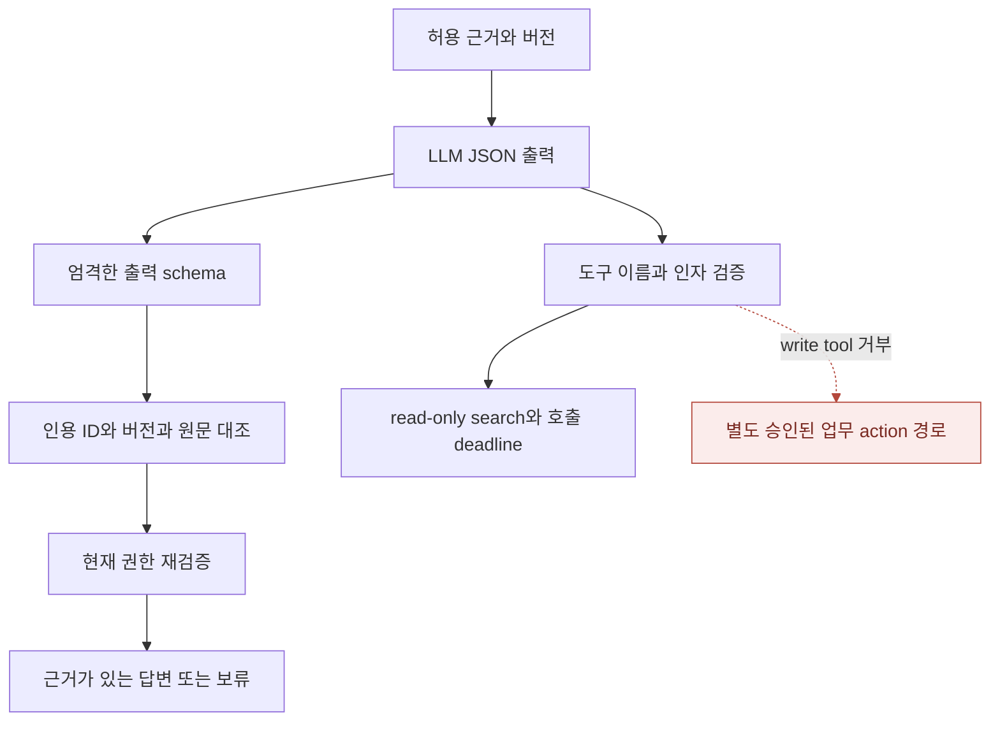

**[핵심 엔지니어링 분석 (Research & Considerations)]**

- **시스템 구성요소:** 제한된 context, 구조화 출력 schema, claim별 citation validator, 의미적 support 평가, tool gateway, 호출·시간·토큰 예산이다. 근거가 없는 질문에는 보류하도록 하고, 인용 링크는 권한 있는 내부 원문 viewer로 연결한다.
- **핵심 고려사항과 환각 통제:** JSON 유효성은 내용의 진실을 증명하지 않는다. 인용문이 원문에 있다는 사실도 “계속 가동하라”라는 주장이 “점검 전 정지하라”라는 문장으로 뒷받침된다는 뜻은 아니다. 코드가 보장하는 것은 인용 provenance다. 의미적 support는 독립 라벨과 평가, 높은 영향의 판단은 전문가 확인으로 통제한다.
- **Prompt injection:** 검색 문서는 명령을 담을 수 있는 비신뢰 입력이다. RAG만으로 간접 prompt injection이 해결되지는 않는다. [OWASP Prompt Injection](https://genai.owasp.org/llmrisk/llm01-prompt-injection/)
- **에이전트 권한:** 모델에게 임의 SQL, shell, URL fetch를 주지 않는다. 예제 gateway는 `search(query)` 하나만 허용하고 tenant와 subject를 서버에 고정한다. 쓰기가 필요해지면 객체 ID, 예상 객체 버전, idempotency key, 별도 action 권한과 승인 상태를 검증하는 경로를 만든다.
- **지연과 비용:** 도구 호출 수, 전체 deadline, 입력·출력 토큰 상한을 함께 둔다. 이 예제의 ToolBudget은 도구 호출 수와 남은 시간을 관리하며, 토큰 상한은 실제 모델 adapter에서 설정해야 한다. 재시도로 같은 deadline을 새로 부여하지 않는다. 확신을 RRF 점수나 모델의 자가 평가 숫자로 대신하지 않는다.

**[실전 코드 (Production-grade Code)]**

실행 가능한 출력 검증 예다. 실제 모델 adapter는 동일한 JSON 계약으로 출력하고, 로컬 endpoint의 timeout·최대 응답 크기·출력 토큰을 강제해야 한다. 그 adapter와 IdP 연결은 고객 환경의 통합 지점이다.

```python
import json
from fde.guardrails import validate_answer
from fde.retrieval import Chunk

evidence = [Chunk("manual-p1", 2,
                  "The pump must stop before inspection.", (1.0, 0.0))]
model_output = json.dumps({
    "abstain": False,
    "claims": [{
        "text": "점검 전에 펌프를 정지해야 합니다.",
        "chunk_id": "manual-p1", "version": 2,
        "quote": "must stop before inspection",
    }],
})
validated = validate_answer(model_output, evidence)
print(validated["claims"][0]["chunk_id"])
# unknown field, duplicate JSON key, 잘못된 citation/version/quote는 거부한다.
```

`fde/guardrails.py`의 `ToolBudget.invoke`는 허용 도구와 정확한 인자 집합을 검사하고 호출 횟수를 차감한다. callback은 받은 `remaining_seconds`를 실제 네트워크 timeout에 적용해야 한다. Python deadline 검사만으로 임의의 blocking 함수를 중단할 수 있다고 가정하지 않는다.

**[발표자 노트 (Speaker Script)]**

“저는 환각을 없앴다고 말하지 않겠습니다. 대신 무엇을 기계적으로 검증했고 무엇을 평가해야 하는지 구분하겠습니다. 이 코드는 검색하지 않은 문서의 인용, 오래된 버전, 원문에 없는 문장을 거부합니다. 하지만 원문의 뜻을 뒤집은 주장을 완벽히 판별하지는 못합니다. 그 부분은 별도의 정답·support 평가로 확인합니다. 에이전트의 경우에는 모델이 잘 행동할 것이라는 기대 대신 실제 호출 가능한 기능을 제한합니다. 모델이 문서의 악성 지시를 따라도 검색 이상의 업무 권한이 생기지 않도록 만드는 것입니다.”

## Frame 3-1 | Level 2 Topic Cluster | 폐쇄망을 독립적인 공급망과 운영 환경으로 설계하기

**[화면 핵심 (On-screen Message)]**

`Air-gapped Supply Chain`

> 서명된 release manifest로 반입물의 승인 여부와 무결성을 검증한다.

- 번들 밖 신뢰 키와 승인 release ID
- 내부 OCI·모델·패키지 저장소
- 인터넷 없는 cold start 시험

**[화면 시각화 가이드 (Visual Layout)]**

전체 조감도를 거쳐 보라 영역으로 이동한다. 인터넷 연결 구역과 고객 폐쇄망 사이에 승인된 반입 지점을 하나만 둔다. 컨테이너 외에 모델·tokenizer·Python wheel·인증서·취약점 정보도 함께 이동하는 모습을 그린다. 발표 시간 2분.

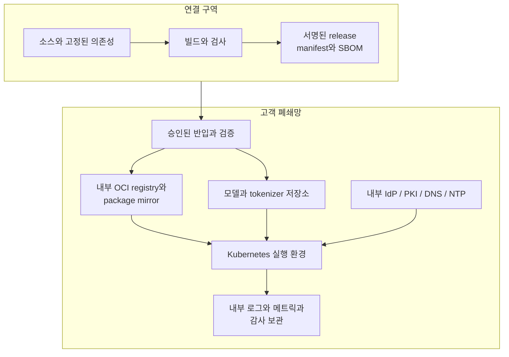

**[핵심 엔지니어링 분석 (Research & Considerations)]**

- **시스템 구성요소:** 내부 Kubernetes와 container runtime, OCI registry, package·OS mirror, 모델 저장소, 내부 인증·시간·인증서 체계, 모니터링, 백업과 복구 매체다. 클러스터 설치부터 업그레이드까지 필요한 이미지와 패키지를 포함한다.
- **핵심 고려사항:** 외부 호출을 제거해도 첫 실행에 tokenizer를 내려받거나, 인증서·라이선스 검증·telemetry가 인터넷을 요구할 수 있다. 네트워크를 실제 차단한 cold start와 재시작 시험으로 숨은 의존성을 확인한다. 모델 가중치뿐 아니라 tokenizer, config, quantization format과 라이선스도 버전 관리한다.
- **서명과 신뢰:** 해시만 번들에 같이 넣으면 공격자가 파일과 해시를 함께 바꿀 수 있다. 검증 키나 trust root는 번들 밖에서 고객에게 사전 배포한다. Sigstore를 선택하면 offline 검증에 필요한 bundle과 trust 자료를 함께 준비하고 승인된 signer identity·issuer를 확인한다. [Sigstore 검증](https://docs.sigstore.dev/cosign/verifying/verify/)
- **예제의 결정:** 실행 예제는 폐쇄망에서 테스트하기 쉬운 RSA-SHA256 서명 manifest를 OpenSSL로 확인한다. 승인된 release ID와 만료를 검사하고 각 파일의 크기·해시를 대조한다. OCI admission, 이미지 내 취약점 검사와 SBOM 검토는 별도의 배포 통제다. [OpenSSL dgst](https://docs.openssl.org/3.0/man1/openssl-dgst/)
- **용량과 운영:** 모델 크기와 KV cache, 동시 요청과 context 길이로 GPU 메모리를 산정한다. API replica를 늘리는 것만으로 추론 처리량이 늘지 않으므로 inference 큐와 GPU 사용률을 따로 본다. 패치 반입 주기, 키 철회, 인증서 만료와 비상 복구 책임자를 미리 정한다.

**[실전 코드 (Production-grade Code)]**

`fde/bundle.py`는 서명을 먼저 검증한 뒤 manifest를 파싱한다. 승인된 키와 기대 release ID는 운영자가 관리하는 별도 경로에서 읽는다. 승인되지 않은 묶음을 검증 통과시키기 위해 기대 ID를 자동으로 번들에서 가져오지 않는다.

```python
import os
from fde.bundle import verify_bundle

verified = verify_bundle(
    os.environ["RELEASE_BUNDLE_DIR"],
    public_key=os.environ["PROVISIONED_RELEASE_PUBLIC_KEY"],
    expected_release=os.environ["APPROVED_RELEASE_ID"],
)
print(verified["release_id"])
# 실제 서명 검증은 openssl dgst -sha256 -verify로 수행한다.
# manifest 서명, 만료, release ID, 파일 크기와 해시를 모두 검사한다.
# 절대 경로, 상위 경로 이탈, 중복 경로와 symlink도 거부한다.
```

반입 staging 디렉터리는 검증 중 쓰기가 차단되고, 배포는 검증된 manifest에 나열된 파일만 소비해야 한다. 해시가 맞는 파일의 안전성이나 라이선스 적합성까지 서명이 증명하는 것은 아니다.

**[발표자 노트 (Speaker Script)]**

“폐쇄망 고객에게 컨테이너 이미지를 전달했다고 배포 준비가 끝난 것은 아닙니다. 모델이 시작하면서 tokenizer를 찾거나, 인증서 갱신이 외부에 의존하면 현장에서 멈춥니다. 저는 실행에 필요한 전체 의존성 묶음과 내부 운영 서비스를 먼저 확인하겠습니다. 반입 시에는 고객이 이미 신뢰하는 키로 manifest를 검증합니다. 여기서 서명은 승인된 제작자가 이 바이트를 만들었다는 근거이고, 그 코드가 안전하다는 보증은 아닙니다. 취약점 검토와 라이선스, rollback 가능성은 별도 게이트로 두겠습니다.”

## Frame 3-2 | Level 3 Deep Dive and Code | 컨테이너 권한과 네트워크 경계를 실행 설정으로 고정하기

**[화면 핵심 (On-screen Message)]**

`Hardened Container Runtime`

> 권한과 네트워크 경계를 설정으로 고정하고 실제 차단은 현장에서 확인한다.

- sha256 image digest 명시
- read-only root와 non-root 실행
- default-deny 기반 NetworkPolicy

**[화면 시각화 가이드 (Visual Layout)]**

폐쇄망의 Kubernetes 내부로 확대한다. gateway·API·DB·inference를 별도 상자로 그리고 허용된 포트만 선으로 연결한다. Internet 방향은 선을 없애고 default deny를 표시한다. API 컨테이너 안에는 non-root·read-only root·token 미마운트를 작은 태그로 붙인다. 발표 시간 3분.

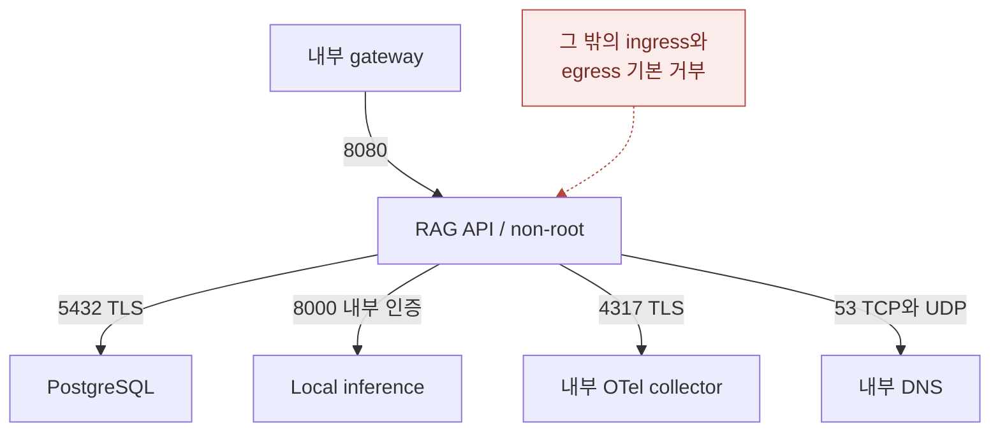

**[핵심 엔지니어링 분석 (Research & Considerations)]**

- **시스템 구성요소:** digest로 고정한 이미지, 제한된 ServiceAccount, securityContext, resource requests/limits, probes, Secret·모델 volume, default-deny NetworkPolicy와 명시적 allow 규칙이다.
- **핵심 고려사항:** Restricted Pod Security 기준의 non-root·권한 상승 금지·capability 제거·seccomp를 반영한다. read-only root filesystem도 적용하고 필요한 임시 쓰기는 제한된 emptyDir로 분리한다. Secret은 이미지나 Git에 넣지 않고 volume과 내부 자격증명 관리 체계로 전달한다. [Kubernetes Pod Security Standards](https://kubernetes.io/docs/concepts/security/pod-security-standards/)
- **네트워크와 암호화:** NetworkPolicy는 이를 구현하는 CNI가 있어야 효과가 있다. L3/L4 허용 목록은 사용자 인증이나 mTLS를 대신하지 않는다. DNS 허용만으로 외부 통신 차단의 전부를 증명하지 않으며 노드·외곽 방화벽과 내부 DNS 정책도 확인한다. [Kubernetes NetworkPolicy](https://kubernetes.io/docs/concepts/services-networking/network-policies/)
- **가용성:** liveness는 프로세스 자체의 복구 불가능 상태를 보고, 외부 DB나 inference 장애로 전체 API를 반복 재시작시키지 않는다. readiness는 새 트래픽 수용 여부를 보며 startup probe는 초기화 시간을 분리한다. GPU 모델 서버는 API와 분리해 독립적으로 큐·자원·warm-up을 관리한다.
- **배포 전제:** renderer는 이미 빌드된 API 이미지가 8080과 `/healthz`, `/readyz`를 제공한다고 가정한 배포 조각이다. 실제 IdP/gateway·DB·inference·OTel, DB TLS 자격증명 Secret `fde-db`, 모델 PVC `approved-models`, registry 인증과 상대 서비스의 운영 정책은 고객 플랫폼에 준비되어야 한다. default-deny가 적용되는 gateway의 ingress/egress와 DB 복제·백업 경로도 별도 검토한다.

**[실전 코드 (Production-grade Code)]**

`deploy/render.py`는 검토된 실제 image digest를 입력받아 Namespace·ServiceAccount·Deployment·Service와 NetworkPolicy를 렌더링한다. 가짜 digest가 들어간 이미지를 실행 가능하다고 제시하지 않는다.

```python
import os
from pathlib import Path
import yaml
from deploy.render import render

documents = render(os.environ["APPROVED_IMAGE"])
Path("workload.yaml").write_text(
    yaml.safe_dump_all(documents, sort_keys=False), encoding="utf-8"
)
# APPROVED_IMAGE는 registry.internal/...@sha256:실제64자리digest 형태다.
# tag-only 입력은 거부한다. 생성물에 비밀 값은 포함하지 않는다.
# 승인된 고객 환경에서 server-side dry-run 후 배포하고 연결을 실측한다.
```

생성되는 컨테이너 설정의 핵심 부분은 다음과 같다. 전체 매니페스트는 renderer 출력에 포함된다.

```yaml
securityContext:
  allowPrivilegeEscalation: false
  readOnlyRootFilesystem: true
  capabilities:
    drop: [ALL]
resources:
  requests:
    cpu: 500m
    memory: 512Mi
  limits:
    cpu: "2"
    memory: 2Gi
```

**[발표자 노트 (Speaker Script)]**

“제가 이 YAML에서 먼저 설명할 것은 replica 수보다 경계입니다. API에는 Kubernetes 관리 권한이 필요하지 않으므로 ServiceAccount 토큰을 자동으로 넣지 않습니다. 컨테이너는 root로 실행하지 않고, 필요한 임시 경로 외에는 쓰기를 제한합니다. 네트워크도 목적지와 포트를 명시합니다. 다만 이 파일이 문법적으로 맞는 것과 CNI가 실제 통신을 차단하는 것은 다른 검증입니다. 고객 환경에서는 허용 경로가 연결되고 금지된 외부 경로가 실패하는지 직접 확인하겠습니다. probe도 의존 서비스 장애 때 재시작 폭풍을 만들지 않게 나누겠습니다.”

## Frame 3-3 | Level 3 Deep Dive and Code | PII를 줄이고 감사 추적을 업무 경계에 남기기

**[화면 핵심 (On-screen Message)]**

`Privacy Minimization and Auditing`

> 필드 최소화와 HMAC 가명처리로 검색 projection과 감사 기록의 노출 위험을 줄인다.

- 정형 연락처 필드 마스킹
- 자유 텍스트 PII의 표본 평가
- 원문 없는 감사 outbox와 별도 보관소

**[화면 시각화 가이드 (Visual Layout)]**

문서가 검색 인덱스로 넘어가는 경계와 API가 감사 기록을 남기는 경계를 나란히 확대한다. 원문에는 연락처가 있고 검색 projection에는 마스킹된 값만 남게 한다. 로그에 원문 질문·응답·토큰이 들어가는 화살표는 차단한다. 발표 시간 3분.

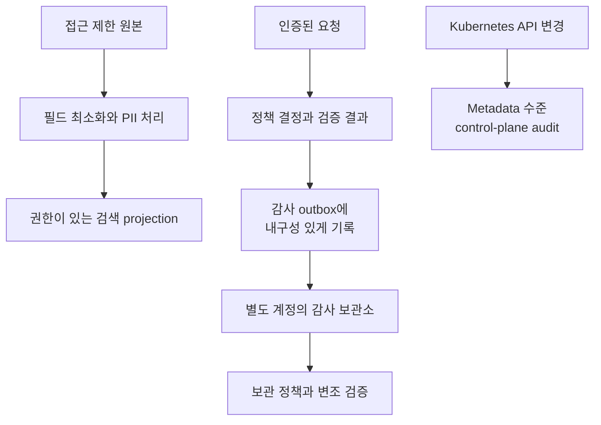

**[핵심 엔지니어링 분석 (Research & Considerations)]**

- **시스템 구성요소:** 데이터 분류, 구조화 필드 allowlist, 도메인별 PII recognizer, 암호화된 제한 원본, 검색 projection, application audit outbox, 별도 audit sink와 Kubernetes API audit를 구분한다.
- **핵심 고려사항:** 정형 연락처 필드는 처음부터 제외하거나 마스킹한다. 자유 텍스트는 recognizer·NER·도메인 룰로 검사하고 표본 평가한다. regex나 Presidio를 사용해도 모든 개인정보 탐지를 보장할 수 없다. 한국어 이름과 OCR 깨짐은 별도 검증 대상이다. [Presidio FAQ](https://github.com/data-privacy-stack/presidio/blob/main/docs/faq.md)
- **로그 최소화:** trace에는 latency·오류 코드·artifact version 등 허용된 항목만 남긴다. 질문·본문·응답·Authorization header를 기본 수집하지 않는다. 작은 식별자 공간의 단순 SHA256은 역추정될 수 있어, 예제는 별도 키와 key ID가 있는 HMAC을 사용한다. 이것은 익명화가 아닌 가명처리다. [OpenTelemetry 민감정보 처리](https://opentelemetry.io/docs/security/handling-sensitive-data/)
- **감사 설계:** 누가 어떤 정책·문서·모델 버전으로 무엇을 읽거나 거부당했는지 추적한다. 예제의 최소 이벤트에는 가명 actor·tenant, request ID, 판정과 artifact digest를 넣는다. 실제 문서 접근 이벤트를 추가할 때도 문서 ID·정책 버전을 allowlist로 확장하고 원문은 넣지 않는다.
- **내구성과 변조:** 수집 상태 변경은 outbox와 함께 commit한다. 민감한 업무 action이나 접근 응답도 정책상 감사 내구성이 필요하면 기록 실패 시 성공으로 응답하지 않는다. DB outbox는 WORM이 아니므로 exporter가 별도 계정의 보관소에 전달하고 수신 ACK 전에는 버리지 않는다. hash chain만으로 꼬리 삭제까지 탐지할 수 없으므로 외부에 보관한 서명 checkpoint나 WORM 정책이 필요하다.
- **계층 분리:** Kubernetes audit는 API server 작업을 기록하며 앱 내부 문서 조회의 대체물이 아니다. Secret 내용이 로그로 복제되지 않도록 Metadata 수준을 사용한다. [Kubernetes Auditing](https://kubernetes.io/docs/tasks/debug/debug-cluster/audit/)

**[실전 코드 (Production-grade Code)]**

아래는 최소화·가명처리의 실행 예다. key는 실습에서만 임시 생성하고, 운영에서는 KMS가 관리하는 키와 교체 절차를 사용한다. `audit_record`는 임의 payload를 받아 그대로 로그에 흘리지 않도록 인자를 제한한다.

```python
import secrets
from fde.privacy import audit_record, mask_contact_fields

projection = mask_contact_fields({
    "asset_id": "00000000-0000-0000-0000-000000000001",
    "contact_email": "engineer@example.com",
    "contact_phone": "010-1234-5678",
    "unapproved_notes": "이 필드는 projection에서 제외됩니다",
})
event = audit_record(
    key=secrets.token_bytes(32), key_id="lab-only-v1",
    tenant="acme", subject="engineer@example.com",
    request_id="00000000-0000-0000-0000-000000000002",
    decision="allow", artifact_digest="sha256:" + "a" * 64,
)
print(projection["contact_email"], event["decision"])
# digest는 검증용 fixture다. 운영에서는 현재 배포 artifact digest를 넣는다.
# audit event를 실제 저장하는 호출은 해당 업무 트랜잭션 안에서 수행한다.
```

**[발표자 노트 (Speaker Script)]**

“폐쇄망이라고 해서 내부 로그에 모든 데이터를 남겨도 되는 것은 아닙니다. 장애를 분석하려고 저장한 prompt나 문서 본문이 더 넓은 권한의 로그 시스템으로 복제될 수 있습니다. 저는 먼저 필요한 필드만 projection에 넣고, 감사 기록도 정해진 필드만 받게 하겠습니다. 연락처를 가린다고 모든 PII가 제거되는 것은 아니므로 자유 텍스트 탐지는 고객 언어와 문서로 평가합니다. 감사 기록은 일반 디버그 로그와 보관 권한을 분리하고, 중요한 작업에서는 내구성 있는 감사 기록과 업무 성공을 함께 결정하겠습니다.”

## Frame 4-1 | Level 2 Topic Cluster | 10일 안에 수직 MVP를 만들고 운영 조건을 합의하기

**[화면 핵심 (On-screen Message)]**

`Ten-day Vertical MVP`

> 범위는 단일 공장으로 줄이되 ACL과 provenance는 미루지 않는다.

- 첫날 접근권한과 데이터 owner 확인
- 일자별 진입 조건이 있는 10일 제안 일정
- 운영 owner·온콜·rollback 담당자에게 인계

**[화면 시각화 가이드 (Visual Layout)]**

조감도를 거쳐 주황 영역으로 이동한다. 10일 timeline을 1주차(범위·데이터·권한·검색)와 2주차(응답·배포·운영·공개) 두 띠로 나누어, 업무 성공 기준에서 작은 수직 경로·평가·제한 공개·운영 인계로 가는 순서를 일자별로 보인다. 마지막에는 사용 결과와 장애 피드백으로 범위를 다시 합의하는 다음 반복을 붙인다. scope를 넓히는 일과 운영 수준을 높이는 일을 같은 일정에 섞지 않는다. 발표 시간 2분.

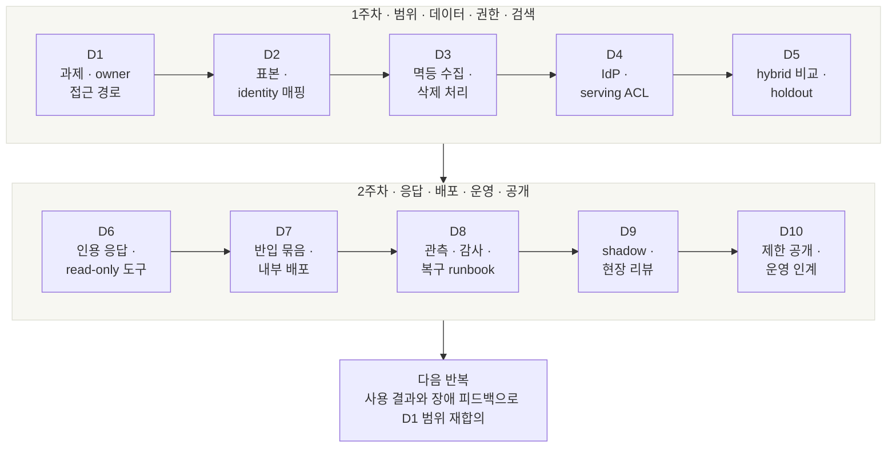

**[핵심 엔지니어링 분석 (Research & Considerations)]**

- **시스템 구성요소:** 고객 업무 담당자, 데이터 owner, 보안·플랫폼 담당자, FDE가 같은 backlog와 수용 기준을 공유한다. 결정 기록에는 선택, 버린 대안, 이유와 재검토 조건을 적는다.
- **핵심 고려사항:** 속도를 위해 문서 범위를 줄일 수는 있지만 ACL과 데이터 provenance를 나중으로 미루지 않는다. 첫 주부터 실제 배포 경로와 평가용 질의를 사용해야 노트북 전용 데모에서 벗어날 수 있다.
- **고객 협업:** 첫날 접근권한과 데이터 owner가 확보되지 않으면 일정의 임계경로가 바뀐다. 합성 데이터로 UI·계약·배포를 진행하되 실제 데이터 통합 완료라고 부르지 않는다. 두 주는 제한 MVP의 시간 상자이며 전체 운영 승인의 마감 보장이 아니다.
- **전환 결정:** 앱 계층은 하나의 작고 관측 가능한 서비스로 시작하고 DB·모델 서버는 별도 경계로 둔다. 트래픽, 조직 소유권이나 배포 주기가 실제로 갈라질 때 서비스 분리를 재검토한다.

| 일자 | 현장에서 만드는 결과 | 다음 단계 진입 조건 |
| --- | --- | --- |
| 1 | 사용자 업무 1개, 기준 과제, 데이터·보안 owner, 접근 경로 | 성공·보류·거부의 의미와 범위 합의 |
| 2 | ERP·정비 API·문서 manifest의 작은 표본, identity 매핑 | 연결 대상과 authoritative source 확인 |
| 3 | 계약 검증·멱등 수집·삭제 처리 | 재전송·역순·복구 테스트 통과 |
| 4 | IdP 연계와 serving ACL | 다른 tenant와 role의 부정 접근 차단 |
| 5 | lexical 기준선과 hybrid 비교, 고정 holdout | 모델 선택 전 검색 실패 원인 분류 |
| 6 | 인용 응답·보류·read-only 도구 | 근거 없는 출력과 도구 인자 거부 |
| 7 | 반입 묶음과 내부 배포 설정 | 인터넷 차단 cold start와 재시작 확인 |
| 8 | 관측·감사·백업·복구 runbook | 실제 복구 시간과 누락 범위 기록 |
| 9 | shadow 실행과 현장 전문가 리뷰 | 업무 과제별 품질·지연 게이트 충족 |
| 10 | 제한 공개, 이관 자료, 다음 backlog | 운영 owner·온콜·rollback 담당자에게 인계 |

**[실전 코드 (Production-grade Code)]**

다음은 `.github/workflows/check.yml`의 검사 job과 같은 흐름이다. 이 job은 예제를 검증하며 자동 운영 배포는 수행하지 않는다. 폐쇄망에서는 승인된 내부 Git runner·action mirror·package mirror로 같은 검증 DAG를 실행한다. 연결 구역에서 받은 의존성은 검토 후 해시 고정 wheelhouse에 반입한다.

```yaml
name: Verify engineering examples
on: [push, pull_request]
permissions:
  contents: read
jobs:
  verify:
    runs-on: ubuntu-24.04
    timeout-minutes: 10
    steps:
      - uses: actions/checkout@11bd71901bbe5b1630ceea73d27597364c9af683
      - uses: actions/setup-python@a26af69be951a213d495a4c3e4e4022e16d87065
        with:
          python-version: '3.12'
      - run: sudo apt-get update -qq && sudo apt-get install -y postgresql
      - run: python -m pip install -r requirements.txt
      - run: python scripts/check.py --all
```

**[발표자 노트 (Speaker Script)]**

“저는 두 주 안에 모든 데이터를 통합하겠다고 약속하지 않겠습니다. 대신 첫날 사용자 과제 하나와 제한된 설비군을 정하고, 그 과제가 실제 권한과 배포 경로를 통과하게 만들겠습니다. 범위를 줄여도 중복 처리와 ACL은 처음부터 넣습니다. 이 부분을 생략하면 데모가 성공해도 운영 전환 때 구조를 다시 만들어야 합니다. 열흘째의 결과물은 화면만이 아니라 평가 결과, 복구 절차, 운영 owner가 함께 있는 제한 공개 서비스입니다. 접근 승인이 지연되면 무엇을 검증했고 무엇이 아직 실제 데이터로 연결되지 않았는지도 분명히 말하겠습니다.”

## Frame 4-2 | Level 3 Deep Dive and Code | 평균 점수에 숨지 않는 품질과 배포 게이트

**[화면 핵심 (On-screen Message)]**

`Evaluation and Promotion Gates`

> 평균이 아닌 질문 유형별 슬라이스 기준으로 승격을 판정한다.

- 코드형·의미형 Hit@5 분리 평가
- support rate와 coverage 동시 충족
- ACL 누출 1건에도 승격 중단

**[화면 시각화 가이드 (Visual Layout)]**

승격 게이트로 확대한다. `코드 검사 → 데이터·모델 평가 → 내부 staging → canary → 운영`을 다섯 문으로 표시한다. 금지 접근 1건은 다른 품질 점수와 합산되지 않고 즉시 실패하는 별도 붉은 문으로 둔다. 발표 시간 3분.

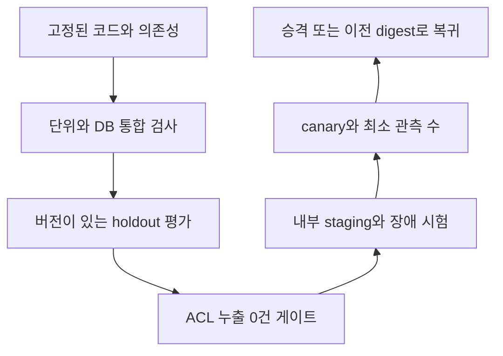

**[핵심 엔지니어링 분석 (Research & Considerations)]**

- **시스템 구성요소:** 소스·의존성·prompt·embedding·reranker·LLM·인덱스·정책·평가셋의 버전을 묶은 release manifest, 독립 라벨, 평가 runner와 승격 gate다. 같은 이미지라도 인덱스나 prompt가 바뀌면 다시 평가한다.
- **핵심 고려사항과 평가 분리:** 질문을 정확 코드형, 의미형, 근거 없음, 권한 없음으로 나눈다. 학습·튜닝 질의와 holdout을 분리하고, “근거 있음” 라벨은 답변한 모델 자신의 평점만으로 결정하지 않는다. 자동 출처 검사와 현장 전문가의 claim support 판정을 함께 사용한다.
- **분모 명시:** Hit@5는 정답 근거를 하나 이상 찾은 질의의 비율이다. 여러 정답 문서 중 얼마나 찾았는지 세는 Recall@5와 구분한다. support rate는 답변한 질의 중 모든 핵심 주장이 근거로 지지된 비율이며, coverage는 답변 가능한 질의 중 실제 답한 비율이다. 무조건 보류해서 support만 높이는 전략을 coverage로 막는다.
- **작은 표본의 한계:** 슬라이스당 30개는 gate가 빈 자료로 통과하는 일을 막는 최소값이다. 누출 0건 관측이 실제 누출 확률 0을 증명하지는 않는다. 운영 공개 범위와 영향에 따라 표본·공격 케이스·신뢰구간 검토를 확대한다.
- **승격과 비용:** 표의 기준은 제안값이다. 실제 deadline·토큰 상한을 고정한 상태에서 평가하고, 전체 p95뿐 아니라 답변 가능한 슬라이스의 p95도 검사한다. canary는 예컨대 5%에서 시작하되 최소 관측 수와 시간, 보안·품질·오류 중단 기준을 모두 충족해야 다음 단계로 진행한다.

| 게이트 | 제안 기준 | 실패했을 때의 조치 |
| --- | --- | --- |
| 코드형·의미형 Hit@5 | 각각 90% 이상 | 청크·분석기·retrieval 조정 후 재평가 |
| 답변 support rate | 코드형·의미형 각 98% 이상 | context와 생성 정책 점검 |
| 답변 coverage | 답변 가능한 각 슬라이스 80% 이상 | 과도한 보류 원인 분석 |
| 근거 없는 질의의 보류율 | 95% 이상 | 근거 sufficiency 판정 조정 |
| 권한 없는 정보의 노출 | 전체 평가에서 누출 0건, 권한 없는 질의는 전건 보류 | 승격 중단과 권한 경계 수정 |
| 응답 p95 | 전체와 답변 가능한 각 슬라이스 5초 이하 | 추론 큐·context·reranker 비용 조정 |

**[실전 코드 (Production-grade Code)]**

`fde/release_gate.py`는 누락·빈 자료·NaN·중복 ID를 거부하고 슬라이스별 기준을 검사한다. 이 함수는 모델을 실행하거나 정답을 자동 생성하는 evaluator가 아니라, **독립적으로 얻은 평가 결과의 승격 판정기**다.

```python
import json
import os
from fde.release_gate import evaluate

with open(os.environ["EVALUATION_REPORT"], encoding="utf-8") as stream:
    report = json.load(stream)
decision = evaluate(report)
print(json.dumps(decision, ensure_ascii=False, indent=2))
if not decision["pass"]:
    raise SystemExit(1)   # CI는 결과가 없거나 실패하면 승격하지 않는다.
```

report는 `dataset_version`, `artifact_digest`, `rows`를 가진다. 각 row는 고유 `id`, `kind`, `retrieval_hit`, `supported`, `abstained`, `leaked`, `latency_ms`를 담는다. `retrieval_hit`은 상위 5개 안에 승인된 정답 근거가 있는지를 evaluator가 판정한 boolean이다. unit test의 합성 row는 gate 계산만 검증하며 고객이나 실제 모델의 성능 결과가 아니다.

**[발표자 노트 (Speaker Script)]**

“전체 평균 하나만 보면 의미형 질문이 전부 실패해도 코드형 질문이 그 문제를 가릴 수 있습니다. 저는 질문 유형과 권한 조건을 분리해서 gate를 걸겠습니다. 답변 support만 높이면 모델이 모든 질문을 거절해서 통과할 수도 있으므로 coverage도 함께 봅니다. 보안 누출은 평균 점수로 상쇄하지 않습니다. 한 건이라도 나오면 승격을 중단합니다. 그리고 이 함수가 통과했다고 모델이 평가된 것은 아닙니다. 실제 모델과 고객 질의로 독립적으로 만든 결과가 먼저 있어야 gate가 의미를 가집니다.”

## Frame 4-3 | Level 3 Deep Dive and Code | 장애를 관측하고 복구 가능한 운영으로 전환하기

**[화면 핵심 (On-screen Message)]**

`Observability and Disaster Recovery`

> 최신성·가용성·답변 품질을 나눠 보고 코드 rollback과 데이터 복구를 구분한다.

- 1시간·5분 window의 burn rate 경보
- 수집 지연과 GPU 추론 큐 관측
- 복구 훈련으로 제안 RPO·RTO 실측

**[화면 시각화 가이드 (Visual Layout)]**

운영 피드백으로 확대한다. 같은 사용자 요청을 trace의 수집·검색·추론 구간으로 나누고, 오른쪽에 원인별 복구 동작을 붙인다. 배포 rollback 화살표와 데이터 replay 화살표를 구분한다. 발표 시간 2분.

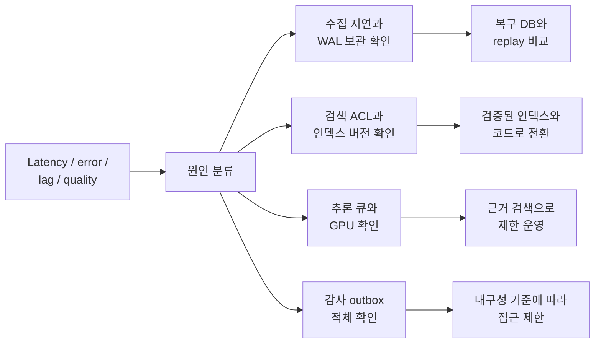

**[핵심 엔지니어링 분석 (Research & Considerations)]**

- **시스템 구성요소:** OpenTelemetry trace, Prometheus 메트릭, source offset·WAL·DLQ·audit outbox 지표, 온라인 보류·검증 실패율과 정기 holdout 평가, 백업·PITR·복구 runbook이다. 사용자 ID·질문·문서 ID를 metric label로 넣어 cardinality와 정보 노출을 키우지 않는다.
- **핵심 고려사항과 SLI 구분:** availability는 유효 요청 중 정상 응답 또는 정책에 맞는 보류·거부를 제공한 비율로 정한다. timeout·시스템 오류는 실패다. 의미적 정답률과 올바른 보류는 별도 품질 지표이므로 HTTP 200으로 대체하지 않는다.
- **알림 결정:** 30일 99.9% availability SLO의 예에서 burn rate 1은 허용 오류율 0.1%와 같다. 1시간과 5분을 함께 보는 14.4배 burn은 약 1.44% 오류율 기준이다. 하나의 긴 window가 끝날 때까지 기다리지 않고, 짧은 window로 현재도 문제가 이어지는지 확인한다. [Google SRE SLO alerting](https://sre.google/workbook/alerting-on-slos/)
- **트레이드오프:** 저트래픽에서는 비율이 불안정하다. 예제 fast-burn 알림은 1시간 요청 100건 이상에서 page하고, 저트래픽은 synthetic probe·오류 개수와 별도 ticket으로 보완한다. 지표 자체의 소실도 별도 알림으로 다룬다.
- **복구와 rollback:** 제안 목표 RPO 5분·RTO 60분은 백업 복구 훈련으로 실측해야 한다. DB는 복구용 별도 인스턴스에 복원해 source 위치·객체 수·표본·tombstone을 확인하고 replay한다. 앱 rollback은 파괴적 schema 변경을 자동으로 되돌리지 못하므로 expand/contract와 이전 인덱스 보관이 필요하다.
- **운영 이관:** 수집 중단 시 WAL 보관 초과, 모델 장애 시 근거만 제공, 감사 sink 장애 시 outbox 보관량과 접근 제한 기준을 runbook에 적는다. 경보에는 담당자·확인할 지표·첫 복구 행동을 연결한다. 서비스별 p95를 평균내지 않고 histogram bucket을 집계해 구한다. [Prometheus histograms](https://prometheus.io/docs/practices/histograms/)

**[실전 코드 (Production-grade Code)]**

`deploy/alerts.yaml`의 fast-burn 규칙이다. `rag_requests_total`은 API가 `outcome=ok|abstain|deny|error`로 기록하는 계약을 전제로 한다. 이 저장소는 해당 API exporter를 구현하지 않는다.

```yaml
groups:
  - name: fde-availability
    rules:
      - alert: RagFastBudgetBurn
        expr: |
          (
            sum(rate(rag_requests_total{outcome="error"}[1h]))
            / clamp_min(sum(rate(rag_requests_total[1h])), 0.000001) > 14.4 * 0.001
          )
          and
          (
            sum(rate(rag_requests_total{outcome="error"}[5m]))
            / clamp_min(sum(rate(rag_requests_total[5m])), 0.000001) > 14.4 * 0.001
          )
          and sum(increase(rag_requests_total[1h])) >= 100
        for: 2m
        labels:
          severity: page
        annotations:
          summary: "RAG availability budget is burning quickly"
```

**[발표자 노트 (Speaker Script)]**

“서비스를 운영할 때는 모델의 응답 속도만 보고 있으면 늦습니다. 수집 lag가 커져도 사용자는 오래된 근거로 답을 받을 수 있고, 감사 outbox가 쌓여도 HTTP는 정상일 수 있습니다. 저는 데이터 최신성, API availability, 답변 품질을 나눠 보겠습니다. 장애가 나면 코드 rollback과 데이터 복구도 구분해야 합니다. 이전 이미지를 띄워도 이미 바뀐 schema와 잘못된 인덱스는 돌아오지 않기 때문입니다. 마지막으로 백업이 있다는 말 대신 복원한 시간과 검증한 데이터 범위를 운영팀에 넘기겠습니다.”

## Frame 0-2 | Level 1 Overview | 네 기술 영역을 하나의 검증 가능한 서비스로 연결하기

**[화면 핵심 (On-screen Message)]**

`Integrated Production Architecture`

> 코드 검증 뒤 고객 환경의 수용 시험을 통과한 범위만 확장한다.

- 재전송에도 보존되는 상태
- 권한과 출처를 검증한 근거 응답
- 검증된 실행물과 운영 가능한 책임

**[화면 시각화 가이드 (Visual Layout)]**

처음의 전체 카메라 위치로 돌아온다. 처음에는 흐름만 보였던 네 영역 위에 각각 **재생 가능한 상태 · 허용된 근거 · 검증된 실행물 · 운영 가능한 책임**을 한 문장씩 겹친다. customer outcome을 맨 위에 두고 기술 선택이 그 결과로 연결되게 한다. 발표 시간 2분.

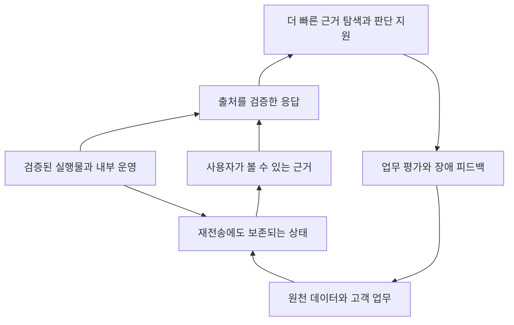

**[핵심 엔지니어링 분석 (Research & Considerations)]**

- **시스템 구성요소:** 데이터 계약·identity·policy·release manifest·평가 결과·운영 책임자가 하나의 변경 관리 흐름으로 연결되어야 한다.
- **핵심 고려사항:** 기술 선택을 “일반적으로 좋다”는 말로 방어하지 않는다. 이 고객의 데이터 분포·보안 경계·장애 복구·현장 일정에서 왜 선택했는지, 어떤 관측 결과가 나오면 바꿀지 설명한다.
- **수용 기준:** 데이터 재처리, 잘못된 권한, 근거 없는 응답, 인터넷 의존성, 복구 실패를 각각 실패 시험으로 확인한다. 고객에게는 직접 측정한 업무 지표와 남은 운영 조건을 함께 제시한다.

**[실전 코드 (Production-grade Code)]**

작업 폴더의 코드·DB 경계는 `scripts/check.py --all`로 검증한다. 실행기는 개인 Unix socket만 사용하는 임시 PostgreSQL과 비특권 LOGIN 계정을 만들고, 테스트가 끝나면 서버와 데이터를 제거한다. 아래는 네 영역의 불변식을 확인하는 테스트를 이름만 발췌한 2026년 11월 17일 실행 결과다. 전체 출력은 `docs/test-output.txt`에 있다. 테스트 통과가 실제 LLM 성능이나 고객 Kubernetes 배포 성공의 증거는 아니다.

```text
$ .venv/bin/python scripts/check.py --all
test_concurrent_redelivery_has_one_effect ... ok          # 1 재전송
test_stale_update_cannot_resurrect_tombstone ... ok       # 1 삭제
test_transaction_rolls_back_if_audit_outbox_fails ... ok  # 1·3 감사
test_rls_applies_before_python_ranking ... ok             # 2 권한
test_output_revalidation_rejects_revocation_during_generation ... ok
test_citation_bound_to_retrieved_version ... ok           # 2 인용
test_tampered_manifest_fails_signature ... ok             # 3 반입
test_quality_gate_baseline_and_leak_in_any_slice ... ok   # 4 게이트
----------------------------------------------------------------------
Ran 74 tests in 1.376s

OK
```

**[발표자 노트 (Speaker Script)]**

“전체 그림으로 돌아오면 네 영역이 따로 있는 기술 목록이 아니라 같은 사용자 신뢰를 지탱하는 경계라는 점이 보입니다. 데이터가 재처리에도 일관되어야 하고, 허용된 근거만 사용해야 하며, 그 로직을 고객 환경에서 검증된 실행물로 돌릴 수 있어야 합니다. 그리고 운영팀이 실패를 발견하고 복구할 수 있어야 합니다. FDE로서 제 역할은 이 제약을 고객의 업무 언어로 확인하고, 가장 작은 유효 범위에서 증명한 뒤 근거를 가지고 확장하는 것입니다. 다음 단계는 실제 고객 질의와 권한 조건으로 제한 공개의 수용 기준을 검증하는 일입니다.”

## Frame 5-1 | Level 2 Topic Cluster | 고객 Discovery로 업무·권한·수용 기준을 먼저 합의하기

**[화면 핵심 (On-screen Message)]**

`Customer Discovery`

> 첫 주 Discovery에서 합의한 권한과 수용 기준이 승격 게이트의 입력이 된다.

- 속성별 권위 소스와 role별 문서 권한 확정
- 정답·보류·거부 정의와 owner별 결정 기록
- 합의된 수용 기준의 4-2 승격 게이트 반영

**[화면 시각화 가이드 (Visual Layout)]**

0-2의 전체 조감도에서 본편 캔버스 바깥의 별도 영역인 ‘현장 플레이북(2부 온보딩 확장)’으로 카메라를 옮긴다. 왼쪽의 다섯 역할 이해관계자 맵에서 중앙의 첫 주 Discovery 질문 카드로 초점을 옮긴 뒤, 각 답변이 owner가 지정된 결정 기록과 수용 기준 제안표로 바뀌어 4-2 승격 게이트로 흘러가는 실선 경로를 확대한다. 접근 승인 지연과 합의되지 않은 범위 확장은 붉은 점선 분기로 정상 흐름과 분리하고, 범위 확장 분기는 결정 기록의 재검토 조건으로 되돌린다. 발표 시간 3분.

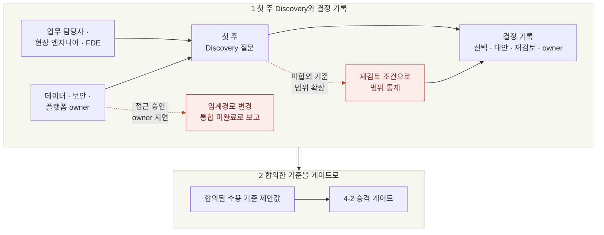

**[핵심 엔지니어링 분석 (Research & Considerations)]**

- **시스템 구성요소:** 첫 주 Discovery에는 업무 담당자(정비 리더), 데이터 owner(ERP·정비 시스템·문서), 보안·플랫폼 담당자, 현장 정비 엔지니어, FDE가 참여한다. 정비 리더는 과제 우선순위와 정답 기준을, 데이터 owner는 원천 책임과 스키마를, 보안·플랫폼 담당자는 IdP·ACL·반입 경로를 맡는다. 현장 정비 엔지니어는 실제 질의 표현과 라벨 검토를 제공하고, FDE는 이 입력을 데이터 계약·평가셋·승격 게이트로 연결한다.
- **핵심 고려사항:** FDE는 첫 주에 여섯 질문으로 모호함을 줄인다. 업무 성과를 무엇으로 비교할지(예: 기준 과제의 근거 탐색 시간과 정답 도달률), 속성별 authoritative source가 어느 시스템인지(예: 소유 공장은 ERP, 작업 완료는 정비 시스템, 점검 절차는 승인된 PDF 매뉴얼), “정답·보류·거부”가 각각 무엇인지, role별로 어떤 문서를 읽을 수 있는지, 응답 지연과 데이터 최신성 요구가 얼마인지, 온콜과 rollback 책임자가 누구인지 확인한다. “부산 공장 P-101의 반복 과열 원인과 점검 순서”도 이 답이 있어야 평가 가능한 과제가 된다.
- **결정 기록과 책임:** 각 답변은 4-1의 결정 기록 형식(선택·버린 대안·이유·재검토 조건)에 역할 기반 owner를 더해 바로 남긴다. owner가 없는 결정은 재검토 조건이 발동해도 누가 다시 판단할지 정할 수 없다. `fde/release_gate.py`는 누락·빈 자료·표본 부족·기준 미달을 기계적으로 거부하지만, 무엇을 “정답”으로 인정하고 누가 holdout을 독립 라벨링할지는 고객과의 합의로 정한다.
- **수용 기준 합의:** 합의한 품질·운영 요구는 4-2 승격 게이트의 입력이 된다. 출발점으로 제안하는 기준은 슬라이스당 최소 30건, 코드형·의미형 Hit@5 0.90, support rate 0.98, coverage 0.80, 근거 없는 질의의 보류율 0.95, 권한 누출 0건(권한 없는 질의는 모두 보류), 전체와 답변 가능한 슬라이스의 p95 5,000ms 이하다. 이 값은 예제 gate에 고정된 기준을 협의의 출발점으로 제안하는 것이다. 품질·지연 기준은 고객이 업무 위험과 비용에 따라 조정할 수 있지만, 권한 누출 0건과 권한 없는 질의의 전건 보류는 협상 대상이 아니다. 모든 변경은 새 결정 기록, gate 갱신과 재평가로 남긴다.
- **일정 위험과 범위 통제:** 4-1 일정에서 첫날 확인할 접근권한과 데이터 owner가 늦어지면 임계경로가 바뀐다. 대기 중에는 합성 데이터로 UI·계약·배포 경로를 검증할 수 있지만 이를 “통합 완료”나 품질 근거로 보고하지 않는다. 추가 공장·설비군·write 기능 같은 scope creep은 조용히 받아들이지 않고, 결정 기록의 재검토 조건에 따라 다음 단계 과제로 분리하고 별도 수용 기준을 정한다.

**[실전 코드 (Production-grade Code)]**

아래는 첫 주 Discovery 결과를 정리한 결정 기록과 수용 기준 예시이며, 모든 값은 고객 합의 전의 가정·제안값이다. `acceptance`의 metric 키는 `fde/release_gate.py`가 반환하는 `metrics` 이름과 맞췄고, `min_examples_per_slice`와 `forbidden_answered`는 gate가 metric 없이 직접 검사하는 조건이다.

```yaml
id: "DR-001"
status: "proposed"             # 역할별 승인 전 초안
basis: "가정·제안값, 고객 합의 전"
owner: "고객 정비 리더"
approvers: { scope: "고객 정비 리더", source: "데이터 owner",
             acl: "보안·플랫폼 담당자", release: "운영 owner" }
consulted: ["현장 정비 엔지니어", "FDE"]
choice: "한 공장·한 설비군의 read-only 정비 지원 MVP"
authoritative_source: { asset_site: "erp", work_order_status: "cmms" }
rejected_alternatives:
  - "전 공장·설비군 일괄 연동과 작업 지시 write 기능"
  - "합성 데이터 데모 통과만으로 승격"
reason: "원천 책임과 권한 경계를 먼저 고정해야 4-2 게이트로 검증할 수 있다"
review_when: "공장·설비군 추가, write 기능 요청, role 정책 변경 시"
acceptance:                    # 모든 값은 제안값
  min_examples_per_slice: 30   # factoid·semantic·unanswerable·forbidden 각각
  factoid: { hit_at_5: 0.90, support_rate: 0.98, coverage: 0.80, p95_ms: 5000 }
  semantic: { hit_at_5: 0.90, support_rate: 0.98, coverage: 0.80, p95_ms: 5000 }
  correct_abstention: 0.95
  leak_count: 0
  forbidden_answered: 0        # 권한 없는 질의는 전건 보류
  p95_ms: 5000
```

이 YAML은 저장소의 `fde/release_gate.py`가 읽는 설정 파일이 아니다. 현재 gate는 같은 기준값을 코드에 고정해 판정하므로, 합의로 기준을 바꾸면 새 결정 기록과 함께 gate 코드나 설정을 갱신하고 독립 라벨링된 holdout으로 다시 평가한다. 여기의 수치는 합의의 출발점이며 고객 환경에서 측정한 성능이 아니다.

**[발표자 노트 (Speaker Script)]**

“본편에서 기술 경계를 봤다면, 여기서부터는 2부 현장 플레이북으로 그 경계를 첫 주에 고객과 어떻게 합의하는지 보겠습니다. 저는 코드를 쓰기 전에 정비 리더, 데이터 owner, 보안·플랫폼 담당자, 현장 정비 엔지니어와 여섯 가지 질문부터 확인하겠습니다. 먼저 근거를 찾는 시간과 정답 도달률처럼 업무 성과를 무엇으로 비교할지 정하고, 설비 소유 공장은 ERP, 작업 완료는 정비 시스템처럼 속성별 authoritative source와 정답·보류·거부의 의미를 정의하겠습니다. role별 문서 권한, 허용 지연과 최신성, 온콜과 rollback 책임도 묻고, 답마다 owner와 재검토 조건이 있는 결정 기록으로 남기겠습니다. 화면의 Hit@5 0.90이나 p95 5초는 예제 gate에 고정된 값을 협의의 출발점으로 제안하는 것이고, 권한 누출 0건과 권한 없는 질의의 보류는 조정하지 않습니다. 코드는 평가 누락과 기준 미달을 승격 게이트에서 막아 줄 뿐, 무엇이 정답이고 누가 라벨링할지는 고객과 합의해야 합니다. 합의한 기준은 4-2의 승격 게이트에 반영하고, 기준이 바뀌면 gate를 고친 뒤 독립 평가 결과로 다시 판정하겠습니다.”

## Frame 5-2 | Level 3 Deep Dive and Code | 오답 신고를 재현 기록으로 파이프라인 경계까지 좁히기

**[화면 핵심 (On-screen Message)]**

`Incident Replay`

> 오답 조사는 답변 시점의 조건을 복원하고 처음 달라진 경계에서 시작한다.

- 답변 시점의 버전과 위치 기록
- 동일 권한의 격리된 replay
- 재현 창은 가장 짧은 보관 기간(예: 백업 7일)

**[화면 시각화 가이드 (Visual Layout)]**

현장 플레이북에서 오답 신고와 복구용 replay 사이를 확대한다. 답변 당시의 최소 기록을 왼쪽에 고정하고, 복원한 환경에서 만든 기록을 오른쪽에 나란히 놓는다. data → policy → retrieval → generation 순서로 비교하며 최초 차이만 주황색으로 강조한다. 입력이 같은데 답변이 달라지는 경로는 기록 누락을 확인하는 붉은 점선으로 표시한다. 발표 시간 4분.

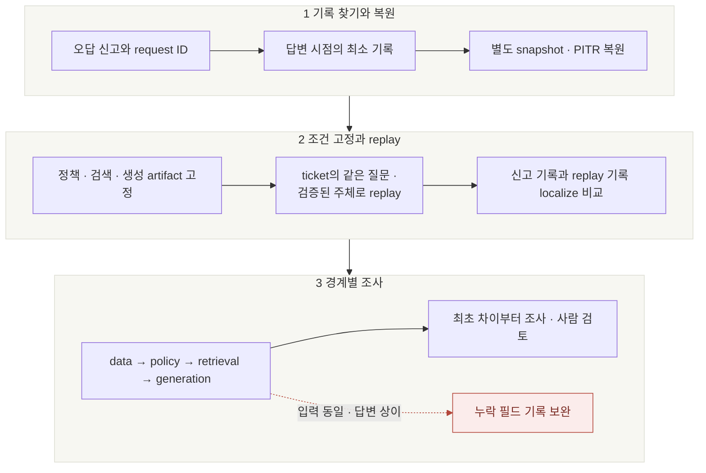

**[핵심 엔지니어링 분석 (Research & Considerations)]**

- **시스템 구성요소:** 답변을 만들 때 다음 필드를 재현 기록(`AnswerRecord`)으로 남긴다: request ID, tenant, HMAC으로 가명처리한 주체와 key ID, 서비스 DB의 복구 목표를 가리키는 snapshot ID, upstream 소스·epoch별 committed offset을 기록한다. 정책, index·embedding·reranker 버전, 생성에 전달한 순서 그대로의 `(chunk_id, version)`, decoding 파라미터를 포함한 prompt 버전, tokenizer와 양자화 형식까지 포함한 model digest를 함께 고정한다. 장애 뒤에는 현재 버전과 위치가 이미 이동하므로 “지금 다시 물어보기”로 당시 조건을 재현할 수 없다.
- **핵심 고려사항과 replay:** 서비스 DB는 별도 복구 인스턴스에 기록된 복구 목표까지 복원한다. PITR이 재생하는 것은 서비스 DB의 WAL이므로, 복원된 소스 위치를 기록과 대조해 모자라면 upstream을 기록된 offset까지 따로 replay하고, DB 밖의 검색 인덱스는 `index_version` 보관본을 다시 적재한다. 당시 정책·embedding·reranker·prompt·모델 artifact를 고정한 뒤, 같은 질문과 검증된 같은 principal로 실행해 replay 기록을 만들고 `localize(reported, replayed)`로 비교한다. HMAC 가명 자체를 인증 자격증명으로 사용하지 않는다. DB 복원에 쓰는 continuous archiving과 PITR은 선택한 목표 시점까지 복구하는 PostgreSQL 기능이다. [PostgreSQL PITR](https://www.postgresql.org/docs/current/continuous-archiving.html)
- **조사 순서와 증명의 한계:** 반환 순서는 data → policy → retrieval → generation이며 최초 차이부터 조사한다. 데이터나 권한 차이가 이후 검색·생성 차이를 만들 수 있으므로 첫 차이는 확정된 근본 원인이 아니다. 입력 차이가 없는데 답변이 달라지면 serving engine 버전·batch 설정 등 누락 필드를 기록에 보완한다. 같은 입력과 decoding 설정에서도 batch 구성이나 GPU 연산 순서에 따라 출력이 달라질 수 있으므로, 재현 대상은 답변 문자열이 아니라 근거와 권한 조건이다. 2-3의 인용 출처 검증은 의미적 정답을 보장하지 않으며, 4-2의 독립 평가와 중요한 점검 순서에 대한 사람 검토를 연결한다.
- **최소화와 접근 경계:** 3-3의 HMAC 가명처리를 따르고, 기록에는 식별자·버전·위치와 보류 여부만 남긴다. 원문 질문·답변·청크 본문·원시 사용자 식별자는 넣지 않는다. tenant는 사용자 식별자가 아닌 조직 경계 ID라 원문으로 두고 접근 범위와 비교 거부에 쓴다. 질문이 필요하면 신고자가 접근 제한 ticket 경로로 다시 제공한다. key ID를 함께 남겨 키를 교체한 뒤에도 당시 키로 같은 가명을 다시 계산한다. 비교는 tenant가 다르면 우선 거부하고 request ID·key ID·주체가 달라도 거부한다. HMAC 키와 당시 주체의 검증된 매핑은 제한된 별도 절차로 관리한다.
- **보관과 재현 창:** 재현 가능 기간의 상한은 기록 보관, snapshot·PITR용 WAL·백업 보관, upstream offset 보관, 이전 인덱스 보관, 모델·prompt 등 관련 artifact 보관 기간의 최솟값이다. 가정으로 기록은 90일, 백업은 7일이고 나머지가 충분해도 7일이 지나면 재현할 수 없다. 기록도 감사 이벤트처럼 고객의 보관·삭제 정책을 적용하며, 정기 복구 훈련으로 실제 복원 가능 범위를 확인한다.

**[실전 코드 (Production-grade Code)]**

`fde/provenance.py`는 기록 형식을 검사하고 입력이 달라진 경계를 순서대로 반환한다. 아래 fixture는 snapshot 복원 뒤 소스 위치가 더 진행되고 근거 순서도 바뀐 replay를 의도적으로 만들며, model digest는 같다.

```python
from dataclasses import replace
from fde.provenance import AnswerRecord, localize

reported = AnswerRecord(
    request_id="12345678-1234-4abc-8def-1234567890ab",
    tenant="fixture-factory", subject_pseudonym="0" * 64, key_id="fixture-v1",
    snapshot_id="backup-v1", source_positions=(("erp", 120), ("manual", 8)),
    policy_version="policy-v1", index_version="index-v1",
    embedding_model="embedding-v1", reranker="reranker-v1",
    prompt_version="prompt-decoding-v1", model_digest="sha256:" + "a" * 64,
    evidence=(("manual-p1", 2), ("maintenance-p2", 1)),
    abstained=False,
)
replayed = replace(
    reported, source_positions=(("erp", 121), ("manual", 8)),
    evidence=tuple(reversed(reported.evidence)),
)
print(localize(reported, replayed))  # ['data', 'retrieval']
```

`"0" * 64` 가명과 `"a" * 64` digest는 형식 검사용 fixture다. 코드는 실제 snapshot 복원, artifact 무결성 검증이나 HMAC 생성 여부를 증명하지 않는다. 버전 문자열이 4-2 release manifest의 불변 artifact를 가리키는지도 이 절차와 함께 별도로 검증한다.

**[발표자 노트 (Speaker Script)]**

“부산 공장 P-101 답변이 틀렸다는 신고가 오면, 먼저 그 답변의 request ID로 당시 기록을 찾겠습니다. 질문은 제한된 ticket에서 다시 받고, 당시 snapshot과 정책·인덱스·모델을 별도 복구 환경에 맞추겠습니다. 같은 주체로 replay한 결과에서 data와 retrieval이 달라졌다면, 더 앞선 data 경계부터 확인하겠습니다. 이 차이는 조사 순서이며 원인이 확정됐다는 뜻은 아닙니다. 입력이 같은데 답변이 달라지면 serving 설정을 더 기록해야 하는지 보고, 문장이 똑같은지보다 근거와 권한이 같은지를 재현 기준으로 삼겠습니다. 근거를 정확히 인용했는지는 코드로 확인하고, 실제 점검 순서가 맞는지는 현장 전문가와 평가하겠습니다. 마지막으로 기록 90일·백업 7일이라는 보관 가정에서는 재현 창도 최대 7일이므로, 보관과 삭제 정책까지 함께 합의하겠습니다.”

## Frame 5-3 | Level 3 Deep Dive and Code | 용량 계산을 가정에서 측정으로 바꾸기

**[화면 핵심 (On-screen Message)]**

`Capacity Math`

> 사용자 수는 유입률과 동시 요청으로 환산하고, 가정은 부하 시험 실측으로 교체한다.

- 원시 벡터와 가중치·KV 분리
- 평균 동시 요청과 버스트 구분
- context·출력 상한과 부하 시험 실측

**[화면 시각화 가이드 (Visual Layout)]**

현장 플레이북의 용량 계산으로 이동한다. 사용자 수를 유입률과 체류시간으로 바꾸는 가지와 sequence당 KV를 구하는 가지를 나란히 확대한다. 두 가지가 GPU 메모리 예산에서 만나는 지점을 강조하고, 모든 숫자에는 가정 표식을 붙인다. 메모리 초과는 context·출력·동시성 상한을 조정한 뒤 예산 재계산으로 되돌리고, 마지막에 부하 시험 결과로 가정을 교체하는 화면을 보여준다. 발표 시간 3분.

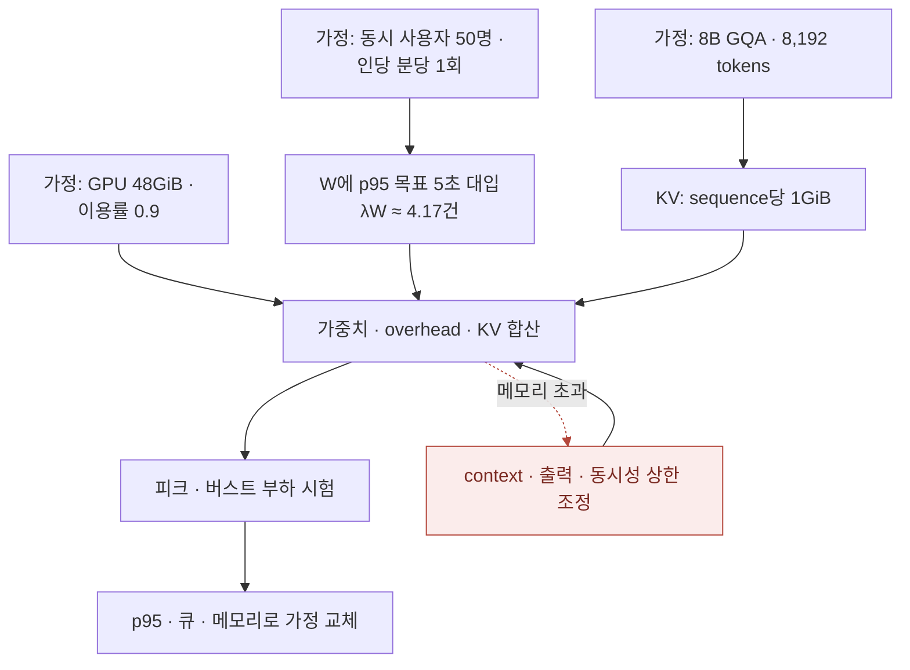

**[핵심 엔지니어링 분석 (Research & Considerations)]**

- **시스템 구성요소:** 청크 인덱스와 GPU 추론 서버를 분리 산정한다. 0-1의 규모 가정인 1,000,000개 × 768차원 × 4B는 정확히 3,072,000,000B, 약 3.07GB의 원시 벡터다. 인덱스·복제본·원문·메타데이터는 제외한다. 가정한 8B급 모델의 양자화 전 fp16 가중치는 8,000,000,000개 × 2B = 16GB이며, 양자화는 용량을 바꾸므로 품질 평가와 함께 결정한다. GB는 10의 거듭제곱, GiB는 2의 거듭제곱 단위로 구분한다.
- **핵심 고려사항과 KV cache:** K와 V를 합한 토큰당 바이트는 `2 × layers × kv_heads × head_dim × bytes_per_value`다. 가정한 8B급 GQA 모델을 32 layers, 8 KV heads, head_dim 128, fp16 2B로 두면 131,072B/token, 즉 128KiB다. context 8,192 tokens를 가정하면 sequence당 1,073,741,824B = 1GiB다. GQA에서는 여러 query head가 더 적은 수의 KV head를 공유하므로 수식에는 attention heads 대신 `kv_heads`를 넣는다.
- **유입률과 동시성:** Little's law `L = λW`는 정상 상태의 장기 평균이다. 사례 표(설계 입력)의 제안값인 동시 사용자 50명이 각자 분당 1회 질문한다고 가정하면 약 0.83req/s다. W는 큐를 포함한 평균 체류시간이므로, 같은 표와 4-2 게이트의 응답 p95 목표 5초를 대입한 약 4.17건(올림 5건)은 실측 평균 W로 교체할 거친 가정이다. 이 L은 검색 단계의 요청도 포함하므로 GPU에서 동시에 decode하는 sequence 수와 같지 않다. 동시 사용자 50명은 동시 요청 50건이 아니다. 평균은 피크가 아니므로 피크 유입률과 지연 예산으로 다시 산정하고 tail·큐 대기를 측정한다. 교대 시작에 50명이 한꺼번에 묻는 상황은 별도 버스트 시험이다.
- **context와 출력 상한:** sequence당 KV를 제한하도록 prompt와 출력을 합친 최대 context를 정하고 출력 토큰도 제한한다. 긴 PDF는 필요한 청크를 검색해 전달하며, context 길이 축소는 메모리를 줄이는 조정 수단이다. serving engine 예시인 vLLM의 `--max-model-len`은 prompt와 출력을 포함한 context 길이이며, `--gpu-memory-utilization`은 model executor가 사용할 GPU 메모리 비율이다. [vLLM engine args](https://docs.vllm.ai/en/latest/configuration/engine_args.html) · [vLLM 메모리 절감](https://docs.vllm.ai/en/latest/configuration/conserving_memory.html)
- **구현 차이와 실측 교체:** 가정한 48GiB GPU 1장과 이용률 0.9로 단일 GPU 예산을 계산한다. 이 사용 가능 메모리 안에서 activations·CUDA graphs·workspace를 합친 runtime overhead를 2GiB로 가정하며, 단편화와 paged KV block allocator는 산술식에 모델링하지 않는다. 실제 벡터·인덱스 크기로 저장량 가정, 적재한 가중치 바이트로 16GB 가정, 입력·출력 토큰 분포로 context 가정, 목표 동시성의 GPU 메모리와 runtime peak로 이용률·overhead 가정을 바꾼다. 피크 유입률·큐 대기·전체 응답 p95로 유입률·5초 목표·동시 요청 가정을 검증하고 조정한다. vLLM 문서는 KV cache 공간이 부족하면 요청을 preempt하고 나중에 재계산해 end-to-end 지연이 늘 수 있다고 설명한다. [vLLM 최적화와 preemption](https://docs.vllm.ai/en/latest/configuration/optimization.html)

**[실전 코드 (Production-grade Code)]**

`fde/capacity.py`로 위 가정의 원시 벡터·KV·평균 동시 요청을 계산하고, 가정한 48GiB GPU 1장의 메모리 예산을 확인한다. `sequences=50`은 별도 버스트 가정이며, `fits`는 산술상 메모리 적합 여부만 나타낸다.

```python
import math
from fde.capacity import (
    gpu_plan, in_flight_requests, kv_cache_bytes_per_token, vector_bytes,
)

vectors = vector_bytes(1_000_000, 768, 4)
kv = kv_cache_bytes_per_token(32, 8, 128, 2)
in_flight = in_flight_requests(50 / 60, 5.0)
sequences = math.ceil(in_flight)
assumptions = dict(
    gpu_bytes=48 * 2**30, utilization=0.9,
    weights_bytes=8_000_000_000 * 2, overhead_bytes=2 * 2**30,
    kv_bytes_per_token=kv, context_tokens=8_192,
)
plan = gpu_plan(**assumptions, sequences=sequences)
burst = gpu_plan(**assumptions, sequences=50)
print(f"vectors={vectors} B, kv={kv} B/token, in_flight={in_flight:.2f}")
print(f"fits={plan.fits}, headroom={plan.headroom_bytes} B, max_sequences={plan.max_sequences}")
print(f"burst_fits={burst.fits}, headroom={burst.headroom_bytes} B")
```

`sequences`에 넣은 5는 검색 단계 요청까지 포함한 평균 L의 올림이며 GPU의 순간 동시 sequence 수가 아니다. 가정으로 계산된 `max_sequences`는 모든 sequence가 context 상한까지 찼을 때의 메모리 한도다. 처리량·p95·큐 대기나 실제 allocator의 수용량을 보장하지 않으므로, 목표 동시성 및 버스트에서 부하 시험으로 확인한다.

**[발표자 노트 (Speaker Script)]**

“동시 사용자 50명이라는 요구를 받으면, 먼저 한 분이 얼마나 자주 질문하고 교대 때 얼마나 몰리는지 확인하겠습니다. 가정한 인당 분당 한 번에 p95 목표 5초를 대입하면 평균 약 4.2건이지만, 이 평균이 버스트를 감당한다는 보장은 없습니다. 0-1에서 계산한 약 3.07GB도 원시 벡터만의 가정값이라서 인덱스와 원문은 별도로 측정하겠습니다. 가정한 GQA 구성에서는 context 상한을 채운 sequence 하나가 KV만 1GiB이므로, 긴 PDF를 통째로 넣기보다 필요한 청크와 출력 상한을 정하겠습니다. 코드의 fits는 가정한 가중치와 overhead를 뺀 산술 결과이며 응답 속도까지 보장하지는 않습니다. 실제 적재 메모리와 토큰 분포로 입력값을 바꾸고, 목표 동시성의 p95·큐 대기·GPU 메모리로 조정하겠습니다. 마지막으로 50명이 한꺼번에 묻는 시험을 따로 돌려서 상한과 대기 정책을 고객 운영팀과 합의하겠습니다.”

## 면접 후속 질문과 설계 판단의 근거

| 질문 | 답변의 중심 논리 |
| --- | --- |
| 왜 처음부터 Kafka와 복잡한 스트리밍 체계를 모두 도입하지 않습니까 | 변경량·최신성·재생 요구가 선택 기준이다. 작은 pilot은 내구성 있는 batch manifest로도 가능하다. CDC가 필요하면 소스 부하·WAL 보관·offset 복구를 운영할 수 있어야 한다. (1-2, 1-3 참조) |
| 온톨로지와 일반적인 정규화 테이블의 차이는 무엇입니까 | 저장 형태보다 업무 의미, 관계, source 책임, action의 불변식과 권한을 재사용 가능한 계약으로 만드는 점을 설명한다. 제품 기능이 필요해지기 전부터 거대한 그래프 플랫폼을 강제하지 않는다. (1-1 참조) |
| 권한을 필터하면 recall과 응답시간이 나빠지지 않습니까 | 실제로 그럴 수 있다. 보안 경계를 고정한 상태에서 ACL 선택도별로 정확 검색·partition·ANN 탐색량을 비교한다. 보안 조건을 낮춰 성능 문제를 해결하지 않는다. (2-1, 2-2 참조) |
| 인용이 있는데도 잘못된 답변이면 어떻게 합니까 | 인용 provenance와 semantic support를 구분한다. 원문과 연결돼도 의미를 반대로 말할 수 있으므로 claim별 독립 평가와 고영향 결정의 사람 검토가 필요하다. (2-3, 4-2 참조) |
| 도구가 두 번 호출되어 작업 지시가 중복되면 어떻게 합니까 | read-only MVP에서 시작한다. 쓰기 도입 시 업무 action의 idempotency key·예상 객체 버전·승인 상태를 하나의 트랜잭션 경계로 강제한다. 네트워크 재시도를 곧바로 업무 재실행으로 해석하지 않는다. (2-3 참조) |
| 공장별 데이터가 커지면 무엇부터 바꿉니까 | 수집 lag, 허용 후보 수, 검색 지연, inference 큐를 나눠 본다. 원인이 검색이면 인덱스와 partition, 추론이면 토큰·배치·GPU 용량을 조정한다. (2-1, 4-3, 5-3 참조) |
| 두 주 후 바로 전체 운영을 약속할 수 있습니까 | 범위가 합의된 제한 MVP와 전체 운영 승인은 다른 결과다. 실제 데이터 접근·보안·복구·평가 게이트를 통과한 범위만 공개하고 미통과 항목의 owner와 다음 행동을 명확히 한다. (4-1, 4-2 참조) |
| 외부 API를 쓸 수 없는 폐쇄망에서 로컬 LLM은 어떤 기준으로 고릅니까 | 라이선스와 반입 검증 통과 여부, 한국어·설비 용어 처리 품질, 양자화에 따른 품질 손실, 가중치·KV cache·런타임 여유분을 포함한 GPU 메모리와 목표 context 길이·동시 요청 수에서의 p95를 함께 본다. 유력 모델을 임의로 단정하지 않고 동일한 튜닝용 검증셋과 deadline 조건에서 support rate, coverage, p95를 비교해 후보를 좁히고, 최종 후보만 고정 holdout으로 확인한다. 선정 후에는 가중치뿐 아니라 tokenizer·config·라이선스까지 서명된 release manifest로 반입하고 인터넷 차단 cold start를 검증한다(3-1, 4-2, 5-3 참조). |
| 청크 크기와 분할 전략은 어떻게 정합니까 | 고정 글자 수나 토큰 수를 정답으로 두지 않고 매뉴얼의 절·표·점검 단계와 설비 코드 맥락이 끊기지 않게 문서 구조 기준으로 나눈다. 후보 전략은 동일한 튜닝용 검증셋에서 코드형·의미형 Hit@5와 context 예산 내 support rate를 비교해 고르며, 정답 근거는 청크 ID가 아니라 문서 버전과 절·페이지 구간으로 라벨링해야 청크 경계가 달라도 같은 기준으로 비교할 수 있다. 청크 전략 변경은 곧 검색 단위 변경이므로 인덱스 재생성과 고정 holdout 재평가를 거쳐 승격한다(2-1, 4-2 참조). |
| 평가셋은 누가 어떻게 라벨링합니까 | 실제 질의를 바탕으로 설비·안전 의미를 아는 현장 전문가가 라벨 가이드에 따라 정답 근거와 핵심 주장별 support를 판정하고, 권한 없음 질의의 허용 여부는 보안·플랫폼 담당자가 정책 기준으로 정한다. 사전에 정한 표본은 두 사람이 독립 라벨링해 조정 전 일치율과 불일치 유형을 기록하고 가이드를 보완하며, 답변 모델의 자기 평가만으로 support나 정답 여부를 확정하지 않는다. 튜닝용 검증셋과 분리된 holdout은 버전을 고정해 최종 승격과 회귀 판정에만 사용한다(4-2, 5-1 참조). |
| 운영 비용은 어떻게 산정하고 통제합니까 | 폐쇄망 비용은 GPU·서버의 감가상각이나 임대료, 전력·운영 인력 같은 고정비와 OCR·embedding·reranker·추론 계산량, 벡터·원문·감사 로그 저장 용량으로 분해하고, 큐 대기는 비용 단위가 아니라 용량 부족 신호로 관리한다. 초기에는 동시 사용자 수와 실제 동시 요청 수를 구분해 일일 질의량·토큰 길이·배치 효율 가정으로 제안 계산을 세우고, 파일럿에서 관측한 토큰·지연·사용률 측정치로 교체한다. 요청별 context·토큰 상한에 더해 요청률·재시도·재임베딩 작업 예산을 두고, 청크 해시 비교로 불필요한 재임베딩을 줄인다(0-1, 5-3 참조). |
| 고객의 데이터 접근 승인이 늦어지면 일정은 어떻게 관리합니까 | 접근 요청마다 승인 담당자·필요 증적·막힌 작업·다음 확인 시점을 기록해 데이터 접근과 owner 확보가 임계경로의 어디를 막는지 드러낸다. 일정은 승인 대기와 구현 작업을 분리해 관리하고, 승인 시점에 따라 가능한 검증 범위와 목표 일자를 다시 제안한다. 합성 데이터 검증과 실제 데이터 검증 결과는 별도 항목으로 보고하고, 미연결 구간의 owner와 재개 조건을 명시한다(4-1, 5-1 참조). |
| 한국어 형태소와 영문 혼합 매뉴얼은 어떻게 검색합니까 | `fde/retrieval.py`의 단순 정규식 tokenizer는 “펌프를” 같은 어절을 조사째 한 토큰으로 두는 예제용이며 실제 한국어 검색 성능의 근거로 쓰지 않는다. 현장 적용에서는 한국어 형태소 분석과 동의어 사전, `P-101`·`ZX-19` 같은 설비·에러 코드 원형 보존을 결합하고 혼합 언어 매뉴얼과 질의에 맞는 한국어·다국어 embedding 모델을 검증한다. 모든 변경은 질의와 문서에 동일 버전 분석기를 적용해 인덱스를 다시 만들고, 코드형·의미형 튜닝용 검증셋으로 비교한 뒤 고정 holdout으로 승격을 판정한다(2-1, 4-2 참조). |
| reranker 도입 여부는 어떻게 판단합니까 | reranker 없는 hybrid(BM25+dense+RRF) 결과를 기준선으로 먼저 측정하고, 도입 시에도 RLS·ACL을 통과한 허용 후보만 rerank한다. 같은 튜닝용 검증셋과 예컨대 200ms 같은 제안 지연 예산 안에서 Hit@5·support rate 개선 폭이 추가 GPU 자원과 p95 증가 비용을 정당화할 때만 채택한다. 개선이 미미하거나 전체 5초 제안 deadline을 위협하면 끄거나 상위 후보 수만 조정한다(0-1, 2-1, 4-2 참조). |
| 프롬프트나 모델 설정만 바꿔도 새 릴리스로 취급합니까 | 같은 코드 이미지라도 prompt·모델·embedding·인덱스·정책 버전이 달라지면 별도 릴리스로 다룬다. 모든 구성 버전을 하나의 release manifest로 묶고 고정 holdout 평가와 ACL 누출 0건 게이트를 다시 통과해야 승격한다. 운영 반영도 canary 최소 관측 수와 중단 기준을 거쳐 진행하고, 중단 시에는 schema 호환성과 현재 ACL·삭제 상태 반영이 확인된 이전 manifest로 복귀한다(4-2, 4-3 참조). |

## 고객 상황 롤플레이

FDE 면접과 현장 대응에서 마주치기 쉬운 고객 압박·보안·장애·권한 요구 상황을 발표 프레임과 연결해 정리한 연습 시나리오다. 각 답변은 가능한 범위와 검증 조건, 책임 경계를 숨기지 않고 30초 안에 전달하는 데 초점을 둔다.

### 1. 고객 임원이 2주 안에 전 공장 확대를 요구한다

- **상황:** 파일럿 초기에 고객 임원이 두 주 안에 모든 공장과 설비로 서비스를 확대해 달라고 요구한다. 아직 공장별 데이터 owner, 접근 권한 체계, 현장 평가 기준도 확정되지 않은 상태다.
- **먼저 확인할 질문:**
  - 2주 뒤에 임원께서 확인하고 싶은 업무 결과는 무엇입니까?
  - 공장별로 ERP·정비 시스템의 데이터 owner와 보안 승인 담당자가 이미 지정되어 있습니까?
  - 공장마다 문서 권한(ACL) 체계와 정답 기준이 같습니까, 다릅니까?
- **30초 답변:** “전 공장으로 확대하려는 목표에는 저도 공감합니다. 다만 두 주는 합의된 단일 공장과 설비군에서 권한·근거·배포 경로가 끝까지 도는 제한 MVP를 검증하는 시간 상자이지, 전 공장 전체 운영 승인을 보장하는 기간이 아닙니다. 저는 첫날 공장별 데이터 owner와 수용 기준을 먼저 확인하고, 1차 공장에서 holdout 품질·ACL 누출 0건 게이트와 복구 시험을 통과한 뒤 다음 공장으로 단계적으로 확장하겠습니다. 접근 승인이 늦어지는 공장은 미연결 상태와 일정을 투명하게 분리해 보고드리겠습니다.” (4-1, 4-2, 5-1 참조)
- **피해야 할 답변:** ‘네, 2주면 전 공장 다 됩니다’처럼 권한·데이터 통합·운영 게이트 검증 없이 일정을 무조건 약속해 나중에 일정 붕괴와 보안 생략을 부른다.

### 2. 보안팀이 원문(문서·로그) 반출을 거부한다

- **상황:** 고객 보안팀이 정비 매뉴얼 원문, 작업 이력, 사용자 질문·응답 로그가 고객사 폐쇄망 밖으로 나가는 것을 전면 거부한다. 원격 디버깅이나 외부 클라우드 모델 평가도 허용되지 않는다.
- **먼저 확인할 질문:**
  - 원문과 로그는 고객 경계 안에 두고, 서명된 실행물을 내부 레지스트리로 반입해 안에서 실행·평가하는 방식은 허용됩니까?
  - 문제 분석이나 품질 보고를 위해 집계 지표나 오류 코드·버전 정보 중 어디까지 반출할 수 있습니까?
  - 로그 필드 allowlist와 HMAC 가명처리 정책을 함께 검토해 주실 보안 담당자는 누구입니까?
- **30초 답변:** “보안팀 원칙대로 원문과 로그를 밖으로 꺼내 달라고 요청하지 않겠습니다. 서명된 release manifest와 검증된 이미지를 내부 레지스트리로 반입해 수집·검색·평가·추론을 모두 고객 폐쇄망 안에서 실행하겠습니다. 내부 로그에도 질문·본문·응답·Authorization header는 기본 수집하지 않고, latency·오류 코드·버전 같은 운영 기록과 HMAC으로 가명처리한 감사 이벤트를 필드 allowlist로 나눠 남기겠습니다. 밖으로는 재식별 위험을 검토해 고객이 승인한 집계 지표와 오류 코드·버전만 공유하고, 원문 확인은 고객 경계 안에서만 하겠습니다.” (3-1, 3-3 참조)
- **피해야 할 답변:** 원문이나 프롬프트 로그를 빼줘야만 모델을 튜닝할 수 있다고 맞서거나, 임시 디버깅을 이유로 보안 경계를 우회하는 예외를 요구한다.

### 3. 데모 중 모델이 P-101 질문에 틀린 답을 한다

- **상황:** 현장 엔지니어 대상 데모에서 “부산 공장 P-101의 반복 과열 원인과 점검 순서는?”이라는 질문에 모델이 잘못된 설비 상태나 구버전 점검 절차를 답한다. 현장에서 즉시 신뢰가 흔들리는 상황이다.
- **먼저 확인할 질문:**
  - 현장에서 보시기에 방금 답변에서 틀린 부분은 설비 매핑, 최신 정비 이력·문서 버전, 아니면 모델의 해석 중 어느 쪽입니까?
  - 이 요청의 trace와 재현 기록(snapshot·소스 위치, 정책·인덱스·모델·prompt 버전, 근거 청크)을 바로 확인해 어느 경계에서 처음 달라졌는지 함께 보시겠습니까?
  - 재시연 전에 이 사례를 회귀 평가 세트에 추가하고 다시 확인하는 일정으로 잡아도 되겠습니까?
- **30초 답변:** “방금 답변은 점검 판단에 사용하지 말아 주십시오. 점검 순서는 승인된 최신 매뉴얼을 현장 담당자와 함께 확인하겠습니다. 그다음 이 요청의 재현 기록으로 당시 snapshot·소스 위치와 정책·인덱스·embedding·reranker·모델·prompt 버전을 고정해 replay하고, data → policy → retrieval → generation 순서로 처음 달라진 경계부터 조사하겠습니다. 이 질문과 기대 근거는 회귀 평가 세트에 추가하고, 수정 후에는 손대지 않은 고정 holdout과 전체 게이트를 다시 통과한 뒤에 재시연하겠습니다.” (0-1, 4-2, 5-2 참조)
- **피해야 할 답변:** LLM 특성상 가끔 틀릴 수 있다며 넘기거나, 원인 경계와 버전 추적 없이 프롬프트만 즉흥 수정해 다시 데모하려 한다.

### 4. 현장 팀이 agent에게 작업 지시 생성(쓰기) 권한을 요구한다

- **상황:** 현장 정비 팀이 근거 조회에 만족하며 AI agent가 곧바로 정비 시스템에 작업 지시(WorkOrder)를 생성하고 확정까지 해 주기를 요구한다. 현재 아키텍처는 `search`만 허용하는 read-only MVP다.
- **먼저 확인할 질문:**
  - 작업 지시를 자동 생성할 때 잘못된 입력이나 중복 호출이 발생하면 현장 안전과 비용에 어떤 영향이 있습니까?
  - 기존 정비 시스템에서 작업 지시 쓰기를 허용할 별도 API 권한, idempotency key, 예상 객체 버전 검증 지원이 준비되어 있습니까?
  - 1단계로 agent가 작업 지시 초안과 근거만 만들어 주고, 최종 확정은 현장 담당자가 기존 시스템에서 승인하는 흐름으로 시작할 수 있습니까?
- **30초 답변:** “현장의 입력 부담을 줄이려는 요구는 충분히 이해합니다. 다만 현재 MVP는 읽기 전용 검색 도구만 허용해 환각이나 문서 내 악성 지시가 설비·작업 변경으로 번지지 않게 막고 있습니다. 저는 1단계로 agent가 근거가 붙은 작업 지시 초안만 제안하고 사람이 기존 정비 시스템에서 최종 승인하는 방식을 권하겠습니다. 실제 쓰기 경로는 정비 시스템이 별도 action 권한, 사람 승인 상태, 예상 객체 버전과 idempotency key를 한 번의 원자적 처리로 검증할 수 있는지 확인하고, 중복·재시도 시험을 통과한 뒤에 도입하겠습니다.” (2-3, 5-1 참조)
- **피해야 할 답변:** 에이전트에게 정비 시스템 쓰기 도구나 임의 API 호출 권한을 바로 열어 주면서 프롬프트 지시만으로 중복이나 오작동을 막겠다고 장담한다.

## 실행 코드와 검증 범위

코드는 Python 3.12, PostgreSQL 16과 고정된 Python 의존성으로 검증한다. 실제 고객 배포 전체가 아니라 **실행 가능한 핵심 로직과 통합 경계 예제**다. 코드 전문은 작업 폴더의 `fde/`, `sql/`, `deploy/`, `tests/`에서 확인할 수 있다.

| 구현 | 파일 | 검증하는 사실 |
| --- | --- | --- |
| 정규화와 멱등 수집 | `fde/ingestion.py`, `sql/schema.sql` | 중복·역순·tombstone·동시 재전송·감사 실패 rollback |
| 권한과 hybrid retrieval | `fde/retrieval.py`, `sql/schema.sql` | 실제 비특권 role, tenant/role 경계, 철회·삭제·연결 풀 identity, BM25·cosine·RRF |
| 출력과 도구 제한 | `fde/guardrails.py` | citation ID·버전·원문 대조, schema·도구·인자·횟수 제한 |
| PII 최소화와 감사 이벤트 | `fde/privacy.py` | 필드 allowlist, 알려진 패턴 처리, HMAC 가명처리와 key ID |
| 오프라인 반입 검증 | `fde/bundle.py` | 실제 서명 검증, manifest·파일 변조, 만료·release 재생·경로 이탈 거부 |
| 배포와 관측 예제 | `deploy/render.py`, `deploy/audit-policy.yaml`, `deploy/alerts.yaml` | digest 요구·YAML 생성·제한된 pod와 네트워크 규칙 |
| 품질 게이트 | `fde/release_gate.py` | 누락·NaN·중복·slice 회귀·과도한 보류·전체 및 유형별 p95·누출 실패 |
| 오답 재현 기록 | `fde/provenance.py` | 기록 형식·가명·digest 검증, 경계 순서의 차이 반환, 다른 tenant·요청·주체·key 비교 거부 |
| 용량 산정 | `fde/capacity.py` | 원시 벡터·KV cache 바이트, Little's law 평균 동시 요청, 단일 GPU 메모리 예산과 입력 검증 |
| 발표 빌드 | `scripts/build_pages.py`, `scripts/deck.py`, `tests/test_pages.py` | 프레임 구조·화면 문구 길이, 줌 캔버스의 카메라 대상과 세 경로 |
| 자동 검증 | `scripts/check.py`, `.github/workflows/check.yml` | 임시 실제 DB를 포함한 반복 가능한 로컬 검사 |

실제 고객 연결에서 추가로 검증할 항목은 IdP 토큰 검증과 tenant 매핑, 실제 embedding·reranker·LLM, 대규모 ACL 검색 backend, 원천 수집 connector와 quarantine, chunk·권한 변경 전파와 실제 응답 경로의 재검증 연결, outbox exporter·WORM 보관, 내부 TLS와 CNI 통신, cold start, backup/PITR, canary 운영이다. 각각 위 프레임의 설계와 수용 조건에 연결되며, 로컬 코드 테스트가 그 완료를 대신하지 않는다.

## 주요 공식 자료와 활용 위치

| 자료 | 발표에 사용한 사실과 위치 |
| --- | --- |
| [Palantir Ontology](https://www.palantir.com/docs/foundry/ontology/overview) | 객체·속성·관계와 action의 연결 관점, 1-1 |
| [Debezium PostgreSQL connector](https://debezium.io/documentation/reference/stable/connectors/postgresql.html) | snapshot·CDC와 장애 복구 시 중복 가능성, 1-2와 1-3 |
| [Confluent Schema Evolution](https://docs.confluent.io/platform/current/schema-registry/fundamentals/schema-evolution.html) | 호환성 방향과 transitive 검사, 1-3 |
| [Elastic RRF](https://www.elastic.co/docs/reference/elasticsearch/rest-apis/reciprocal-rank-fusion) | 서로 다른 검색 결과의 순위 결합, 2-1 |
| [pgvector](https://github.com/pgvector/pgvector#filtering) | 근사 인덱스 필터와 iterative scan의 관계, 2-1 |
| [PostgreSQL Row Security](https://www.postgresql.org/docs/current/ddl-rowsecurity.html) | owner·superuser·BYPASSRLS의 예외와 FORCE, 2-2 |
| [OWASP Prompt Injection](https://genai.owasp.org/llmrisk/llm01-prompt-injection/) | 외부 문서의 지시와 RAG의 방어 한계, 2-3 |
| [Sigstore Verification](https://docs.sigstore.dev/cosign/verifying/verify/) | signer 검증과 offline bundle 자료, 3-1 |
| [OpenSSL dgst](https://docs.openssl.org/3.0/man1/openssl-dgst/) | 서명·검증 명령의 구현 근거, 3-1 |
| [Kubernetes Pod Security](https://kubernetes.io/docs/concepts/security/pod-security-standards/) | non-root와 권한 제한, 3-2 |
| [Kubernetes NetworkPolicy](https://kubernetes.io/docs/concepts/services-networking/network-policies/) | CNI 필요조건과 default deny, 3-2 |
| [Kubernetes Auditing](https://kubernetes.io/docs/tasks/debug/debug-cluster/audit/) | control-plane 감사와 Metadata 수준, 3-3 |
| [Presidio FAQ](https://github.com/data-privacy-stack/presidio/blob/main/docs/faq.md) | 자동 PII 탐지의 누락과 오탐, 3-3 |
| [OpenTelemetry Sensitive Data](https://opentelemetry.io/docs/security/handling-sensitive-data/) | 텔레메트리 최소화와 단순 해시의 한계, 3-3 |
| [Google SRE SLO Alerting](https://sre.google/workbook/alerting-on-slos/) | multi-window burn rate와 저트래픽 고려, 4-3 |
| [Prometheus Histograms](https://prometheus.io/docs/practices/histograms/) | histogram 기반 지연시간 집계, 4-3 |
| [PostgreSQL PITR](https://www.postgresql.org/docs/current/continuous-archiving.html) | base backup과 WAL 재생으로 선택한 시점까지 복구, 5-2 |
| [vLLM engine args](https://docs.vllm.ai/en/latest/configuration/engine_args.html) | `--max-model-len`의 범위와 `--gpu-memory-utilization`의 의미, 5-3 |
| [vLLM 메모리 절감](https://docs.vllm.ai/en/latest/configuration/conserving_memory.html) | context 길이와 동시 sequence 상한으로 메모리 사용 축소, 5-3 |
| [vLLM 최적화와 preemption](https://docs.vllm.ai/en/latest/configuration/optimization.html) | KV cache 부족 시 preemption과 재계산에 따른 지연 증가, 5-3 |
| [Prezi 이미지 형식](https://support.prezi.com/hc/en-us/articles/8285064300183-Adding-and-using-the-Bynder-integration) | Present로 옮길 도식의 PNG 선택 |
